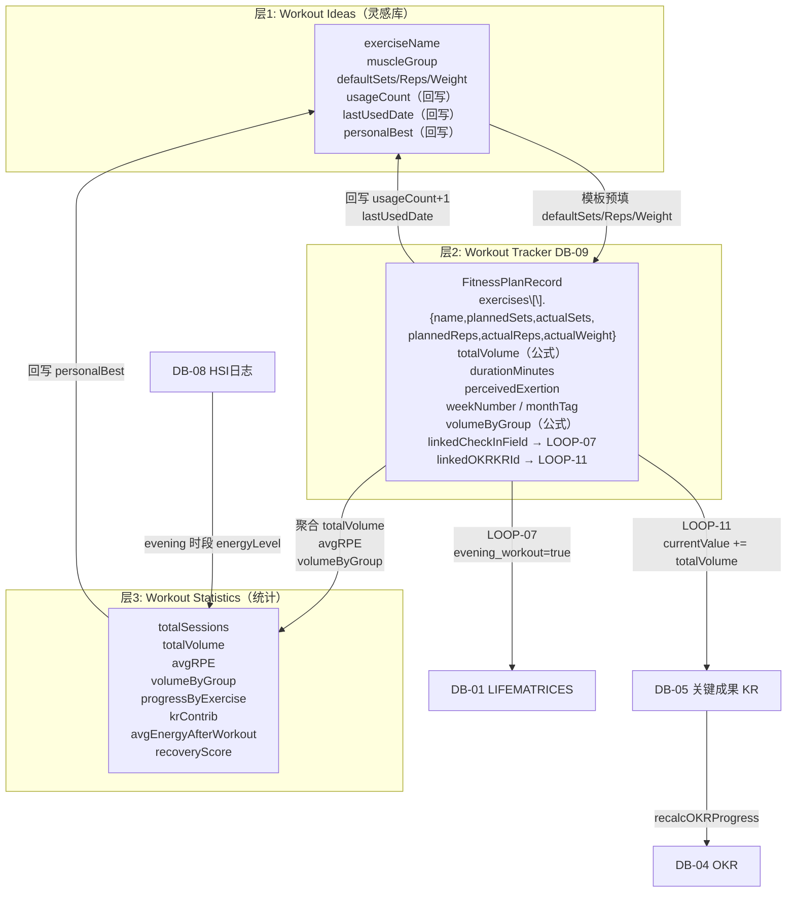
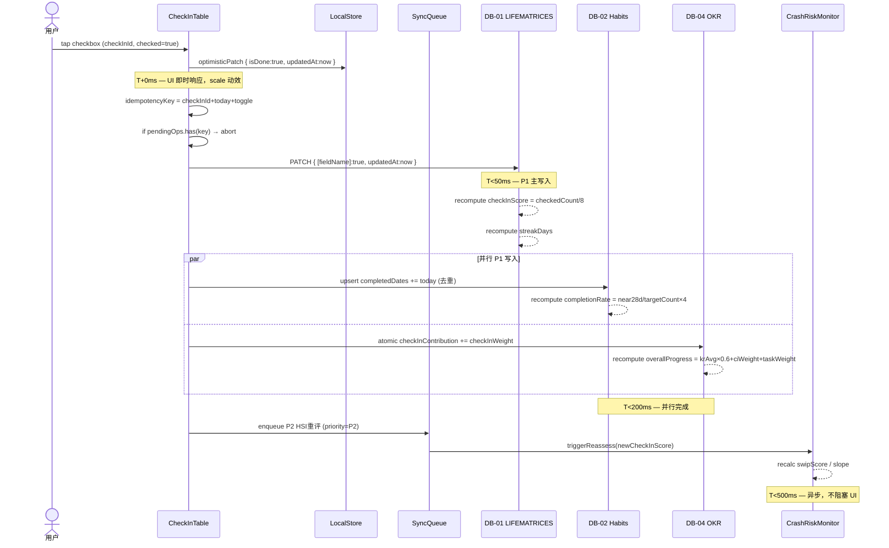
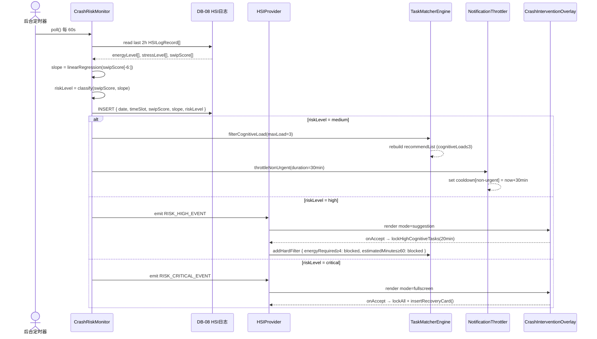
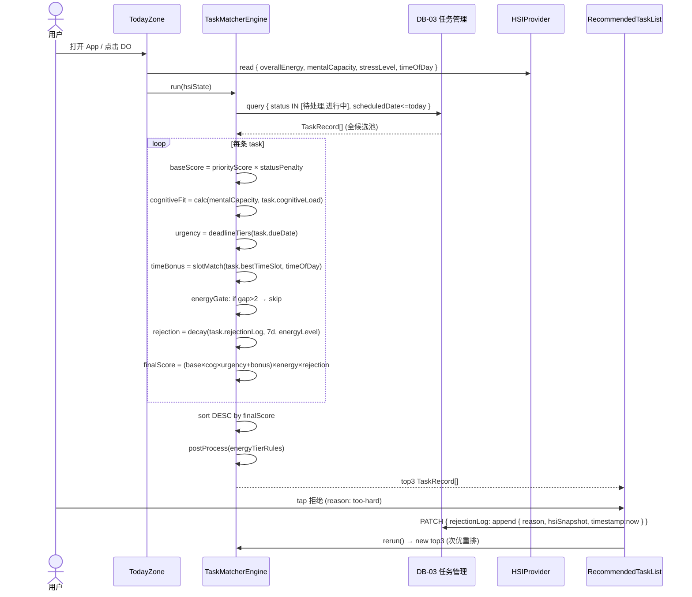
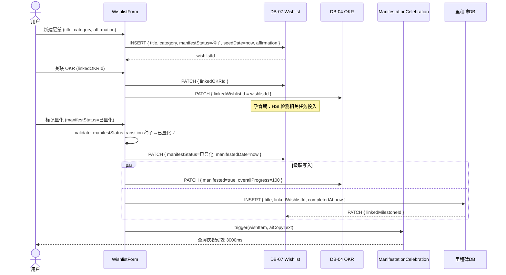
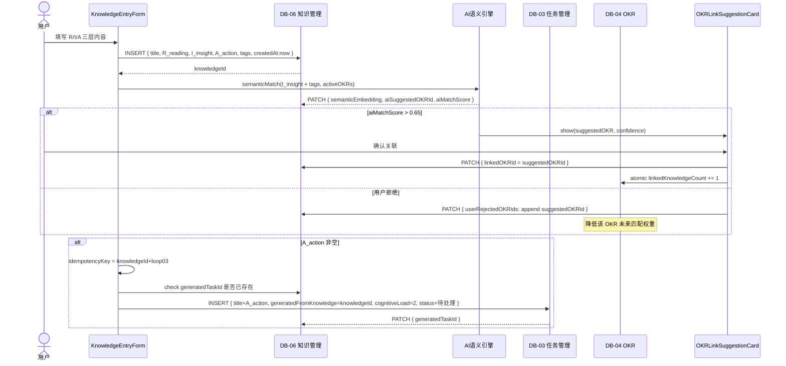
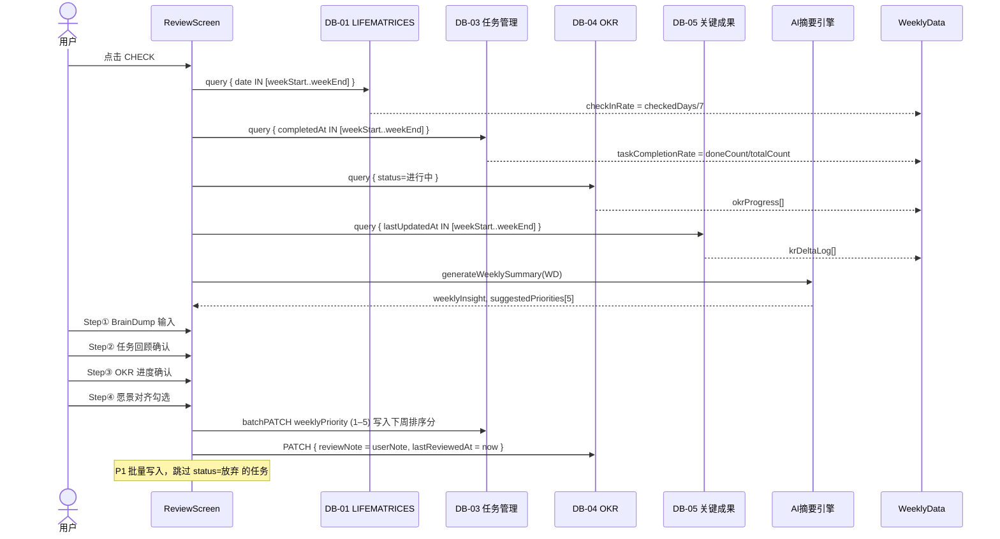
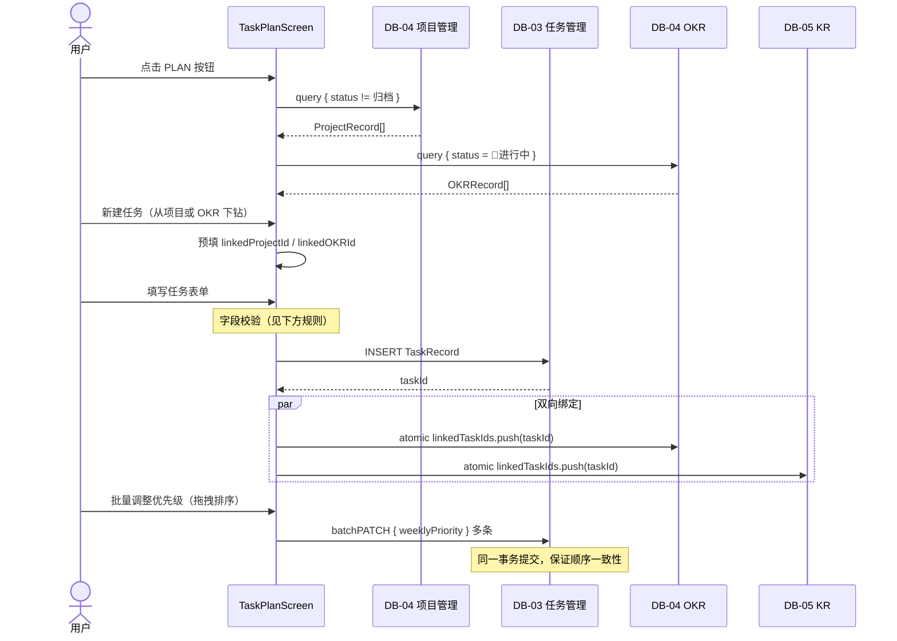

# 二十五、三层健身架构完整字段流转 + 全系统字段索引总表

## 25.1 三层健身架构字段映射

<aside>
🏋️

三层架构：**Workout Ideas（灵感库）→ Workout Tracker（执行记录，DB-09）→ Workout Statistics（统计分析）**。字段从灵感层流转到执行层再聚合到统计层，形成完整的训练数据闭环。

</aside>

```tsx
// ─── 层 1: Workout Ideas（灵感库）─────────────────────────
// 定义动作库与训练模板，不存储执行数据
interface WorkoutIdeaRecord {
  id:            string;
  exerciseName:  string;            // 动作名，如「卧推」「深蹲」「引体向上」
  muscleGroup:   string[];          // 目标肌群，如 ['胸', '三头']
  category:      'strength' | 'cardio' | 'flexibility' | 'sport';
  defaultSets:   number;            // 默认组数（模板值）
  defaultReps:   number;            // 默认次数
  defaultWeight?: number;           // 默认重量（kg，可选）
  coachNote?:    string;            // 动作要领备注
  videoUrl?:     string;            // 教学视频链接

  // 流转字段（Ideas → Tracker）
  usageCount:    number;            // 被引用到 Tracker 的次数（公式汇总）
  lastUsedDate?: Date;              // 最近一次执行日期（来自 Tracker 聚合）
  personalBest?: number;            // 个人最佳重量（来自 Statistics 聚合）
}

// ─── 层 2: Workout Tracker（执行记录，DB-09）──────────────
// 每次训练创建一条记录，包含当日计划与实际执行数据
// interface FitnessPlanRecord 已在 DB-09 节定义，此处补充字段流转关系

// Ideas → Tracker 的数据流：
// 1. 用户从 Workout Ideas 选取动作 → exercises[].name 来自 Ideas.exerciseName
// 2. 默认组数/次数/重量从 Ideas 预填（可修改）
// 3. Tracker 保存时回写 Ideas.usageCount += 1 + lastUsedDate = today

// Tracker 关键流转字段（补充）：
interface TrackerFlowFields {
  linkedIdeaIds: string[];          // 每个 exercise 对应的 Ideas 记录 ID
  weekNumber:    number;            // 第几周（公式：ISO week number，用于 Statistics 聚合）
  monthTag:      string;            // 月份标签，如 '2026-03'（Statistics 分组用）
  volumeByGroup: Record<string, number>;
  // 按肌群分组的总训练量，如 { 胸: 4000, 背: 3200, 腿: 6000 }
  // 公式：按 exercise.muscleGroup × (sets × reps × weight) 分组求和
}

// ─── 层 3: Workout Statistics（统计分析）──────────────────
// 聚合层，不存储原始数据，只保存聚合结果（可以是 Tracker 的 Rollup 视图）
interface WorkoutStatisticsRecord {
  period:          string;          // 统计周期，如 '2026-W12'（周）或 '2026-03'（月）
  totalSessions:   number;          // 训练次数
  totalVolume:     number;          // 总训练量 kg（所有 sets × reps × weight 之和）
  avgRPE:          number;          // 平均主观疲劳感
  volumeByGroup:   Record<string, number>;  // 按肌群分组总量
  progressByExercise: Array<{       // 各动作个人最佳进展
    exerciseName: string;
    maxWeight:    number;           // 最大重量
    maxReps:      number;           // 最大次数
    trend:        'up' | 'flat' | 'down'; // 与上周期比较
  }>;

  // 与 OKR 联动
  linkedKRId?:  string;             // 健身 KR ID → LOOP-11
  krContrib:    number;             // 本周期对 KR 的贡献量

  // 与 HSI 联动
  avgEnergyAfterWorkout: number;    // 训练后平均能量（来自 DB-08 同日 evening 时段）
  recoveryScore:         number;    // 恢复评分：avgEnergyAfterWorkout / 5 × 100
}
```

## 25.2 三层字段流转完整图



## 25.3 全系统字段读写方向索引总表

| **DB** | **关键字段** | **读（R）/ 写（W）/ 计算（C）** | **写入来源 / 触发** |
| --- | --- | --- | --- |
| DB-01 | `morning_meditation` … `presleep_reading` | W（用户勾选）/ R（ReviewScreen 聚合） | CheckInTable onToggle → P0 写入 |
| DB-01 | `checkInScore` | C（公式: 已勾选数/8） | 每次 onToggle 触发重算 |
| DB-01 | `streakDays` | C（查询前 N 天） | 每次 onToggle 触发 updateStreakDays() |
| DB-01 | `hsiSnapshot` | W（HSIProvider 每 60s 写入） | CrashRiskMonitor 轮询 → P3 异步写入 |
| DB-02 | `completedDates` | W（push today）/ R（completionRate 计算） | CheckIn 级联 → P1 写入（多字段触发） |
| DB-02 | `completionRate` | C（近 4 周完成率） | completedDates 变化时触发重算 |
| DB-03 | `status` | W（用户操作）/ R（TaskMatcher 过滤） | 用户点击完成 → P0 写入；自动降级读取 |
| DB-03 | `cognitiveLoad` | R（TaskMatcher hardFilter / 评分） | 创建时由用户填写，不自动修改 |
| DB-03 | `weeklyPriority` | W（周回顾 LOOP-05 批量写入） | ReviewScreen Step④ 确认后写入 |
| DB-03 | `rejectionLog` | W（用户拒绝推荐任务时追加） | TaskMatcher onReject → P1 写入 |
| DB-04 | `overallProgress` | C（AVG KR.progress × 100 + checkInContrib） | KR currentValue 变化 / CheckIn 勾选时触发 |
| DB-04 | `checkInContribution` | W（CheckIn 勾选 LOOP-01 increment +1） | onCheckInToggle 级联 → P1 写入 |
| DB-04 | `manifested` | W（Wishlist 状态→已显化时写入 true） | LOOP-04 → Wishlist.onManifest 触发 |
| DB-05 | `currentValue` | W（原子加法，Task 完成 LOOP-02） | onTaskComplete → atomicIncrement |
| DB-05 | `progress` | C（CLAMP (cur-start)/(target-start), 0,1） | currentValue 变化时触发重算 |
| DB-06 | `A_action` | R（LOOP-03 触发条件判断） | 用户填写，非空 → 自动生成任务 |
| DB-06 | `generatedTaskId` | W（LOOP-03 生成任务后写入） | KnowledgeEntryForm 保存 → P1 写入（幂等） |
| DB-07 | `manifestStatus` | W（用户手动 / HSI 辅助提示） | WishlistScreen 状态机更新（状态转换有约束） |
| DB-07 | `savedAmount` | W（LOOP-10: FinanceWidget 存钱记录 += amount） | FinanceRecord category=存钱 保存时触发 |
| DB-08 | `energyLevel` `stressLevel` `swipScore` | W（CrashRiskMonitor 每 60s 写入） | P3 批量写入；strategy=upsert（幂等键） |
| DB-08 | `circadianPhaseTag` | W（CheckIn 勾选冥想/运动后微更新） | CHECK_IN_CASCADE_MAP presleep_meditation 触发 |
| DB-09 | `actualSets` `actualReps` `actualWeight` | W（用户逐组填写） | FitnessTracker SetCard 输入 → P0 写入 |
| DB-09 | `totalVolume` | C（Σ sets × reps × weight） | actualSets/Reps/Weight 变化时重算 |
| DB-09 | `completedAt` | W（LOOP-07: 健身完成写入 / CheckIn 联动写入） | FitnessTracker.onWorkoutComplete / 打卡联动 |
| DB-10 | `energyBoostFactor` | W（LOOP-08: NutritionPlanner 每餐打卡后重算） | onMealEaten → 聚合 → 写入（clamp 0.8–1.2） |
| DB-10 | `actualProtein` `actualCalories` | W（今日已吃餐次聚合） | onMealEaten 触发全量重算 |
| DB-11 | `eaten` `eatenAt` | W（用户打卡）/ R（DB-10 聚合） | NutritionPlanner 每餐 checkbox → P0 写入 |
| DB-11 | `totalProtein` `totalCalories` | C（Σ ingredients.protein/calories） | 食材列表确定时计算，用户可手动覆盖 |
| DB-12 | `quantity` | W（用户手动更新 / 自动扣减） | MealPlan 执行后可触发食材扣减（可选功能） |
| DB-12 | `restockTaskId` | W（LOOP-09B 生成任务后写入 / 任务完成后清空） | InventoryWidget.onRestock → P1（幂等） |
| DB-13 | `amount` `category` | W（用户快速记账 3 步） | FinanceWidget QuickLog → P0 写入 |
| DB-13 | `isOverBudget` | C（本月同类累计 > 预算配置） | 每次写入 amount 后触发月度累计检查 |
| DB-14 | `linkedTaskIds` | W（LOOP-09 自动生成任务后写入任务 ID 数组） | ActivityPlanner.onActivityCreate → P1（幂等） |
| DB-14 | `autoGenerateTasks` | R（LOOP-09 前置条件判断） | 用户创建活动时设置，默认 true |
| DB-15 | `medication.stock` | W（用户手动更新）/ R（库存阈值检查） | 手动更新；低于 restockThreshold → 生成提醒任务 |

## 25.4 字段索引快查表（按字段名检索）

| **字段名** | **所在 DB** | **类型** | **关联 LOOP** |
| --- | --- | --- | --- |
| `overallEnergy` | HSIProvider (内存) | 1|2|3|4|5 | 全系统驱动字段 |
| `swipScore` | HSIProvider + DB-08 | number 0–100 | CrashRiskMonitor / TaskMatcher 硬过滤 |
| `mentalCapacity` | HSIProvider (内存) | number 0–1 | TaskMatcher cognitiveFitMultiplier |
| `checkInScore` | DB-01 | number 0–1 | LOOP-01 / ReviewScreen 完成率 |
| `streakDays` | DB-01 | number | 习惯连续打卡展示 |
| `completedDates` | DB-02 | Date[] | LOOP-01b / Habits 完成率 |
| `cognitiveLoad` | DB-03 | 1|2|3|4|5 | TaskMatcher 硬过滤 + cognitiveFitMultiplier |
| `rejectionLog` | DB-03 | Array | TaskMatcher rejectionPenalty 衰减 |
| `weeklyPriority` | DB-03 | number 1–5 | LOOP-05 / TaskMatcher weeklyPriorityBoost |
| `overallProgress` | DB-04 | number 0–100 | LOOP-01 / LOOP-02 / OKRProgressToggle 展示 |
| `checkInContribution` | DB-04 | number | LOOP-01 累积贡献 |
| `currentValue` | DB-05 | number | LOOP-02 原子加法 |
| `progress` | DB-05 | number 0–1 | LOOP-02 → DB-04.overallProgress 重算 |
| `generatedTaskId` | DB-06 | string | LOOP-03 幂等防重复 |
| `savedAmount` | DB-07 | number | LOOP-10 存钱进度 |
| `energyBoostFactor` | DB-10 | number 0.8–1.2 | LOOP-08 → HSIProvider.overallEnergy 修正 |
| `totalVolume` | DB-09 | number | LOOP-11 → DB-05.currentValue 加法 |
| `restockTaskId` | DB-12 | string | LOOP-09B 幂等防重复 |
| `linkedTaskIds` | DB-14 | string[] | LOOP-09 活动→任务批量生成 |

---

# 二十六、ReviewScreen 周回顾字段级数据聚合规范

<aside>
📍

**设计目标**

`<ReviewScreen>` 四个子面板（BrainDump / 任务回顾 / OKR 进度 / 愿景对齐）均需从多个 DB 精确拉取字段并在回顾完成后写回特定字段。本节定义每个子面板的字段级读取查询、聚合公式与写回路径，形成完整的「读取—展示—写回」闭环。

</aside>

## 26.1 入口聚合查询（页面打开时并行执行）

```tsx
// ReviewScreen 挂载时并行发起 5 条查询，< 800ms 全部返回
async function prefetchReviewData(weekStart: Date, weekEnd: Date): Promise<WeeklyData> {

  const [checkInRows, taskRows, okrRows, krRows, wishlistRows] = await Promise.all([

    // ① CheckIn 完成率（DB-01）
    db.lifematrices.query(`
      SELECT date,
             checkInScore,
             morning_meditation, morning_exercise, morning_learning,
             commute_bike, evening_workout, evening_review,
             presleep_meditation, presleep_reading,
             hsiSnapshot_energyAtMorning, hsiSnapshot_energyAtEvening,
             hsiSnapshot_swipScore
      FROM DB01
      WHERE date >= ? AND date <= ?
      ORDER BY date ASC
    `, [weekStart, weekEnd]),

    // ② 任务完成数 & 拒绝数（DB-03）
    db.tasks.query(`
      SELECT id, title, status, cognitiveLoad, estimatedMinutes,
             completedAt, weeklyPriority, linkedOKRId, linkedKRId,
             okrContribution, rejectionLog
      FROM DB03
      WHERE (scheduledDate >= ? AND scheduledDate <= ?)
         OR (completedAt >= ? AND completedAt <= ?)
    `, [weekStart, weekEnd, weekStart, weekEnd]),

    // ③ 进行中 OKR 进度（DB-04）
    db.okrs.query(`
      SELECT id, title, overallProgress, checkInContribution,
             taskContribution, reviewNote, status, targetDate
      FROM DB04
      WHERE status = '🚀 进行中'
      ORDER BY overallProgress DESC
    `),

    // ④ KR 当周增量（DB-05）
    db.keyResults.query(`
      SELECT id, title, linkedOKRId, currentValue, targetValue,
             progress, lastUpdatedAt, lastUpdatedBy
      FROM DB05
      WHERE lastUpdatedAt >= ? AND lastUpdatedAt <= ?
    `, [weekStart, weekEnd]),

    // ⑤ 本周新显化愿望（DB-07）
    db.wishlists.query(`
      SELECT id, title, category, manifestedDate, celebrationCopy
      FROM DB07
      WHERE manifestedDate >= ? AND manifestedDate <= ?
    `, [weekStart, weekEnd]),
  ]);

  return buildWeeklyData(checkInRows, taskRows, okrRows, krRows, wishlistRows);
}
```

## 26.2 聚合计算公式

```tsx
function buildWeeklyData(ci, tasks, okrs, krs, wishlists): WeeklyData {

  // —— 打卡层 ——
  const checkInRate = ci.length > 0
    ? ci.reduce((s, r) => s + r.checkInScore, 0) / ci.length  // 7日均值
    : 0;

  // 连续打卡天数（streak）：从今天向前逐日检查 checkInScore > 0
  const streakDays = (() => {
    let streak = 0;
    for (let i = ci.length - 1; i >= 0; i--) {
      if (ci[i].checkInScore > 0) streak++;
      else break;
    }
    return streak;
  })();

  // 最高频未打卡项（找出7天内 false 出现次数最多的字段）
  const CHECK_FIELDS = [
    'morning_meditation','morning_exercise','morning_learning',
    'commute_bike','evening_workout','evening_review',
    'presleep_meditation','presleep_reading'
  ];
  const missCount: Record<string, number> = {};
  for (const field of CHECK_FIELDS) {
    missCount[field] = ci.filter(r => !r[field]).length;
  }
  const topMissField = Object.entries(missCount)
    .sort((a, b) => b[1] - a[1])[0][0];  // 最常缺失的习惯

  // —— 任务层 ——
  const completedTasks = tasks.filter(t => t.status === '✅ 已完成');
  const taskCompletionRate = tasks.length > 0
    ? completedTasks.length / tasks.length
    : 0;

  // 平均认知负荷分布（用于下周任务建议）
  const avgCogLoad = completedTasks.length > 0
    ? completedTasks.reduce((s, t) => s + t.cognitiveLoad, 0) / completedTasks.length
    : 3;

  // 总完成时长（分钟）
  const totalMinutes = completedTasks.reduce((s, t) => s + (t.estimatedMinutes ?? 0), 0);

  // —— OKR 层 ——
  // 本周 KR 增量汇总（按 OKR 分组）
  const krDeltaByOKR: Record<string, number> = {};
  for (const kr of krs) {
    const delta = kr.progress;  // 本周进度增量（lastUpdatedAt 在本周内）
    krDeltaByOKR[kr.linkedOKRId] = (krDeltaByOKR[kr.linkedOKRId] ?? 0) + delta;
  }

  return {
    checkInRate,
    streakDays,
    topMissField,
    taskCompletionRate,
    avgCogLoad,
    totalMinutes,
    okrProgress:   okrs.map(o => ({ ...o, weekDelta: krDeltaByOKR[o.id] ?? 0 })),
    milestones:    wishlists,
    krUpdates:     krs,
  };
}
```

## 26.3 Step ① BrainDump 字段规范

```tsx
// <BrainDumpBox> 组件写入字段
interface BrainDumpWriteSpec {
  // 写入目标：DB-03 任务管理（批量新建草稿任务）
  // 触发时机：用户点击「保存并整理」
  newTasks: Array<{
    title:        string;   // 每行文本作为一条任务标题
    status:       '🕐 待处理';
    priority:     'P2-中';  // BrainDump 来源默认 P2
    cognitiveLoad: 2;       // 默认认知负荷 2（轻量）
    source:       'brain-dump';
    weeklyPriority: null;   // 待下周排序时填写
    scheduledDate: null;    // 待 PLAN 阶段分配
  }>;
}

// 异常态：checkInRate < 0.3 时直接跳至此 Step，不展示数据汇总
// 文案：「这周有些忙，先把脑子里的东西倒出来就好」
// 不展示任何缺失警告
```

## 26.4 Step ② 任务回顾字段规范

```tsx
// <TaskReviewPanel> 读取与写回
interface TaskReviewReadSpec {
  // 读取：本周任务（已完成 + 未完成）
  // 展示字段：title | status | cognitiveLoad | completedAt | rejectionLog
  displayFields: ['title', 'status', 'cognitiveLoad', 'completedAt', 'weeklyPriority'];

  // 聚合展示
  summary: {
    completedCount:    number;   // completedTasks.length
    taskCompletion%:   string;   // (completedCount / totalCount × 100).toFixed(0) + '%'
    avgCogLoad:        number;   // 平均认知负荷
    topRejectedReason: string;   // rejectionLog 中最频繁的拒绝原因
    totalFocusMinutes: number;   // Σ estimatedMinutes（已完成）
  };
}

interface TaskReviewWriteSpec {
  // 写入触发：用户为下周任务手动拖拽排序后点击「确认」
  // 写入目标：DB-03 任务管理
  // 写入字段：weeklyPriority（1=最高 ~ 5=最低）
  // LOOP-05 触发
  batchUpdate: Array<{
    taskId:         string;
    weeklyPriority: 1 | 2 | 3 | 4 | 5;
  }>;

  // 写入约束：
  // - 已放弃任务（status='🗑 放弃'）跳过，不报错
  // - 同一批次中 weeklyPriority=1 最多 3 条（避免全部高优）
  maxPriority1Count: 3;
}
```

## 26.5 Step ③ OKR 进度字段规范

```tsx
// <OKRProgressPanel> 读取与写回
interface OKRProgressReadSpec {
  perOKR: {
    title:              string;
    overallProgress:    number;  // 0–100
    weekDelta:          number;  // 本周进度增量（krDeltaByOKR）
    checkInContrib:     number;  // LOOP-01 本周累计
    taskContrib:        number;  // LOOP-02 本周累计
    daysUntilTarget:    number;  // targetDate - today（天数）
    status:             string;
  }[];

  // 警示规则：
  // overallProgress 增量 = 0 且 daysUntilTarget < 30 → 显示「⚠️ 本周无进展」
  // overallProgress >= 100 → 触发显化建议「🌱 目标达成！去 Wishlist 庆祝？」
}

interface OKRProgressWriteSpec {
  // 用户填写「本周回顾备注」后写入 DB-04
  perOKR: Array<{
    okrId:       string;
    reviewNote:  string;   // DB-04.reviewNote（追加，非覆盖）
    // 格式：「[2026-W12] {用户输入}」
    // 写入方式：
    //   newNote = `[${weekLabel}] ${inputText}`
    //   DB-04.reviewNote = existing ? existing + '\n' + newNote : newNote
  }>;
}
```

## 26.6 Step ④ 愿景对齐字段规范

```tsx
// <VisionAlignmentPanel> 读取与写回
interface VisionAlignmentReadSpec {
  // 本周新显化愿望（DB-07.manifestedDate 在本周内）
  newlyManifested: WishlistRecord[];

  // 待孕育中愿望进度（DB-07.manifestStatus = '🌱 孕育中'）
  nurturing: Array<{
    id:              string;
    title:           string;
    category:        string;
    linkedOKRProgress: number;  // 关联 OKR.overallProgress
    savedAmount?:    number;    // DB-13 存钱进度（如有）
  }>;

  // AI 生成下周建议优先级（TaskMatcher 离线计算）
  nextWeekSuggestions: Array<{
    taskId:  string;
    reason:  string;   // 「与你的目标「{okr.title}」高度相关」
    score:   number;   // 0–100
  }>;
}

interface VisionAlignmentWriteSpec {
  // 用户确认「愿景对齐」checkbox
  // 写入 DB-01（今日打卡记录）
  weeklyAlignmentConfirmed: {
    targetDB:  'DB-01';
    field:     'weeklyAlignmentChecked';  // boolean
    value:     true;
    date:      Date;  // 本周回顾日期
  };

  // 同步写入 DB-04：下周目标备注
  nextWeekFocus?: {
    okrId:     string;
    focusNote: string;  // 追加到 DB-04.reviewNote
  };
}
```

---

# 二十七、WishlistScreen 显化状态机字段级转换规范

<aside>
🌱

**设计目标**

Wishlist 条目从「种子」到「已显化」的每次状态跃迁，均需精确执行跨库字段写入。本节定义四个状态的转换触发条件、写入字段清单与庆祝动效触发时序，以及 AI 辅助显化建议的字段操作路径。

</aside>

## 27.1 状态机完整定义

```tsx
// 状态转换图（合法跃迁路径）
const MANIFEST_STATE_MACHINE = {
  '🌱 种子': {
    canTransitionTo: ['🌱 孕育中', '⏸ 暂停'],
    triggerType:     'manual',   // 用户手动更改
  },
  '🌱 孕育中': {
    canTransitionTo: ['✨ 已显化', '⏸ 暂停', '🌱 种子'],
    triggerType:     'manual | auto',
    // auto 触发：linkedOKRId.overallProgress >= 100
  },
  '✨ 已显化': {
    canTransitionTo: ['⏸ 暂停'],
    triggerType:     'manual',
    // 不可回退至种子（DB-07 校验规则）
  },
  '⏸ 暂停': {
    canTransitionTo: ['🌱 种子', '🌱 孕育中'],
    triggerType:     'manual',
  },
};
```

## 27.2 各状态跃迁写入清单

```tsx
// ─── 跃迁 A：种子 → 孕育中 ────────────────────────────────
interface Transition_Seed_to_Nurturing {
  trigger:  'user_manual';   // 用户在卡片上点击「开始孕育」
  writes: [
    { db: 'DB-07', field: 'manifestStatus',   value: '🌱 孕育中' },
    { db: 'DB-07', field: 'nurturingStartDate', value: Date.now() },
    // 如果 linkedOKRId 未填：提示「要为这个愿望创建一个目标吗？」→ 用户确认后
    { db: 'DB-04', field: 'linkedWishlistId', value: wishlistId,
      condition: 'linkedOKRId 不存在 AND 用户确认创建 OKR' },
    { db: 'DB-04', field: 'title',            value: `[愿望目标] ${wishlist.title}`,
      condition: '同上' },
    { db: 'DB-04', field: 'status',           value: '🚀 进行中',
      condition: '同上' },
  ];
}

// ─── 跃迁 B：孕育中 → 已显化 ────────────────────────────────
interface Transition_Nurturing_to_Manifested {
  trigger:  'user_manual | auto_okr_complete';
  // auto_okr_complete：DB-04.overallProgress >= 100 时自动弹出建议

  writes: [
    // P0：核心状态写入（乐观更新）
    { db: 'DB-07', field: 'manifestStatus',  value: '✨ 已显化',  priority: 'P0' },
    { db: 'DB-07', field: 'manifestedDate',  value: Date.now(),  priority: 'P0' },

    // P0：触发全屏庆祝动效（非写入，UI 事件）
    { event: 'TRIGGER_CELEBRATION',
      payload: { wishlistId, duration: 3000, aiCopyText: '' } },

    // P1：关联 OKR 标记显化
    { db: 'DB-04', field: 'manifested',      value: true,        priority: 'P1',
      condition: 'linkedOKRId 存在' },
    { db: 'DB-04', field: 'overallProgress', value: 100,         priority: 'P1',
      condition: 'linkedOKRId 存在 AND overallProgress < 100' },

    // P1：里程碑 DB 自动生成记录（REL-09）
    { db: 'MilestoneDB', operation: 'INSERT', priority: 'P1',
      fields: {
        title:     `✨ ${wishlist.title} · 已显化`,
        date:      Date.now(),
        category:  wishlist.category,
        sourceId:  wishlistId,
        sourceDB:  'DB-07',
      },
    },

    // P2：AI 生成庆祝文案（异步）
    { db: 'DB-07', field: 'celebrationCopy',
      value: 'AI_ASYNC_GENERATE',    // 后台生成后回填
      priority: 'P2' },
  ];

  // 庆祝动效触发时序：
  // t=0ms   → 本地 store 立即置 manifestStatus='已显化'
  // t=0ms   → <ManifestationCelebration> 渲染（全屏）
  // t=50ms  → DB-07 乐观写入确认
  // t=300ms → DB-04/MilestoneDB 级联写入
  // t=2000ms → AI 文案生成完成，更新庆祝页文案
  // t=3000ms → 动效结束，用户可关闭
}

// ─── 跃迁 C：任意状态 → 暂停 ────────────────────────────────
interface Transition_To_Paused {
  trigger: 'user_manual';
  writes: [
    { db: 'DB-07', field: 'manifestStatus', value: '⏸ 暂停' },
    { db: 'DB-07', field: 'pausedNote',     value: userInputReason },  // 可选原因
    // 关联 OKR 不自动暂停（用户独立管理）
    // 仅推送提示：「你的目标「{okr.title}」还在进行中，要一并暂停吗？」
  ];
}
```

## 27.3 AI 辅助显化建议字段路径

```tsx
// 每周日 21:00 自动运行「显化进度评估」
async function assessManifestProgress() {

  const nurturingItems = await db.wishlists.query(
    `SELECT id, title, linkedOKRId, seedDate, nurturingStartDate
     FROM DB07 WHERE manifestStatus = '🌱 孕育中'`
  );

  for (const item of nurturingItems) {

    const daysSinceSeed = (Date.now() - item.seedDate) / 86400000;
    const okrProgress = item.linkedOKRId
      ? (await db.okrs.get(item.linkedOKRId)).overallProgress
      : null;

    // 规则 1：孕育 > 90 天且 OKR 进度 < 20% → 生成「重新激活」建议
    if (daysSinceSeed > 90 && (okrProgress ?? 0) < 20) {
      await db.wishlists.update(item.id, {
        aiSuggestion: '🌱 这个愿望已经孕育 90 天了，要不要重新拆解成更小的行动步骤？',
        aiSuggestionType: 'reactivate',
        aiSuggestionDate: Date.now(),
      });
    }

    // 规则 2：OKR 进度 >= 80% 且未转为已显化 → 推送「即将显化」提示
    if ((okrProgress ?? 0) >= 80) {
      await db.wishlists.update(item.id, {
        aiSuggestion: `✨ 你的目标进度已达 ${okrProgress}%，这个愿望快要显化了！`,
        aiSuggestionType: 'nearly-there',
        aiSuggestionDate: Date.now(),
      });
      // 写入 DB-07.nearlyManifested = true → 首页「即将显化」角标
      await db.wishlists.update(item.id, { nearlyManifested: true });
    }
  }
}
```

## 27.4 Wishlist 显化进度字段汇总表

| **字段名** | **类型** | **写入时机** | **读取方** | `manifestStatus` | enum | 用户手动 / auto_okr_complete | WishlistScreen / 首页角标 |
| --- | --- | --- | --- | --- | --- | --- | --- |
| `seedDate` | Date | 条目创建时（一次性） | 进度计算 / AI 评估 | `nurturingStartDate` | Date | 跃迁→孕育中时 | AI 评估（孕育天数） |
| `manifestedDate` | Date | 跃迁→已显化时（P0） | 周回顾 / 里程碑 DB | `celebrationCopy` | string | AI 异步生成（P2） | ManifestationCelebration |
| `nearlyManifested` | boolean | OKR ≥ 80% 时 | 首页 WishlistCard 角标 | `aiSuggestion` | string | 每周评估（P2） | WishlistScreen 提示卡 |
| `linkedBudget.savedAmount` | number | LOOP-10 存钱记录写入 | WishlistCard 预算进度条 | `linkedOKRId` | string FK | 用户关联 / 自动创建 OKR | 进度展示 / 状态机 auto 触发 |

---

# 二十八、KnowledgeScreen AI 语义匹配字段级规范

<aside>
📚

**设计目标**

从知识录入 → AI 语义向量生成 → OKR 匹配建议 → 用户确认/拒绝 → 任务自动生成，每一步的字段读写、向量存储与降级策略均需精确定义，确保 AI 行为完全可溯源、可测试。

</aside>

## 28.1 知识保存完整字段写入时序

```tsx
// 用户点击「保存」后的字段写入时序（标注延迟）
async function saveKnowledge(input: KnowledgeInput) {

  // ── t=0ms · P0：立即写入核心字段（乐观更新）──
  const knowledgeId = uuid();
  await db.knowledge.create({
    id:           knowledgeId,
    title:        input.title,
    source:       input.source,
    sourceType:   input.sourceType,
    R_reading:    input.R_reading,
    I_insight:    input.I_insight,
    A_action:     input.A_action,
    tags:         input.tags,
    createdAt:    Date.now(),
    // AI 字段初始化为空，异步填充
    semanticEmbedding: null,
    aiSuggestedOKRId:  null,
    aiMatchScore:      null,
  });  // P0 写入完成，UI 立即显示「已保存」

  // ── t=0ms · P1：如 A_action 非空，立即生成任务（LOOP-03）──
  if (input.A_action?.trim()) {
    const taskId = uuid();
    await db.tasks.create({
      id:                   taskId,
      title:                input.A_action.trim(),
      status:               '🕐 待处理',
      priority:             'P2-中',
      cognitiveLoad:        2,
      source:               'knowledge',
      generatedFromKnowledge: knowledgeId,
      linkedKnowledgeIds:   [knowledgeId],
      createdAt:            Date.now(),
    });
    // 反写 DB-06.generatedTaskId（防重复幂等键）
    await db.knowledge.update(knowledgeId, { generatedTaskId: taskId });
  }  // P1 写入完成（< 200ms）

  // ── t=200ms · P2：AI 语义向量生成（异步，不阻塞 UI）──
  semanticEmbeddingService.generate(input.R_reading + ' ' + input.I_insight)
    .then(async (embedding: number[]) => {

      await db.knowledge.update(knowledgeId, { semanticEmbedding: embedding });

      // ── t=400–800ms · P2：向量相似度搜索进行中 OKR ──
      const activeOKRs = await db.okrs.getAll({ status: '🚀 进行中' });
      const scored = activeOKRs
        .map(okr => ({
          okr,
          score: cosineSimilarity(embedding, okr.semanticEmbedding ?? []),
        }))
        .filter(x => x.score > 0.65)
        .sort((a, b) => b.score - a.score);

      if (scored.length > 0) {
        const best = scored[0];
        await db.knowledge.update(knowledgeId, {
          aiSuggestedOKRId: best.okr.id,
          aiMatchScore:     best.score,
        });
        // ← 触发 UI 渲染 <OKRLinkSuggestionCard>（useEffect 监听字段变化）
      }
    });
}
```

## 28.2 OKR 关联确认/拒绝写入路径

```tsx
// 用户点击「✅ 关联」
async function confirmOKRLink(knowledgeId: string, okrId: string) {
  await Promise.all([
    // DB-06：写入确认关联
    db.knowledge.update(knowledgeId, {
      linkedOKRId:       okrId,
      aiSuggestedOKRId:  null,   // 清除建议状态
      aiMatchScore:      null,
    }),
    // DB-04：OKR 知识数 +1
    db.okrs.increment(okrId, 'linkedKnowledgeCount', 1),
    // DB-03（如已生成任务）：继承 linkedOKRId
    db.tasks.updateByKnowledge(knowledgeId, { linkedOKRId: okrId }),
  ]);
}

// 用户点击「✕ 不关联」
async function rejectOKRLink(knowledgeId: string, okrId: string) {
  // 写入拒绝记录（降低未来匹配权重）
  await db.knowledge.update(knowledgeId, {
    aiSuggestedOKRId:   null,
    aiMatchScore:       null,
    userRejectedOKRIds: arrayUnion(okrId),  // 追加到数组
  });
  // 调整该 OKR 的语义权重（本地，不写 DB-04）
  localMatchWeights.downvote(okrId, 0.1);  // 权重乘以 0.9
}
```

## 28.3 R.I.A. 三层字段完整验证规则

```tsx
const RIA_FIELD_RULES = {
  R_reading: {
    required:    true,
    minLength:   10,
    maxLength:   2000,
    label:       '原文摘录 / 局部知识',
    placeholder: '粘贴或输入你读到的内容...',
    onEmpty:     'warn',    // 警告但不阻断保存
  },
  I_insight: {
    required:    false,
    maxLength:   1000,
    label:       '个人洞察',
    placeholder: '这对你意味着什么？',
    onEmpty:     'ok',
    // 为空时：AI 匹配权重降低 20%（R_reading 独立参与向量生成）
    aiWeightPenalty: 0.2,
  },
  A_action: {
    required:    false,
    maxLength:   500,
    label:       '行动调整',
    placeholder: '你打算做什么不同的事？',
    onEmpty:     'ok',
    // 非空时触发 LOOP-03 任务生成
    triggerLoop: 'LOOP-03',
    // 建议使用动词开头（UI 提示，不强制）
    uiHint:      '建议以动词开头，如「开始…」「减少…」「每天…」',
  },
};
```

## 28.4 语义匹配字段降级策略

```tsx
// 当 AI 服务不可用时的降级路径
const AI_FALLBACK_STRATEGY = {

  // 降级 1：向量服务超时（> 3s）
  embeddingTimeout: {
    action:     'skip-ai-match',
    uiEffect:   '不显示 OKRLinkSuggestionCard',
    fieldEffect: 'semanticEmbedding = null（保留，待下次同步重试）',
    retryPolicy: '下次打开 KnowledgeScreen 时后台重试',
  },

  // 降级 2：无进行中 OKR（全部已完成或暂停）
  noActiveOKR: {
    action:     'skip-match',
    uiEffect:   '显示「要先设定一个目标来关联知识吗？」入口按钮',
    fieldEffect: 'aiSuggestedOKRId = null',
  },

  // 降级 3：最高匹配分 < 0.65
  lowMatchScore: {
    action:     'skip-suggestion',
    uiEffect:   '不显示建议卡片（用户无感知）',
    fieldEffect: 'aiMatchScore 存入但不触发 UI',
    // 仍写入 aiMatchScore，供未来批量关联用
  },

  // 降级 4：用户已手动填写 linkedOKRId
  manualOKRExists: {
    action:     'skip-ai',
    uiEffect:   '不显示 AI 建议（尊重用户选择）',
    fieldEffect: 'aiSuggestedOKRId 写入但不触发卡片',
  },
};
```

---

# 二十九、CrashRiskMonitor 字段级实时监控规范

<aside>
⚠️

**设计目标**

精确定义 swipScore 的实时计算公式、slope 趋势算法、四级风险分类的字段条件、干预响应的精确字段操作，以及每日「崩溃预警日志」的写入规范，确保监控系统完全可复现、可调试。

</aside>

## 29.1 swipScore 实时计算公式（字段级）

```tsx
// 每 60s 执行一次，输入来自 HSIProvider 最新状态
function computeSwipScore(hsi: LifeCompassStateVector): number {

  // ── 三项原始分（各 0–100）──
  const stressPart    = hsi.emotion.stressLevel * 100;          // 压力权重 40%
  const mentalPart    = (1 - hsi.focus.mentalCapacity) * 100;   // 认知余量耗尽 35%
  const cogLoadPart   = hsi.focus.cognitiveLoad * 100;          // 当前认知负荷 25%

  // ── 基础 swipScore ──
  const base = stressPart * 0.40
             + mentalPart * 0.35
             + cogLoadPart * 0.25;

  // ── 修正系数 ──
  const lowEnergyBoost = hsi.energy.overallEnergy <= 2 ? 8 : 0;   // 低能量追加 +8
  const continuousHighLoad = (() => {
    // 连续高认知负荷时长追加（每超过 90min 追加 5 分，上限 +20）
    const highLoadMinutes = hsi._internal?.continuousHighLoadMinutes ?? 0;
    return Math.min(20, Math.floor(highLoadMinutes / 90) * 5);
  })();
  const lateNightPenalty = [
    'night', 'pre-sleep'
  ].includes(hsi.temporal.timeOfDay) ? 5 : 0;   // 深夜追加 +5

  // ── 最终值（截断到 0–100）──
  return Math.min(100, Math.max(0,
    base + lowEnergyBoost + continuousHighLoad + lateNightPenalty
  ));
}
```

## 29.2 slope 趋势算法（30 分钟滑动窗口）

```tsx
// slope = swipScore 的线性回归斜率（每分钟变化率）
// 数据来源：DB-08 近 30min 日志记录
function computeSwipSlope(recentLogs: HSILogRecord[]): number {

  // 过滤近 30min 记录（最多 30 个点）
  const cutoff = Date.now() - 30 * 60 * 1000;
  const points = recentLogs
    .filter(log => log.createdAt >= cutoff)
    .map((log, i) => ({ x: i, y: log.swipScore }));

  if (points.length < 3) return 0;  // 数据不足，返回斜率 0

  // 最小二乘线性回归
  const n   = points.length;
  const sumX = points.reduce((s, p) => s + p.x, 0);
  const sumY = points.reduce((s, p) => s + p.y, 0);
  const sumXY = points.reduce((s, p) => s + p.x * p.y, 0);
  const sumX2 = points.reduce((s, p) => s + p.x * p.x, 0);

  const slope = (n * sumXY - sumX * sumY) / (n * sumX2 - sumX * sumX);
  // 单位：swipScore 分 / 每分钟
  return slope;
}
```

## 29.3 四级风险分级字段条件

```tsx
type RiskLevel = 'low' | 'medium' | 'high' | 'critical';

function classifyRisk(swipScore: number, slope: number): RiskLevel {
  if (swipScore > 90 || slope > 0.08)  return 'critical';  // 极端状态
  if (swipScore > 70 && slope > 0.03)  return 'high';      // 崩溃预警
  if (swipScore >= 60 || slope >= 0.03) return 'medium';   // 压力积累
  return 'low';
}

// 各级触发的字段操作
const RISK_RESPONSE: Record<RiskLevel, RiskResponseSpec> = {
  low: {
    uiChange:      [],   // 无 UI 变化
    taskFilter:    null, // 不过滤任务
    dbWrite:       { db: 'DB-08', fields: { riskLevel: 'low' } },  // 仅写日志
    notifyThrottle: false,
  },
  medium: {
    uiChange: [
      'RecoveryCard 插入任务列表顶部（swipScore ≥ 60）',
    ],
    taskFilter: null,   // 不过滤，仅提示
    dbWrite:    { db: 'DB-08', fields: { riskLevel: 'medium', autoIntervened: true } },
    notifyThrottle: true,  // 非紧急推送节流
  },
  high: {
    uiChange: [
      'CrashInterventionOverlay mode=suggestion 底部抽屉出现',
      'TodayZone 视觉密度降低（次要卡片折叠）',
    ],
    taskFilter: {
      field:    'cognitiveLoad',
      operator: '>=',
      value:    4,
      action:   'hide',   // 认知需求 ≥ 4 的任务不出现在推荐列表
    },
    dbWrite: {
      db:     'DB-08',
      fields: { riskLevel: 'high', interventionTriggered: true, triggerTime: Date.now() },
    },
    notifyThrottle: true,
    dailyTriggerLimit: 2,  // 每日最多触发 2 次 high/critical 干预
  },
  critical: {
    uiChange: [
      'CrashInterventionOverlay mode=fullscreen 全屏覆盖',
      'TaskMatcherEngine 硬锁 20min（高认知任务不可选）',
    ],
    taskFilter: {
      field:    'cognitiveLoad',
      operator: '>=',
      value:    3,
      action:   'hide',   // ≥ 3 的任务全部隐藏
      lockDurationMs: 1200000,  // 20min 后自动解锁
    },
    dbWrite: {
      db:     'DB-08',
      fields: {
        riskLevel:            'critical',
        criticalInterventionAt: Date.now(),
        forcedRestStart:      Date.now(),
        forcedRestEnd:        Date.now() + 1200000,
      },
    },
    notifyThrottle: true,
    dailyTriggerLimit: 2,
  },
};
```

## 29.4 干预响应后字段恢复流程

```tsx
// 用户选择「选项A：休息 20 分钟」后的字段操作时序
async function handleRestAccepted(interventionId: string) {

  const restEnd = Date.now() + 20 * 60 * 1000;

  // t=0ms：写入 DB-08 干预记录
  await db.hsiLogs.update(interventionId, {
    userResponse:    'accepted',
    restStartAt:     Date.now(),
    restEndAt:       restEnd,
  });

  // t=0ms：设置 TaskMatcherEngine 硬过滤锁
  taskMatcher.setHardFilter({
    field:       'cognitiveLoad',
    condition:   '>= 4',
    expiresAt:   restEnd,
    reason:      'crash-intervention-rest',
  });

  // t=0ms：关闭 CrashInterventionOverlay
  // t=1200000ms（20min后）：自动触发 HSI 重新评估
  setTimeout(async () => {
    const newHSI = await computeHSI(synheartSDK, historyLog);
    const newScore = computeSwipScore(newHSI);

    // 写入恢复后评估结果
    await db.hsiLogs.update(interventionId, {
      postRestSwipScore: newScore,
      restEffective:     newScore < 60,  // 休息是否有效
    });

    // 解除硬过滤锁
    taskMatcher.clearHardFilter('crash-intervention-rest');

    // 如果恢复后 swipScore 仍 > 70：重新评估是否触发 high 干预
    if (newScore > 70) {
      // 但受 dailyTriggerLimit = 2 限制
      await evaluateAndTriggerIntervention();
    }
  }, 20 * 60 * 1000);
}
```

---

# 三十一、全字段操作动线时序图（6 大 Flow 完整 Sequence）

<aside>
⏱️

**设计目标**

本节以 Mermaid sequenceDiagram 形式，将 6 大 Flow 的每一步操作精确映射到具体字段写入时序，覆盖：触发方（Actor）→ 组件层（Component）→ 服务层（Service）→ DB 字段写入→ 级联触发。所有时间标注基于 P1 级 SLA（≤ 200ms 完成主链路）。

</aside>

## Flow 1 · 工作日打卡动线（CheckIn 主链路）



## Flow 2 · 崩溃预警干预动线



## Flow 3 · 任务匹配推荐动线



## Flow 4 · 愿望显化动线



## Flow 5 · 知识录入关联动线



## Flow 6 · 周回顾聚合动线



---

# 三十二、NotificationThrottler 推送节流完整字段规范

<aside>
🔔

**设计原则**

ND/ADHD 用户对推送极度敏感。NotificationThrottler 是全系统唯一推送出口，所有通知必须经过节流、去重、优先级队列过滤后才能送达用户。核心目标：**同一时间窗口只有最高优先级的一条通知触达用户**。

</aside>

## 通知记录数据结构

```tsx
interface NotificationRecord {
  id:           string;           // UUID
  type:         NotificationType; // 见下方枚举
  priority:     0 | 1 | 2 | 3;   // 0=紧急 1=重要 2=普通 3=装饰性
  title:        string;
  body:         string;
  payload?:     Record<string, unknown>; // 点击后跳转参数

  // 节流控制字段
  dedupeKey:    string;           // 去重键（同 key 在冷却期内不再推送）
  cooldownMs:   number;           // 冷却时长（ms），推送后锁定
  createdAt:    Date;
  scheduledAt?: Date;             // 定时推送（为空则立即）
  sentAt?:      Date;             // 实际送达时间
  suppressedBy?: string;          // 被哪条更高优先级通知压制

  // 生命周期字段
  status: 'pending' | 'sent' | 'suppressed' | 'expired' | 'failed';
  expireAt: Date;                 // 超过此时间未送达则丢弃
}

type NotificationType =
  | 'crash-risk-high'      // P0: 崩溃预警（高）
  | 'crash-risk-critical'  // P0: 崩溃预警（危急）
  | 'deadline-overdue'     // P1: 任务超期
  | 'deadline-today'       // P1: 今日截止任务
  | 'checkin-reminder'     // P1: 晚间打卡提醒
  | 'okr-weekly-review'    // P1: 周回顾提醒
  | 'restock-alert'        // P2: 库存低阈值
  | 'meal-prep-reminder'   // P2: 备餐提醒
  | 'activity-prep'        // P2: 活动准备清单
  | 'wishlist-progress'    // P3: 愿望进度更新
  | 'monthly-review'       // P3: 月度复盘提示
  | 'streak-milestone'     // P3: 连续打卡里程碑
```

## 节流规则表

| **通知类型** | **优先级** | **冷却时间** | **去重键** | **每日上限** | **HSI抑制条件** |
| --- | --- | --- | --- | --- | --- |
| `crash-risk-critical` | P0 | 4h | `crash:critical:${date}` | 2次 | 无抑制 |
| `crash-risk-high` | P0 | 2h | `crash:high:${date}:${hour}` | 3次 | 无抑制 |
| `deadline-overdue` | P1 | 1h | `deadline:${taskId}:overdue` | 3次 | stressLevel > 0.8 → 延迟 2h |
| `checkin-reminder` | P1 | 24h | `checkin:reminder:${date}` | 1次 | 已完成打卡 → 不推 |
| `okr-weekly-review` | P1 | 7d | `review:weekly:${weekNum}` | 1次/周 | energy ≤ 1 → 延迟 24h |
| `restock-alert` | P2 | 12h | `restock:${itemId}` | 2次 | stressLevel > 0.7 → 抑制 |
| `meal-prep-reminder` | P2 | 12h | `meal:prep:${date}:${mealSlot}` | 2次 | energy ≤ 2 → 抑制 |
| `wishlist-progress` | P3 | 72h | `wishlist:progress:${wishlistId}` | 1次/3天 | stressLevel > 0.5 → 抑制 |
| `streak-milestone` | P3 | 24h | `streak:${streakDays}:${date}` | 1次 | high-stress → 抑制 |

## 节流引擎核心逻辑

```tsx
class NotificationThrottler {
  private queue: NotificationRecord[] = []; // 按 priority ASC 排序
  private cooldownMap: Map<string, Date> = new Map(); // dedupeKey → unlockedAt
  private dailyCounts: Map<string, number> = new Map(); // type → count today

  enqueue(notification: Omit<NotificationRecord, 'id' | 'status' | 'createdAt'>): void {
    const { dedupeKey, type, priority } = notification;

    // ① 冷却期检查
    const unlockedAt = this.cooldownMap.get(dedupeKey);
    if (unlockedAt && unlockedAt > new Date()) {
      this.record({ ...notification, status: 'suppressed', suppressedBy: 'cooldown' });
      return;
    }

    // ② 每日上限检查
    const dailyLimit = DAILY_LIMITS[type];
    if ((this.dailyCounts.get(type) ?? 0) >= dailyLimit) {
      this.record({ ...notification, status: 'suppressed', suppressedBy: 'daily-limit' });
      return;
    }

    // ③ HSI 状态抑制检查
    const hsi = HSIProvider.getSnapshot();
    if (shouldSuppressForHSI(type, hsi)) {
      const delayMs = getHSIDelayMs(type, hsi);
      if (delayMs > 0) {
        // 延迟推送而非丢弃
        this.enqueueDelayed({ ...notification, scheduledAt: addMs(new Date(), delayMs) });
        return;
      }
      this.record({ ...notification, status: 'suppressed', suppressedBy: 'hsi-state' });
      return;
    }

    // ④ 同窗口优先级压制（10min 窗口内已有 P0 → 压制 P2/P3）
    const recentHighPriority = this.queue.find(
      n => n.priority < priority && n.sentAt > subMs(new Date(), 600_000)
    );
    if (recentHighPriority) {
      this.record({ ...notification, status: 'suppressed', suppressedBy: recentHighPriority.id });
      return;
    }

    // ⑤ 通过所有检查 → 入队
    this.queue.push({ ...notification, id: uuid(), status: 'pending', createdAt: new Date() });
    this.flush();
  }

  private flush(): void {
    // 按 priority ASC 取第一条发送
    const next = this.queue.sort((a, b) => a.priority - b.priority)[0];
    if (!next || next.status !== 'pending') return;

    SystemNotification.send(next);
    next.status = 'sent';
    next.sentAt = new Date();

    // 更新冷却状态
    this.cooldownMap.set(next.dedupeKey, addMs(new Date(), next.cooldownMs));
    this.dailyCounts.set(next.type, (this.dailyCounts.get(next.type) ?? 0) + 1);
  }
}
```

---

# 三十三、HSI 节律基线学习算法字段规范

<aside>
🧠

**设计目标**

不依赖可穿戴设备时，HSI 能够通过历史打卡、任务完成模式、Mini CheckIn 的主观输入，自动学习每个用户的个人节律基线（circadianProfile），并随时间动态更新置信度，驱动静默推断精度持续提升。

</aside>

## 节律基线数据结构

```tsx
interface CircadianProfile {
  userId: string;
  lastUpdated: Date;

  // 每个时段的能量基线（基于 28 天历史 DB-08 加权学习）
  energyBaseline: Record<TimeSlot, {
    mean:       number;          // 历史均值 (1–5)
    std:        number;          // 标准差（波动性）
    sampleSize: number;          // 有效样本数
    lastDecayAt: Date;           // 上次衰减时间
  }>;

  // 工作日 vs 周末差异系数
  weekdayFactor: number;         // 工作日能量相对基线的乘数（默认 1.0）
  weekendFactor: number;         // 周末能量相对基线的乘数（默认 1.0）

  // 节律稳定性指标
  rhythmStability: number;       // 0–1：越高表示作息越规律
  // 计算：std(energyBaseline.morning.mean 近 4 周) 倒数归一化

  // Confidence 字段（驱动降级策略）
  overallConfidence: number;     // 0–1：模型整体置信度
  confidenceComponents: {
    historicalDepth:   number;   // 历史样本数占比（目标≥28条）
    recencyFreshness:  number;   // 最近 7d 有样本 → 高分
    manualAlignment:   number;   // Mini CheckIn 主观值 vs 推断值吻合率
    sleepConsistency:  number;   // 作息时间一致性（Phase 6 SYN-04）
  };
}
```

## 基线学习算法（指数加权移动平均 EWMA）

```tsx
// 每次 DB-08 新增记录后触发更新
function updateCircadianBaseline(
  profile: CircadianProfile,
  newRecord: HSILogRecord
): CircadianProfile {
  const slot = newRecord.timeSlot;
  const base  = profile.energyBaseline[slot];

  // ─── EWMA 参数 ─────────────────────────────────────────────────────
  // α（学习率）随时间动态调整：新用户高学习率、老用户低学习率（更稳定）
  const α = base.sampleSize < 7  ? 0.4   // 冷启动期：快速适应
           : base.sampleSize < 28 ? 0.2   // 成长期：中速学习
           : 0.1;                          // 成熟期：保守更新，抵抗噪声

  const newMean = α × newRecord.energyLevel + (1 - α) × base.mean;
  const newStd  = Math.sqrt(
    α × Math.pow(newRecord.energyLevel - newMean, 2) + (1 - α) × Math.pow(base.std, 2)
  );

  // ─── 衰减机制（Temporal Decay）──────────────────────────────────────
  // 若该时段超过 7 天无新样本 → 降低置信度，向全局均值回归
  const daysSinceDecay = (Date.now() - base.lastDecayAt.getTime()) / 86_400_000;
  const decayedMean = daysSinceDecay > 7
    ? newMean × (1 - 0.02 × daysSinceDecay) + GLOBAL_ENERGY_MEAN × (0.02 × daysSinceDecay)
    : newMean;
  // GLOBAL_ENERGY_MEAN = 3.0（系统默认基线）
  // 衰减上限：不超过 50% 向全局均值回归（最大 daysSinceDecay 取 25d）

  return {
    ...profile,
    energyBaseline: {
      ...profile.energyBaseline,
      [slot]: {
        mean:       Math.min(Math.max(decayedMean, 1.0), 5.0), // clamp [1,5]
        std:        newStd,
        sampleSize: base.sampleSize + 1,
        lastDecayAt: new Date(),
      },
    },
  };
}
```

## Confidence 计算公式

```tsx
function computeHSIConfidence(profile: CircadianProfile): number {
  const totalSamples = Object.values(profile.energyBaseline)
    .reduce((sum, s) => sum + s.sampleSize, 0);

  // ─── 四个分量各 0–1 ──────────────────────────────────────────────────

  // ① 历史深度：28 条样本为满分（每个时段至少 5–6 条）
  const depthScore = Math.min(totalSamples / 28, 1.0);

  // ② 数据新鲜度：最近 7 天内有样本才算新鲜
  const latestSampleAge = (Date.now() - profile.lastUpdated.getTime()) / 86_400_000;
  const freshnessScore  = latestSampleAge <= 1  ? 1.0
                        : latestSampleAge <= 3  ? 0.8
                        : latestSampleAge <= 7  ? 0.5
                        : 0.2; // 7天以上数据陈旧

  // ③ Mini CheckIn 吻合率（主观验证推断精度）
  const alignmentScore = profile.confidenceComponents.manualAlignment;
  // 由历史 miniCheckIn 选项与推断值的差距计算：
  // 完全一致 → 1.0 | 相差 1 级 → 0.7 | 相差 2 级 → 0.3

  // ④ 节律稳定性加成
  const stabilityBonus = profile.rhythmStability × 0.1; // 最多 +10% 分

  // ─── 加权融合 ────────────────────────────────────────────────────────
  const rawConfidence =
    depthScore     × 0.35 +
    freshnessScore × 0.35 +
    alignmentScore × 0.20 +
    stabilityBonus;

  // 冷启动保护：样本 < 3 条时强制 confidence < 0.5（触发 MiniCheckIn）
  return totalSamples < 3
    ? Math.min(rawConfidence, 0.45)
    : Math.min(Math.max(rawConfidence, 0.0), 1.0);
}
```

## 静默推断主函数（无可穿戴数据时）

```tsx
function inferHSIFromBaseline(
  profile: CircadianProfile,
  contextSignals: ContextSignals
): Partial<LifeCompassStateVector> {
  const slot      = contextSignals.timeOfDay;
  const base      = profile.energyBaseline[slot];
  const dayFactor = isWeekend() ? profile.weekendFactor : profile.weekdayFactor;

  // 基础能量推断（节律基线 × 日期因子）
  const rawEnergy = base.mean × dayFactor;

  // 营养能量修正（LOOP-08 写入的 energyBoostFactor）
  const nutritionFactor = contextSignals.energyBoostFactor ?? 1.0; // 0.8–1.2

  // 打卡完成度修正（checkInScore 高 → 状态更好）
  const checkInBoost = contextSignals.todayCheckInScore > 0.6 ? 0.2 : 0.0;

  const finalEnergy = Math.min(Math.max(
    rawEnergy × nutritionFactor + checkInBoost,
    1.0
  ), 5.0);

  // stressLevel 推断（基于 CrashRiskMonitor 的 swipScore）
  const stressFromSWIP = contextSignals.swipScore / 100; // 归一化 0–1

  // 认知余量推断（能量高且压力低 → 认知余量高）
  const mentalCapacity = Math.max(0.0,
    (finalEnergy / 5) × (1 - stressFromSWIP)
  );

  return {
    energy: {
      overallEnergy:   Math.round(finalEnergy) as 1|2|3|4|5,
      computedFromHSI: true,
    },
    emotion: {
      stressLevel:   stressFromSWIP,
      valence:       stressFromSWIP < 0.3 ? 'positive' : stressFromSWIP < 0.7 ? 'neutral' : 'negative',
    },
    focus: {
      mentalCapacity,
      cognitiveLoad: 1 - mentalCapacity,
    },
    confidence: computeHSIConfidence(profile),
  };
}
```

---

# 三十四、TaskPlanScreen · PLAN 模式字段级完整规范

<aside>
📝

**设计目标**

PLAN 模式是系统「收集→计划→执行」链路的中枢。本节覆盖：① 项目（Project）→ 任务（Task）→ OKR KR 的三层分解字段链路；② 任务创建表单完整字段校验规则；③ 任务批量操作的字段写入时序；④ 任务与 OKR/KR 双向绑定的字段级 API 契约。

</aside>

## PLAN 模式操作动线（Flow 3B · 完整字段链路）



## `<TaskPlanScreen>` 完整字段规范

```tsx
// 真实数据源：https://www.notion.so/54c0dfc8e62183e4a77101c2b11d1c92（项目）/ https://www.notion.so/9a00dfc8e62182769ec381ed9a265b9e（任务）

interface TaskPlanScreenState {
  viewMode: 'by-project' | 'by-okr' | 'by-status' | 'matrix';
  // matrix = 优先级（横轴）× 认知负荷（纵轴）四象限视图

  filterState: TaskFilterState;
  sortKey: 'priority' | 'dueDate' | 'cognitiveLoad' | 'weeklyPriority' | 'createdAt';
  selectedTaskIds: string[];    // 批量操作选中集合
}

interface TaskFilterState {
  status?:       TaskRecord['status'][];
  priority?:     TaskRecord['priority'][];
  cognitiveLoad?: (1|2|3|4|5)[];
  dueDateRange?: { start: Date; end: Date };
  linkedOKRId?:  string;
  linkedProjectId?: string;
  hasNoOKR?:     boolean;     // 筛选「未关联 OKR」的孤立任务
}
```

## 任务创建表单字段校验规则

```tsx
// 所有字段校验在前端执行（P0 阻断提交），后端再次校验（防绕过）

const TASK_FORM_VALIDATION: Record<keyof TaskRecord, FieldValidation> = {

  title: {
    required: true,
    minLength: 1,
    maxLength: 200,
    onEmpty: '任务名称不能为空',
  },

  status: {
    required: true,
    default: '🕐 待处理',
    // 新建任务只允许 待处理 / 进行中，不允许直接创建为「已完成」
    allowedOnCreate: ['🕐 待处理', '🔄 进行中'],
  },

  priority: {
    required: true,
    default: 'P2-中',
  },

  cognitiveLoad: {
    required: true,
    type: 'integer',
    range: [1, 5],
    default: 2,
    // UI: 5 级滑块，hover 显示说明：
    // 1=无需思考 2=轻度专注 3=中度专注 4=高度专注 5=深度创作
  },

  estimatedMinutes: {
    required: false,
    type: 'integer',
    min: 1,
    max: 480,   // 最长 8h（超长任务需拆分）
    suggestSplit: (v) => v > 120,  // > 2h 时提示「建议拆分为子任务」
  },

  energyRequired: {
    required: false,
    default: cognitiveLoad,   // 默认等于认知负荷（大多数情况下相关）
    type: 'integer',
    range: [1, 5],
  },

  bestTimeSlot: {
    required: false,
    default: 'any',
    // 系统根据历史完成率自动建议：
    // 若过去 4 周该优先级任务在 morning 完成率最高 → 建议填 morning
  },

  dueDate: {
    required: false,
    // 若 priority = P0 且 dueDate 为空 → 黄色警告（不阻断）
    warnIfEmpty: (t) => t.priority === 'P0-极高',
    // 不得设置过去日期（允许今天）
    minDate: startOfDay(new Date()),
  },

  linkedOKRId: {
    required: false,
    // 创建时若从 OKR 下钻进入 → 自动预填
    // 若手动选择 OKR → 同步展示关联 KR 列表供选择
    onSet: (okrId) => loadLinkedKRs(okrId),  // 异步拉取可选 KR
  },

  linkedKRId: {
    required: false,
    dependsOn: 'linkedOKRId',   // linkedOKRId 为空时此字段不可选
    // 选择后：自动填充 okrContribution 建议值
    //   metricType = number    → 建议值 = (KR.targetValue - KR.currentValue) / remainingTasks
    //   metricType = boolean   → 建议值 = 1
    //   metricType = percentage → 建议值 = 5（5% 进展）
  },

  okrContribution: {
    required: false,
    type: 'number',
    min: 0,
    default: 1,
    // 仅当 linkedKRId 存在时显示此字段
  },
};
```

## 项目分解字段架构（DB-Project）

```tsx
// 对应 https://www.notion.so/54c0dfc8e62183e4a77101c2b11d1c92 项目管理数据库
interface ProjectRecord {
  id: string;
  title: string;
  status: '规划中' | '进行中' | '暂停' | '已完成' | '已归档';
  priority: 'P0-极高' | 'P1-高' | 'P2-中' | 'P3-低';

  // 时间字段
  startDate?: Date;
  targetDate?: Date;
  completedAt?: Date;

  // 进度聚合
  taskCount:       number;    // 公式：linkedTaskIds.length
  completedCount:  number;    // 公式：linkedTaskIds.filter(t => t.status=已完成).length
  progress:        number;    // 公式：completedCount / taskCount（0 tasks → 0）

  // OKR 关联（项目作为 OKR 执行载体）
  linkedOKRId?:   string;     // → https://www.notion.so/2840dfc8e62182b1a1b681caa51d9b22 目标管理
  linkedKRId?:    string;     // → https://www.notion.so/ee00dfc8e62183ebbe4e81e437350159 关键成果

  // 任务关联
  linkedTaskIds:  string[];   // → https://www.notion.so/9a00dfc8e62182769ec381ed9a265b9e 任务管理（所有子任务）

  // GTD 属性
  context?: '@电脑' | '@外出' | '@电话' | '@等待' | '@随时';
  area?: string;               // 生活领域标签，与 Daily Routine 对应

  notes?: string;
  createdAt: Date;
}
```

## 任务批量操作字段写入规则

```tsx
// 批量优先级调整（拖拽排序后提交）
interface BatchPriorityUpdate {
  updates: Array<{ taskId: string; weeklyPriority: number }>;
  // weeklyPriority 范围：1–N（N = 本周任务总数），唯一序号
}

// 执行规则：
// 1. 前端乐观排序 → 立即刷新列表顺序
// 2. 后台合并为单次 batchPATCH（减少 API 调用）
// 3. 冲突处理：若某任务在提交前被删除 → 跳过（不报错）
// 4. 写入后不触发 LOOP 级联（weeklyPriority 是纯排序字段）

// 批量状态变更
interface BatchStatusUpdate {
  taskIds: string[];
  newStatus: TaskRecord['status'];
  // 批量完成：newStatus = '✅ 已完成'
  //   → 每条任务触发 LOOP-02（KR / OKR 进度更新）
  //   → P1 写入，并行执行，不等待全部完成才返回 UI
  //   → 任一失败 → 该条任务状态回滚，其余不受影响
}

// 批量 OKR 关联（统一绑定多个任务到同一 OKR）
interface BatchOKRLink {
  taskIds:    string[];
  linkedOKRId: string;
  linkedKRId?: string;
  // 执行后：DB-04.linkedTaskIds.push(...taskIds)（原子操作，去重）
  // 每条任务追加 linkedOKRId / linkedKRId 字段
}
```

## 四象限矩阵视图字段映射

```tsx
// viewMode = 'matrix' 时的渲染逻辑
// 横轴：priority（P0–P3 → 紧急/重要度）
// 纵轴：cognitiveLoad（1–5 → 难度）
// 点击象限格 → 过滤出该范围任务

const MATRIX_QUADRANTS = [
  {
    label: '🔥 立刻做',
    xRange: ['P0-极高', 'P1-高'],
    yRange: [1, 2, 3],
    color: 'red_bg',
    hsiRule: 'energy ≥ 3 时渲染，否则折叠'
  },
  {
    label: '📅 计划做',
    xRange: ['P0-极高', 'P1-高'],
    yRange: [4, 5],
    color: 'orange_bg',
    hsiRule: 'energy ≥ 4 且 mentalCapacity ≥ 0.7 时显示'
  },
  {
    label: '⚡ 顺手做',
    xRange: ['P2-中', 'P3-低'],
    yRange: [1, 2],
    color: 'green_bg',
    hsiRule: '低能量时优先展示此象限'
  },
  {
    label: '🗑 考虑删除',
    xRange: ['P2-中', 'P3-低'],
    yRange: [4, 5],
    color: 'gray_bg',
    hsiRule: '周回顾时高亮提示清理'
  },
];
// HSI 驱动：低能量状态下，矩阵自动聚焦「顺手做」象限，隐藏其他
```

---

# 三十五、全系统字段变更审计轨迹规范

<aside>
🔍

**设计目标**

任何一次数据字段变更，系统都应能回答三个问题：**谁改的？从哪里触发的？改了什么？** 审计轨迹是数据健康检查、调试 LOOP 异常、理解状态回退的基础设施。本节覆盖：ChangeLog 记录结构、各 DB 关键字段的追踪级别定义、健康检查查询脚本。

</aside>

## ChangeLog 记录数据结构

```tsx
interface ChangeLogRecord {
  // ─── 元信息 ──────────────────────────────────────────────────────────
  id:           string;            // UUID
  timestamp:    Date;              // 服务端写入时间
  sessionId:    string;            // 操作会话 ID（同一用户操作批次）

  // ─── 操作来源 ─────────────────────────────────────────────────────────
  source: ChangeSource;
  // ChangeSource 枚举：
  // 'user-direct'   用户直接操作 UI
  // 'loop-01'       CheckIn → OKR LOOP
  // 'loop-02'       Task → KR LOOP
  // 'loop-03'       Knowledge → Task LOOP
  // 'loop-04'       Wishlist → OKR LOOP
  // 'loop-05'       Review → Task 优先级
  // 'loop-06'       HSI 日志 LOOP
  // 'loop-07~11'    生活实践 LOOP
  // 'hsi-infer'     HSI 自动推断
  // 'system-formula' 服务端公式重算
  // 'offline-sync'  离线队列同步
  // 'batch-op'      批量操作
  // 'ai-suggest'    AI 建议（用户未确认时为草稿，确认后变为 user-direct）

  // 触发上下文
  triggerEntityType: string;       // 触发实体类型，如 'CheckIn' 'Task'
  triggerEntityId:   string;       // 触发实体 ID

  // ─── 变更详情 ─────────────────────────────────────────────────────────
  targetDB:     string;            // 如 'DB-01' 'DB-05'
  targetEntityId: string;
  field:        string;            // 变更字段名
  oldValue:     unknown;           // 变更前值（序列化存储）
  newValue:     unknown;           // 变更后值
  delta?:       number;            // 数值型字段的差值（便于趋势分析）

  // ─── 执行状态 ─────────────────────────────────────────────────────────
  writeStatus: 'success' | 'failed' | 'rolled-back' | 'pending';
  failureReason?: string;
  rollbackedAt?: Date;
  idempotencyKey?: string;         // 关联幂等键
}
```

## 各 DB 字段追踪级别定义

| **DB** | **字段** | **追踪级别** | **说明** |
| --- | --- | --- | --- |
| DB-01 | `morning_meditation` 等 8 个布尔 | L1 完整记录 | 打卡核心，每次变更记录 oldValue + source |
| DB-01 | `checkInScore` `streakDays` | L2 仅记录新值 | 公式字段，频繁变更，只需最新值 |
| DB-03 | `status` | L1 完整记录 | 状态机转换是核心事件，需全历史 |
| DB-03 | `weeklyPriority` | L2 仅记录新值 | 每周回顾会批量覆盖，历史价值低 |
| DB-03 | `rejectionLog[]` | L1 完整记录 | HSI 学习数据，追加型，不覆盖 |
| DB-04 | `overallProgress` | L1 完整记录 + delta | OKR 进度是核心 KPI，需趋势图 |
| DB-04 | `checkInContribution` `taskContribution` | L1 完整记录 | 贡献来源需可溯源 |
| DB-05 | `currentValue` | L1 完整记录 + delta + source | KR 进度最核心字段，需 valueChangeLog |
| DB-07 | `manifestStatus` | L1 完整记录 | 显化状态机，每次转换均有意义 |
| DB-07 | `savedAmount` | L1 完整记录 + delta | 财务类字段，需可审计 |
| DB-08 | 所有 HSI 快照字段 | L3 仅写入不记录 changelog | 高频写入（60s 一次），独立存储即为日志 |
| DB-10 | `energyBoostFactor` | L2 仅记录新值 | 每日重算，只需当前值 |

**追踪级别说明：**

- **L1** 完整记录：oldValue + newValue + source + triggerEntityId 全部写入 ChangeLog
- **L2** 仅记录新值：newValue + source，不存 oldValue（节省存储）
- **L3** 不记录：实体本身已是时序日志，无需 ChangeLog 二次记录

## 健康检查查询脚本

```tsx
// ─── 健康检查 1：检测僵尸任务（30天未更新的进行中任务）────────────
async function checkZombieTasks(): Promise<HealthCheckResult> {
  const cutoff = subDays(new Date(), 30);
  const zombies = await db.tasks.query({
    status:    '🔄 进行中',
    updatedAt: { lt: cutoff },
  });
  return {
    name:    'zombie-tasks',
    status:  zombies.length > 0 ? 'WARN' : 'PASS',
    count:   zombies.length,
    details: zombies.map(t => ({ id: t.id, title: t.title, lastUpdated: t.updatedAt })),
    action:  '建议在周回顾中归档或拆解这些任务',
  };
}

// ─── 健康检查 2：OKR 进度与 KR 实际值不一致────────────────────────
async function checkOKRProgressConsistency(): Promise<HealthCheckResult[]> {
  const okrs = await db.okrs.query({ status: '🚀 进行中' });
  const issues: HealthCheckResult[] = [];

  for (const okr of okrs) {
    const krs = await db.keyResults.queryByOKR(okr.id);
    if (krs.length === 0) continue;

    const krAvg = mean(krs.map(k => k.progress)) * 100;
    const expectedProgress = clamp(
      krAvg * 0.6 + min(okr.checkInContribution, 20) + min(okr.taskContribution * 2, 20),
      0, 100
    );
    const deviation = Math.abs(okr.overallProgress - expectedProgress);

    if (deviation > 5) {
      issues.push({
        name:    `okr-progress-mismatch:${okr.id}`,
        status:  'WARN',
        details: { okrId: okr.id, stored: okr.overallProgress, expected: expectedProgress, deviation },
        action:  '触发 overallProgress 强制重算',
      });
    }
  }
  return issues;
}

// ─── 健康检查 3：孤立任务（无 OKR / 无项目关联）────────────────────
async function checkOrphanTasks(): Promise<HealthCheckResult> {
  const orphans = await db.tasks.query({
    status:        { in: ['🕐 待处理', '🔄 进行中'] },
    linkedOKRId:   null,
    linkedProjectId: null,
    scheduledDate: { gte: subDays(new Date(), 7) },  // 最近7天内创建
  });
  return {
    name:   'orphan-tasks',
    status: orphans.length > 5 ? 'WARN' : 'PASS',
    count:  orphans.length,
    action: '建议在 PLAN 模式中为这些任务绑定 OKR',
  };
}

// ─── 健康检查 4：LOOP-09B 补货任务积压────────────────────────────
async function checkRestockBacklog(): Promise<HealthCheckResult> {
  const pending = await db.inventoryItems.query({
    'quantity': { lte: db.inventoryItems.field('restockThreshold') },
    'restockTaskId': null,   // 未生成补货任务
  });
  return {
    name:   'restock-backlog',
    status: pending.length > 3 ? 'WARN' : 'PASS',
    count:  pending.length,
    details: pending.map(i => i.name),
    action:  '点击补货按钮或在 InventoryWidget 触发 LOOP-09B',
  };
}

// ─── 健康检查 5：HSI 节律数据断档（超过 3 天无 DB-08 记录）──────────
async function checkHSIDataGap(): Promise<HealthCheckResult> {
  const latest = await db.hsiLogs.query({
    orderBy: 'date DESC',
    limit: 1,
  });
  const daysSince = latest[0]
    ? differenceInDays(new Date(), latest[0].date)
    : 999;
  return {
    name:   'hsi-data-gap',
    status: daysSince > 3 ? 'WARN' : daysSince > 7 ? 'FAIL' : 'PASS',
    details: { daysSinceLastRecord: daysSince },
    action:  daysSince > 3
      ? 'HSI 置信度将降低，建议每日打开 App 触发自动记录'
      : undefined,
  };
}

// ─── 综合健康报告（Weekly Review 时自动运行）──────────────────────
async function runFullHealthCheck(): Promise<HealthReport> {
  const results = await Promise.all([
    checkZombieTasks(),
    checkOKRProgressConsistency(),
    checkOrphanTasks(),
    checkRestockBacklog(),
    checkHSIDataGap(),
  ]);

  const flat = results.flat();
  return {
    runAt:   new Date(),
    overall: flat.some(r => r.status === 'FAIL')  ? 'FAIL'
           : flat.some(r => r.status === 'WARN')  ? 'WARN'
           : 'PASS',
    items:   flat,
    // 健康报告展示在 ReviewScreen 顶部，仅显示 WARN/FAIL 条目
    // PASS 条目折叠，不打扰用户
  };
}
```

## ChangeLog 查询接口（调试 / 回溯用）

```tsx
// 查询某实体字段的完整变更历史
async function getFieldHistory(
  targetDB: string,
  entityId: string,
  field: string,
  limit = 20
): Promise<ChangeLogRecord[]> {
  return db.changeLogs.query({
    targetDB,
    targetEntityId: entityId,
    field,
    writeStatus: 'success',
    orderBy: 'timestamp DESC',
    limit,
  });
}

// 示例：查看某 OKR 的 overallProgress 变更历史（用于 ReviewScreen 趋势图）
// const history = await getFieldHistory('DB-04', 'okr-001', 'overallProgress');
// → 返回按时间倒序的 delta 序列，可直接渲染折线图

// 查询某 LOOP 在过去 7 天的执行记录（调试 LOOP 异常）
async function getLOOPExecutionLog(
  loopId: `loop-${string}`,
  days = 7
): Promise<ChangeLogRecord[]> {
  return db.changeLogs.query({
    source: loopId,
    timestamp: { gte: subDays(new Date(), days) },
    orderBy: 'timestamp DESC',
  });
}
```

---

# 三十六、ReviewScreen 字段级周聚合算法与趋势计算规范

## 一、数据聚合入口：WeeklyDataBuilder

```tsx
// 周回顾打开时，WeeklyDataBuilder 并行拉取五库数据，< 1.5s 完成
interface WeeklyDataBuilder {
  weekStart: Date;   // ISO 周一 00:00:00
  weekEnd:   Date;   // ISO 周日 23:59:59

  // 并行查询五库（Promise.all）
  sources: {
    checkIns:   QuerySpec<DB01>;  // date BETWEEN weekStart AND weekEnd
    tasks:      QuerySpec<DB03>;  // completedAt BETWEEN weekStart AND weekEnd
    okrs:       QuerySpec<DB04>;  // status = '🚀 进行中'
    keyResults: QuerySpec<DB05>;  // linkedOKRId IN activeOKRIds
    hsiLogs:    QuerySpec<DB08>;  // date BETWEEN weekStart AND weekEnd
  };
}
```

## 二、三维统计字段精细计算

### 维度 A · 打卡完成率

```tsx
interface CheckInWeekStats {
  // 原始字段（来自 DB-01）
  totalDays:        number;   // 查询到的记录行数（最多7）
  scoredDays:       number;   // checkInScore >= 0.5 的天数
  perfectDays:      number;   // checkInScore === 1.0 的天数
  missingDays:      number;   // 7 - totalDays（无记录 = 全未打卡）

  // 每项打卡的7日完成向量（用于热力图渲染）
  itemVectors: Record<CheckInField, boolean[]>;  // 每项 7 个 boolean
  // CheckInField ∈ {morning_meditation, morning_exercise, morning_learning,
  //                  commute_bike, evening_workout, evening_review,
  //                  presleep_meditation, presleep_reading}

  // 聚合指标
  weeklyCheckInRate: number;  // scoredDays / 7
  // 趋势：与上周对比
  prevWeekRate?:     number;
  rateDelta?:        number;  // weeklyCheckInRate - prevWeekRate
  trendTag: 'up' | 'stable' | 'down';
  // up: rateDelta > 0.1 | stable: |rateDelta| <= 0.1 | down: rateDelta < -0.1

  // 最长连续打卡天数（本周内）
  maxStreakInWeek:   number;
  // 算法：遍历7天 scoredDays 向量，记录最长连续 true 序列长度

  // 习惯维度（来自 DB-02 linkedHabits）
  habitCompletionMap: Record<string, number>;  // habitId → 本周完成次数
}
```

### 维度 B · 任务完成率

```tsx
interface TaskWeekStats {
  // 原始字段（来自 DB-03）
  totalCompleted:     number;  // completedAt IN 本周的任务数
  totalCreated:       number;  // createdAt IN 本周的任务数
  totalCarryOver:     number;  // dueDate < weekStart && status != 已完成（遗留任务）
  totalAbandoned:     number;  // status = '🗑 放弃' IN 本周

  // 认知负荷分布（Task 完成质量评估）
  cognitiveLoadDist: {
    high:   number;  // cognitiveLoad 4–5 完成数
    medium: number;  // cognitiveLoad 2–3 完成数
    low:    number;  // cognitiveLoad 1   完成数
  };

  // 完成率（相对于「本周应完成」量）
  weeklyCompletionRate: number;
  // 公式：totalCompleted / (totalCompleted + totalCarryOver + totalAbandoned)
  // 分母含遗留 → 更真实反映承诺兑现率

  // 按优先级分层（用于 ReviewScreen 任务回顾面板渲染）
  byPriority: Record<'P0'|'P1'|'P2'|'P3', { completed: number; total: number }>;

  // Top 完成任务（按 finalScore 倒序，limit 5）
  topCompletedTasks: Array<{
    taskId:        string;
    title:         string;
    cognitiveLoad: number;
    linkedOKRId?:  string;
    completedAt:   Date;
  }>;

  // 趋势
  prevWeekCompleted?: number;
  completionDelta?:   number;
  trendTag: 'up' | 'stable' | 'down';
}
```

### 维度 C · OKR 进度趋势

```tsx
interface OKRWeekStats {
  // 每个活跃 OKR 的本周进度变化
  okrDeltas: Array<{
    okrId:          string;
    title:          string;
    progressBefore: number;  // weekStart 时的 overallProgress 快照
    progressAfter:  number;  // weekEnd 时的 overallProgress
    delta:          number;  // progressAfter - progressBefore
    // 快照来源：ChangeLog（三十五节）或 DB-08 HSI 日志中的 okrSnapshot 字段

    // KR 明细
    krDeltas: Array<{
      krId:          string;
      title:         string;
      currentValue:  number;
      targetValue:   number;
      valueDelta:    number;  // 本周增量
      progress:      number;  // 当前进度 0–1
    }>;

    checkInContribThisWeek: number;  // 本周打卡贡献分
    taskContribThisWeek:    number;  // 本周任务贡献分
  }>;

  // 全局 OKR 健康度评分（用于 ReviewScreen 顶部指标卡）
  overallOKRHealth: number;
  // 公式：mean(activeOKRs.map(o => o.overallProgress)) / 100
  //       × (1 - stalledRatio)  // stalledRatio = 连续2周 delta=0 的 OKR 比例

  // 僵尸 OKR（进度 delta < 1 连续 3 周）
  stalledOKRIds: string[];
}
```

## 三、AI 周建议生成字段协议

```tsx
interface WeeklySuggestionInput {
  // 输入字段（全量传入 AI 推断函数）
  checkInRate:          number;   // 本周打卡率
  taskCompletionRate:   number;   // 本周任务完成率
  averageHSIEnergy:     number;   // 本周 DB-08 energyLevel 均值
  stalledOKRIds:        string[]; // 僵尸 OKR
  topUnfinishedTasks:   string[]; // 未完成 P0/P1 任务标题
  brainDumpText:        string;   // BrainDumpBox 输入文本
  weeklyHSILowDays:     number;   // 本周 energyLevel <= 2 的天数
}

interface WeeklySuggestionOutput {
  // AI 输出字段
  priorityTasks: Array<{
    title:         string;   // 下周建议任务标题（可直接写入 DB-03）
    priority:      'P0' | 'P1' | 'P2';
    linkedOKRId?:  string;   // AI 自动关联
    reason:        string;   // 推荐理由（50字内）
  }>;                        // limit: 5条

  focusOKR?: {
    okrId:   string;
    reason:  string;   // 为何本周重点关注此 OKR
  };

  recoveryAdvice?: string;   // 若 weeklyHSILowDays >= 3 → 必须生成恢复建议
  affirmation:     string;   // 个性化鼓励语（结合本周亮点数据）
}

// 生成触发时机：ReviewScreen Step ③ OKR 面板展示后异步触发
// 展示时机：Step ④ 愿景对齐面板顶部
// 用户操作：可逐条接受（写入 DB-03）或忽略（不写入）
// 接受写入规范：
//   title → DB-03.title
//   priority → DB-03.priority
//   linkedOKRId → DB-03.linkedOKRId
//   reason → DB-03.notes（附「📍 周回顾推荐」前缀）
//   weeklyPriority → 1（最高优先级，下周排序靠前）
```

## 四、ReviewScreen 步骤状态字段

```tsx
interface ReviewSessionRecord {
  // 会话状态字段（存 localStorage，不写 DB）
  sessionId:       string;   // UUID，每次打开新建
  weekStart:       Date;
  currentStep:     1 | 2 | 3 | 4;
  stepCompletedAt: Record<1|2|3|4, Date | null>;

  // Step ① BrainDump
  brainDumpText:   string;   // 用户输入，最终写入 DB-04 reviewNote

  // Step ② 任务回顾
  tasksMarkedDone:     string[];  // 本次回顾中补标完成的任务 ID
  tasksAbandoned:      string[];  // 本次回顾中放弃的任务 ID
  nextWeekPriorities:  Record<string, 1|2|3|4|5>;  // taskId → weeklyPriority

  // Step ③ OKR 回顾
  okrNotesMap:  Record<string, string>;  // okrId → 本周回顾备注
  krManualUpdates: Record<string, number>;  // krId → 手动修正 currentValue

  // Step ④ 愿景对齐
  visionAligned:       boolean;  // 「✅ 愿景对齐」checkbox
  acceptedSuggestions: string[]; // 接受的 AI 建议任务 ID
  sessionNote:         string;   // 最终复盘备注

  // 会话完成后写入 DB 字段映射：
  // brainDumpText        → DB-04.reviewNote（当前焦点 OKR）
  // tasksMarkedDone      → DB-03.status = '✅ 已完成', completedAt = now()
  // tasksAbandoned       → DB-03.status = '🗑 放弃'
  // nextWeekPriorities   → DB-03.weeklyPriority（批量）
  // okrNotesMap          → DB-04.reviewNote（各 OKR）
  // krManualUpdates      → DB-05.currentValue（手动写入，lastUpdatedBy='manual'）
  // visionAligned + date → DB-08 HSI 日志中附加 weeklyAligned=true
}
```

---

# 三十七、WishlistScreen 显化状态机字段转换 + AI 情感文案生成字段协议

## 一、显化状态机完整转换规则

```tsx
// 状态枚举（DB-07.manifestStatus）
type ManifestStatus = '🌱 种子' | '🌱 孕育中' | '✨ 已显化' | '⏸ 暂停';

// 合法状态转换矩阵
const MANIFEST_TRANSITIONS: Record<ManifestStatus, ManifestStatus[]> = {
  '🌱 种子':   ['🌱 孕育中', '⏸ 暂停'],
  '🌱 孕育中': ['✨ 已显化', '⏸ 暂停', '🌱 种子'],  // 可退回种子
  '✨ 已显化': ['⏸ 暂停'],                            // 已显化不可逆转为种子/孕育中
  '⏸ 暂停':   ['🌱 种子', '🌱 孕育中'],              // 暂停可恢复
};

// 每次状态转换写入的字段
const TRANSITION_FIELD_WRITES: Record<string, Partial<WishlistRecord>> = {

  '种子 → 孕育中': {
    manifestStatus: '🌱 孕育中',
    // 触发条件检测：linkedOKRId 是否存在 OR 至少1条 linkedTask 状态=进行中
    // 若条件不满足 → 提示用户「先关联一个 OKR 或创建一个任务来推进这个愿望」
  },

  '孕育中 → 已显化': {
    manifestStatus:  '✨ 已显化',
    manifestedDate:  'now()',        // 写入显化时间戳
    // 级联触发（LOOP-04）：
    //   DB-04.manifested = true
    //   DB-04.overallProgress = 100
    //   DB-08 写入 HSILogRecord { source: 'manifestation-event' }
    //   里程碑 DB 新建记录（REL-09）
    // AI 文案生成（异步，P2）：
    //   celebrationCopy = await generateCelebrationCopy(wishItem)
  },

  '任意 → 暂停': {
    manifestStatus: '⏸ 暂停',
    // 记录暂停时间（可选扩展字段 pausedAt）
    // 关联任务 → 批量设为 '⏸ 暂停' 状态（可选，弹框询问用户）
  },

  '暂停 → 恢复': {
    // manifestStatus 恢复为暂停前的状态（需记录 previousStatus 字段）
    // 关联任务恢复为 '🔄 进行中'
  },
};
```

## 二、显化进度量化字段（孕育中阶段）

```tsx
interface ManifestationProgress {
  wishlistId: string;

  // 进度维度一：OKR 关联进度
  linkedOKRProgress?:  number;   // DB-04.overallProgress（0–100）

  // 进度维度二：关联任务完成率
  linkedTaskTotal:     number;   // DB-03 中 linkedWishlistId = this.id 的任务总数
  linkedTaskDone:      number;   // 其中 status = 已完成 的数量
  taskCompletionRate:  number;   // linkedTaskDone / linkedTaskTotal

  // 进度维度三：存钱进度（财富类愿望）
  savedAmount?:        number;   // DB-13 存钱记录累计
  targetBudget?:       number;   // WishlistRecord.targetBudget
  budgetProgress?:     number;   // savedAmount / targetBudget

  // 综合显化进度（渲染进度条）
  overallProgress: number;
  // 公式：
  //   weights = { okr: 0.4, task: 0.4, budget: 0.2 }
  //   若无 linkedOKRId → weights = { task: 0.7, budget: 0.3 }
  //   若无 targetBudget → weights = { okr: 0.5, task: 0.5 }
  //   overallProgress = Σ(weight × dimension) × 100

  // 显化推进建议（每次打开孕育中条目时计算）
  nudgeMessage?: string;
  // 规则：
  //   taskCompletionRate < 0.2 && daysIn孕育中 > 14 → '已经两周了，要不要创建一个任务来推进？'
  //   linkedOKRProgress === 0 && daysIn孕育中 > 7  → '要不要先定一个目标来对齐这个愿望？'
  //   budgetProgress > 0.8                          → '存钱进度已超 80%！快到了 ✨'
}
```

## 三、AI 情感文案生成字段协议

```tsx
interface CelebrationCopyInput {
  // 输入字段（传入 AI 生成函数）
  wishTitle:        string;   // 愿望标题
  category:         string;   // 类别（健康/事业/旅行等）
  seedDate:         Date;     // 种植日期
  manifestedDate:   Date;     // 显化日期
  daysToManifest:   number;   // manifestedDate - seedDate（天数）
  linkedOKRTitle?:  string;   // 关联 OKR 标题
  topCompletedTask?: string;  // 贡献最大的已完成任务标题
  userEnergyToday:  1|2|3|4|5; // 当前能量（影响文案语气）
  evidence?:        string;   // 用户填写的「这件事是怎么发生的」
}

interface CelebrationCopyOutput {
  // AI 输出字段（写入 DB-07.celebrationCopy）
  headlineCopy:   string;   // 主标题（15字内，如「✨ 你的梦想真的发生了！」）
  bodyCopy:       string;   // 正文（50–80字，个性化叙述显化历程）
  affirmation:    string;   // 未来肯定句（「下一个愿望，我已在路上」类）
  shareTag:       string;   // 可分享的话题标签（如「#365天显化计划」）
}

// 生成时机：manifestStatus → 已显化 后 P2 异步触发
// 展示时机：ManifestationCelebration 动效开始后 800ms 淡入
// 持久化：写入 DB-07.celebrationCopy（JSON.stringify）
// 降级策略：AI 生成失败 → 使用预设模板
//   模板：「🎉 ${wishTitle} — 用了 ${daysToManifest} 天，你做到了！」
```

## 四、ManifestationHistory 渲染字段规范

```tsx
interface ManifestationHistoryItem {
  // 从 DB-07 查询（manifestStatus = '✨ 已显化'，按 manifestedDate DESC）
  id:              string;
  title:           string;
  category:        string;
  seedDate:        Date;
  manifestedDate:  Date;
  daysToManifest:  number;   // 计算字段：manifestedDate - seedDate
  evidence?:       string;
  celebrationCopy?: string;  // JSON parsed CelebrationCopyOutput
  visualUrl?:      string;   // 愿景图
  emotionNote?:    string;

  // 渲染模式
  cardMode: 'compact' | 'expanded';  // 默认 compact，点击展开
  // compact 显示：title + category badge + daysToManifest + manifestedDate
  // expanded 显示：全部字段 + celebrationCopy + evidence
}

// 排序规则：manifestedDate DESC（最近显化排最前）
// 分组规则：按 category 可切换分组视图（默认按时间）
// 顶部指标：总显化数 / 最短显化天数 / 最近显化距今天数
```

---

# 三十八、KnowledgeScreen 语义向量字段生命周期 + R.I.A. 三阶段字段写入时序

## 一、语义向量字段生命周期

```tsx
// DB-06.semanticEmbedding 的完整生命周期

enum EmbeddingLifecycle {
  PENDING   = 'pending',    // 条目刚保存，向量尚未生成
  COMPUTING = 'computing',  // AI 正在生成（后台，P2 优先级）
  READY     = 'ready',      // 向量已生成，可参与相似度计算
  STALE     = 'stale',      // title/R/I/A 字段更新后，向量过期待重算
  ERROR     = 'error',      // 生成失败（降级：禁用 AI 匹配，保留条目）
}

interface EmbeddingRecord {
  // 存储于 DB-06（或独立向量存储服务）
  knowledgeId:     string;
  vector:          number[];    // 维度：1536（OpenAI text-embedding-3-small）
  model:           string;      // 'text-embedding-3-small'
  inputHash:       string;      // SHA256(title + R_reading + I_insight + A_action)
                                // 用于判断 STALE：inputHash 变化 → 标记 STALE
  lifecycle:       EmbeddingLifecycle;
  generatedAt:     Date;
  expiresAt?:      Date;        // 可选：定期重算策略（如3个月后强制更新）
}

// STALE 检测规则（每次 DB-06 save 触发）：
//   newHash = SHA256(title + R_reading + I_insight + A_action)
//   if newHash !== embedding.inputHash:
//     embedding.lifecycle = STALE
//     enqueueReembedding(knowledgeId)  // P3 队列，不阻塞 UI
```

## 二、OKR 语义匹配字段算法

```tsx
interface SemanticMatchSpec {
  // 输入
  knowledgeVector:  number[];   // DB-06.semanticEmbedding（READY 状态）
  activeOKRs: Array<{
    id:       string;
    vector:   number[];    // DB-04.semanticEmbedding（同上）
    title:    string;
    rejectedByUser: boolean;  // DB-06.userRejectedOKRIds 中包含此 OKR
  }>;

  // 算法
  similarity(a: number[], b: number[]): number {
    // 余弦相似度
    const dot  = a.reduce((s, ai, i) => s + ai * b[i], 0);
    const magA = Math.sqrt(a.reduce((s, ai) => s + ai * ai, 0));
    const magB = Math.sqrt(b.reduce((s, bi) => s + bi * bi, 0));
    return dot / (magA * magB);
  };

  // 过滤 + 降权
  results: Array<{
    okrId:      string;
    rawScore:   number;   // 余弦相似度 0–1
    penalty:    number;   // 1.0 正常 / 0.3 用户曾拒绝该 OKR 的匹配
    finalScore: number;   // rawScore × penalty
  }>;

  // 触发展示阈值：finalScore > 0.65
  // 展示上限：1张卡片（取 finalScore 最高者）
  // 若有多个 > 0.65：用户确认第一张后，询问「还有其他相关目标，是否继续关联？」
}
```

## 三、R.I.A. 三阶段字段写入时序

```tsx
// 用户在 KnowledgeEntryForm 中逐步填写 R → I → A
// 每个阶段对应不同的字段写入和 AI 触发时机

// ─── 阶段 R（Reading 原文摘录）─────────────────────────────────
// T+0       用户填写 title + R_reading，点击「保存草稿」
//   写入 DB-06：{ title, R_reading, createdAt, source, sourceType }
//   lifecycle = PENDING
//   本地标记 isDraft = true

// ─── 阶段 I（Insight 个人洞察）──────────────────────────────────
// T+任意时刻  用户补充 I_insight，点击「更新」
//   写入 DB-06：{ I_insight, updatedAt }
//   触发 embedding 重算（STALE → enqueueReembedding）

// ─── 阶段 A（Action 行动调整）→ 最终保存 ──────────────────────
// T+0         用户填写 A_action，点击「完成保存」
//   P0 写入 DB-06：{ A_action, isDraft: false }
//   P1 触发 LOOP-03（异步，< 500ms）：
//     → 若 A_action.length > 10：
//         新建 DB-03 Task：{
//           title:                   A_action（前50字），
//           generatedFromKnowledge:  knowledge.id,
//           priority:                'P2',
//           cognitiveLoad:           2,
//           status:                  '🕐 待处理',
//           linkedOKRId:             knowledge.linkedOKRId（若存在）,
//           linkedKnowledgeIds:      [knowledge.id],
//         }
//         DB-06.generatedTaskId = newTask.id
//   P2 触发语义匹配（embedding READY 后自动触发）：
//     → cosine similarity → 若最高分 > 0.65 → 渲染 OKRLinkSuggestionCard

// ─── 用户确认 OKR 关联 ──────────────────────────────────────────
// onConfirm()：
//   P1 写入 DB-06.linkedOKRId = suggestedOKR.id
//   P1 写入 DB-06.aiMatchScore = finalScore
//   P1 写入 DB-04.linkedKnowledgeCount += 1（原子加）
//   若已生成 Task（generatedTaskId 存在）：
//     P1 更新 DB-03.linkedOKRId = suggestedOKR.id

// onReject(reason)：
//   P2 写入 DB-06.userRejectedOKRIds.push(suggestedOKR.id)（降权）
//   P2 清空 DB-06.aiSuggestedOKRId（不再显示该条建议）
```

## 四、知识标签自动推断字段规范

```tsx
// 基于语义向量的自动标签推断（P3 优先级，不阻塞主流程）

interface AutoTaggingSpec {
  // 输入
  knowledgeId:    string;
  vector:         number[];   // DB-06.semanticEmbedding

  // 标签词库（内置，可扩展）
  tagVectors: Record<string, number[]>;  // tag → 对应向量
  // 内置标签：'神经科学' | '营养学' | '运动' | '认知' | '冥想' |
  //            '时间管理' | '财富' | '旅行' | '人际关系' | '创作'

  // 推断规则：余弦相似度 > 0.72 的标签全部加入
  // 写入：DB-06.tags.push(...inferredTags)（去重）
  // 展示：KnowledgeEntryForm 底部「AI 推荐标签」chips，用户可删除

  // 边界：最多自动推荐 3 个标签
  maxAutoTags: 3;
}
```

---

# 三十九、CrashInterventionOverlay 全字段干预闭环

## 一、触发字段链路（swipScore → 干预模式判定）

```tsx
// CrashRiskMonitor 每60秒执行的评估函数

interface CrashRiskAssessment {
  // 输入字段（来自 HSIProvider + DB-08）
  currentSwipScore:   number;   // 当前 swipScore（0–100）
  slope:              number;   // 过去2h swipScore 斜率（每小时上升量）
  previousRiskLevel:  'low' | 'medium' | 'high' | 'critical';
  interventionCount:  number;   // 今日已触发干预次数（存 sessionStorage）
  lastInterventionAt?: Date;    // 上次干预时间戳

  // 评估规则（精确阈值）
  newRiskLevel: 'low' | 'medium' | 'high' | 'critical';
  // low:      swipScore < 60  AND slope < 0.03
  // medium:   swipScore 60–70 OR  slope 0.03–0.05
  // high:     swipScore > 70  AND slope > 0.03
  // critical: swipScore > 90  OR  slope > 0.08

  // 干预触发门禁（防频繁打扰）
  canTriggerIntervention: boolean;
  // 规则：
  //   interventionCount >= 2 → false（今日已达上限）
  //   lastInterventionAt && (now - lastInterventionAt) < 3600000 → false（1h内不重复）
  //   newRiskLevel === previousRiskLevel → false（风险未升级不重复触发）
  //   以上均通过 → true
}
```

## 二、干预闭环字段状态机

```tsx
// 干预会话字段（存 sessionStorage，不持久化）
interface InterventionSession {
  sessionId:          string;
  triggeredAt:        Date;
  triggeredSwipScore: number;
  mode:               'suggestion' | 'fullscreen';

  // 用户响应字段
  userResponse?:      'accept' | 'ignore' | 'view-detail';
  responseAt?:        Date;

  // 接受（选项A）后的锁定字段
  restLockActive:     boolean;   // true = 高认知任务入口锁定中
  restLockStartAt?:   Date;
  restLockDurationMs: number;    // 默认 1200000（20min）
  restLockEndsAt?:    Date;      // restLockStartAt + restLockDurationMs

  // 解锁条件（满足任一即解锁）
  unlockConditions: {
    timerExpired:    boolean;   // restLockEndsAt < now()
    manualOverride:  boolean;   // 用户在设置中强制解锁（仅 fullscreen 模式可选）
    swipDropped:     boolean;   // swipScore 下降 > 15（休息有效）
  };

  // 实际解锁触发规则（每60s CrashRiskMonitor 轮询时检测）
  // if restLockActive && any(unlockConditions) → restLockActive = false
  // 解锁后：TaskMatcherEngine 移除 cognitiveLoad >= 4 的过滤
}
```

## 三、锁定任务期间字段修改规范

```tsx
// restLockActive = true 时 TaskMatcherEngine 的字段过滤规则
interface RestLockFilterSpec {
  // 硬性过滤（直接从推荐池移除，不参与排序）
  filterOut: [
    { field: 'cognitiveLoad', op: '>=', value: 4 },
    { field: 'estimatedMinutes', op: '>', value: 30 },
  ];

  // 强制插入（覆盖正常推荐结果）
  forceInsert: [
    // 若 DB-03 中存在 category='恢复/休息' 的任务 → 置顶
    { condition: "category = '恢复/休息'", position: 0 },
  ];

  // UI 层反馈（锁定期间任务列表顶部显示）
  lockBanner: {
    text:        '🌿 休息模式：20分钟内只展示轻量任务',
    countdown:   number;   // restLockEndsAt - now()（ms）
    showDismiss: false;    // 不允许用户手动关闭横幅
  };

  // 导航限制（锁定期间禁用的入口）
  disabledNavItems: ['PLAN', 'DO'];  // PDCANavBar 中 PLAN / DO 按钮置灰
  // WRITE / CHECK 仍可使用（知识录入、周回顾不受影响）
}
```

## 四、干预后数据写入规范

```tsx
// 干预会话结束后（用户响应 OR 20min 超时）写入 DB-08 HSI 日志
interface InterventionLogWrite {
  // 写入 DB-08 新建记录
  date:             Date;
  timeSlot:         'morning' | 'noon' | 'afternoon' | 'evening' | 'night';
  source:           'crash-intervention';   // 固定值
  swipScore:        number;   // triggeredSwipScore

  // 扩展字段（DB-08 JSON 附加列）
  interventionMeta: {
    mode:             'suggestion' | 'fullscreen';
    userResponse:     'accept' | 'ignore' | 'view-detail' | 'timeout';
    restDurationMs?:  number;   // 实际休息时长（接受后计算）
    swipAfterRest?:   number;   // 休息结束后的 swipScore（效果评估）
    swipDelta?:       number;   // swipAfterRest - triggeredSwipScore
    // swipDelta < 0 → 休息有效，写入节律基线学习数据（CircadianProfile）
  };
}

// 长期学习：若 swipDelta < -10（休息效果显著）
//   → 更新 CircadianProfile.recoveryPatterns：
//     recordRecoveryEvent({ timeOfDay, duration: restDurationMs, swipDrop: |swipDelta| })
//   → 用于未来预测「在此时段休息效果最好」
```

---

# 四十、全系统 UI 状态机字段驱动规范

## 一、UIMode 字段映射完整矩阵

```tsx
// UIMode 由 resolveUIMode(hsi) 计算，4种模式 × 全组件响应
type UIMode = 'normal' | 'low-energy' | 'high-stress' | 'focused';

// 各模式触发字段阈值（精确到字段名）
const UI_MODE_THRESHOLDS = {
  focused:     { 'hsi.focus.mentalCapacity': { op: '>', value: 0.8 } },
  high_stress: { 'hsi.emotion.stressLevel':  { op: '>', value: 0.7 } },
  low_energy:  { 'hsi.energy.overallEnergy': { op: '<=', value: 2 } },
  normal:      'default',
  // 优先级：focused > high_stress > low_energy > normal
  // 多条件同时满足 → 取最高优先级
};
```

## 二、全组件 × UIMode 响应矩阵（字段级）

| **组件** | **字段** | **normal** | **low-energy** | **high-stress** | **focused** |
| --- | --- | --- | --- | --- | --- |
| `HSIStatusBar` | `bgSaturation` | 100% | 60% | 60% | 100% |
| `TodayZone` | `maxVisibleCards` | 3 | 2 | 2 | 5 |
| `TodayZone` | `showAffirmation` | false | true | false | false |
| `TaskRecommendList` | `maxCognitiveLoad` | 5 | 3 | 3 | 5 |
| `TaskRecommendList` | `maxEstimatedMinutes` | ∞ | 30 | 60 | ∞ |
| `CheckInTable` | `showStreak` | true | false | false | true |
| `PDCANavBar` | `disabledModes` | [] | ['PLAN'] | [] | [] |
| `OKRProgressToggle` | `defaultExpanded` | false | false | false | true |
| `DailyRoutineToggle` | `defaultExpanded` | false | false | false | false |
| `SystemNavToggle` | `defaultExpanded` | false | false | false | false |
| `NotificationThrottler` | `allowedTypes` | all | P0 only | P0 only | P0+P1 |
| `ManifestationCelebration` | `duration` | 3000ms | 2000ms | 1500ms | 3000ms |
| `CrashInterventionOverlay` | `canTrigger` | true | true | true | false（专注中不打断） |
| `ReviewScreen` | `skipDataSummary` | false | true（直入 BrainDump） | true | false |
| 全局动画 | `animationEnabled` | true | partial | false | true |
| 全局动画 | `transitionDuration` | 200ms | 200ms | 100ms | 150ms |

## 三、UIMode 切换防抖字段规范

```tsx
// 防止 HSI 波动导致 UI 模式频繁切换（抖动问题）

interface UIModeDebounceSpec {
  // 进入阈值：连续 N 次评估（60s × N）均满足条件才切换
  enterDebounce: {
    'low-energy':  1,  // 立即（能量低 → 立即减负）
    'high-stress': 1,  // 立即（压力高 → 立即减压）
    'focused':     2,  // 需连续2次 mentalCapacity > 0.8（防误触）
  };

  // 退出阈值：连续 M 次评估均不满足才退出（防止模式闪烁）
  exitDebounce: {
    'low-energy':  3,  // 连续3次 energy >= 3 才退出（能量稳定后再恢复）
    'high-stress': 2,  // 连续2次 stressLevel <= 0.6 才退出
    'focused':     1,  // 立即退出（专注结束即恢复）
  };

  // 评估计数器（存 HSIProvider 内存）
  modeEvalCounts: Record<UIMode, { enter: number; exit: number }>;
}
```

## 四、HSI 字段 → UI 属性直接映射表

| **HSI 字段** | **阈值** | **直接影响的 UI 属性** | **组件** |
| --- | --- | --- | --- |
| `energy.overallEnergy` | ≤ 2 | `bgSaturation -= 40%` / `showAffirmation = true` | 全局 / TodayZone |
| `emotion.stressLevel` | > 0.7 | `animationEnabled = false` / `transitionDuration = 100ms` | 全局 |
| `focus.mentalCapacity` | > 0.8 | `maxVisibleCards = 5` / `OKRToggle.defaultExpanded = true` | TodayZone / OKRProgressToggle |
| `focus.cognitiveLoad` | > 0.7 | `TaskRecommendList.maxCognitiveLoad = 3` | TaskRecommendList |
| `temporal.timeOfDay` | 'morning' | `DailyRoutineToggle.highlightSlot = 'morning'` | DailyRoutineToggle |
| `swipScore` | > 60 | `RecoveryCard.visible = true`（插入任务列表顶部） | TaskManagerScreen |
| `swipScore` | > 90 | `CrashInterventionOverlay.mode = 'fullscreen'` | CrashInterventionOverlay |
| `confidence` | < 0.5 | `MiniCheckIn.visible = true` | TodayZone |
| `confidence` | 0.5–0.75 | 推断值显示 + 「点击确认」提示 | HSIStatusBar |
| `behavior.activityPattern` | 'active' | `FitnessTracker.suggestLightMode = false`（不降级运动方案） | FitnessTracker |

## 五、全局响应式布局字段规范

```tsx
// 屏幕尺寸 + UIMode 双维度驱动布局字段

interface ResponsiveLayoutSpec {
  // 屏幕断点
  breakpoints: {
    compact: { maxWidth: 375 };   // iPhone SE 类
    standard: { maxWidth: 430 };  // 主流 iPhone
    large: { minWidth: 431 };     // iPad / 大屏
  };

  // 布局字段（按断点 + UIMode 组合）
  gridColumns:     number;   // 标准: 1列 / large: 2列（今日区 + 任务列表）
  cardPadding:     number;   // compact: 12px / standard: 16px / large: 24px
  fontScale:       number;   // low-energy: 1.05（轻微放大）/ 其他: 1.0
  bottomNavHeight: number;   // 标准: 83px（含 home indicator）/ compact: 70px

  // ND 可访问性字段
  reduceMotion:    boolean;  // 来自系统 prefers-reduced-motion，覆盖 UIMode 动画设置
  highContrast:    boolean;  // 来自系统 prefers-contrast
  hapticEnabled:   boolean;  // 默认 true，可在设置中关闭（HSP 用户）

  // 触觉反馈规范（Haptics.impact）
  hapticMap: {
    checkIn:         'light';     // 打卡勾选
    taskComplete:    'medium';    // 任务完成
    manifestation:   'heavy';     // 显化庆祝
    modeSwitch:      'light';     // PDCA 切换
    errorFeedback:   'rigid';     // 写入失败
  };
}
```

---

# 三十、全系统事件总线规范（跨组件事件字段定义与优先级路由）

<aside>
⚡

**设计目标**

定义跨组件异步通信的事件总线（EventBus）：所有模块通过标准化事件而非直接调用进行解耦。本节给出全部事件的字段定义、优先级分级、消费者注册规则与去重/节流策略，形成系统解耦的完整设计基础。

</aside>

## 30.1 事件总线架构

```tsx
// 全系统共用单一 EventBus 实例（单例）
// 所有事件均有类型安全的 payload 定义
type LifeCompassEvent =
  | CheckInToggledEvent
  | TaskCompletedEvent
  | OKRProgressUpdatedEvent
  | WishlistManifestEvent
  | KnowledgeSavedEvent
  | HSIStateChangedEvent
  | CrashRiskChangedEvent
  | WeeklyReviewCompletedEvent
  | FitnessWorkoutCompletedEvent
  | NutritionMealLoggedEvent;

interface BaseEvent {
  type:       string;
  id:         string;   // 事件 UUID（去重用）
  timestamp:  number;   // Unix ms
  priority:   'P0' | 'P1' | 'P2' | 'P3';
  source:     string;   // 发出事件的组件名
}
```

## 30.2 全部事件字段定义

```tsx
// ── P0 事件（立即处理，不得延迟）──────────────────

interface CheckInToggledEvent extends BaseEvent {
  type:     'CHECKIN_TOGGLED';
  priority: 'P0';
  payload: {
    checkInId:     string;     // DB-01 行 ID
    field:         string;     // 被勾选的字段名，如 'morning_meditation'
    checked:       boolean;
    date:          string;     // YYYY-MM-DD
    linkedOKRId?:  string;     // 若存在，触发 LOOP-01
    linkedHabitId?: string;    // 若存在，触发 LOOP-01b
  };
  consumers: ['OKRProgressService', 'HabitsService', 'CheckInScoreComputer'];
}

interface TaskCompletedEvent extends BaseEvent {
  type:     'TASK_COMPLETED';
  priority: 'P0';
  payload: {
    taskId:          string;
    title:           string;
    completedAt:     number;
    linkedKRId?:     string;   // 触发 LOOP-02
    linkedOKRId?:    string;   // 触发 LOOP-02b
    okrContribution?: number;
    cognitiveLoad:   number;   // 供 HSI 学习用
  };
  consumers: ['KRProgressService', 'OKRProgressService', 'HSILearningService'];
}

// ── P1 事件（< 500ms 处理）──────────────────────────

interface WishlistManifestEvent extends BaseEvent {
  type:     'WISHLIST_MANIFESTED';
  priority: 'P1';
  payload: {
    wishlistId:    string;
    title:         string;
    manifestedAt:  number;
    linkedOKRId?:  string;   // 触发 OKR.manifested = true
  };
  consumers: ['OKRService', 'MilestoneService', 'CelebrationService', 'AIService'];
}

interface FitnessWorkoutCompletedEvent extends BaseEvent {
  type:     'FITNESS_WORKOUT_COMPLETED';
  priority: 'P1';
  payload: {
    planId:              string;
    linkedCheckInField:  string;   // LOOP-07
    linkedOKRKRId?:      string;   // LOOP-11
    totalVolume:         number;
    completedAt:         number;
  };
  consumers: ['CheckInSyncService', 'KRProgressService'];
}

interface NutritionMealLoggedEvent extends BaseEvent {
  type:     'NUTRITION_MEAL_LOGGED';
  priority: 'P1';
  payload: {
    mealId:          string;
    eaten:           boolean;
    totalProtein:    number;
    totalCalories:   number;
    date:            string;
    mealSlot:        'breakfast' | 'lunch' | 'dinner' | 'snack';
  };
  consumers: ['HSIEnergyBoostService'];  // 触发 LOOP-08 能量系数重算
}

// ── P2 事件（异步，可延迟到空闲时处理）────────────────

interface KnowledgeSavedEvent extends BaseEvent {
  type:     'KNOWLEDGE_SAVED';
  priority: 'P2';
  payload: {
    knowledgeId:  string;
    hasAAction:   boolean;   // true → 触发 LOOP-03 任务生成
    rawText:      string;    // R + I 拼接文本，供 AI 向量化
  };
  consumers: ['TaskAutoGenerateService', 'SemanticEmbeddingService'];
}

interface HSIStateChangedEvent extends BaseEvent {
  type:     'HSI_STATE_CHANGED';
  priority: 'P2';
  payload: {
    newState:   Partial<LifeCompassStateVector>;
    changedFields: string[];   // 变化的具体字段名
    source:     'synheart' | 'manual' | 'mini-checkin' | 'timer';
  };
  consumers: ['TaskMatcherEngine', 'UIModeSwitcher', 'CrashRiskMonitor'];
}

// ── P3 事件（后台批处理，每分钟一批）─────────────────

interface OKRProgressUpdatedEvent extends BaseEvent {
  type:     'OKR_PROGRESS_UPDATED';
  priority: 'P3';
  payload: {
    okrId:          string;
    previousProgress: number;
    newProgress:    number;
    updatedBy:      'task' | 'checkin' | 'manual';
  };
  consumers: ['WishlistAutoManifestService', 'ReviewDataAggregator'];
}

interface CrashRiskChangedEvent extends BaseEvent {
  type:     'CRASH_RISK_CHANGED';
  priority: 'P2';
  payload: {
    previousLevel: RiskLevel;
    newLevel:      RiskLevel;
    swipScore:     number;
    slope:         number;
  };
  consumers: ['CrashInterventionOverlay', 'TaskMatcherEngine', 'NotificationThrottler'];
}

interface WeeklyReviewCompletedEvent extends BaseEvent {
  type:     'WEEKLY_REVIEW_COMPLETED';
  priority: 'P1';
  payload: {
    weekLabel:         string;   // 如 '2026-W12'
    weeklyPriorityMap: Record<string, number>;  // taskId → priority
    alignmentChecked:  boolean;
  };
  consumers: ['TaskPriorityBatchWriter', 'HSIBaselineResetter'];
}
```

## 30.3 事件去重与节流规则

```tsx
const EVENT_DEDUP_RULES: Record<string, DedupSpec> = {

  // CheckIn 勾选：同一 checkInId+field 在 1s 内去重（防抖动）
  'CHECKIN_TOGGLED': {
    dedupeKey:     (e) => `${e.payload.checkInId}:${e.payload.field}`,
    windowMs:      1000,
    strategy:      'last-wins',   // 1s 内只保留最后一次（覆盖前一次）
  },

  // HSI 状态变化：同一字段组 5s 内合并
  'HSI_STATE_CHANGED': {
    dedupeKey:     (e) => e.payload.changedFields.sort().join(','),
    windowMs:      5000,
    strategy:      'merge',       // 合并 newState，取最新值
  },

  // 崩溃风险：同级别 60s 内去重（防止反复触发同一干预）
  'CRASH_RISK_CHANGED': {
    dedupeKey:     (e) => e.payload.newLevel,
    windowMs:      60000,
    strategy:      'first-wins',  // 60s 内只处理第一次
  },

  // OKR 进度：同 okrId 10s 内合并（批量任务完成场景）
  'OKR_PROGRESS_UPDATED': {
    dedupeKey:     (e) => e.payload.okrId,
    windowMs:      10000,
    strategy:      'last-wins',
  },

  // 任务完成：不去重（每次完成都应该被处理）
  'TASK_COMPLETED': {
    dedupeKey:     (e) => e.id,   // 每个事件 UUID 唯一
    windowMs:      0,
    strategy:      'none',
  },
};
```

## 30.4 消费者注册与优先级路由

```tsx
// 事件总线消费者注册表（启动时初始化）
const EVENT_BUS_REGISTRY = [

  // CHECKIN_TOGGLED 路由
  { event: 'CHECKIN_TOGGLED',  consumer: 'OKRProgressService',
    condition: (e) => !!e.payload.linkedOKRId,
    execPriority: 'immediate' },
  { event: 'CHECKIN_TOGGLED',  consumer: 'HabitsService',
    condition: (e) => !!e.payload.linkedHabitId,
    execPriority: 'immediate' },
  { event: 'CHECKIN_TOGGLED',  consumer: 'CheckInScoreComputer',
    condition: () => true,
    execPriority: 'immediate' },

  // TASK_COMPLETED 路由
  { event: 'TASK_COMPLETED',   consumer: 'KRProgressService',
    condition: (e) => !!e.payload.linkedKRId,
    execPriority: 'immediate' },
  { event: 'TASK_COMPLETED',   consumer: 'OKRProgressService',
    condition: (e) => !!e.payload.linkedOKRId,
    execPriority: 'deferred-100ms' },

  // HSI_STATE_CHANGED 路由（批量消费，等待合并窗口）
  { event: 'HSI_STATE_CHANGED', consumer: 'TaskMatcherEngine',
    condition: (e) => e.payload.changedFields.includes('energy.overallEnergy')
                   || e.payload.changedFields.includes('focus.mentalCapacity'),
    execPriority: 'deferred-5s' },
  { event: 'HSI_STATE_CHANGED', consumer: 'CrashRiskMonitor',
    condition: (e) => e.payload.changedFields.includes('emotion.stressLevel'),
    execPriority: 'immediate' },

  // OKR_PROGRESS_UPDATED 路由
  { event: 'OKR_PROGRESS_UPDATED', consumer: 'WishlistAutoManifestService',
    condition: (e) => e.payload.newProgress >= 100,
    execPriority: 'deferred-10s' },
];

// execPriority 说明：
// 'immediate'      → 同步执行，当前调用栈内完成
// 'deferred-100ms' → 100ms 后执行（让 P0 写入先完成）
// 'deferred-5s'    → 5s 后执行（等待 HSI 合并窗口）
// 'deferred-10s'   → 10s 后执行（批量 OKR 更新合并）
```

## 30.5 全系统事件优先级索引表

| **事件** | **优先级** | **发出方** | **核心消费者** | **触发 LOOP** |
| --- | --- | --- | --- | --- |
| `TASK_COMPLETED` | P0 | TaskManagerScreen | KRProgressService / OKRProgressService | LOOP-02 / LOOP-02b |
| `FITNESS_WORKOUT_COMPLETED` | P1 | FitnessTracker | CheckInSyncService / KRProgressService | LOOP-07 / LOOP-11 |
| `WEEKLY_REVIEW_COMPLETED` | P1 | ReviewScreen | TaskPriorityBatchWriter | LOOP-05 |
| `HSI_STATE_CHANGED` | P2 | HSIProvider | TaskMatcherEngine / CrashRiskMonitor / UIModeSwitcher | — |
| `OKR_PROGRESS_UPDATED` | P3 | OKRProgressService | WishlistAutoManifestService / ReviewDataAggregator | — |

---

## 五、全文档版本标记更新