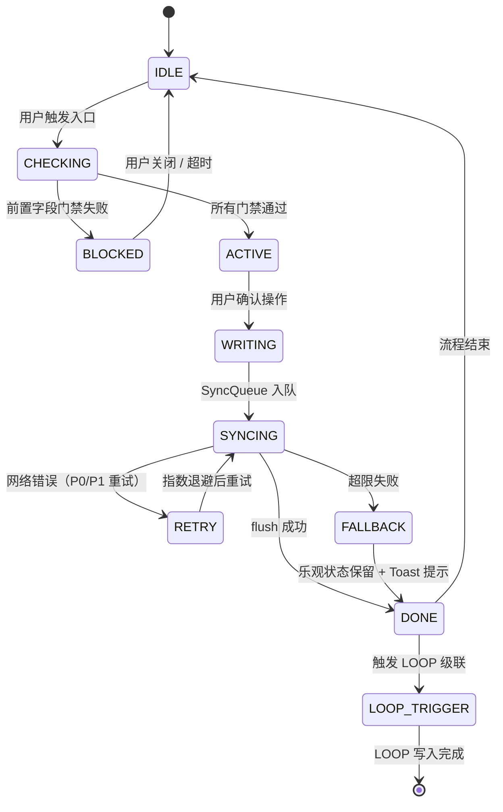

# 一·十四、Flow 状态机 × 字段门禁规范

> 每个 Flow 在执行过程中，有明确的**进入前置条件**（字段门禁）、**核心执行字段**、**异常退出分支**和**正常完成写入字段**。本节定义完整的 Flow 级状态转换规格，与 **# 二十一** AppFSM 应用级状态机对齐。
> 

## A · Flow 状态机通用模型



## B · 各 Flow 字段门禁 × 状态转换规范

### Flow 1 · CheckIn 打卡

| 状态节点 | 字段门禁 / 条件 | 字段来源 | 门禁失败处理 |
| --- | --- | --- | --- |
| **CHECKING**（进入前置） | DB-01 今日行是否已创建（`date = today()`） | DB-01 查询 | 自动 CREATE 今日行后继续 |
| **CHECKING** | HSIProvider.`confidence` 就绪（> 0） | HSI 内存 | confidence=0 → 允许继续（CheckIn 本身可提升 confidence） |
| **ACTIVE → WRITING** | 用户勾选 `[fieldName]`；`linkedOKRId` 有效性验证（非空则触发 LOOP-01） | DB-01.`linkedOKRId` | `linkedOKRId` 无效 → 仅写 DB-01，跳过 LOOP-01 |
| **WRITING**（核心写入字段） | DB-01: `[fieldName]=true` · `checkInScore` 公式 · DB-02: `completedDates` array-union · DB-04: `checkInContribution` +=1 | — | DB-01 写入失败 → 乐观状态回滚 + SyncQueue P0 重试 5 次 |
| **DONE → LOOP_TRIGGER** | LOOP-01(P1) · LOOP-02(P1,streak≥7) · LOOP-06(P1,linkedPlanId) · LOOP-15(P2,streak∈{7,30,100}) | — | LOOP 失败 → P2 静默丢弃；P1 重试 3 次 |

### Flow 2 · 崩溃干预

| 状态节点 | 字段门禁 / 条件 | 字段来源 | 门禁失败处理 |
| --- | --- | --- | --- |
| **CHECKING**（触发前置） | `swipScore > 60`（medium）或 `swipScore > 90`（critical） | CrashRiskMonitor 内存 | 不满足阈值 → IDLE，继续 60s 轮询 |
| **CHECKING** | `dailyOverlayCount < 2`（今日未超频率上限） | DB-08.`dailyOverlayCount` | ≥ 2 → 进入 BLOCKED，silent mode 继续监听，不弹层 |
| **CHECKING** | `now - lastOverlayShownAt ≥ 30min`（冷却期结束） | DB-08.`lastOverlayShownAt` | 冷却期内 → BLOCKED，不触发 |
| **ACTIVE**（弹层显示字段） | 渲染字段：`swipScore`（进度条）· `slope`（趋势文案）· `riskLevel`（mode 判定） | HSI 内存 | 字段缺失 → 使用上次快照 |
| **WRITING**（弹层触发时） | DB-08: `dailyOverlayCount+=1` · `lastOverlayShownAt=now()` · `interventionLog` array-union | — | DB-08 写入失败 → P2 静默重试 1 次，不影响弹层显示 |
| **DONE**（onRest 路径） | AppFSM: `disableNav('DO', 20min)` · `hardFilter.maxCogLoad=2`（内存） · DB-08: `dailyRecoveryCardCount+=1` | — | AppFSM 写入失败 → P0 重试，DO 按钮保持禁用（安全方向） |

### Flow 3 · 任务执行（DO）

| 状态节点 | 字段门禁 / 条件 | 字段来源 | 门禁失败处理 |
| --- | --- | --- | --- |
| **CHECKING**（进入 TaskManagerScreen） | AppFSM `disabledRoutes` 不含 'DO'（崩溃干预冷却期检查） | AppFSM 内存 | DO 在禁用列表 → BLOCKED，显示倒计时「休息中 XX:XX」 |
| **CHECKING** | HSIProvider.`overallEnergy` 就绪（非 staleness） | HSI 内存 | staleness=true → 使用上次快照（容许降级推荐） |
| **ACTIVE**（TaskMatcherEngine 执行门禁） | Step1: `task.energyRequired - overallEnergy ≤ 2`（能量门禁）
Step1: `task.cognitiveLoad ≤ hardFilter.maxCogLoad`（崩溃保护） | HSI 内存 · DB-03 · AppFSM hardFilter | energyGap > 2 → 直接过滤，不进推荐池（无 UI 提示） |
| **WRITING**（开始任务） | DB-03: `status='⏳进行中'` · `startedAt=now()` · `startedHSISnapshot={energy,mentalCapacity,stressLevel}` | — | P0 写入失败 → 乐观状态保持，SyncQueue 重试 5 次 |
| **WRITING**（完成任务） | DB-03: `status='✅完成'` · `completedAt=now()` · `completedHSISnapshot` · `actualMinutes` | — | 同上；`actualMinutes` 异常（负值）→ 置 null，不影响完成状态 |
| **DONE → LOOP_TRIGGER** | LOOP-07(P0, linkedKRId 存在) · taskContribution += 1(P1) | — | LOOP-07 失败 → P0 重试 5 次（高优先级保障） |

### Flow 4 · 愿景显化

| 状态节点 | 字段门禁 / 条件 | 字段来源 | 门禁失败处理 |
| --- | --- | --- | --- |
| **CHECKING** | DB-07 该条目 `manifestStatus ≠ '✨已显化'`（防重复显化） | DB-07 | 已显化 → BLOCKED，UI 显示「已显化」只读状态 |
| **ACTIVE → WRITING** | 用户填写 `evidence`（可选但推荐）；`linkedOKRId` 有效性验证 | DB-07 / DB-04 | `evidence` 空 → 允许继续；`linkedOKRId` 无效 → 跳过 LOOP-04 的 DB-04 写入 |
| **WRITING** | DB-07: `manifestStatus='✨已显化'` · `manifestedDate=today()` · `evidence`
DB-04: `manifested=true` · `overallProgress=100`（LOOP-04） | — | DB-04 写入失败 → P1 重试 3 次；ManifestationCelebration 等 DB 确认后触发 |
| **DONE** | UI: ManifestationCelebration 3000ms（或 DB-12.celebrationDuration 覆盖）
不触发 LOOP-07（overallProgress 直接 patch，非 KR 公式路径） | DB-12.celebrationDuration | celebrationDuration 缺失 → 默认 3000ms |

### Flow 5 · 知识录入

| 状态节点 | 字段门禁 / 条件 | 字段来源 | 门禁失败处理 |
| --- | --- | --- | --- |
| **CHECKING** | 无强制前置门禁（任何状态均可进入知识录入） | — | — |
| **ACTIVE**（必填字段校验） | `title` 非空（必填）；`R_reading` 非空（必填）；`I_insight` 非空（建议）；`A_action` 可选 | 用户输入 | `title` 或 `R_reading` 为空 → 保存按钮 disabled，不触发任何写入 |
| **WRITING**（P0 同步写入） | DB-06: `title` · `sourceType` · `R_reading` · `I_insight` · `A_action` · `createdAt=now()` | — | P0 失败 → 乐观状态保持，重试 5 次 |
| **DONE → LOOP_TRIGGER**（异步并行） | AI 语义分析（T<2000ms）→ `semanticEmbedding` · `aiSuggestedOKRId` · `aiMatchScore`（P1）
LOOP-03（A_action 非空 → DB-03 新任务，P2） | — | AI 超时(>2000ms) → 不渲染 OKRLinkSuggestionCard；LOOP-03 失败 → P2 静默丢弃 |
| **LOOP_TRIGGER**（等待用户确认 OKRLink） | aiMatchScore > 0.65 → 渲染 OKRLinkSuggestionCard
30s 无操作 → 自动收起（不写 userRejectedOKRIds） | DB-06.aiMatchScore | < 0.65 → 静默写入 aiSuggestedOKRId，不渲染卡片 |

### Flow 6 · 周回顾（CHECK）

| 状态节点 | 字段门禁 / 条件 | 字段来源 | 门禁失败处理 |
| --- | --- | --- | --- |
| **CHECKING**（进入前置） | DB-08.`weeklyReviewDone ≠ true`（防止本周重复回顾，或用户主动重开） | DB-08 | weeklyReviewDone=true → 显示「本周已完成回顾」+ 允许重新进入（可覆盖） |
| **ACTIVE** Step0（数据聚合读取） | 纯只读 SQL 聚合，无写入门禁；DB-01/03/04/05/08/09c/11 均需可访问 | 多 DB 联合查询 | 任一 DB 超时 → 对应 Section 降级（显示「数据加载中」，不阻止进入） |
| **WRITING** Step②（LOOP-05 批量写入） | 用户确认任务排序；批量 PATCH `weeklyPriority`  • `weeklyPrioritySource` | DB-03 全部「待处理/进行中」任务 | 部分 task PATCH 失败 → 对应任务保留旧值，其余正常写入（不回滚全批） |
| **WRITING** Step③（LOOP-07 级联） | KR 手动修改 → DB-05.`currentValue` · `lastUpdatedBy='user-manual'`
LOOP-16 健身周统计覆盖写（isIdempotent=true，幂等保障） | DB-05 / DB-09c | LOOP-16 重复触发 → 幂等键 `stats:${weekEnd}:${krId}:loop16` 去重 |
| **DONE**（完成周回顾） | DB-08: `weeklyReviewDone=true` · `reviewCompletedAt=now()`（P1，幂等键 `review:${weekEnd}:done`） | — | 写入失败 → CHECK 按钮不显示绿色，P1 重试 3 次 |

### Flow 7 · 健身记录 & Flow 8 · 饮食记录（字段门禁速览）

| Flow | 核心进入门禁字段 | 异常分支 | 完成写入字段 | 触发 LOOP |
| --- | --- | --- | --- | --- |
| **Flow 7** 健身记录 | DB-09b 对应训练计划行存在（`linkedPlanId` 有效）；`completedAt` 未写入（防重） | 重复 completedAt → 幂等键 `${workoutId}:loop11/12` 去重；actualWeightKg < 0 → 拒绝写入 | DB-09b: `actualVolume` · `actualSets` · `actualWeightKg` · `completedAt` | LOOP-11(P1) · LOOP-12(P1) → LOOP-07(P0) · LOOP-08(P2) |
| **Flow 8** 饮食记录 | 无强制门禁；`mealType` 必填（早/午/晚/加餐）；`mealTimestamp` 自动填充 now() | nutritionScore 超出 [0,10] → clamp 处理，不拦截保存；重复时间段 → 允许（append-only） | DB-11: `mealTimestamp` · `mealType` · `calories` · `protein` · `carbs` · `fat` · `nutritionScore` | LOOP-14(P1,内存实时) · LOOP-13(P2,T<500ms) |

## C · Flow 异常场景 × 字段级回滚规范

| 异常场景 | 影响 Flow | 乐观状态 | 回滚字段 | 回滚操作 | 用户感知 |
| --- | --- | --- | --- | --- | --- |
| DB-01 打卡写入 409 冲突 | Flow 1 | checkbox 已勾选（乐观） | DB-01.`[fieldName]` / `checkInScore` | `rollbackPatch` 将 checkbox 恢复 false，`checkInScore` 恢复 | Toast「打卡同步失败，请重试」；checkbox 视觉回弹 |
| 任务完成 P0 flush 失败（5次重试后） | Flow 3 | status='✅完成'（乐观） | DB-03.`status` / `completedAt` | `rollbackPatch` status 恢复 '⏳进行中' | Toast「任务同步失败」；任务卡片回到进行中状态 |
| Wishlist 显化 DB-04 写入失败 | Flow 4 | ManifestationCelebration 已触发（乐观） | DB-04.`manifested` / `overallProgress` | `rollbackPatch` manifested=false，OKR 角标回退 | 庆祝动效结束后 Toast「显化同步失败」；OKR 进度回退 |
| LOOP-07 公式服务端失败 | Flow 3/5/7（任何触发 KR 变更的 Flow） | overallProgress 未更新（公式未触发） | DB-04.`overallProgress` | P0 重试 5 次；失败后写 DB-08.`errorLog`：`{type:'formula-failure', field:'overallProgress', at:now()}` | OKR 角标短暂不更新；下次用户进入 Flow6 时重算 |
| HSI SDK 断联（Synheart 离线） | 所有 Flow（影响任务推荐质量） | Layer1 weight=0 降级 | HSI 内存.`overallEnergy` | L1 weight 降为 0，L3 weight 补偿至 0.5；confidence 下降 → 可能渲染 MiniCheckIn | EnergyIndicator 显示「生理信号不可用」；推荐基于行为+历史节律 |
| SyncQueue 网络离线（全量离线） | 所有写入 Flow | 所有乐观状态保持 | P0/P1/P2 所有入队条目 | Queue 暂停 flush；online-restore 恢复后按优先级顺序 flush（P0→P1→P2） | UI 显示「离线模式」；操作正常响应；恢复联网后自动同步 |

---

# 一·十七、日内典型字段流转时序全景

> 以「一个典型工作日」为时间轴，追踪 LIFE COMPASS 系统在 **早晨 → 日中 → 傍晚 → 夜间** 四个时段内，各模块依次被触发时的**精确字段流转顺序**。每一步标注：触发字段 → 写入路径 → 级联字段 → 最终 UI 变化。
> 

> 配合 **# 一·十一** 操作动线（操作为轴）和 **# 一·六** LOOP 矩阵（流程为轴）联合阅读；本节以**时钟为轴**，还原系统一天的完整字段脉搏。
> 

---

## 📅 时序总览 Mermaid（日内字段脉搏图）

```mermaid
gantt
    title LIFE COMPASS 日内字段流转时序
    dateFormat HH:mm
    axisFormat %H:%M

    section 🌅 早晨（07:00-09:00）
    inferHSI 首次执行（circadianBaseline→overallEnergy）     :07:00, 1m
    CheckIn checkbox 勾选（checkInScore PATCH）               :07:05, 10m
    LOOP-01 checkInContribution 写入                          :07:06, 2m
    LOOP-07 overallProgress 公式重算                          :07:07, 1m
    MiniCheckIn 显隐判断（confidence 阈值）                   :07:08, 1m
    LOOP-06 Workout Tracker 预写入（linkedPlanId）            :07:10, 2m

    section ☀️ 日中（09:00-12:00）
    DO 进入 TaskMatcherEngine 7步评分                         :09:00, 1m
    任务开始 startedHSISnapshot 写入                          :09:05, 1m
    知识录入 R/I/A 保存 DB-06                                 :10:00, 3m
    LOOP-03 A_action→DB-03 新任务生成                         :10:02, 2m
    AI 语义分析 semanticEmbedding 异步写入                    :10:05, 30m
    OKRLinkSuggestionCard 渲染（aiMatchScore>0.65）           :10:35, 5m
    进餐记录 mealTimestamp LOOP-14 内存实时                   :12:00, 1m

    section 🌆 傍晚（17:00-20:00）
    健身记录补录 actualVolume/actualSets PATCH                :17:30, 5m
    LOOP-11 currentValue += volume×sets                       :17:31, 1m
    LOOP-07 P0 overallProgress 重算                           :17:32, 1m
    任务完成 completedHSISnapshot 写入                        :18:00, 1m
    taskContribution += 1 LOOP-07 级联                        :18:01, 1m
    进餐记录 nutritionScore LOOP-13 P2 写入 DB-08             :19:00, 2m
    energyBoostFactor = score/10×1.5+0.85                     :19:01, 1m

    section 🌙 夜间（21:00-23:00）
    CHECK 周回顾（仅周日）SQL 聚合读取 DB-01~11              :21:00, 10m
    weeklyPriority 批量 PATCH LOOP-05                         :21:15, 5m
    visionAlignmentRating DB-07 写入                          :21:25, 3m
    weeklyReviewDone=true DB-08 写入                          :21:30, 1m
    LOOP-08 circadianBaseline 30日滚动更新 P2                 :22:00, 5m
    CrashRiskMonitor 60s 轮询 swipScore 重算                  :22:30, 1m
```



---

## 🌅 早晨阶段（07:00–09:00）· 系统唤醒 & 打卡闭环

```
时间    字段流转事件
────────────────────────────────────────────────────────────────
07:00   [HSIProvider] App 前台恢复
          读取：DB-08.circadianBaseline.typicalEnergyLevel
                DB-08.energyBoostFactor
                Synheart SDK HRV（若可用）
          执行：inferHSI() T<40ms
          写入：内存 overallEnergy / confidence / swipScore
          判断：confidence < 0.5 → MiniCheckIn 渲染

07:05   [CrashRiskMonitor] 首次 60s 轮询
          读取：内存 stressLevel / swipScore / DB-08.weeklyReviewDone
          输出：swipScore（日初通常低）→ TodayZone 正常密度

07:05   [Flow 1 CheckIn] 用户开始勾选 CheckIn 表格
          写入 A → SyncQueue P0 → DB-01:
            PATCH { [fieldName]: true, updatedAt: now() }
            服务端公式：checkInScore = checkedCount / 11
          写入 B → SyncQueue P1 → DB-02（linkedHabits 存在）:
            array-union { completedDates: [today()] }
            streak 服务端公式重算

07:06   [LOOP-01] checkInScore 写入完成后级联
          条件：DB-01.linkedOKRId 非空
          写入 → SyncQueue P1 → DB-04:
            atomic-increment { checkInContribution: +1 }
          幂等键：`${checkInId}:${today()}:loop01`

07:07   [LOOP-07 P0] checkInContribution 变更触发
          服务端公式：overallProgress = mean(KR.progress[])
          写入：DB-04.overallProgress 实时更新 T<100ms
          UI：PDCANavBar OKR 角标数字更新

07:08   [HSIProvider] checkInScore 变更回流
          Layer2 权重更新：confidence = 有效源数 / 4
          判断：confidence ≥ 0.75 → MiniCheckIn 隐藏
          内存：TaskMatcherEngine 推荐列表静默重排

07:10   [LOOP-06 可选] linkedPlanId 非空（关联健身计划）
          写入 → SyncQueue P1 → DB-09b:
            PATCH { completedAt: now(), linkedCheckInField: fieldName }
          → WorkoutTrackerScreen 等待用户补录运动详情

07:15   [LOOP-15 可选] streak 达到阈值（7/30/100天）
          条件：DB-02.streak ∈ {7, 30, 100}
          写入 → SyncQueue P2 → DB-07 CREATE:
            { title: '[习惯里程碑]...', linkedHabitId, date: today() }
          幂等键：`${habitId}:streak${n}:loop15`
```

---

## ☀️ 日中阶段（09:00–12:00）· 任务执行 & 知识录入

```
时间    字段流转事件
────────────────────────────────────────────────────────────────
09:00   [Flow 3 DO] 用户点击 PDCANavBar「DO」
          读取：内存 overallEnergy / mentalCapacity / stressLevel
                     temporal.timeOfDay / swipScore
          [TaskMatcherEngine] 7步评分 T<100ms（纯内存）:
            Step1  energyGap = task.energyRequired - overallEnergy
                   → energyGap > 2 过滤
            Step2  读取 DB-03: cognitiveLoad / energyRequired /
                   bestTimeSlot / weeklyPriority / rejectionLog
            Step3–7 算法评分 → finalScore Top3
          输出：RecommendedTaskList 3条任务渲染

09:05   [Flow 3] 用户点击「▶ 开始任务」
          写入 → SyncQueue P0 → DB-03:
            PATCH { status: '⏳进行中',
                    startedAt: now(),
                    startedHSISnapshot: {
                      energyLevel: overallEnergy,
                      mentalCapacity, stressLevel } }
          幂等键：`${taskId}:${today()}:start`

10:00   [Flow 5 Knowledge] 用户录入知识条目
          写入 → SyncQueue P0 → DB-06 CREATE:
            { title, R_reading, I_insight, A_action,
              sourceType, createdAt: now() }
          幂等键：`knowledge:${title}:${today()}:save`

10:00   [LOOP-03 并发] A_action 非空 → 自动生成任务
          写入 → SyncQueue P2 → DB-03 CREATE:
            { title: A_action, cognitiveLoad: 2,
              status: '🕐待处理', generatedFromKnowledge: knowledgeId }
          幂等键：`${knowledgeId}:loop03`
          → 新任务进入候选池（下次 DO 进入生效）

10:05   [AI 语义引擎 异步] T<2000ms 后台 worker
          输入：DB-06.R_reading + I_insight（文本拼接）
          计算：semanticEmbedding 向量化
                cosine_similarity → aiMatchScore[] → aiSuggestedOKRId
          写入 → SyncQueue P1 → DB-06:
            PATCH { semanticEmbedding, aiSuggestedOKRId, aiMatchScore }

10:35   [OKRLinkSuggestionCard] aiMatchScore 写入完成后
          判断：> 0.85 → 「高度匹配」文案
                0.65–0.85 → 「可能相关」文案
                < 0.65 → 静默，不渲染卡片
          30s 无操作 → 自动收起（不写 DB）

11:00   [Flow 3] 用户完成任务
          写入 → SyncQueue P0 → DB-03:
            PATCH { status: '✅完成',
                    completedAt: now(),
                    completedHSISnapshot: { ...当前HSI },
                    actualMinutes: completedAt - startedAt }
          幂等键：`${taskId}:${today()}:complete`

11:00   [LOOP-07 级联 P0] linkedKRId 存在时
          写入 → SyncQueue P0 → DB-05:
            PATCH { currentValue: +taskKRIncrement,
                    lastUpdatedBy: 'task-complete' }
          → LOOP-07 T<100ms：DB-04.overallProgress 公式重算
          → PDCANavBar 角标实时更新

12:00   [Flow 8 MealLog] 午餐记录保存
          写入 → SyncQueue P1 → DB-11 CREATE:
            { mealTimestamp: now(), mealType: 'lunch',
              calories, protein, carbs, fat, nutritionScore }

12:00   [LOOP-14 即时 纯内存] mealTimestamp 写入触发
          计算：hoursHungry = (now() - lastMealTimestamp) / 3600000
                hungerPenalty = clamp((hoursHungry-2)/6, 0, 0.5)
                lastMealTimestamp = now() → hungerPenalty = 0
          → inferHSI() 立即重调用 T<50ms
          → overallEnergy 可能上升 → TaskMatcherEngine 静默重排
```

---

## 🌆 傍晚阶段（17:00–20:00）· 健身记录 & 能量基线更新

```
时间    字段流转事件
────────────────────────────────────────────────────────────────
17:30   [Flow 7 Workout] 健身后补录运动详情
          写入 → SyncQueue P1 → DB-09b PATCH:
            { actualVolume, actualSets, actualWeightKg,
              completedAt: now() }

17:31   [LOOP-11] actualVolume × actualSets 级联
          条件：DB-09b.linkedKRId = 运动量类型 KR
          写入 → SyncQueue P1 → DB-05:
            atomic-increment { currentValue: +actualVolume×actualSets,
                               lastUpdatedBy: 'loop11' }
          幂等键：`${workoutId}:loop11`

17:31   [LOOP-12 并发] 训练次数 KR 同步写入
          写入 → SyncQueue P1 → DB-05:
            atomic-increment { currentValue: +1,
                               lastUpdatedBy: 'loop12' }
          幂等键：`${workoutId}:loop12`

17:32   [LOOP-07 P0 × 2次] LOOP-11 + LOOP-12 各触发一次
          写入：DB-04.overallProgress 公式重算
          注意：两次触发间隔 < 100ms，服务端合并处理
          → PDCANavBar OKR 角标更新（可能更新两次）

17:35   [PR 检测 可选]
          查询：SELECT max(actualWeightKg) FROM DB-09b
                WHERE exerciseId = 当前动作
          若突破 → SyncQueue P1 → DB-07 CREATE:
            { title: '[健身里程碑]...', category: '健身里程碑' }

18:00   [CrashRiskMonitor 轮询 60s]
          重新计算 swipScore（傍晚通常偏高）
          判断：score > 60 → medium 干预 OR score > 90 → critical 全屏
          写入 → DB-08（若触发）:
            { dailyOverlayCount += 1, lastOverlayShownAt: now(),
              interventionLog: array-union {...} }

19:00   [Flow 8 MealLog] 晚餐记录
          同 12:00 流程，LOOP-14 内存立即 + LOOP-13 P2 写入 DB-08

19:01   [LOOP-13 P2] nutritionScore → energyBoostFactor
          计算：energyBoostFactor = nutritionScore / 10 × 1.5 + 0.85
          写入 → SyncQueue P2 → DB-08:
            PATCH { energyBoostFactor }
          幂等键：`meallog:${mealId}:loop13`
          → HSIProvider Layer3 当日基线更新
          → 次日 inferHSI 基线值上调
```

---

## 🌙 夜间阶段（21:00–23:00）· 周回顾（仅周日）& 节律学习

```
时间    字段流转事件
────────────────────────────────────────────────────────────────
21:00   [Flow 6 Review] 用户进入 CHECK 页面（周日触发）
          Step0 SQL 聚合读取（只读，实时计算）:
            DB-01：SELECT date, checkInScore WHERE date ∈ 本周
            DB-03：completionRate / pendingTasks[]
            DB-04：overallProgress / taskContribution
            DB-05：currentValue / targetValue / progress
            DB-08：avg(energyLevel) WHERE date ∈ 本周
            DB-09c：weeklyVolume WHERE weekEnd=本周
            DB-11：avg(nutritionScore) WHERE mealTimestamp ∈ 本周
          → WeeklyDataSummary 数据看板渲染

21:15   [Step② 任务排序] 用户拖拽 OR AI 一键分配
          写入 → SyncQueue P1 → DB-03 批量 PATCH:
            forEach task: { weeklyPriority, weeklyPrioritySource }
          幂等键：`review:${weekEnd}:loop05:${taskId}`
          字段交接：→ 下周 DO TaskMatcherEngine Step5
                        baseScore += weeklyPriority × 0.2

21:20   [Step③ KR 手动修正 可选]
          写入 → SyncQueue P0 → DB-05:
            PATCH { currentValue: userInput,
                    lastUpdatedBy: 'user-manual' }
          → LOOP-07 P0 T<100ms：overallProgress 重算

21:25   [Step③ LOOP-16 可选] 周训练量覆盖写入
          条件：DB-09c.weeklyVolume 存在 AND isIdempotent=true
          写入 → SyncQueue P1 → DB-05:
            PATCH { currentValue: weeklyVolume }（覆盖，非增量）
          幂等键：`stats:${weekEnd}:${krId}:loop16`

21:25   [Step④ 愿景对齐]
          写入 → SyncQueue P1 → DB-07 forEach:
            PATCH { visionAlignmentRating: 1–5,
                    visionAlignmentQuickAnswer: text }

21:30   [Review 完成] 最终写入
          写入 → SyncQueue P1 → DB-08:
            PATCH { weeklyReviewDone: true,
                    reviewCompletedAt: now() }
          幂等键：`review:${weekEnd}:done`
          → PDCANavBar CHECK 绿色标记
          → CrashRiskMonitor 下周保护分基线重置

22:00   [LOOP-08 节律学习 后台 P2]
          输入：当日 DB-08 所有 energyLevel 样本点
          计算：rollingMean(30日窗口)
          写入 → SyncQueue P2 → DB-08:
            PATCH { circadianBaseline: {
              typicalEnergyLevel: mean,
              typicalStressLevel: mean,
              sampleCount: n } }
          幂等键：`circadian:${timeOfDay}:${today()}:loop08`
          → 明日 inferHSI Layer3 基线值更新

22:30   [CrashRiskMonitor 最后一次轮询]
          若 swipScore 已降至正常 → silent mode（不触发 Overlay）
          写入：无（仅读取内存）

23:00   [App 退入后台]
          SyncQueue P2 flush 最后一批（后台 5min 间隔）
          DB-08 当日行最终状态落盘
          内存：overallEnergy / swipScore 状态保留至明日 App 恢复
```

---

## 📊 日内字段写入频率统计（典型工作日）

| 时段 | 主要写入字段 | SyncQueue 压力 | 核心 LOOP | 关键 UI 变化 |
| --- | --- | --- | --- | --- |
| 🌅 早晨 07:00–09:00 | `checkInScore` / `completedDates` / `streak` / `checkInContribution` / `overallProgress` | P0×1 + P1×3（约 4 条目） | LOOP-01 / LOOP-07 / LOOP-06 / LOOP-15 | MiniCheckIn 显隐 / OKR 角标更新 / 打卡表填绿 |
| ☀️ 日中 09:00–12:00 | `status` / `startedHSISnapshot` / `completedHSISnapshot` / `currentValue` / `R_reading` / `A_action` / `semanticEmbedding` / `mealTimestamp` | P0×3 + P1×2 + P2×1（约 6 条目） | LOOP-03 / LOOP-07 / LOOP-09 / LOOP-14 | 任务状态更新 / OKR 进度条 / 推荐卡片 / 能量指示器 |
| 🌆 傍晚 17:00–20:00 | `actualVolume` / `actualSets` / `completedAt` / `currentValue`（×2 LOOP-11/12）/ `energyBoostFactor` | P1×4 + P2×1（约 5 条目） | LOOP-11 / LOOP-12 / LOOP-07×2 / LOOP-13 | KR 进度条双跳 / OKR 进度更新 / 能量基线刷新 |
| 🌙 夜间 21:00–23:00（周日） | `weeklyPriority` / `visionAlignmentRating` / `weeklyReviewDone` / `currentValue`（LOOP-16）/ `circadianBaseline` | P1×5 + P2×1（约 6–10 条目批量） | LOOP-05 / LOOP-16 / LOOP-08 | CHECK 绿标 / 下周任务排序生效 / 节律基线更新 |