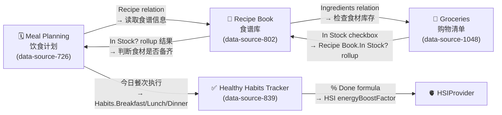
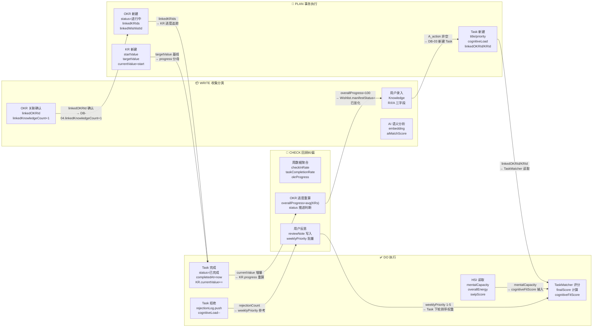
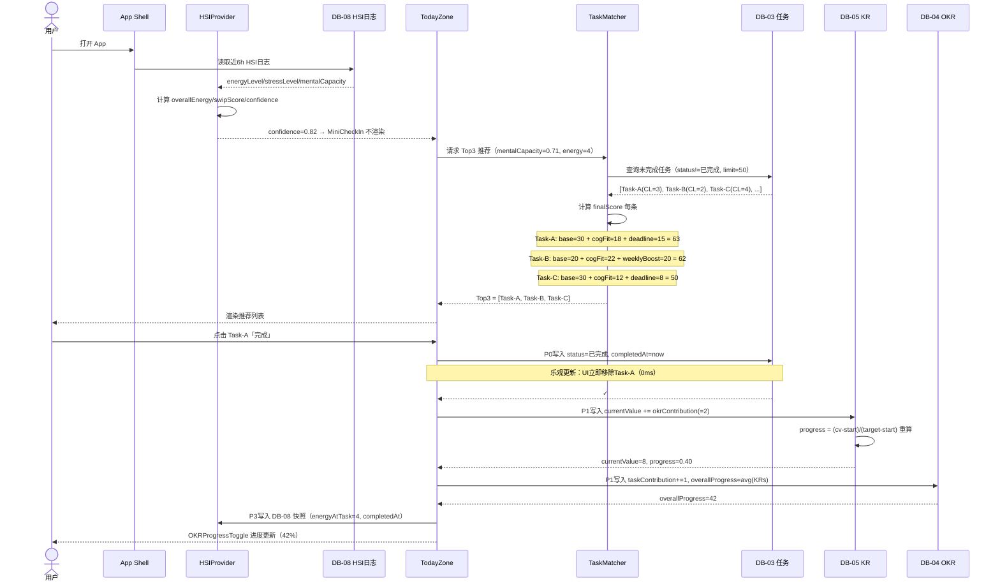
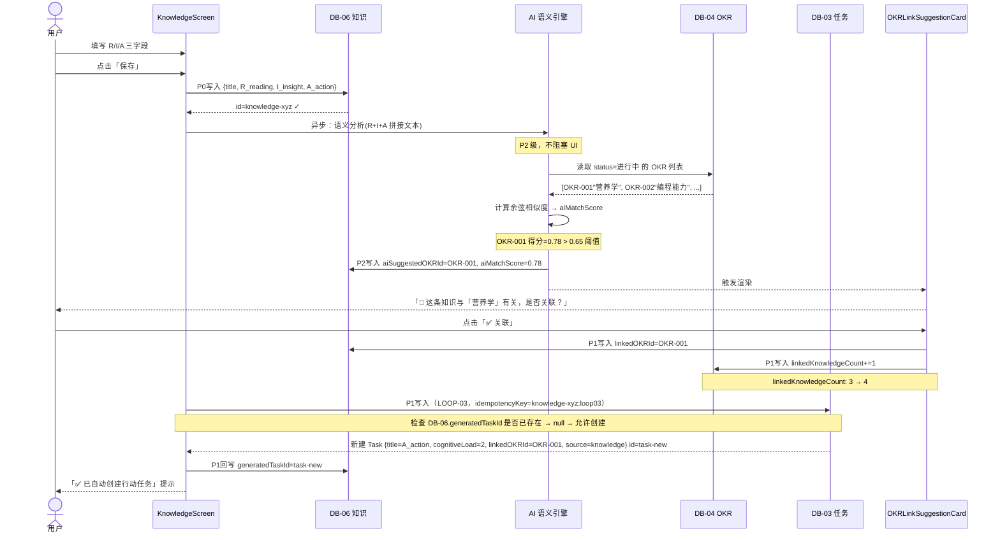
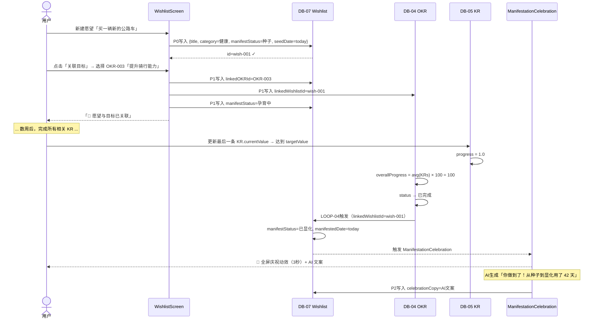
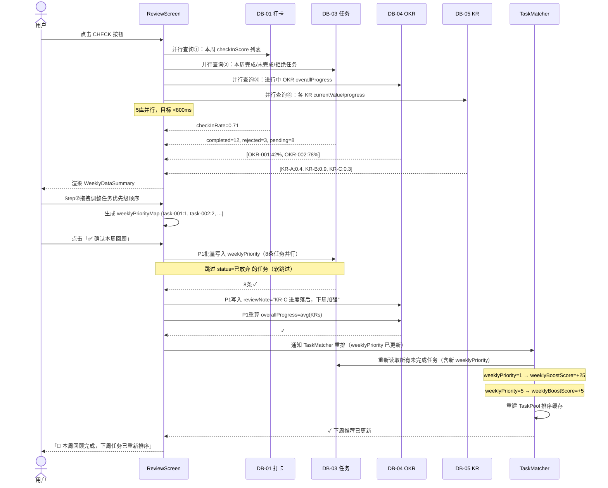
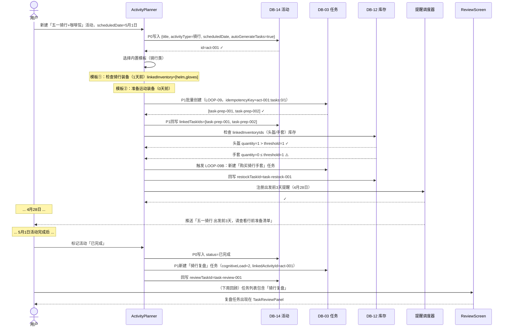
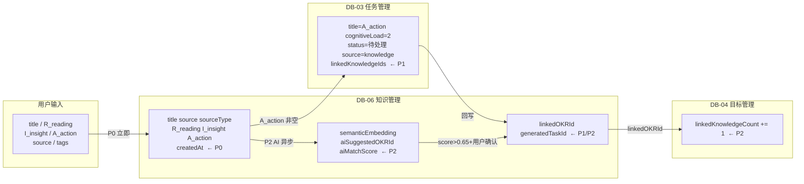
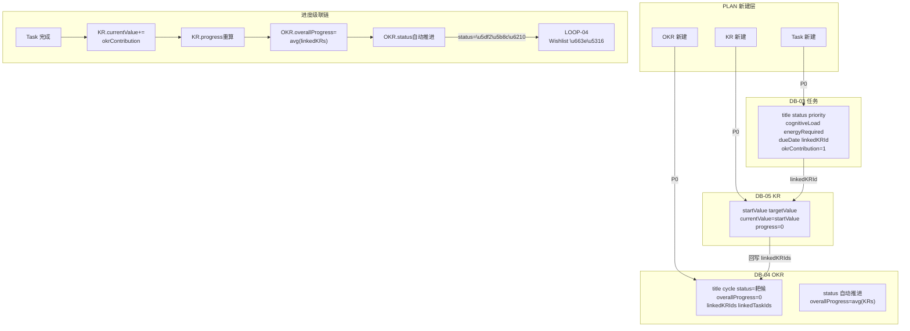
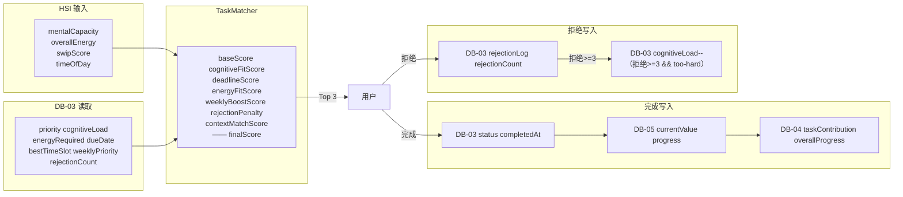

## 一、四库联动真实字段总图



## 二、Meal Planning 饮食计划（data-source-726）真实字段

```tsx
// 真实字段（来自 data-source-726 schema 确认）
interface MealPlanningRecord {
  Name:               string;              // title（餐名，如 "蒸板鸭"、"芹菜炒蘑菇"）
  // 日期（字段名为「Date - Week Day」，注意含空格和连字符）
  'date:Date - Week Day:start': string;   // ISO-8601 date，标记本餐计划日期
  // 餐次分类
  Meal: 'Breakfast' | 'Lunch' | 'Dinner' | 'Snack'; // select
  // 食谱关联（核心链接字段）
  Recipe: string[];                        // relation → data-source-802（Recipe Book）
  // Rollup 字段（从 Recipe.Ingredients 继承，只读）
  Ingredients: string;                     // rollup → Recipe.Ingredients 条目数量
  // 文本标签
  'Recipe book Label:': string;            // text，固定值 "Recipe Book:"
  Created_time: string;                    // created_time，自动生成
}
// 操作动线：
// 1. 用户打开 MealPlanCalendar（周视图）→ 按日期和餐次展示
//    视图：calendar by「Date - Week Day」，周范围
//    卡片展示：Name / Meal / Recipe 关联食谱名
// 2. 新建餐计划：填写 Name + 选择 Meal 餐次 + 选择 Recipe
//    → Recipe 字段填入后，Ingredients rollup 自动展示食材数量
// 3. 执行餐次（已吃）→ 写入 Habits 对应字段（LOOP-13）
//    Meal = 'Breakfast' → Habits.Breakfast = true
//    Meal = 'Lunch'     → Habits.Lunch = true
//    Meal = 'Dinner'    → Habits.Dinner = true
```

## 三、Recipe Book 食谱库（data-source-802）真实字段

```tsx
// 真实字段（来自 data-source-802 schema 确认）
interface RecipeBookRecord {
  Name:     string;                        // title（食谱名，如 "蘑菇炒芹菜"）
  // 分类字段
  Course: 'Dinner' | 'Entrees' | 'Sides' | 'Sauces & Dressings'
        | 'Snack' | 'Dessert' | 'Breakfast' | 'Lunch'
        | 'Drink' | '中式炒菜' | '碳水';    // select
  Cuisine: Array<
    | 'Vegetarian' | 'Indian' | 'Mexican' | 'Middle-Eastern'
    | 'Korean' | 'Asian' | 'Chinese' | 'North American'
    | 'French' | 'Japanese' | 'Thai' | 'Vegan' | 'Italian'
  >;                                       // multi_select
  Time: '+60 min' | '60 min' | '50 min' | '40 min' | '30 min'
      | '25 min' | '20 min' | '15 min' | '10 min' | '5 min'; // select
  Fav:    boolean;                         // checkbox 字段名「Fav?」→ 收藏食谱
  Image:  string[];                        // file（食谱图片，用于 MealCard 展示）
  Link:   string;                          // url（原始食谱链接）
  // 食材关联（链接到 Groceries）
  Ingredients: string[];                   // relation → data-source-1048（Groceries）
  // 关键 Rollup：食材备货状态
  'In Stock?': string;                     // rollup from Ingredients.In Stock
  //   rollup 计算方式：COUNT of Ingredients where In Stock=true
  //   前端判断备料完整性：
  //     allInStock = (In Stock? count === Ingredients.length)
  //     partialInStock = (In Stock? count > 0 && < Ingredients.length)
  //     notInStock = (In Stock? count === 0)
}
// 前端利用 Recipe Book 的「In Stock?」逻辑：
// 1. MealPlanCalendar 展示每个餐次卡片时，检查关联 Recipe 的 In Stock? 值
// 2. 若 allInStock → 卡片显示「✅ 食材备齐」绿色角标
// 3. 若 partialInStock → 显示「⚠️ 部分缺货」橙色角标 + 显示缺货食材列表
// 4. 若 notInStock → 显示「🛒 需采购」红色角标 + 跳转 Groceries 采购引导
```

## 四、Groceries 购物清单（data-source-1048）真实字段

```tsx
// 真实字段（来自 data-source-1048 schema 确认）
interface GroceriesRecord {
  Name:     string;                        // title（食材名，如 "Mozzarella cheese"、"Oil"）
  // 分类
  Category: Array<
    | 'Grain' | 'Bakery' | 'Produce' | 'Meat' | 'Fish' | 'Dairy'
    | 'Sauce' | 'Frozen Food' | 'Condiments' | 'Spices' | 'Drinks'
    | 'Alcohol' | 'Cleaning' | 'Pet' | 'Personal' | 'Fruits'
    | 'Vegetables' | 'Vegan' | 'Oils' | 'Herbs'
  >;                                       // multi_select
  Quantity:  string;                       // text（如 "2"、"1 bottle"，非 number！）
  Comments:  string;                       // text（备注，如 "Italian Brand"）
  // 采购渠道
  Store: 'Butchers' | 'Mini Market' | 'Independent Grocery Store'
       | 'Asian Grocery Store' | 'Supermarket' | 'Health Food Store'; // select
  // ⚡ 核心驱动字段（牵动整个四库联动）
  'In Stock': boolean;                     // checkbox 字段名「In Stock」（无问号）
  // 用户到货/补货后勾选 → 驱动 Recipe Book.In Stock? rollup 更新
  // 反向关联（链接食谱）
  'Recipe Book': string[];                 // relation → data-source-802（Recipe Book）
}
// GroceryCheckWidget 操作动线（LOOP-14 核心）：
// 1. 展示所有 In Stock=false 的食材（"待采购清单"）
// 2. 用户采购后点击 In Stock checkbox
//    → 写入：Groceries.'In Stock' = true（P0 写入）
//    → 级联：Recipe Book.'In Stock?' rollup 自动更新
//    → 级联：MealPlanCalendar 食材备齐状态角标更新（UI 刷新）
// 3. 「按 Store 分组视图」：按 Store 字段 groupBy，显示去哪家店买什么
//    → 优化「出门采购」操作效率
// 4. 「按 Category 过滤」：生鲜类（Produce/Fruits/Vegetables）优先展示
```

## 五、Healthy Habits Tracker 六项字段完整规范（data-source-839）

```tsx
// 真实字段（来自 data-source-839 schema 全量确认）
interface HealthyHabitsTrackerRecord {
  // 识别字段
  Day:  string;                            // title（日期标识，如 "2" 表示第2天，可自定义）
  'date:Date:start': string;              // date（打卡日期，ISO-8601）
  // ══════ 六项习惯打卡字段（checkbox）══════
  '7-8H Sleep': boolean;                  // 睡眠 7-8 小时
  '2L Water':   boolean;                  // 饮水 2 升
  Breakfast:    boolean;                  // 吃早饭
  Lunch:        boolean;                  // 吃午饭
  Dinner:       boolean;                  // 吃晚饭
  Exercises:    boolean;                  // 运动完成（由 LOOP-12a 写入）
  // ══════ 公式字段（自动计算，只读）══════
  '% Done':      string;                  // formula: 六项完成率（formula-code-1050）
  'Progress Bar': string;                 // formula: 视觉进度条字符串（formula-code-1051）
}
// % Done 公式逻辑推断（formula-code-1050）：
// checkedCount = [7-8H Sleep, 2L Water, Breakfast, Lunch, Dinner, Exercises]
//               .filter(Boolean).length
// result = round(checkedCount / 6 × 100) + "%"
// 完整打卡（6/6）= 100%
// 半数完成（3/6）= 50%
// Progress Bar 公式逻辑推断（formula-code-1051）：
// 将 % Done 转换为可视化字符串，如：
// 100% → "████████████ 100%"
//  50% → "██████░░░░░░  50%"
//   0% → "░░░░░░░░░░░░   0%"
// HabitsTracker 组件与六项字段的写入来源：
// ┌─────────────────┬──────────────────────────────────────────┐
// │  字段名          │  写入来源                                │
// ├─────────────────┼──────────────────────────────────────────┤
// │ 7-8H Sleep      │ 用户手动打卡 / MiniCheckIn 睡眠问题推断   │
// │ 2L Water        │ 用户手动打卡（无自动来源）                │
// │ Breakfast       │ LOOP-13: MealPlanning Breakfast 执行后写  │
// │ Lunch           │ LOOP-13: MealPlanning Lunch 执行后写      │
// │ Dinner          │ LOOP-13: MealPlanning Dinner 执行后写     │
// │ Exercises       │ LOOP-12a: Workout Tracker 33.Done?=true   │
// └─────────────────┴──────────────────────────────────────────┘
```

## 六、LOOP-13–16 完整字段级规范（确认版）

| **LOOP** | **触发事件** | **源 DB · 字段** | **目标 DB · 字段** | **写入值** |
| --- | --- | --- | --- | --- |
| LOOP-13a | 用户标记 Breakfast 餐次已吃 | MealPlanning.Meal = 'Breakfast' | HabitsTracker.Breakfast | `true`（checkbox） |
| LOOP-13b | 用户标记 Lunch 餐次已吃 | MealPlanning.Meal = 'Lunch' | HabitsTracker.Lunch | `true`（checkbox） |
| LOOP-13c | 用户标记 Dinner 餐次已吃 | MealPlanning.Meal = 'Dinner' | HabitsTracker.Dinner | `true`（checkbox） |
| LOOP-14 | [Groceries.In](http://Groceries.In) Stock checkbox 勾选 | Groceries.'In Stock' = true | RecipeBook.'In Stock?' rollup | rollup count 自动 +1 |
| LOOP-15 | Habits.% Done 值变化 | HabitsTracker.'% Done' formula | HSIProvider.energyBoostFactor | ≥83% → 1.1；≤33% → 0.9；else → 1.0 |
| LOOP-16 | Recipe 新增 Ingredients 关联 | RecipeBook.Ingredients relation | MealPlanning.Ingredients rollup | rollup 自动更新食材数 |

## 七、组件级字段绑定规范

```tsx
// <MealPlanCalendar> 周视图组件
interface MealPlanCalendarProps {
  mealPlanUrl:    'collection://14d0dfc8-e621-83c8-a9d0-87b2ee0ee617';    // Meal Planning 饮食计划
  recipeBookUrl:  'collection://c940dfc8-e621-833e-b569-87e4322ec1df';    // Recipe Book（用于查 In Stock?）
  groceriesUrl:   'collection://ba40dfc8-e621-8257-a653-877d118eeb9e';   // Groceries（用于 GroceryCheckWidget）
  habitsUrl:      'collection://e7e0dfc8-e621-8367-85c4-072f6894ef59';    // Healthy Habits Tracker
  // 视图配置（对应真实 calendar view by「Date - Week Day」）
  viewMode: 'week' | 'list';               // 对应 DB 已有的 calendar 和 table 视图
  currentWeekStart: Date;
  onMealComplete: (
    mealPlanUrl:  string,
    mealSlot:     'Breakfast' | 'Lunch' | 'Dinner' | 'Snack'
  ) => void; // 触发 LOOP-13
}
// <GroceryCheckWidget> 食材备货检查组件
interface GroceryCheckWidgetProps {
  dataSourceUrl:  'collection://ba40dfc8-e621-8257-a653-877d118eeb9e';
  recipeFilter?:  string[];               // 过滤只显示特定食谱所需的食材
  groupBy:        'Store' | 'Category';   // 对应真实 Store / Category 字段
  onInStockToggle: (
    groceryUrl: string,
    inStock:    boolean
  ) => void; // 写入 'In Stock' checkbox，触发 LOOP-14
}
// <HabitsDailyTracker> 六项打卡组件
interface HabitsDailyTrackerProps {
  dataSourceUrl:  'collection://e7e0dfc8-e621-8367-85c4-072f6894ef59';
  date:           Date;
  // 自动写入字段（由系统触发，组件只读展示）
  autoFields: {
    Exercises:  boolean; // 由 LOOP-12a 注入（健身完成后）
    Breakfast:  boolean; // 由 LOOP-13a 注入（饮食计划执行后）
    Lunch:      boolean; // 由 LOOP-13b 注入
    Dinner:     boolean; // 由 LOOP-13c 注入
  };
  // 手动打卡字段（用户直接操作）
  onManualCheck: (
    field: '7-8H Sleep' | '2L Water',
    value: boolean
  ) => void;
  // % Done 变化回调（触发 LOOP-15 HSI 能量调整）
  onProgressChange: (percentDone: number) => void;
}
// <RecipeStockIndicator> 食谱备货状态指示器
interface RecipeStockIndicatorProps {
  recipeUrl:   string;                    // Recipe Book 页面 URL
  inStockData: {
    inStockCount:  number;               // from Recipe.'In Stock?' rollup
    totalCount:    number;               // from Recipe.Ingredients.length
  };
  onViewGroceries: () => void;           // 跳转 GroceryCheckWidget
  // 渲染规则：
  // allInStock    (inStockCount === totalCount) → 绿色 ✅ 角标
  // partialInStock (0 < inStockCount < totalCount) → 橙色 ⚠️
  // notInStock    (inStockCount === 0) → 红色 🛒
  // noIngredients (totalCount === 0) → 灰色 「未关联食材」
}
```

## 八、四库联动验证清单（LOOP-13–16 断言）

```tsx
// 端到端测试用例：用户早餐打卡完整流程
async function verify_NutritionLoop(mealPlanUrl: string) {
  const meal = await db.mealPlanning.get(mealPlanUrl);
  if (meal.Meal !== 'Breakfast') return 'SKIP';
  const todayHabits = await db.habitsTracker.getByDate(today());
  const beforeBreakfast = todayHabits?.Breakfast;
  const beforeDone = todayHabits?.['% Done'];
  // 执行：标记早餐已吃
  await mealService.markComplete(mealPlanUrl);
  await waitFor(300);
  const afterHabits = await db.habitsTracker.getByDate(today());
  return [
    // LOOP-13a 验证
    { assert: 'HabitsTracker.Breakfast = true',
      result: afterHabits?.Breakfast === true ? 'PASS' : 'FAIL' },
    // LOOP-15 验证（% Done 公式更新）
    { assert: '% Done 增加（至少 +17%）',
      result: afterHabits && beforeDone !== undefined
        ? (parseFloat(afterHabits['% Done']) > parseFloat(beforeDone as string) ? 'PASS' : 'FAIL')
        : 'SKIP' },
    // 先决条件验证
    { assert: '当日 Habits 行存在',
      result: todayHabits ? 'PASS' : 'FAIL' },
  ];
}
// 端到端测试用例：食材补货 → 食谱备货状态更新
async function verify_GroceryToRecipe(groceryUrl: string) {
  const grocery = await db.groceries.get(groceryUrl);
  const linkedRecipes = grocery['Recipe Book'];
  if (linkedRecipes.length === 0) return 'SKIP - 未关联食谱';
  const recipe = await db.recipeBook.get(linkedRecipes[0]);
  const beforeInStock = recipe['In Stock?']; // rollup count 字符串
  // 执行：勾选 In Stock
  await db.groceries.update(groceryUrl, { 'In Stock': true });
  await waitFor(500); // rollup 计算稍慢
  const afterRecipe = await db.recipeBook.get(linkedRecipes[0]);
  return [
    { assert: 'Groceries.In Stock = true',
      result: (await db.groceries.get(groceryUrl))['In Stock'] === true ? 'PASS' : 'FAIL' },
    // LOOP-14 验证
    { assert: 'Recipe Book.In Stock? rollup 数值增加',
      result: parseInt(afterRecipe['In Stock?']) > parseInt(beforeInStock) ? 'PASS' : 'WARN' },
  ];
}
```

---

# 二十一、PDCA 完整数据循环 · 字段全生命周期

<td>真实 DB 字段三层健身架构（Workout ideas / Tracker 0-1 / Tracker 33 / Statistics）、Habits 六项 checkbox 字段、营养四库联动（Meal Planning → Recipe Book → Groceries）、LOOP-12–16 完整字段级闭环规范（按 Store 分组购物任务生成）</td>

<aside>
🔁

**设计目标**

PDCA 四模块（WRITE → PLAN → DO → CHECK）并非孤立屏幕，而是一个**共享同一套字段状态的循环系统**。本节从三个维度补全模块间流转：①一次完整 PDCA 循环中字段的全生命周期；②模块边界处传递的精确消息格式（哪些字段、哪种类型、是否必填）；③5 条典型用户旅程的端到端序列图（精确到每步 DB 操作）。

</aside>

## 一、PDCA 完整数据循环、消息格式标准、任务推荐序列图



### PDCA 各阶段「进入字段」与「退出字段」契约

| **模块** | **读入字段（来自其他模块）** | **写出字段（传给其他模块）** | **本模块核心写入** |
| --- | --- | --- | --- |
| WRITE | `OKRRecord.id` `OKRRecord.title`（PLAN 已建）
`TaskRecord.id`（DO 完成后反查来源） | `KnowledgeRecord.generatedTaskId` → PLAN
`OKRRecord.linkedKnowledgeCount` → CHECK 聚合 | `DB-06`: R/I/A、embedding、aiMatchScore、linkedOKRId |
| PLAN | `KnowledgeRecord.generatedTaskId`（WRITE 输出）
`WishlistRecord.linkedOKRId`（Wishlist 关联） | `TaskRecord.linkedKRId` → DO
`KeyResultRecord.targetValue` → DO 进度分母
`OKRRecord.linkedKRIds` → CHECK 聚合 | `DB-03`: 完整 Task 字段；`DB-04`: OKR；`DB-05`: KR |
| DO | `TaskRecord.cognitiveLoad/energyRequired`（PLAN 写入）
`HSI.mentalCapacity/overallEnergy`（全局）
`TaskRecord.weeklyPriority`（CHECK 写入） | `TaskRecord.status=已完成` → CHECK 统计
`KR.currentValue` → CHECK 进度
`TaskRecord.rejectionLog` → CHECK 学习 | `DB-03`: completedAt、rejectionLog；`DB-05`: currentValue |
| CHECK | `DB-01.checkInScore`（打卡）
`DB-03.status/completedAt`（DO 完成）
`DB-05.currentValue/progress`（DO 写入） | `TaskRecord.weeklyPriority` → DO 下轮排序
`OKRRecord.reviewNote` → PLAN 参考
`OKRRecord.overallProgress` → WRITE 显化触发 | `DB-03`: weeklyPriority 批量；`DB-04`: reviewNote、overallProgress |

---

## 二、模块间消息格式（精确字段契约）

```tsx
// ============================================================
// 模块边界处传递的标准消息格式
// 每条消息对应一次「模块间数据交接」事件
// ============================================================
// ① WRITE → PLAN：知识行动触发任务创建
interface WriteToпланMessage {
  type: 'KNOWLEDGE_ACTION_SAVED';
  payload: {
    knowledgeId:    string;           // DB-06.id（必填）
    aAction:        string;           // DB-06.A_action（必填，非空才触发）
    linkedOKRId?:   string;           // DB-06.linkedOKRId（可选，继承给 Task）
    linkedKRId?:    string;           // DB-06.linkedKRId（可选，继承给 Task）
    suggestedCognitiveLoad: 2;        // 知识生成任务默认认知负荷 2
    suggestedPriority: 'P2-中';      // 知识生成任务默认优先级
  };
  meta: {
    source:       'KnowledgeEntryForm';
    triggeredAt:  Date;
    idempotencyKey: string;           // knowledgeId + ':loop03'（防重）
  };
}
// ② PLAN → DO：任务就绪进入执行池
interface PlanToDoMessage {
  type: 'TASK_READY_FOR_EXECUTION';
  payload: {
    taskId:           string;         // DB-03.id（必填）
    title:            string;         // DB-03.title
    cognitiveLoad:    1|2|3|4|5;     // DB-03.cognitiveLoad（TaskMatcher 核心输入）
    energyRequired:   1|2|3|4|5;     // DB-03.energyRequired
    bestTimeSlot:     string;         // DB-03.bestTimeSlot
    estimatedMinutes: number;         // DB-03.estimatedMinutes
    dueDate?:         Date;           // DB-03.dueDate（截止日期紧迫分）
    weeklyPriority?:  number;         // DB-03.weeklyPriority（CHECK 写入后携带）
    linkedOKRId?:     string;         // DB-03.linkedOKRId
    linkedKRId?:      string;         // DB-03.linkedKRId
    okrContribution?: number;         // DB-03.okrContribution（完成时贡献量）
  };
  meta: {
    source: 'TaskPlanScreen';
    scheduledDate?: Date;             // DB-03.scheduledDate（为空则按 HSI 动态调度）
  };
}
// ③ DO → CHECK：任务完成上报
interface DoToCheckMessage {
  type: 'TASK_COMPLETED';
  payload: {
    taskId:          string;          // DB-03.id
    completedAt:     Date;            // DB-03.completedAt
    linkedKRId?:     string;          // DB-03.linkedKRId
    linkedOKRId?:    string;          // DB-03.linkedOKRId
    okrContribution: number;          // DB-03.okrContribution（写入 KR 的增量）
    hsiAtCompletion: {                // 完成时 HSI 快照（供周回顾分析）
      energyLevel:    1|2|3|4|5;
      mentalCapacity: number;
      timeOfDay:      string;
    };
  };
  meta: {
    source: 'TaskManagerScreen';
    completionDurationMs: number;     // 从「进行中」到「已完成」的耗时
  };
}
// ④ DO → CHECK：任务拒绝上报（HSI 学习数据）
interface DoToCheckRejectionMessage {
  type: 'TASK_REJECTED';
  payload: {
    taskId:          string;
    reason:          'too-hard' | 'too-easy' | 'not-now';
    rejectionCount:  number;          // 累计拒绝次数
    hsiSnapshot: {
      cognitiveLoad:  number;
      mentalCapacity: number;
      stressLevel:    number;
      timeOfDay:      string;
    };
    // 自适应调整建议（由 DO 模块计算，CHECK 写入）
    suggestedPriorityDelta: -1 | 0;  // 连续拒绝 ≥ 3 次 → -1
    suggestedCognitiveLoadDelta: -1 | 0;
  };
}
// ⑤ CHECK → PLAN：周回顾后任务优先级更新
interface CheckToPlanMessage {
  type: 'WEEKLY_PRIORITY_UPDATED';
  payload: {
    updates: Array<{
      taskId:         string;         // DB-03.id
      weeklyPriority: 1|2|3|4|5;    // DB-03.weeklyPriority（1=最高）
    }>;
    reviewNote?: string;              // DB-04.reviewNote（OKR 层面备注）
    okrProgressMap: Map<string, number>; // okrId → overallProgress（最新值）
  };
  meta: {
    source:       'ReviewScreen';
    weekOf:       string;             // 'YYYY-WW' 格式
    confirmedAt:  Date;
    totalTasksUpdated: number;
  };
}
// ⑥ CHECK → WRITE（通过 Wishlist）：OKR 完成触发显化
interface CheckToWriteManifestMessage {
  type: 'OKR_MANIFESTED';
  payload: {
    okrId:           string;          // DB-04.id
    overallProgress: 100;             // 触发条件：达到 100
    linkedWishlistId: string;         // DB-07.id
    // 写入目标
    wishlist: {
      manifestStatus:  '✨ 已显化';
      manifestedDate:  Date;
    };
  };
  meta: {
    source: 'OKRProgressPanel';
    celebrationTriggered: boolean;    // 是否触发 <ManifestationCelebration>
  };
}
```

---

## 三、5 条关键用户旅程端到端序列图

### 旅程 1 · 「早晨打开 App → 完成今日推荐任务」



---

### 旅程 2 · 「录入知识 → AI 关联 OKR → 自动生成任务」



---

### 旅程 3 · 「新建愿望 → 关联 OKR → 完成 OKR → 触发显化庆祝」



---

### 旅程 4 · 「周回顾 → 任务优先级重排 → 影响下周 DO 推荐」



---

### 旅程 5 · 「新建旅行计划 → 自动生成准备任务 → 出发前提醒 → 完成复盘」



---

## 四、全局字段状态快照 · 任意时刻系统状态读取规范

```tsx
// ============================================================
// 「系统当前状态」= 以下字段集合的联合快照
// 任何模块的 UI 渲染均可从此快照推导
// ============================================================
interface LifeCompassSystemSnapshot {
  // ── 能量层（HSI · 实时）────────────────────────────
  hsi: {
    overallEnergy:    1|2|3|4|5;          // 驱动 TaskMatcher 主要参数
    mentalCapacity:   number;             // 0-1，认知余量
    stressLevel:      number;             // 0-1，触发崩溃预警
    swipScore:        number;             // 0-100，综合风险分
    confidence:       number;             // 0-1，决定 MiniCheckIn 显隐
    energyBoostFactor: number;            // 0.8-1.2，来自今日饮食（LOOP-08）
    source: 'hsi-auto' | 'manual';        // 推断 vs 手动
  };
  // ── 今日层（Daily · 当日归零）──────────────────────
  today: {
    checkInScore:     number;             // DB-01，今日打卡完成率
    checkInItems:     CheckInState[];     // isDone/linkedOKRId 列表
    tasksCompleted:   number;             // DB-03，今日完成任务数
    tasksRejected:    number;             // DB-03，今日拒绝任务数
    mealsLogged:      number;             // DB-11，已打卡餐数
    workoutDone:      boolean;            // DB-09，今日运动是否完成
  };
  // ── 目标层（OKR · 季度/年度）───────────────────────
  okrs: Array<{
    id:               string;
    title:            string;
    overallProgress:  number;             // 0-100，来自 KR 平均
    status:           string;             // 进行中/已完成
    krSummary: Array<{
      id:             string;
      progress:       number;             // 0-1
      currentValue:   number;
      targetValue:    number;
      unit:           string;
    }>;
    linkedWishlistId?: string;            // 显化关联
  }>;
  // ── 任务层（Task Pool · 滚动更新）──────────────────
  taskPool: {
    pending:          ScoredTask[];       // finalScore 降序排列
    inProgress:       TaskRecord[];       // 正在执行
    completedToday:   TaskRecord[];       // 今日已完成
    top3:             ScoredTask[];       // TodayZone 显示的推荐
    lastScoredAt:     Date;              // TaskMatcher 最后一次计算时间
  };
  // ── 愿望层（Wishlist · 长期）────────────────────────
  wishlist: {
    seeds:            WishlistRecord[];   // 种子
    nurturing:        WishlistRecord[];   // 孕育中
    manifested:       WishlistRecord[];   // 已显化（只增不减）
    pendingCelebration?: string;          // 待庆祝的显化 ID
  };
  // ── 生活实践层（Lifestyle · 当日/本周）──────────────
  lifestyle: {
    todayFitnessPlan?: FitnessPlanRecord; // DB-09 今日计划
    todayMeals:        MealPlanRecord[];  // DB-11 今日餐
    lowInventoryItems: InventoryRecord[]; // DB-12 低于阈值物品
    upcomingActivities: ActivityRecord[]; // DB-14 未来7天活动
  };
  // ── 元数据层──────────────────────────────────────────
  meta: {
    snapshotAt:       Date;
    networkState:     'online' | 'slow' | 'offline';
    syncQueueSize:    number;             // 待同步写入数量
    lastReviewedWeek: string;             // 'YYYY-WW'，最近一次周回顾
  };
}
// 快照读取规则（启动时一次性构建，后续增量更新）：
//
// 1. App 启动：并行读取 HOT 缓存全量 → 构建初始快照（目标 < 200ms）
// 2. 用户操作：乐观更新对应字段 → 快照增量 patch（0ms）
// 3. DB 确认：成功后 patch 静默更新；失败后回滚对应字段
// 4. 跨模块导航：目标模块读取快照中对应层数据，无需重新查询 DB
// 5. 周回顾完成：全量刷新 OKR + Task 层（CHECK → 新 PDCA 循环起点）
```

---

## 五、数据流在各模块间的「边界检查点」总表

| **边界** | **触发条件（精确字段）** | **传递的核心字段** | **接收方动作** | **失败处理** |
| --- | --- | --- | --- | --- |
| WRITE → PLAN | `DB-06.A_action` 从空变非空 + 保存 | `knowledgeId` `A_action` `linkedOKRId` | PLAN 模块在 DB-03 新建 Task，回写 `generatedTaskId` | 写入失败 → `generatedTaskId` 保持 null，下次保存时重试 |
| PLAN → DO | `DB-03.status` 从待处理变为进行中，或 `scheduledDate = today` | `taskId` `cognitiveLoad` `energyRequired` `dueDate` `weeklyPriority` | DO 模块将 Task 加入 TaskPool，触发 TaskMatcher 重排 | 任务仍在 DB，下次 DO 打开时重新查询 |
| DO → CHECK | `DB-03.status` 变为已完成 或 `rejectionLog.push` | `completedAt` `okrContribution` `linkedKRId` `rejectionCount` | CHECK 模块聚合本周完成率，KR.currentValue 增加 | P1 失败 → 本地缓存，后台重试 3 次 |
| CHECK → PLAN | 用户点击「确认周回顾」 | `weeklyPriorityMap` `reviewNote` `overallProgress` | PLAN/DO 模块 Task 权重更新，OKR reviewNote 写入 | 批量写入部分失败 → 跳过失败条目，记录日志 |
| DO → HSI | 任务拒绝 `reason=too-hard`，连续 ≥ 3 次 | `cognitiveLoad` `mentalCapacity` `hsiSnapshot` | HSI 降低 `mentalCapacity` 估计值，TaskMatcher 重排 | HSI 仅内存更新，不持久化（下次打开后恢复） |
| CHECK → Wishlist | `DB-04.overallProgress = 100` 且 `linkedWishlistId` 非空 | `wishlistId` `manifestedDate` | Wishlist 写入 `manifestStatus=已显化`，触发庆祝动效 | 显化写入失败 → Toast 提示用户手动确认 |
| Lifestyle → DO | `FitnessTracker.onWorkoutComplete` | `linkedCheckInField` `linkedOKRKRId` `totalVolume` | DO 更新 LIFEMATRICES 打卡项，KR.currentValue 增加 | LOOP-07/11 失败 → 入 SyncQueue，离线安全 |
| Lifestyle → PLAN | `ActivityPlanner.onActivityCreate` | `activityType` `scheduledDate` `taskTemplates[]` | PLAN 批量新建准备任务，linkedActivityId 关联 | 幂等键防重；失败则下次活动编辑时重新触发 |

---

# 十六、字段级数据流转精细规范

<aside>
🔬

**设计目标**

本节将所有数据闭环精细到**字段粒度**：明确每条数据从哪个 DB 的哪个字段读取、经过何种计算变换、写入哪个 DB 的哪个字段、触发条件是什么。任何闭环路径均可通过字段名在代码中精确追踪。

</aside>

## 一、全链路字段流转总表（LOOP-01 至 LOOP-11）

| **LOOP** | **读取源 DB · 字段** | **触发条件（字段级）** | **写入目标 DB · 字段** | **写入操作** | **数据类型** |
| --- | --- | --- | --- | --- | --- |
| LOOP-01 | DB-01 `CheckInRecord.linkedOKRId`
DB-01 `CheckInRecord.isDone` | `isDone` 从 `false` → `true`
且 `linkedOKRId !== null` | DB-04 `OKRRecord.checkInContribution` | `+= CheckInRecord.checkInWeight`（默认 1） | `number` |
| LOOP-01b | DB-01 `CheckInRecord.linkedHabitId`
DB-01 `CheckInRecord.isDone` | `isDone` → `true` 且 `linkedHabitId !== null` | DB-02 `HabitsRecord.completedDates` | `completedDates.push(today: Date)` | `Date[]` |
| LOOP-02 | DB-03 `TaskRecord.linkedKRId`
DB-03 `TaskRecord.okrContribution`
DB-03 `TaskRecord.status` | `status` 从任意 → `'✅ 已完成'`
且 `linkedKRId !== null` | DB-05 `KeyResultRecord.currentValue` | `+= TaskRecord.okrContribution`（默认 1） | `number` |
| LOOP-02b | DB-03 `TaskRecord.linkedOKRId`
DB-03 `TaskRecord.status` | `status` → `'✅ 已完成'` 且 `linkedOKRId !== null` | DB-04 `OKRRecord.taskContribution`
DB-04 `OKRRecord.overallProgress` | `taskContribution += 1`
`overallProgress = avg(linkedKRs.progress) × 100` | `number` |
| LOOP-03 | DB-06 `KnowledgeRecord.aAction`
DB-06 `KnowledgeRecord.id`
DB-06 `KnowledgeRecord.linkedOKRId` | `aAction` 字段从空 → 非空（保存时检测） | DB-03 `TaskRecord`（新建行） | 新建：`title = A_action` `source = 'knowledge'` `linkedKnowledgeIds = [knowledge.id]` `linkedOKRId = knowledge.linkedOKRId` `cognitiveLoad = 2`（默认）`status = '🕐 待处理'` | 新建 `TaskRecord` |
| LOOP-04 | DB-07 `WishlistRecord.linkedOKRId`
DB-04 `OKRRecord.manifested` | DB-04 `OKRRecord.status` → `'✨ 已完成'`
且 `WishlistRecord.linkedOKRId = OKR.id` | DB-07 `WishlistRecord.manifestStatus`
DB-07 `WishlistRecord.manifestedDate` | `manifestStatus = '✨ 已显化'`
`manifestedDate = today` | `string` / `Date` |
| LOOP-05 | ReviewScreen `weeklyPriorityMap: Map<taskId, score>` | 用户点击「确认」完成 Step ⑤ 周回顾 | DB-03 `TaskRecord.weeklyPriority`（批量） | `weeklyPriority = weeklyPriorityMap.get(task.id)`（1–5） | `number` |
| LOOP-06 | `HSIProvider.state: LifeCompassStateVector` | `CrashRiskMonitor` 每 60s 轮询 | DB-08 `HSILogRecord`（新建行） | 新建：`energyLevel` `stressLevel` `mentalCapacity` `swipScore` `activityPattern` `source = 'hsi-auto'` `confidence` | 新建 `HSILogRecord` |
| LOOP-07 | DB-09 `FitnessPlanRecord.id`
DB-09 `FitnessPlanRecord.linkedCheckInField` | `FitnessTracker.onWorkoutComplete` 触发 | DB-01 `LIFEMATRICESRecord.[linkedCheckInField]` | `[linkedCheckInField] = true`
例：`evening_workout = true` | `boolean` |
| LOOP-08 | DB-11 `MealPlanRecord.totalProtein`
DB-11 `MealPlanRecord.totalCalories`
DB-10 `NutritionGoalRecord.proteinTarget` | `MealPlanRecord.eaten` 从 `false` → `true`（最后一餐打卡） | DB-10 `NutritionGoalRecord.energyBoostFactor`
HSIProvider `state.energyBoostFactor` | 计算后赋值（见 § 三详细公式） | `number`（0.8–1.2） |
| LOOP-09 | DB-14 `ActivityRecord.taskTemplates[]`
DB-14 `ActivityRecord.id`
DB-14 `ActivityRecord.scheduledDate` | `ActivityRecord` 保存时 `autoGenerateTasks = true` | DB-03 `TaskRecord`（批量新建） | 每条 template → 新建 Task：`title` `cognitiveLoad` `scheduledDate = activity.scheduledDate - daysBeforeActivity` `linkedActivityId = activity.id` | 批量新建 `TaskRecord[]` |
| LOOP-09B | DB-12 `InventoryRecord.quantity`
DB-12 `InventoryRecord.restockThreshold`
DB-12 `InventoryRecord.restockTaskId` | `quantity ≤ restockThreshold`
且 `restockTaskId === null`（防重复） | DB-03 `TaskRecord`（新建行）
DB-12 `InventoryRecord.restockTaskId` | 新建：`title = '购买 ' + name` `cognitiveLoad = 1` `priority = 'P2-中'` `source = 'manual'`
回写：`restockTaskId = newTask.id` | 新建 `TaskRecord` |
| LOOP-10 | DB-13 `FinanceRecord.category`
DB-13 `FinanceRecord.amount`
DB-13 `FinanceRecord.linkedWishlistId` | `category = '存钱'` 且 `linkedWishlistId !== null` | DB-07 `WishlistRecord.linkedBudget.savedAmount` | `savedAmount += FinanceRecord.amount` | `number` |
| LOOP-11 | DB-09 `FitnessPlanRecord.totalVolume`
DB-09 `FitnessPlanRecord.linkedOKRKRId` | `FitnessPlanRecord.completedAt` 写入时
且 `linkedOKRKRId !== null` | DB-05 `KeyResultRecord.currentValue` | `+= FitnessPlanRecord.totalVolume`（当 unit = 'volume'）
或 `+= 1`（当 unit = '次'） | `number` |

---

## 二、HSI 状态向量字段血缘图

```tsx
// ============================================================
// HSI 各字段的上游来源 → 计算规则 → 下游消费组件
// ============================================================
const HSI_FIELD_LINEAGE = {
  // ── energy.overallEnergy ──────────────────────────────────
  'energy.overallEnergy': {
    sources: [
      { db: 'DB-08 HSILog',    field: 'energyLevel',         weight: 0.4 },
      { db: 'DB-01 CheckIn',  field: 'hsiSnapshot.energyAtMorning', weight: 0.3 },
      { db: 'UI 手动覆盖',    field: 'manualOverride',        weight: 1.0 }, // 覆盖其他
      { db: 'DB-10 Nutrition',field: 'energyBoostFactor',     weight: 0.3 }, // LOOP-13（原 LOOP-08，已合并）
    ],
    formula: `
      if (manualOverride) return manualOverride;
      base = weighted_avg(energyLevel_7d_median, energyAtMorning_today);
      return clamp(round(base × energyBoostFactor), 1, 5);
    `,
    consumers: [
      '<EnergyIndicator />       → 展示当前能量色块',
      '<TaskRecommendList />      → cognitiveFitMultiplier 系数',
      '<FitnessTracker />         → lowEnergyVariant 切换阈值',
      '<CrashRiskMonitor />       → swipScore 分项权重',
    ],
  },
  // ── focus.mentalCapacity ──────────────────────────────────
  'focus.mentalCapacity': {
    sources: [
      { db: 'DB-08 HSILog',    field: 'mentalCapacity',       weight: 0.5 },
      { db: 'DB-03 Task',      field: 'rejectionLog 近24h拒绝次数', weight: -0.1 },
      { db: 'DB-01 CheckIn',  field: 'morning_meditation',   weight: +0.05 }, // 冥想加成
    ],
    formula: `
      base = HSILog.mentalCapacity_ewma(span=6h);    // 指数加权移动平均
      penalty = min(rejectionCount_24h × 0.1, 0.3); // 拒绝越多说明不在状态
      bonus = morning_meditation ? 0.05 : 0;
      return clamp(base - penalty + bonus, 0, 1);
    `,
    consumers: [
      'TaskMatcherEngine         → cognitiveFitMultiplier 主要输入',
      '<RecoveryCard />          → visible = mentalCapacity < 0.3',
      'CrashRiskMonitor          → swipScore 分项权重（最高权重）',
    ],
  },
  // ── emotion.stressLevel ──────────────────────────────────
  'emotion.stressLevel': {
    sources: [
      { db: 'DB-08 HSILog',    field: 'stressLevel',          weight: 0.6 },
      { db: 'DB-03 Task',      field: 'rejectionLog[-1].reason = too-hard', weight: +0.1 },
      { db: 'DB-01 CheckIn',  field: 'hsiSnapshot.stressLevel',  weight: 0.4 },
    ],
    formula: `
      return ewma(stressLevel, span=3h) + too_hard_rejection_last_hour × 0.1;
    `,
    consumers: [
      'resolveUIMode()           → high-stress 模式（stressLevel > 0.7）',
      'CrashRiskMonitor          → swipScore 分项权重',
      '<TodayZone />             → isHighStress prop',
    ],
  },
  // ── swipScore（崩溃风险综合分）────────────────────────────
  'swipScore': {
    sources: [
      { field: 'focus.mentalCapacity',    weight: -30 }, // 越低风险越高
      { field: 'emotion.stressLevel',     weight: +25 },
      { field: 'energy.overallEnergy',    weight: -20 }, // 越低风险越高
      { field: 'checkInRate_7d',          weight: -15 }, // 打卡率低 → 风险高
      { field: 'tasksRejected_today',     weight: +10 }, // 今日拒绝任务次数
    ],
    formula: `
      raw = 50                              // 基础分
        + (0.5 - mentalCapacity)  × 60     // mentalCapacity 0.5以下开始升分
        + stressLevel             × 50
        + (3 - overallEnergy)     × 10     // energy 3以下开始升分
        - checkInRate_7d          × 30
        + tasksRejected_today     × 5;
      return clamp(raw, 0, 100);
    `,
    thresholds: {
      low:      'score < 60  → 无操作',
      medium:   'score 60-70 → 自动干预（静默）',
      high:     'score > 70  → <CrashInterventionOverlay mode=suggestion>',
      critical: 'score > 90  → <CrashInterventionOverlay mode=fullscreen>',
    },
  },
  // ── confidence（HSI 置信度）───────────────────────────────
  'confidence': {
    sources: [
      { field: 'DB-08 最近一条记录距当前时间差',  desc: '时间越近置信越高' },
      { field: 'DB-08 source = hsi-auto 比例',   desc: '自动推断比例' },
      { field: 'manualOverride 是否存在',        desc: '手动设置提高置信' },
    ],
    formula: `
      timeDelta = now - lastHSILog.timestamp;   // 单位：分钟
      timeFactor = max(0, 1 - timeDelta / 120); // 2小时内线性衰减至0
      if (manualOverride && overrideAge < 30min) return 0.95;
      return clamp(timeFactor × 0.85 + autoLogRatio × 0.15, 0, 1);
    `,
    consumers: [
      '<MiniCheckIn />  → visible = confidence < 0.75',
      '<HSIStatusBar /> → computedFromHSI = confidence > 0.5',
    ],
  },
};
```

---

## 三、TaskMatcher 评分字段精细公式

```tsx
// ============================================================
// TaskMatcherEngine 完整评分流水线
// 输入：TaskRecord[] + LifeCompassStateVector
// 输出：ScoredTask[]（降序排列，取 Top 3 展示）
// ============================================================
interface ScoredTask {
  task: TaskRecord;
  finalScore:              number;   // 最终推荐分（展示用）
  // 分解分（调试/日志用）
  baseScore:               number;   // 任务初始优先级分
  cognitiveFitScore:       number;   // 认知负荷匹配分
  deadlineScore:           number;   // 截止日期紧迫分
  energyFitScore:          number;   // 能量层级匹配分
  weeklyBoostScore:        number;   // 周回顾提升分
  rejectionPenalty:        number;   // 拒绝次数惩罚分
  contextMatchScore:       number;   // 当前场景匹配分
}
function scoreTask(
  task: TaskRecord,
  hsi: LifeCompassStateVector,
  now: Date
): ScoredTask {
  // ① baseScore — 来自任务本身属性
  //    字段：TaskRecord.priority → 映射为分值
  const baseScore = {
    'P0-极高': 40,
    'P1-高':   30,
    'P2-中':   20,
    'P3-低':   10,
  }[task.priority];
  // ② cognitiveFitScore — 认知负荷与当前脑力容量的匹配
  //    读取字段：
  //      task.cognitiveLoad          (1–5)
  //      hsi.focus.mentalCapacity    (0–1)
  //    公式：
  const actualCapacity     = hsi.focus.mentalCapacity;          // 0–1
  const taskRequirement    = task.cognitiveLoad / 5;            // 归一化到 0–1
  const capacityGap        = actualCapacity - taskRequirement;  // 正 = 绰绰有余
  const cognitiveFitScore  = capacityGap >= 0
    ? 20 + capacityGap × 10                   // 有余力：最高 30 分
    : 20 + capacityGap × 40;                  // 超出容量：最低 -20 分（过滤）
  //    硬过滤规则：
  //      if hsi.energy.overallEnergy <= 2 && task.cognitiveLoad >= 4 → score = -999（屏蔽）
  //      if hsi.swipScore > 70 && task.cognitiveLoad >= 4 → score = -999（屏蔽）
  // ③ deadlineScore — 截止日期紧迫度
  //    读取字段：task.dueDate
  const daysUntilDue = task.dueDate
    ? Math.max(0, (task.dueDate.getTime() - now.getTime()) / 86400000)
    : 999;  // 无截止日期
  const deadlineScore =
    daysUntilDue === 0 ? 30   // 今天到期
    : daysUntilDue <= 1 ? 25
    : daysUntilDue <= 3 ? 15
    : daysUntilDue <= 7 ? 8
    : 0;
  // ④ energyFitScore — 能量层级匹配
  //    读取字段：
  //      task.energyRequired         (1–5)
  //      hsi.energy.overallEnergy    (1–5)
  const energyGap       = hsi.energy.overallEnergy - task.energyRequired;
  const energyFitScore  =
    energyGap >= 0  ? Math.min(15, energyGap × 5)   // 能量充足
    : energyGap × 8;                                  // 能量不足：负分
  // ⑤ weeklyBoostScore — 周回顾写入的下周优先级提升
  //    读取字段：TaskRecord.weeklyPriority（LOOP-05 写入）
  const weeklyBoostScore = task.weeklyPriority
    ? (6 - task.weeklyPriority) × 5   // priority 1 → +25, priority 5 → +5
    : 0;
  // ⑥ rejectionPenalty — 被拒绝次数惩罚
  //    读取字段：TaskRecord.rejectionCount
  const rejectionPenalty = -(task.rejectionCount ?? 0) × 3;  // 每拒绝一次 -3 分
  // ⑦ contextMatchScore — 当前时段与任务最佳时段匹配
  //    读取字段：
  //      task.bestTimeSlot
  //      hsi.temporal.timeOfDay
  const contextMatchScore =
    task.bestTimeSlot === 'any' ? 5
    : task.bestTimeSlot === hsi.temporal.timeOfDay ? 10
    : 0;
  const finalScore = baseScore + cognitiveFitScore + deadlineScore
                   + energyFitScore + weeklyBoostScore
                   + rejectionPenalty + contextMatchScore;
  return { task, finalScore, baseScore, cognitiveFitScore, deadlineScore,
           energyFitScore, weeklyBoostScore, rejectionPenalty, contextMatchScore };
}
```

---

## 四、关键闭环字段时序（事件驱动精细版）

### LOOP-02 精细时序 · 任务完成 → KR 进度更新

```tsx
// 触发入口：用户点击 TaskCard「完成」按钮
// 时序：P1 级写入（< 200ms 目标完成）
async function onTaskComplete(task: TaskRecord) {
  // Step 1：本表写入（P0 · 立即）
  await db.tasks.update(task.id, {
    status:      '✅ 已完成',
    completedAt: new Date(),              // 字段：TaskRecord.completedAt
  });
  // Step 2：KR 进度更新（P1 · < 200ms）
  if (task.linkedKRId) {
    const kr = await db.keyResults.get(task.linkedKRId);
    const delta = task.okrContribution ?? 1; // 默认贡献 1 个单位
    await db.keyResults.update(task.linkedKRId, {
      currentValue:   kr.currentValue + delta,         // LOOP-02 核心写入
      lastUpdatedBy:  'task',
      lastUpdatedAt:  new Date(),
      // 联动计算：progress = (currentValue - startValue) / (targetValue - startValue)
      progress: (kr.currentValue + delta - kr.startValue)
              / (kr.targetValue - kr.startValue),      // 0–1
    });
  }
  // Step 3：OKR 总进度重算（P1 · 触发于 KR 写入完成后）
  if (task.linkedOKRId) {
    const okr  = await db.okrs.get(task.linkedOKRId);
    const krs  = await db.keyResults.getByOKR(task.linkedOKRId);
    const avg  = krs.reduce((s, k) => s + k.progress, 0) / krs.length;
    await db.okrs.update(task.linkedOKRId, {
      overallProgress:  Math.round(avg × 100),         // DB-04.overallProgress
      taskContribution: okr.taskContribution + 1,      // LOOP-02b
    });
  }
  // Step 4：拒绝日志清理（P2 · 异步）
  //   任务完成后，重置该任务的 rejectionCount（已不再需要惩罚）
  db.tasks.update(task.id, { rejectionCount: 0 }).catch(noop);
}
```

### LOOP-07 + LOOP-11 精细时序 · 健身完成 → 打卡 + OKR

```tsx
// 触发入口：FitnessTracker「完成训练」按钮
async function onWorkoutComplete(
  plan: FitnessPlanRecord,
  actualSets: SetRecord[]
) {
  // Step 1：DB-09 写入实际完成数据（P0）
  const totalVolume = actualSets.reduce(
    (sum, s) => sum + (s.actualSets ?? 0) × (s.actualReps ?? 0) × (s.actualWeight ?? 1),
    0
  );
  await db.fitnessPlans.update(plan.id, {
    completedAt:  new Date(),              // DB-09.completedAt
    exercises:    mergeActualSets(plan.exercises, actualSets), // 合并实际数据
    totalVolume,                           // DB-09.totalVolume（Σ sets×reps×weight）
    durationMinutes: calcDuration(),
    perceivedExertion: userRPEInput,
  });
  // Step 2：LOOP-07 · 写入 LIFEMATRICES 打卡项（P1）
  // plan.linkedCheckInField 存储对应 LIFEMATRICES 的字段名
  // 例：plan.linkedCheckInField = 'evening_workout'
  await db.lifematrices.update(getTodayRecordId(), {
    [plan.linkedCheckInField]: true,       // LOOP-07 动态字段写入
    completedAt: new Date(),
  });
  // Step 3：LOOP-11 · 写入 OKR KR 进度（P1）
  if (plan.linkedOKRKRId) {
    const kr = await db.keyResults.get(plan.linkedOKRKRId);
    const contribution =
      kr.unit === 'volume' ? totalVolume   // 以总训练量计
      : kr.unit === 'min'  ? plan.durationMinutes ?? 0
      : 1;                                 // 默认 +1 次
    await db.keyResults.update(plan.linkedOKRKRId, {
      currentValue:  kr.currentValue + contribution,  // LOOP-11 核心
      lastUpdatedBy: 'task',
      lastUpdatedAt: new Date(),
    });
  }
  // Step 4：LOOP-07b · 同步 HSI 快照到 DB-01 hsiSnapshot（P2 · 异步）
  const currentHSI = useHSI();
  db.lifematrices.update(getTodayRecordId(), {
    'hsiSnapshot.energyAtEvening': currentHSI.energy.overallEnergy,
  }).catch(noop);
}
```

### LOOP-08 精细时序 · 饮食打卡 → HSI 能量系数

```tsx
// 触发入口：NutritionPlanner 最后一餐 eaten → true
async function onAllMealsLogged(date: Date, goalId: string) {
  // Step 1：汇总今日实际摄入（从 DB-11 查询）
  const meals = await db.mealPlans.getByDate(date);
  const eatenMeals  = meals.filter(m => m.eaten);
  const totalCalories = eatenMeals.reduce((s, m) => s + m.totalCalories, 0);
  const totalProtein  = eatenMeals.reduce((s, m) => s + m.totalProtein,  0);
  // Step 2：计算 energyBoostFactor（LOOP-08 核心公式）
  const goal = await db.nutritionGoals.get(goalId);
  const proteinRatio = totalProtein / goal.proteinTarget;  // 实际 / 目标
  // 升糖负荷（简化为碳水摄入量映射）
  const totalCarbs = eatenMeals.reduce(
    (s, m) => s + m.ingredients.reduce((is, i) => is + i.carb, 0), 0
  );
  const glycemicLoad = totalCarbs / goal.carbTarget × 100;  // 0–200+
  const energyBoostFactor =
    proteinRatio >= 0.9 && glycemicLoad < 60  ? 1.1
    : proteinRatio < 0.6 || glycemicLoad > 100 ? 0.9
    : 1.0;
  // Step 3：写入 DB-10.energyBoostFactor（P1）
  await db.nutritionGoals.update(goalId, {
    actualCalories:    totalCalories,     // DB-10.actualCalories
    actualProtein:     totalProtein,      // DB-10.actualProtein
    energyBoostFactor,                   // DB-10.energyBoostFactor（LOOP-08）
  });
  // Step 4：HSIProvider 内存更新（即时，无持久化，仅影响当日）
  //   HSI 计算时：overallEnergy × energyBoostFactor
  //   此写入触发 HSI 重新计算 energy.overallEnergy 和 TaskMatcher 重排
  dispatch({ type: 'UPDATE_ENERGY_BOOST', payload: energyBoostFactor });
}
```

### LOOP-09 精细时序 · 活动创建 → 任务批量生成

```tsx
// 触发入口：ActivityPlanner 保存 ActivityRecord
async function onActivityCreate(activity: ActivityRecord) {
  if (!activity.autoGenerateTasks) return;
  // Step 1：选择模板（内置 + 自定义 taskTemplates 合并）
  const builtInTemplates = ACTIVITY_TASK_TEMPLATES[activity.activityType] ?? [];
  const allTemplates     = [...builtInTemplates, ...activity.taskTemplates];
  // Step 2：批量创建任务（P1）
  const generatedTaskIds: string[] = [];
  for (const tpl of allTemplates) {
    const scheduledDate = subtractDays(
      activity.scheduledDate,
      tpl.daysBeforeActivity              // 提前天数字段
    );
    // 每个模板 → DB-03 新建 TaskRecord
    const newTask = await db.tasks.create({
      title:              tpl.title,           // DB-03.title
      cognitiveLoad:      tpl.cognitiveLoad,   // DB-03.cognitiveLoad
      scheduledDate,                           // DB-03.scheduledDate
      linkedActivityId:   activity.id,         // DB-03.linkedActivityId（自定义关联）
      linkedOKRId:        activity.linkedOKRId, // 继承活动的 OKR 关联
      status:             '🕐 待处理',
      source:             'manual',
      priority:           'P2-中',
      estimatedMinutes:   tpl.estimatedMinutes ?? 30,
    });
    generatedTaskIds.push(newTask.id);
    // 库存检查（LOOP-09 联动 DB-12）
    if (tpl.linkedInventoryIds?.length) {
      const lowStockItems = await db.inventory
        .getByIds(tpl.linkedInventoryIds)
        .filter(i => i.quantity <= i.restockThreshold);
      // 对每个库存不足的物品触发 LOOP-09B（如尚未生成补货任务）
      for (const item of lowStockItems) {
        if (!item.restockTaskId) {
          await triggerRestockTask(item); // → LOOP-09B
        }
      }
    }
  }
  // Step 3：回写 DB-14.linkedTaskIds（P1）
  await db.activities.update(activity.id, {
    linkedTaskIds: generatedTaskIds,       // DB-14.linkedTaskIds
  });
  // Step 4：出发前 3 天提醒调度（P2 · 异步）
  scheduleReminder({
    triggerAt: subtractDays(activity.scheduledDate, 3),
    message:   `「${activity.title}」出发前 3 天，请查看行前准备清单`,
    linkedChecklistId: activity.linkedChecklistId,
  });
}
```

---

## 五、字段变更传播依赖图（关键路径）

```mermaid
flowchart TD
    subgraph 用户行为层
        A1["用户勾选 CheckIn"]
        A2["用户完成 Task"]
        A3["用户保存 Knowledge"]
        A4["用户完成健身"]
        A5["用户记账（存钱类）"]
        A6["用户创建活动"]
    end
    subgraph DB写入层（P0/P1）
        B1["DB-01\nisDone=true\ncompletedAt=now"]
        B2["DB-03\nstatus=已完成\ncompletedAt=now"]
        B3["DB-06\naAction≠空"]
        B4["DB-09\ncompletedAt=now\ntotalVolume=Σsets"]
        B5["DB-13\ncategory=存钱\namount=X"]
        B6["DB-14\nautoGenerateTasks=true"]
    end
    subgraph 关联写入层（P1 · <200ms）
        C1["DB-02\ncompletedDates.push"]
        C2["DB-04\ncheckInContribution+=1"]
        C3["DB-05\ncurrentValue+=contribution"]
        C4["DB-04\ntaskContribution+=1\noverallProgress=avg(KRs)"]
        C5["DB-03\n新建 Task\nsource=knowledge"]
        C6["DB-01\n[linkedCheckInField]=true"]
        C7["DB-05\ncurrentValue+=volume"]
        C8["DB-07\nsavedAmount+=amount"]
        C9["DB-03\n批量新建准备任务"]
    end
    subgraph AI异步层（P2）
        D1["DB-04\nlinkedKnowledgeCount+=1"]
        D2["DB-10\nenergyBoostFactor计算"]
        D3["HSIProvider\noverallEnergy重算"]
        D4["DB-07\nmanifestStatus推进"]
    end
    A1 --> B1
    B1 -->|linkedHabitId存在| C1
    B1 -->|linkedOKRId存在| C2
    C2 -->|OKR.status→完成| D4
    A2 --> B2
    B2 -->|linkedKRId存在| C3
    B2 -->|linkedOKRId存在| C4
    A3 --> B3
    B3 -->|aAction非空| C5
    B3 -->|aiMatchScore>0.65+用户确认| D1
    A4 --> B4
    B4 -->|linkedCheckInField| C6
    B4 -->|linkedOKRKRId存在| C7
    B4 -->|触发饮食汇总| D2
    D2 --> D3
    D3 -->|energy重算| TaskMatcher["TaskMatcherEngine\nfinalScore重排"]
    A5 --> B5
    B5 -->|linkedWishlistId存在| C8
    A6 --> B6
    B6 -->|taskTemplates展开| C9
```

---

## 六、字段写入优先级与事务边界

```tsx
// ============================================================
// 每次用户操作触发的写入事务分级
// P0 = 同步写入，阻塞 UI 确认
// P1 = 同步写入，不阻塞 UI（乐观更新 + 后台确认）
// P2 = 异步写入，失败静默
// P3 = 批量写入，每分钟一次
// ============================================================
const FIELD_WRITE_TRANSACTIONS: Record<string, FieldWriteSpec[]> = {
  'CheckIn.勾选': [
    { priority: 'P0', db: 'DB-01', fields: ['isDone', 'completedAt'] },
    { priority: 'P1', db: 'DB-02', fields: ['completedDates'] ,       condition: 'linkedHabitId !== null' },
    { priority: 'P1', db: 'DB-04', fields: ['checkInContribution'],   condition: 'linkedOKRId !== null' },
    { priority: 'P2', db: 'DB-01', fields: ['hsiSnapshot'],           condition: 'always' },
  ],
  'Task.完成': [
    { priority: 'P0', db: 'DB-03', fields: ['status', 'completedAt'] },
    { priority: 'P1', db: 'DB-05', fields: ['currentValue', 'progress', 'lastUpdatedAt'],  condition: 'linkedKRId !== null' },
    { priority: 'P1', db: 'DB-04', fields: ['taskContribution', 'overallProgress'],        condition: 'linkedOKRId !== null' },
    { priority: 'P2', db: 'DB-03', fields: ['rejectionCount → 0'],    condition: 'always' },
  ],
  'Knowledge.保存': [
    { priority: 'P0', db: 'DB-06', fields: ['title', 'R_reading', 'I_insight', 'A_action'] },
    { priority: 'P1', db: 'DB-03', fields: ['新建 Task'],              condition: 'A_action !== null' },
    { priority: 'P2', db: 'DB-06', fields: ['semanticEmbedding', 'aiSuggestedOKRId', 'aiMatchScore'], condition: 'AI任务完成' },
    { priority: 'P2', db: 'DB-04', fields: ['linkedKnowledgeCount'],  condition: '用户确认关联' },
  ],
  'FitnessTracker.完成': [
    { priority: 'P0', db: 'DB-09', fields: ['completedAt', 'actualSets', 'totalVolume'] },
    { priority: 'P1', db: 'DB-01', fields: ['[linkedCheckInField]'],  condition: 'linkedCheckInField !== null' },
    { priority: 'P1', db: 'DB-05', fields: ['currentValue'],          condition: 'linkedOKRKRId !== null' },
    { priority: 'P2', db: 'DB-01', fields: ['hsiSnapshot.energyAtEvening'] },
  ],
  'NutritionPlanner.全餐打卡': [
    { priority: 'P0', db: 'DB-11', fields: ['eaten', 'eatenAt'] },
    { priority: 'P1', db: 'DB-10', fields: ['actualCalories', 'actualProtein', 'energyBoostFactor'] },
    { priority: 'P1', db: 'HSI',   fields: ['energy.overallEnergy（重算）'] },
  ],
  'ActivityPlanner.保存': [
    { priority: 'P0', db: 'DB-14', fields: ['title', 'scheduledDate', 'activityType'] },
    { priority: 'P1', db: 'DB-03', fields: ['批量新建 Task'],          condition: 'autoGenerateTasks = true' },
    { priority: 'P1', db: 'DB-14', fields: ['linkedTaskIds'],          condition: '任务创建完成后回写' },
    { priority: 'P2', db: 'DB-12', fields: ['restockTaskId'],          condition: '低库存物品触发 LOOP-09B' },
  ],
  'FinanceWidget.记账（存钱）': [
    { priority: 'P0', db: 'DB-13', fields: ['type', 'amount', 'category', 'date'] },
    { priority: 'P1', db: 'DB-07', fields: ['linkedBudget.savedAmount'], condition: 'linkedWishlistId !== null' },
  ],
  'CrashRiskMonitor.轮询': [
    { priority: 'P3', db: 'DB-08', fields: ['新建 HSILogRecord（全字段）'] },
  ],
};
```

---

# 十七、核心系统模块字段级精细规范

<aside>
🧩

**设计目标** 本节将 WRITE / PLAN / DO / CHECK 四大模块的每一步操作动线精细到**字段粒度**：首屏渲染读取哪些字段、每个用户操作触发哪些字段写入、OKR 如何级联计算、周回顾如何从各 DB 聚合数据。

</aside>

## 一、首页 DashboardScreen 数据读取字段规范

### 1·1 App 开启首屏加载字段清单（目标 < 40ms）

```tsx
// 首屏渲染需要的字段，按 P0→P1→P2 优先级加载
const DASHBOARD_BOOTSTRAP: ReadPlan = {
  P0: [
    // 1）HSI 状态向量——内存缓存优先，超过 2h 无效则从 DB-08 重建
    {
      source: 'LocalCache / DB-08',
      fields: [
        'hsi.energy.overallEnergy',      // 首屏能量色块
        'hsi.focus.mentalCapacity',      // TaskMatcher 主要输入
        'hsi.swipScore',                 // 崩溃风险鈠报层
        'hsi.confidence',                // 决定是否渲染 MiniCheckIn
        'hsi.temporal.timeOfDay',        // 任务时段匹配
      ],
    },
    // 2）今日打卡项——只读 done/label/timeSlot，不加载详情
    {
      source: 'DB-01',
      fields: ['isDone', 'label', 'timeSlot', 'linkedOKRId', 'linkedPlanId'],
      filter: 'date = today',
    },
    // 3）任务属候库——TaskMatcher 所需的字段屟
    {
      source: 'DB-03',
      fields: [
        'id', 'title', 'status', 'priority',
        'cognitiveLoad', 'energyRequired',
        'dueDate', 'bestTimeSlot',
        'weeklyPriority', 'rejectionCount',
        'linkedOKRId', 'linkedKRId',
      ],
      filter: "status IN ('\ud83d\udd50 \u5f85\u5904\u7406','\ud83d\udd04 \u8fdb\u884c\u4e2d')",
    },
  ],
  P1: [
    // 4）OKR 进度折叠区——首屏可见后 200ms 内
    {
      source: 'DB-04',
      fields: ['id', 'title', 'overallProgress', 'status', 'targetDate', 'linkedKRIds'],
      filter: "status = '\ud83d\ude80 \u8fdb\u884c\u4e2d'",
      limit: 3,
    },
    // 5）今日健身计划
    {
      source: 'DB-09',
      fields: [
        'id', 'title', 'scheduledDate',
        'energyRequired', 'lowEnergyVariant',
        'linkedCheckInField',
      ],
      filter: 'scheduledDate = today',
    },
  ],
  P2: [
    // 6）HSI 历史快照（节律学习用）
    {
      source: 'DB-08',
      fields: ['energyLevel','stressLevel','mentalCapacity','swipScore','confidence','timestamp'],
      filter: 'timestamp > now - 2h',
      aggregate: 'latest = 5',
    },
    // 7）Wishlist 进行中条目
    {
      source: 'DB-07',
      fields: ['id','title','manifestStatus','linkedBudget.savedAmount','linkedBudget.targetAmount'],
      filter: "manifestStatus != '\u2728 \u5df2\u663e\u5316'",
      limit: 3,
    },
    // 8）库存警告
    {
      source: 'DB-12',
      fields: ['id','name','quantity','restockThreshold'],
      filter: 'quantity <= restockThreshold',
      limit: 5,
    },
  ],
};
```

### 1·2 首屏数据新鲜度规则

```tsx
const DATA_FRESHNESS_RULES = {
  'hsi':          { maxAge: '2h',   onStale: '运行 CrashRiskMonitor 强制刷新' },
  'db01_checkin': { maxAge: 'eod',  onStale: '小于凌晨 00:00则失效' },  // end-of-day
  'db03_tasks':   { maxAge: 'none', onStale: '每次编辑后实时刷新' },
  'db04_okr':     { maxAge: '5min', onStale: '每次 KR 写入后 1s 内刷新' },
  'db08_hsilog':  { maxAge: '60s',  onStale: '每分钟轮询写入' },
};
```

### 1·3 打卡完成率实时计算（每次勾选后重算）

```tsx
// 读取字段：DB-01.[morning_meditation, morning_exercise, ...][]
const CHECKIN_FIELDS: (keyof LIFEMATRICESRecord)[] = [
  'morning_meditation','morning_exercise','morning_learning',
  'commute_bike','evening_workout','evening_review',
  'presleep_meditation','presleep_reading',
];
function calcCheckInRate(rec: LIFEMATRICESRecord): number {
  const done = CHECKIN_FIELDS.filter(f => rec[f] === true).length;
  return done / CHECKIN_FIELDS.length;    // DB-01.checkInScore 写入
}
function calcStreak(records: LIFEMATRICESRecord[]): number {
  let streak = 0;
  for (let i = records.length - 1; i >= 0; i--) {
    if (records[i].checkInScore > 0) streak++; else break;
  }
  return streak;  // DB-01.streakDays 写入（P3 批量）
}
```

---

## 二、WRITE 模块（📦 收集分类）字段级精细规范

### 2·1 知识录入完整字段时序

```tsx
// 触发：KnowledgeEntryForm.保存
async function onKnowledgeSave(draft: KnowledgeDraft) {
  // ① P0 本表写入（立即）
  const record = await db.knowledge.create({
    title:       draft.title,           // DB-06.title
    source:      draft.source,          // DB-06.source
    sourceType:  draft.sourceType,      // DB-06.sourceType
    R_reading:   draft.R_reading,       // DB-06.R_reading  原文摘录
    I_insight:   draft.I_insight,       // DB-06.I_insight  个人洞察
    A_action:    draft.A_action,        // DB-06.A_action   行动调整（LOOP-03 源）
    tags:        draft.tags ?? [],      // DB-06.tags
    createdAt:   new Date(),            // DB-06.createdAt
  });
  // ② P1 LOOP-03 任务生成（< 200ms， A_action 非空时）
  if (record.A_action?.trim()) {
    const newTask = await db.tasks.create({
      title:              record.A_action,   // DB-03.title  = A_action 内容
      cognitiveLoad:      2,                 // DB-03.cognitiveLoad  默认中等
      status:             '\ud83d\udd50 \u5f85\u5904\u7406',        // DB-03.status
      source:             'knowledge',       // DB-03.source  来源标记
      linkedKnowledgeIds: [record.id],       // DB-03.linkedKnowledgeIds
      linkedOKRId:        record.linkedOKRId,// DB-03.linkedOKRId  继承知识关联
      priority:           'P2-\u4e2d',           // DB-03.priority
      estimatedMinutes:   30,                // DB-03.estimatedMinutes
      energyRequired:     2,                 // DB-03.energyRequired
      rejectionCount:     0,                 // DB-03.rejectionCount
    });
    await db.knowledge.update(record.id, {
      generatedTaskId: newTask.id,           // DB-06.generatedTaskId 回写
    });
  }
  // ③ P2 AI 语义分析（异步，不阻塞 UI）
  triggerAIAnalysis(record.id);
}
async function onAIAnalysisComplete(knowledgeId: string, result: AIAnalysisResult) {
  // AI 语义分析完成写入
  await db.knowledge.update(knowledgeId, {
    semanticEmbedding: result.embedding,       // DB-06.semanticEmbedding 向量
    aiSuggestedOKRId:  result.topMatchOKRId,   // DB-06.aiSuggestedOKRId
    aiMatchScore:      result.matchScore,       // DB-06.aiMatchScore  0–1
  });
  // 匹配分 > 0.65 → 渲染 <OKRLinkSuggestionCard>
  if (result.matchScore > 0.65) {
    dispatch({ type: 'SHOW_OKR_SUGGESTION',
      payload: { knowledgeId, okrId: result.topMatchOKRId, confidence: result.matchScore } });
  }
}
async function onOKRLinkConfirmed(knowledgeId: string, okrId: string) {
  // 写入 DB-06.linkedOKRId
  await db.knowledge.update(knowledgeId, { linkedOKRId: okrId });
  // 已生成任务补充 OKR 关联
  const k = await db.knowledge.get(knowledgeId);
  if (k.generatedTaskId) {
    await db.tasks.update(k.generatedTaskId, { linkedOKRId: okrId }); // DB-03.linkedOKRId
  }
  // LOOP-03 最终写入：DB-04.linkedKnowledgeCount += 1
  const okr = await db.okrs.get(okrId);
  await db.okrs.update(okrId, { linkedKnowledgeCount: okr.linkedKnowledgeCount + 1 });
}
```

### 2·2 WRITE 字段导向图



---

## 三、PLAN 模块（📝 事务执行）字段级精细规范

### 3·1 新建任务字段时序

```tsx
// 触发：TaskPlanScreen 新建 Task
async function onTaskCreate(draft: TaskDraft) {
  const task = await db.tasks.create({
    // 必填字段
    title:            draft.title,              // DB-03.title
    status:           '\ud83d\udd50 \u5f85\u5904\u7406',              // DB-03.status  初始状态
    priority:         draft.priority ?? 'P2-\u4e2d', // DB-03.priority
    cognitiveLoad:    draft.cognitiveLoad ?? 2,  // DB-03.cognitiveLoad  1–5
    energyRequired:   draft.energyRequired ?? 2, // DB-03.energyRequired 1–5
    bestTimeSlot:     draft.bestTimeSlot ?? 'any',// DB-03.bestTimeSlot
    estimatedMinutes: draft.estimatedMinutes,    // DB-03.estimatedMinutes
    dueDate:          draft.dueDate,             // DB-03.dueDate
    scheduledDate:    draft.scheduledDate,       // DB-03.scheduledDate
    source:           draft.source ?? 'manual',  // DB-03.source
    // 关联字段
    linkedProjectId:  draft.linkedProjectId,     // DB-03.linkedProjectId  → 项目 DB
    linkedOKRId:      draft.linkedOKRId,         // DB-03.linkedOKRId    → DB-04
    linkedKRId:       draft.linkedKRId,          // DB-03.linkedKRId     → DB-05
    okrContribution:  draft.okrContribution ?? 1,// DB-03.okrContribution 单位贡献量
    rejectionCount:   0,                         // DB-03.rejectionCount  初始化
  });
  // 项目任务数同步（P1）
  if (task.linkedProjectId) {
    const proj = await db.projects.get(task.linkedProjectId);
    await db.projects.update(task.linkedProjectId, {
      linkedTaskIds: [...proj.linkedTaskIds, task.id],   // 项目.linkedTaskIds
      taskCount:     proj.taskCount + 1,                 // 项目.taskCount
    });
  }
  return task;
}
```

### 3·2 OKR 新建 + KR 绑定字段时序

```tsx
// OKR 初始化
async function onOKRCreate(draft: OKRDraft) {
  const okr = await db.okrs.create({
    title:                draft.title,              // DB-04.title
    description:          draft.description,        // DB-04.description
    status:               '\ud83c\udf31 \u8019候',              // DB-04.status
    cycle:                draft.cycle,              // DB-04.cycle  如 '2026-Q2'
    startDate:            draft.startDate,          // DB-04.startDate
    targetDate:           draft.targetDate,         // DB-04.targetDate
    visionTag:            draft.visionTag,          // DB-04.visionTag  愿景标签
    linkedWishlistId:     draft.linkedWishlistId,   // DB-04.linkedWishlistId → DB-07
    linkedKRIds:          [],                       // DB-04.linkedKRIds  初始为空
    linkedTaskIds:        [],                       // DB-04.linkedTaskIds
    overallProgress:      0,                        // DB-04.overallProgress
    checkInContribution:  0,                        // DB-04.checkInContribution
    taskContribution:     0,                        // DB-04.taskContribution
    linkedKnowledgeCount: 0,                        // DB-04.linkedKnowledgeCount
    manifested:           false,                    // DB-04.manifested
  });
  return okr;
}
// KR 创建并回写 OKR
async function onKRCreate(draft: KRDraft, parentOKRId: string) {
  const kr = await db.keyResults.create({
    title:          draft.title,              // DB-05.title
    linkedOKRId:    parentOKRId,              // DB-05.linkedOKRId  必填
    metricType:     draft.metricType,         // DB-05.metricType
    startValue:     draft.startValue ?? 0,    // DB-05.startValue  起始基线
    targetValue:    draft.targetValue,        // DB-05.targetValue
    currentValue:   draft.startValue ?? 0,    // DB-05.currentValue = startValue
    unit:           draft.unit,               // DB-05.unit
    progress:       0,                        // DB-05.progress  初始 0
    lastUpdatedBy:  'manual',                 // DB-05.lastUpdatedBy
    lastUpdatedAt:  new Date(),               // DB-05.lastUpdatedAt
  });
  // 回写 OKR.linkedKRIds 和 激活状态
  const okr = await db.okrs.get(parentOKRId);
  await db.okrs.update(parentOKRId, {
    linkedKRIds: [...okr.linkedKRIds, kr.id],  // DB-04.linkedKRIds  添加新 KR
    status: '\ud83d\ude80 \u8fdb\u884c\u4e2d',                        // DB-04.status  任一 KR 创建即激活
  });
  return kr;
}
```

### 3·3 OKR 进度级联计算字段链

```tsx
// 层级 1：KR 字段计算️
function computeKRProgress(kr: KeyResultRecord): number {
  // 读取：DB-05.currentValue / startValue / targetValue
  const range = kr.targetValue - kr.startValue;
  if (range === 0) return kr.currentValue > 0 ? 1 : 0;
  return clamp((kr.currentValue - kr.startValue) / range, 0, 1);
  // 写入：DB-05.progress
}
// 层级 2：OKR overallProgress 字段计算
function computeOKRProgress(krs: KeyResultRecord[]): number {
  // 读取：DB-04.linkedKRIds → DB-05[].progress
  if (!krs.length) return 0;
  return Math.round(krs.reduce((s, k) => s + k.progress, 0) / krs.length * 100);
  // 写入：DB-04.overallProgress
}
// 层级 3：OKR 状态自动推进
function computeOKRStatus(okr: OKRRecord, progress: number): OKRStatus {
  // 读取：DB-04.overallProgress / targetDate / manifested
  if (okr.manifested || progress >= 100) return '\u2728 \u5df2\u5b8c\u6210'; // → 触发 LOOP-04
  if (progress > 0)                      return '\ud83d\ude80 \u8fdb\u884c\u4e2d';
  if (new Date() > okr.targetDate)       return '\u23f8 \u6682停';         // 超期未完成
  return '\ud83c\udf31 \u8019候';
  // 写入：DB-04.status
}
// 层级 4：级联入口（每次 KR 写入后触发）
async function cascadeOKRUpdate(krId: string) {
  const kr     = await db.keyResults.get(krId);
  const okr    = await db.okrs.get(kr.linkedOKRId);
  const allKRs = await db.keyResults.getByOKR(kr.linkedOKRId);
  const updatedKRs = allKRs.map(k => k.id === krId ? kr : k);
  const newProgress = computeOKRProgress(updatedKRs);
  const newStatus   = computeOKRStatus(okr, newProgress);
  await db.okrs.update(okr.id, {
    overallProgress: newProgress,    // DB-04.overallProgress
    status:          newStatus,      // DB-04.status
  });
  // 完成 → LOOP-04 Wishlist 显化
  if (newStatus === '\u2728 \u5df2\u5b8c\u6210' && okr.linkedWishlistId) {
    await triggerManifestationFlow(okr.linkedWishlistId);
  }
}
```

### 3·4 PLAN 模块字段导向图



---

## 四、DO 模块（✅ 任务执行）字段级精细规范

### 4·1 TaskMatcher 字段读取调用顺序

```tsx
// TaskMatcherEngine 单次执行读取字段清单
const TASK_MATCHER_READ_FIELDS: (keyof TaskRecord)[] = [
  'id', 'title', 'status', 'priority',
  'cognitiveLoad',    // 评分项 ② cognitiveFitScore 主要输入
  'energyRequired',   // 评分项 ④ energyFitScore
  'dueDate',          // 评分项 ③ deadlineScore
  'bestTimeSlot',     // 评分项 ⑦ contextMatchScore
  'weeklyPriority',   // 评分项 ⑤ weeklyBoostScore（LOOP-05 写入）
  'rejectionCount',   // 评分项 ⑥ rejectionPenalty
  'linkedOKRId',      // 展示关联标签用
  'linkedKRId',
];
const HSI_FIELDS_CONSUMED_BY_MATCHER = [
  'focus.mentalCapacity',   // 评分项 ②
  'energy.overallEnergy',   // 评分项 ④ + 硬过滤
  'swipScore',              // 硬过滤：>70 屏蔽 cognitiveLoad>=4
  'temporal.timeOfDay',     // 评分项 ⑦
];
```

### 4·2 任务拒绝字段时序

```tsx
// 触发：TaskCard 拒绝按钮
async function onTaskRejected(
  taskId: string,
  reason: 'too-hard' | 'too-easy' | 'not-now',
  hsi: LifeCompassStateVector
) {
  const task = await db.tasks.get(taskId);
  // P0: 拒绝日志写入
  await db.tasks.update(taskId, {
    rejectionLog: [...(task.rejectionLog ?? []), {
      reason,
      hsiSnapshot: {
        energy:         hsi.energy.overallEnergy,
        mentalCapacity: hsi.focus.mentalCapacity,
        stressLevel:    hsi.emotion.stressLevel,
        timeOfDay:      hsi.temporal.timeOfDay,
      },
      timestamp: new Date(),
    }],                                              // DB-03.rejectionLog 追加
    rejectionCount: (task.rejectionCount ?? 0) + 1, // DB-03.rejectionCount += 1
  });
  // P1: HSI 内存更新（即时生效，拒绝分提升，自动下沉列表）
  dispatch({ type: 'TASK_REJECTED', payload: { taskId, reason } });
  // 拒绝学习：连续拒绝 >= 3 → 自动调整任务苦度属性
  const newCount = (task.rejectionCount ?? 0) + 1;
  if (reason === 'too-hard' && newCount >= 3) {
    await db.tasks.update(taskId, {
      cognitiveLoad: Math.max(1, task.cognitiveLoad - 1), // DB-03.cognitiveLoad 自动下调
    });
    dispatch({ type: 'SUGGEST_TASK_SPLIT', payload: { taskId } });
  }
  if (reason === 'too-easy' && newCount >= 3) {
    await db.tasks.update(taskId, {
      priority: demotePriority(task.priority),            // DB-03.priority 自动降级
    });
  }
}
```

### 4·3 DO 模块字段导向图



---

## 五、CHECK 模块（📍 回顾纳偏）字段级精细规范

### 5·1 WeeklyData 聚合公式字段源

```tsx
// 周回顾开始时，自动从各 DB 聚合本周数据
async function buildWeeklyData(weekStart: Date, weekEnd: Date): Promise<WeeklyData> {
  // ① 打卡完成率（来自 DB-01）
  const checkIns = await db.lifematrices.getRange(weekStart, weekEnd);
  const checkInRate = checkIns.length > 0
    ? checkIns.reduce((s, r) => s + r.checkInScore, 0) / checkIns.length  // DB-01.checkInScore 平均
    : 0;
  // 字段：WeeklyData.checkInRate  展示到 <WeeklyDataSummary>
  // ② 任务完成率（来自 DB-03）
  const tasks = await db.tasks.getRange(weekStart, weekEnd);
  const tasksCompleted = tasks.filter(t => t.status === '\u2705 \u5df2\u5b8c\u6210').length;
  const taskCompletionRate = tasks.length > 0 ? tasksCompleted / tasks.length : 0;
  // 字段：WeeklyData.taskCompletionRate  来自 DB-03.status + completedAt
  // ③ OKR 进度列表（来自 DB-04 + DB-05）
  const activeOKRs = await db.okrs.getByStatus('\ud83d\ude80 \u8fdb\u884c\u4e2d');
  const okrProgress: OKRProgressSnapshot[] = await Promise.all(
    activeOKRs.map(async okr => {
      const krs = await db.keyResults.getByOKR(okr.id);
      return {
        okrId:    okr.id,
        title:    okr.title,                    // DB-04.title
        progress: okr.overallProgress,          // DB-04.overallProgress  参考字段
        delta:    okr.overallProgress           // 本周增量 = 当前进度 - 上周的即时市塩
          - (await getOKRProgressAtDate(okr.id, weekStart)), // 周初快照值
        krs: krs.map(k => ({                    // DB-05.title / currentValue / progress
          title:        k.title,
          currentValue: k.currentValue,
          targetValue:  k.targetValue,
          progress:     k.progress,
          unit:         k.unit,
        })),
      };
    })
  );
  // 字段：WeeklyData.okrProgress[]
  // ④ HSI 趋势（来自 DB-08）
  const hsiLogs = await db.hsiLogs.getRange(weekStart, weekEnd);
  const energyCalendar: EnergyDay[] = groupByDate(hsiLogs).map(day => ({
    date:          day.date,
    avgEnergy:     avg(day.records.map(r => r.energyLevel)),    // DB-08.energyLevel 平均
    avgStress:     avg(day.records.map(r => r.stressLevel)),    // DB-08.stressLevel 平均
    maxSwipScore:  max(day.records.map(r => r.swipScore)),      // DB-08.swipScore 最大値
  }));
  // 字段：WeeklyData.energyCalendar[]
  // ⑤ 里程碑（从 Wishlist 显化 DB-07）
  const manifested = await db.wishlist.getManifested(weekStart, weekEnd);
  const milestones: Milestone[] = manifested.map(w => ({
    wishlistId:    w.id,
    title:         w.title,             // DB-07.title
    manifestedDate: w.manifestedDate,   // DB-07.manifestedDate
    evidence:      w.evidence,          // DB-07.evidence
  }));
  // 字段：WeeklyData.milestones[]
  // ⑥ 打卡行为对比（SYN-05，来自 DB-01 + DB-08）
  const behaviorVsCheckIn: BehaviorCompareItem[] = CHECKIN_FIELDS.map(field => {
    const selfReport = checkIns.filter(r => r[field]).length / checkIns.length; // 主观打卡率
    const hsiSignal  = inferBehaviorFromHSI(field, hsiLogs);                    // 行为推断率
    const deviation  = Math.abs(selfReport - hsiSignal);
    return {
      label:       CHECKIN_LABELS[field],
      selfReport,
      behaviorData: hsiSignal,
      deviation:   deviation < 0.1 ? 'consistent' : deviation < 0.3 ? 'minor' : 'major',
    };
  });
  // 字段：WeeklyData.behaviorVsCheckIn[]
  return { checkInRate, taskCompletionRate, okrProgress,
           energyCalendar, milestones, behaviorVsCheckIn };
}
```

### 5·2 周回顾完成写入字段时序

```tsx
// 触发：ReviewScreen Step ⑤ 用户点击「确认」
async function onReviewComplete(
  weeklyPriorityMap: Map<string, number>,   // taskId → 下周优先分 1–5
  reviewNotes: Map<string, string>          // okrId  → 回顾备注
) {
  // ① P1 LOOP-05: 任务 weeklyPriority 批量写入
  const taskUpdates = [...weeklyPriorityMap.entries()].map(([taskId, priority]) =>
    db.tasks.update(taskId, {
      weeklyPriority: priority,             // DB-03.weeklyPriority  1–5
    })
  );
  await Promise.all(taskUpdates);
  // ② P1 OKR 回顾备注写入
  const okrUpdates = [...reviewNotes.entries()].map(([okrId, note]) =>
    db.okrs.update(okrId, {
      reviewNote: note,                     // DB-04.reviewNote
    })
  );
  await Promise.all(okrUpdates);
  // ③ P2 周回顾完成记录（写入右项目周期 DB）
  if (currentCycleId) {
    await db.cycles.update(currentCycleId, {
      lastReviewedAt:    new Date(),           // 周期.lastReviewedAt
      weeklyReviewCount: cycl.weeklyReviewCount + 1, // 周期.weeklyReviewCount
    });
  }
}
```

### 5·3 CHECK 模块字段导向图

```mermaid
flowchart TD
    subgraph 数据聚合层
        DB01["DB-01\ncheckInScore平均"]
        DB03["DB-03\nstatus completedAt"]
        DB04["DB-04\noverallProgress"]
        DB05["DB-05\ncurrentValue progress"]
        DB07["DB-07\nmanifested milestones"]
        DB08["DB-08\nenergyLevel swipScore"]
    end
    subgraph WeeklyData
        W1["checkInRate"]
        W2["taskCompletionRate"]
        W3["okrProgress[]\nkrs[] delta"]
        W4["energyCalendar[]"]
        W5["milestones[]"]
        W6["behaviorVsCheckIn[]"]
    end
    subgraph 用户操作
        S1["Step① 清空大脑"]
        S2["Step② 任务回顾"]
        S3["Step③ OKR 进度"]
        S4["Step④ 愿景对齐"]
    end
    subgraph 写入层（LOOP-05）
        W1W["DB-03.weeklyPriority 批量"]
        W2W["DB-04.reviewNote"]
    end
    DB01-->W1 DB03-->W2
    DB04-->W3 DB05-->W3
    DB07-->W5 DB08-->W4 DB08-->W6 DB01-->W6
    W1+W2+W3+W4+W5+W6 --> S1
    S1-->S2-->S3-->S4
    S2-->W1W
    S3-->W2W
```

---

## 六、核心系统字段整体数据流转路径图