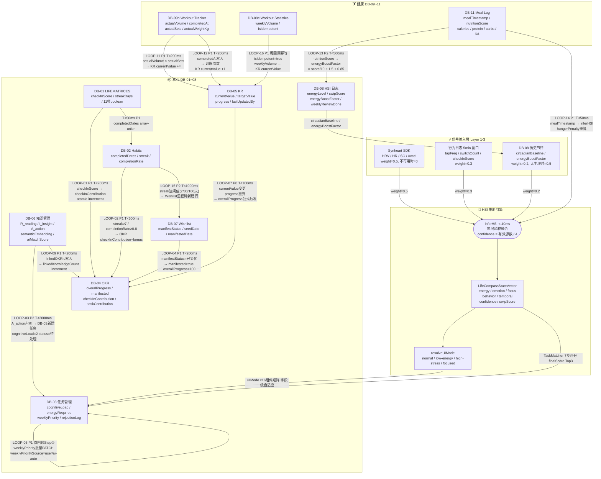
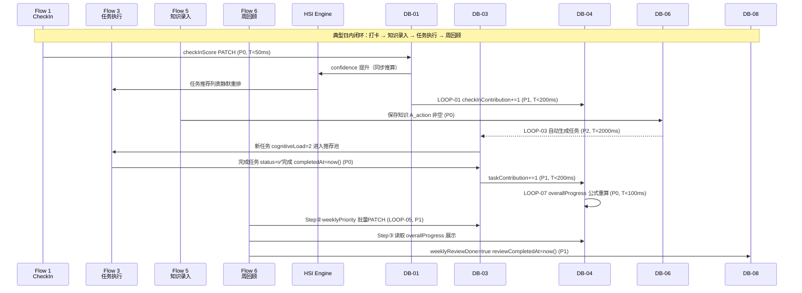
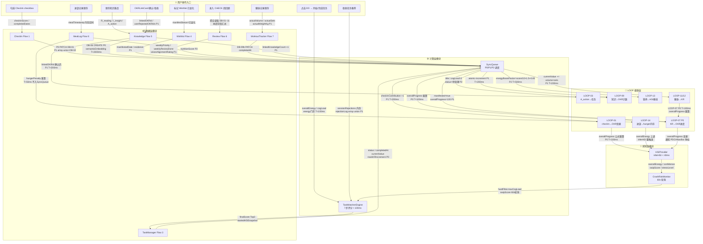
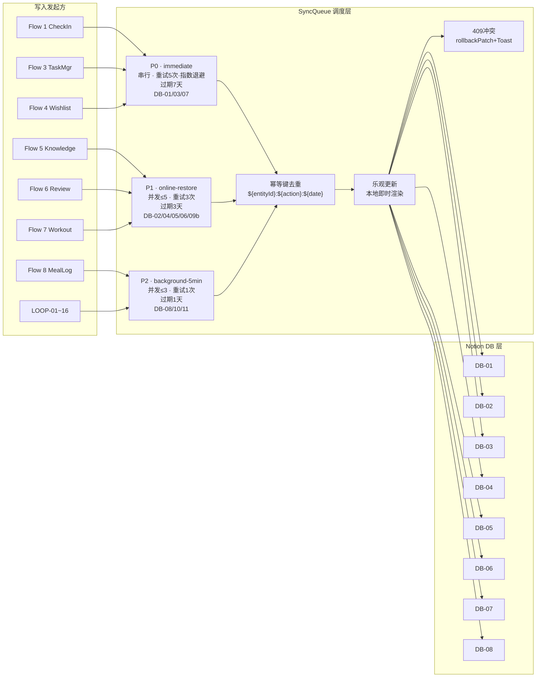
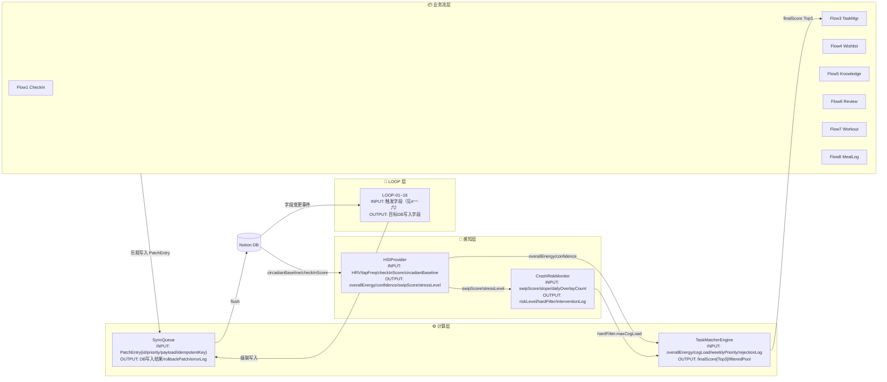

# 一·五、全局数据闭环架构图

> 系统全局视图：信号输入 → HSI 推断 → UI 自适应 → 用户操作 → 数据写入 → 闭环反哺 HSI。所有 LOOP 编号与第十七节对齐。
> 



---

# 一·六、DB × LOOP 字段一致性速查矩阵

> 本节为 DB-01~12 接口定义与 LOOP-01~16 触发链路的**完整交叉引用验证矩阵**，精确到触发源字段 → 触发条件 → 写入目标字段 → 操作类型 × 优先级 × 时序。
> 

> 与 **# 一·五** Mermaid 架构图、**# 十·五** TypeScript 接口定义、**# 十·六** LOOP 完整链路汇总表三节完全对齐。任何 DB 字段变更需同步更新本矩阵。
> 

## LOOP-01~16 触发-写入全量对照表

| LOOP # | 触发源 DB | 触发字段（读） | 触发条件 | 写入目标 DB | 写入字段（写） | 操作类型 | SyncQueue 优先级 | 时序 T+ | 幂等键规范 |
| --- | --- | --- | --- | --- | --- | --- | --- | --- | --- |
| LOOP-01 | DB-01 LIFEMATRICES | `checkInScore` / `[fieldName]: boolean` | checkbox 勾选，`linkedOKRId` 非空 | DB-04 OKR | `checkInContribution` += `checkInWeight`（默认 1） | atomic-increment | P1 | T<200ms | `${checkInId}:${today()}:loop01` |
| LOOP-02 | DB-02 Habits | `streak` / `completionRate` | `streak ≥ 7` 或 `completionRate ≥ 0.8` | DB-04 OKR | `checkInContribution` += bonus（奖励加成） | atomic-increment | P1 | T<500ms | `${habitId}:${today()}:loop02-bonus` |
| LOOP-03 | DB-06 知识管理 | `A_action` / `knowledgeId` | `A_action` 非空（保存时触发） | DB-03 任务管理 | `title`=A_action, `cognitiveLoad`=2, `status`='🕐 待处理', `priority`='P2-中', `generatedFromKnowledge`=knowledgeId | create | P2 | T<2000ms | `${knowledgeId}:loop03` |
| LOOP-04 | DB-07 Wishlist | `manifestStatus` / `linkedOKRId` | `manifestStatus` 变更为 '✨ 已显化' | DB-04 OKR | `manifested`=true, `overallProgress`=100 | patch | P1 | T<200ms | `${wishId}:loop04` |
| LOOP-05 | DB-03 任务管理 | `weeklyPriority` / `weeklyPrioritySource` | 周回顾 Step② 用户确认排序（或 AI 自动分配） | DB-03 任务管理 | `weeklyPriority`=userAssignedRank, `weeklyPrioritySource`='user'|'ai-auto' | patch（批量 PATCH） | P1 | 周回顾 Step② 确认时 | `review:${weekEnd}:loop05:${taskId}` |
| LOOP-06 | DB-01 LIFEMATRICES | `linkedPlanId`（REL-06）/ `completedAt` | 打卡勾选，`linkedPlanId` 非空 | DB-09b Workout Tracker | `completedAt`=now(), `linkedCheckInField`=fieldName | patch | P1 | T<200ms | `${checkInId}:${today()}:loop06` |
| LOOP-07 | DB-05 KR | `currentValue` / `targetValue` / `progress` | `currentValue` 任意变更（手动 / LOOP-11/12/16 写入） | DB-04 OKR | `overallProgress` 公式重算（= mean(KR.progress[])） | formula-trigger（服务端公式） | P0 | T<100ms | `${krId}:${now()}:loop07` — `isIdempotent=false`（进度实时变化） |
| LOOP-08 | DB-08 HSI 日志 | `circadianBaseline` / `energyBoostFactor` | 每日节律学习器 30日滑动窗口更新（inferHSI Layer 3） | DB-08 HSI 日志 | `circadianBaseline.typicalEnergyLevel`, `circadianBaseline.typicalStressLevel`, `circadianBaseline.sampleCount`（滚动均值更新） | patch | P2 | T<1000ms（后台节律学习，非实时） | `circadian:${timeOfDay}:${today()}:loop08` |
| LOOP-09 | DB-06 知识管理 | `linkedOKRId`（用户确认关联后写入） | `linkedOKRId` 非空（OKRLinkSuggestionCard onConfirm） | DB-04 OKR | `linkedKnowledgeCount` += 1 | atomic-increment | P1 | T<200ms | `${knowledgeId}:loop09` |
| LOOP-10 | DB-10a/b/c 营养四库 | `mealPlanId` / `recipeId` / `groceryStatus` | Meal Plan 确认 → Recipe 关联 → 购物清单状态更新 | DB-11 Meal Log | `linkedMealPlanId`, `linkedRecipeId`, `nutritionScore`（来自 Recipe 营养字段聚合） | patch | P2 | T<500ms | `meallog:${mealDate}:${mealType}:loop10` |
| LOOP-11 | DB-09b Workout Tracker | `actualVolume` / `actualSets` / `actualWeightKg` | 训练记录保存，关联 KR（`linkedKRId` 非空） | DB-05 KR | `currentValue` += `actualVolume × actualSets` | atomic-increment | P1 | T<200ms | `${workoutId}:loop11` |
| LOOP-12 | DB-09b Workout Tracker | `completedAt` / `linkedKRId`（训练次数 KR） | `completedAt` 写入（训练完成） | DB-05 KR | `currentValue` += 1（训练次数计数） | atomic-increment | P1 | T<200ms | `${workoutId}:loop12` |
| LOOP-13 | DB-11 Meal Log | `nutritionScore`（0–10） | Meal Log 保存，`nutritionScore` 非空 | DB-08 HSI 日志 | `energyBoostFactor` = `nutritionScore / 10 × 1.5 + 0.85` | patch | P2 | T<500ms | `meallog:${mealId}:loop13` |
| LOOP-14 | DB-11 Meal Log | `mealTimestamp` | `mealTimestamp` 写入（进餐记录） | HSIProvider（内存） | `lastMealTimestamp` → `inferHSI` `hungerPenalty` 重算（`= clamp((hoursHungry-2)/6, 0, 0.5)`） | 内存更新（非 DB 写入） | P1 | T<50ms | 无（内存实时，不入 SyncQueue） |
| LOOP-15 | DB-02 Habits | `streak`（连续打卡天数） | `streak` 达到阈值：7 / 30 / 100 天 | DB-07 Wishlist（里程碑区） | 新建行：`title`=`[习惯里程碑] ${habitName} 连续 ${streak} 天`, `linkedHabitId`, `date`=today() | create | P2 | T<1000ms | `${habitId}:streak${streak}:loop15` |
| LOOP-16 | DB-09c Workout Statistics | `weeklyVolume` / `isIdempotent` | 周回顾触发，`isIdempotent=true` 防重复写入 | DB-05 KR | `currentValue` = `weeklyVolume`（覆盖写入，非增量） | patch（幂等覆盖） | P1 | T<200ms（周回顾时批量） | `stats:${weekEnd}:${krId}:loop16` — `isIdempotent=true` |

## DB 字段被引用次数统计（触发侧 × 写入侧）

| 数据库 | 作为触发源的 LOOP | 作为写入目标的 LOOP | 关键跨库字段 |
| --- | --- | --- | --- |
| DB-01 LIFEMATRICES | LOOP-01, LOOP-06 | — | `checkInScore`, `linkedOKRId`, `linkedPlanId` |
| DB-02 Habits | LOOP-02, LOOP-15 | （DB-01 → completedDates array-union，非 LOOP 编号） | `streak`, `completionRate`, `completedDates` |
| DB-03 任务管理 | LOOP-05 | LOOP-03, LOOP-05 | `cognitiveLoad`, `weeklyPriority`, `weeklyPrioritySource`, `rejectionLog`, `A_action`→`generatedFromKnowledge` |
| DB-04 OKR | LOOP-04（反向） | LOOP-01, LOOP-02, LOOP-04, LOOP-07（公式侧）, LOOP-09 | `overallProgress`（公式字段）, `checkInContribution`, `taskContribution`, `manifested`, `linkedKnowledgeCount` |
| DB-05 KR | LOOP-07 | LOOP-11, LOOP-12, LOOP-16 | `currentValue`, `targetValue`, `progress`（公式）, `lastUpdatedBy` |
| DB-06 知识管理 | LOOP-03, LOOP-09 | LOOP-03（generatedTaskId 回写） | `A_action`, `linkedOKRId`, `semanticEmbedding`, `aiMatchScore`, `userRejectedOKRIds` |
| DB-07 Wishlist | LOOP-04 | LOOP-15 | `manifestStatus`, `seedDate`, `manifestedDate`, `linkedOKRId`, `visionAlignmentRating`, `visionAlignmentQuickAnswer`, `reviewSkippedByUIMode` |
| DB-08 HSI 日志 | LOOP-08（节律 → inferHSI Layer 3） | LOOP-08, LOOP-13 | `energyBoostFactor`, `circadianBaseline`, `weeklyReviewDone`, `swipScore`, `dailyRecoveryCardCount` |
| DB-09b Workout Tracker | LOOP-11, LOOP-12 | LOOP-06 | `actualVolume`, `actualSets`, `actualWeightKg`, `completedAt` |
| DB-09c Workout Statistics | LOOP-16 | — | `weeklyVolume`, `isIdempotent` |
| DB-10a/b/c 营养四库 | LOOP-10 | — | `mealPlanId`, `recipeId`, `groceryStatus`, `nutritionScore`（来源字段） |
| DB-11 Meal Log | LOOP-13, LOOP-14 | LOOP-10 | `nutritionScore`, `mealTimestamp`, `calories`, `protein`, `carbs`, `fat` |
| DB-12 UserPrefs | —（偏好读取，不触发 LOOP） | — | `celebrationDuration`, `uiModeOverride`, `notificationPrefs`（影响 UIMode 渲染，不参与数据闭环） |

## 关键一致性校验规则

<aside>
✅

**字段命名一致性**：所有 LOOP 中的字段名与对应 DB TypeScript 接口（# 十·五）完全对齐。v4.4 新增字段（`weeklyPrioritySource` / `visionAlignmentRating` / `visionAlignmentQuickAnswer` / `reviewSkippedByUIMode`）已在本矩阵中反映。

</aside>

<aside>
⚡

**幂等性规则**：LOOP-16（`isIdempotent=true`，周统计覆盖写入）；LOOP-07（`isIdempotent=false`，KR 进度实时变化需每次触发）；其余 LOOP 通过幂等键（`SyncQueueEntry.id`）保证不重复写入。

</aside>

<aside>
🔗

**跨库级联校验**：LOOP-07 是核心级联节点——任何修改 `DB-05.currentValue` 的操作（LOOP-11/12/16）都会经 LOOP-07 触发 `DB-04.overallProgress` 公式重算，形成 DB-09b → DB-05 → DB-04 三级级联，P0 优先级保障 T<100ms 完成。

</aside>

---

# 一·七、系统约束边界 & 性能时序全览

> 本节汇总系统所有关键时序限制、频率上限、数量边界，供工程实现与 QA 验收使用。所有值均为**硬性约束**，不可降级妥协。
> 

## ⚡ 性能时序约束（T < Xms）

| 约束项 | 时序上限 | 触发场景 | 超时降级策略 |
| --- | --- | --- | --- |
| `TaskMatcherEngine` | **< 100ms** | PDCANavBar「DO」进入 / 「换一批」 | 离线用 IndexedDB 缓存快照 |
| DB-01 打卡写入（P0） | **T < 50ms** | checkbox 勾选 → LIFEMATRICES PATCH | SyncQueue 入队，乐观更新 |
| LOOP-14 进餐内存更新 | **T < 50ms** | mealTimestamp 写入 → hungerPenalty 重算 | 不入 SyncQueue（内存实时） |
| DB-05 KR 公式触发（P0 / LOOP-07） | **T < 100ms** | `currentValue` 任意变更 | isIdempotent=false 保持实时 |
| DB-07 Wishlist 写入（P1） | **T < 200ms** | LOOP-04 manifestStatus 变更 | — |
| AI 语义分析（OKR 匹配） | **T < 2000ms** | 知识保存后异步 | 超时不触发 OKRLinkSuggestionCard |
| LOOP-08 节律学习更新 | **T < 1000ms** | 30 日滚动窗口均往更新 | P2，sampleCount < 7 下调置信 |
| SyncQueue P2 flush 间隔 | 每 **5min** | 后台低优先级写入 | — |
| CrashRiskMonitor 轮询 | 每 **60s** | swipScore + slope 重算 | — |

## 🕒 频率上限 & 数量边界

| 约束项 | 限额 / 边界 | 作用域 | 超限处理 | CrashInterventionOverlay 触发 | ≤ **2 次 / 天** | 每日重置 | 超过后 silent mode 继续，不弹层 |
| --- | --- | --- | --- | --- | --- | --- | --- |
| RecoveryCard （gentle/moderate） | ≤ **3 次 / 天** | 每日重置 | urgent 不受频率限制 | RecoveryCard 冷却期（onAccept 后） | **20min** | TaskMatcherEngine hardFilter 生效期 | 冷却内不再插入 |
| RecoveryCard 重触发间隔（onDismiss 后） | **5min** | swipScore 未降则重试 | 5min 内不重复触发 | OKRLinkSuggestionCard 超时 | **30s** 无操作自动收起 | 单次显示 | 不写入 userRejectedOKRIds |
| TaskRecommendList maxVisible | **3 条** | 每次推荐 | 「换一批」重排次优推荐 | rejectionLog 记忆窗口 | **7 天 / 同能量状态** | 衍减计算范围 | 超 7 天历史拒绝不影响分 |
| rejectionPenalty 最低值 | **0.1**（≥ 4 次拒绝时） | 任务推荐分 | 不完全屏蔽，保留 10% 权重 | SyncQueue P0 maxRetries | **5 次**（指数退避 1→2→4→8→16s） | 网络失败重试 | 超限保留乐观状态 + Toast |
| SyncQueue P1 maxRetries | **3 次** | — | 同上 | SyncQueue P2 maxRetries | **1 次** | — | 静默丢弃，写入 errorLog |
| SyncQueue P0 flush 并发 | 串行（限 1） | 保序写入 DB-01/03/07 | — | SyncQueue P1 flush 并发 | 最多 **5 并发** | — | — |
| SyncQueue P2 flush 并发 | 最多 **3 并发** | — | — | SyncQueue P0 过期丢弃 | **7 天** | — | 过期后条目被移除 |
| SyncQueue P1 过期丢弃 | **3 天** | — | — | SyncQueue P2 过期丢弃 | **1 天** | — | — |
| 节律学习 sampleCount 最少安全值 | **7 个样本** | circadianBaseline 置信度 | < 7 时 confidence 下调 | 节律学习窗口 | **30 日** | 滚动均値计算范围 | — |
| LOOP-15 习惯里程碑阈値 | **7 / 30 / 100 天** | streak 达到时触发 | 幂等键：`${habitId}:streak${n}:loop15` | OKRLinkSuggestionCard 触发阈値 | aiMatchScore > **0.65** | 匹配切分最低要求 | 不达阈値静默写入 aiSuggestedOKRId |
| OKR 匹配 「高度匹配」显示阈値 | aiMatchScore ≥ **0.85** | 卡片文案 | 0.65–0.85 显示「可能相关」 | ManifestationCelebration 默认时长 | **3000ms** | 全屏庆祝动效 | 可由 DB-12.celebrationDuration 覆盖 |

<aside>
📌

**与 # 零 速查卡的关系**：# 零 展示精华阈值结果（汚出収区）；# 一·七 进一步补充触发场景、降级策略、并发度、过期时间等工程实现所需的所有细节。

</aside>

---

# 一·八、跨 Flow 字段流转全景图

> 6 大功能流程（Flow 1–6）通过共享 DB 字段形成多向数据闭环。本节定义各 Flow 之间的字段交接点、传递方向与跨 Flow LOOP 触发链路，精细到字段名 × 操作类型 × 生效时序。配合 **# 一·五** 架构图、**# 一·六** LOOP 矩阵联合阅读。
> 

## Flow 间数据交接矩阵（上下游字段依赖）

| 上游 Flow（产出方） | 产出字段（写入 DB） | 下游 Flow（消费方） | 消费路径 | 关联 LOOP | 生效延迟 | **Flow 1** CheckIn 打卡 | `DB-01.checkInScore` | Flow 3 TaskMatcher | HSI `confidence` 提升 → 任务推荐静默重排 | — | T<50ms |
| --- | --- | --- | --- | --- | --- | --- | --- | --- | --- | --- | --- |
| **Flow 1** CheckIn 打卡 | `DB-01.checkInScore` → `DB-04.checkInContribution` | Flow 6 Step③ OKR 汇总 | OKR 贡献度数据源，`overallProgress` 公式因子 | LOOP-01 | T<200ms | **Flow 1** CheckIn 打卡 | `DB-02.completedDates` → `streak` | Flow 4 Wishlist 里程碑 | `streak` 达阈值（7/30/100天）→ 里程碑自动新建 | LOOP-15 | T<1000ms |
| **Flow 1** CheckIn 打卡 | `DB-08.checkInScore`（`swipScore` 保护分 −5） | Flow 2 崩溃干预 | `computeSwipScore` 保护项，降低崩溃风险分 | — | T<60s 轮询 | **Flow 3** 任务完成 | `DB-03.status='✅ 完成'` / `completedAt` / `completedHSISnapshot` | Flow 6 Step② 任务回顾 | 本周完成率统计主数据源 | — | 即时（乐观更新） |
| **Flow 3** 任务完成 | `DB-04.taskContribution += 1` | Flow 6 Step③ OKR 展示 | OKR 任务贡献统计，触发 `overallProgress` 重算 | LOOP-07（间接） | T<200ms | **Flow 3** 任务拒绝 | `DB-03.rejectionLog\[\]`（含 `hsiSnapshot.energyLevel`） | Flow 3 下次推荐 | `rejectionPenalty` 7 日同能量状态衰减系数 | — | 7 日内滚动生效 |
| **Flow 5** 知识录入 | `DB-06.A_action` → `DB-03` 新任务行 | Flow 3 TaskMatcher | 新任务（`cognitiveLoad=2`）进入推荐池 | LOOP-03 | T<2000ms | **Flow 5** 知识录入 | `DB-06.linkedOKRId` → `DB-04.linkedKnowledgeCount += 1` | Flow 6 Step③ OKR 展示 | OKR 知识关联数统计 | LOOP-09 | T<200ms |
| **Flow 6** Step② 周回顾 | `DB-03.weeklyPriority` / `weeklyPrioritySource` | Flow 3 TaskMatcher | `weeklyPriority` 纳入 `baseScore` 推荐排序 | LOOP-05 | 本周 DO 进入时生效 | **Flow 6** Step④ 周回顾 | `DB-07.visionAlignmentRating` / `visionAlignmentQuickAnswer` | Flow 4 ManifestationHistory | 愿景对齐历史记录可查阅 | — | 即时 |
| **Flow 4** 愿景显化 | `DB-07.manifestStatus='已显化'` → `DB-04.manifested=true` | Flow 6 Step③ OKR 展示 | OKR 显化状态标注，`overallProgress=100` | LOOP-04 | T<200ms | **Flow 2** 崩溃干预 `onAccept` | `DB-08.dailyRecoveryCardCount += 1` | Flow 3 TaskMatcher | `hardFilter` 启用 20min，`cognitiveLoad ≥ 4` 任务屏蔽 | — | 即时（内存） |

## 健康数据 → HSI 反馈跨模块交接矩阵

| 上游 Flow（产出方） | 产出字段（写入 DB） | 下游消费方 | 消费路径 | 关联 LOOP | 生效延迟 |
| --- | --- | --- | --- | --- | --- |
| **Flow 7** 健身记录 | `DB-09b.actualVolume` × `actualSets` | DB-05 KR（运动量类型） | `currentValue += totalVolume`，LOOP-07 触发 OKR 进度重算 | LOOP-11 → LOOP-07 | T<200ms → T<100ms |
| **Flow 7** 健身记录 | `DB-09b.completedAt`（训练完成时间戳） | DB-05 KR（训练次数类型） | `currentValue += 1`，LOOP-07 触发 OKR 进度重算 | LOOP-12 → LOOP-07 | T<200ms → T<100ms |
| **Flow 7** 健身记录 | `DB-09b.completedAt`  • `DB-09c.weeklyVolume` | Flow 6 Step③ OKR 汇总 | 周统计数据作为 KR.currentValue 覆盖写入基准（LOOP-16 触发侧） | LOOP-16（周回顾触发） | 周回顾 Step② 确认时 |
| **Flow 7** 健身记录 | `DB-08.exercisedToday=true`  • `exercisedAt` | HSI Engine Layer 3 | 当日 `energyBoostFactor += 0.1`，次日节律学习纳入样本 | LOOP-08（次日节律更新） | T<500ms（当日异步） |
| **Flow 7** 健身记录 | `DB-09b` PR 检测：`actualWeightKg > historical max` | Flow 4 ManifestationHistory | 自动新建 DB-07 里程碑行 `category='健身里程碑'` | —（独立写入，非 LOOP-15 路径） | T<500ms（完成动效后） |
| **Flow 8** 饮食记录 | `DB-11.mealTimestamp`（进餐时间） | HSI Engine（内存实时） | LOOP-14：`hungerPenalty` 立即重算 → `inferHSI` 重新调用 → `overallEnergy` 可能上调 | LOOP-14（纯内存，T<50ms） | T<50ms（进餐即时生效） |
| **Flow 8** 饮食记录 | `DB-11.nutritionScore`（0–10 营养评分） | DB-08 HSI 日志 → inferHSI Layer 3 | LOOP-13：`energyBoostFactor = score/10×1.5+0.85`，影响当日及次日能量推断基线 | LOOP-13 → LOOP-08（次日） | T<500ms（异步 P2） |
| **Flow 8** 饮食记录 | `DB-11.linkedMealPlanId`  • 营养宏量字段 | Flow 6 Step① BrainDumpBox / WeeklyDataSummary | 本周 `avgNutritionScore` 聚合展示：`avg(nutritionScore) WHERE mealTimestamp ∈ 本周` | —（SQL 聚合，非 LOOP） | 周回顾进入时实时计算 |
| **Flow 1** CheckIn → **Flow 7** 健身 | `DB-01.linkedPlanId`（REL-06 打卡关联健身计划） | DB-09b Workout Tracker | LOOP-06：`completedAt=now()`  • `linkedCheckInField` 预写入，WorkoutTrackerScreen 补录详情 | LOOP-06 | T<200ms（打卡时） |
| **Flow 2** 崩溃干预 `onAccept` | `DB-08.interventionLog[]`  • `dailyRecoveryCardCount` | Flow 7 建议 | urgent 干预后推荐 category='恢复/休息' 运动（如拉伸/散步），`cognitiveLoad=1` 任务过滤 | —（内存 hardFilter 联动） | 即时（20min 冷却） |

## CrashInterventionOverlay 完整字段写入规范

```tsx
// ── 触发入口 & 渲染模式判定 ─────────────────────────────────────
// CrashRiskMonitor 60s 轮询完成后：
//   resolveRiskLevel(score, slope) === 'high'     → mode='suggestion'（底部抽屉）
//   resolveRiskLevel(score, slope) === 'critical'  → mode='fullscreen'（全屏覆盖）
//
// 频率门禁（DB-08 字段驱动）：
//   读取 DB-08 当日行：
//     dailyOverlayCount  （今日已触发次数）
//     lastOverlayShownAt （最近一次显示时间）
//   if dailyOverlayCount >= 2: 跳过（silent mode 继续监听）
//   if now - lastOverlayShownAt < 1800000 (30min): 跳过

// ── 完整字段渲染规范 ─────────────────────────────────────────────
interface CrashInterventionOverlayProps {
  mode:       'suggestion' | 'fullscreen';
  swipScore:  number;          // 来自 HSIProvider.swipScore（进度条可视化）
  slope:      number;          // 来自 computeSwipSlope（「正在上升 +${slope}/s」文案）
  riskLevel:  'high' | 'critical';
  onRest:     () => void;      // 「好，去休息」
  onDismiss?: () => void;      // fullscreen 模式无 dismiss（强制休息）
}

// 渲染字段映射：
// - swipScore 进度条：0–100，critical 区间（>90）红色
// - slope 文案：「⚠️ 压力值正在上升（${(slope * 60).toFixed(1)}/min）」
// - riskLevel='critical' → 隐藏所有 PLAN/DO 按钮（AppFSM.disableNavFor(20min)）
// - 恢复建议 SOP（按 riskLevel 选择）：
//     high:     ['5min 拉伸', '离开屏幕走走', '喝一杯水']
//     critical: ['停止工作', '深呼吸 3min', '闭眼冥想 5min', '睡 20min']
// - UIMode 强制切换：high-stress（关闭所有动效，饱和度 60%）

// ── 完整字段写入时序 ─────────────────────────────────────────────
// [触发时]
// T+0ms   DB-08 写入：
//   PATCH 当日行：
//     { dailyOverlayCount:   atomic-increment +1,
//       lastOverlayShownAt:  now(),
//       interventionLog:     array-union {
//         shownAt:    now(),
//         swipScore:  current,
//         riskLevel:  'high' | 'critical',
//         mode:       'suggestion' | 'fullscreen',
//       }}
//   幂等键：`intervention:${today()}:${Math.floor(now/60000)}` — 同分钟内不重复

// [onRest 用户点击「去休息」]
// T+0ms   DB-08 写入：
//   PATCH 当日行：
//     { dailyRecoveryCardCount: atomic-increment +1,
//       lastRecoveryDismissAt:  —（不写，此为 accept 非 dismiss）,
//       interventionLog[-1].acceptedAt: now() }
//   → CrashRiskMonitor 进入 30min 冷却（lastOverlayShownAt 已写入）
//   → AppFSM.disableNav('DO', 20min)（TaskManagerScreen PLAN/DO 禁用）
//   → TaskMatcherEngine.hardFilter = { maxCognitiveLoad: 2 } 启用 20min

// [mode='fullscreen' 强制处理]
// T+0ms   AppFSM 状态写入（内存）：
//   { forcedScreen: 'RecoveryScreen', disabledRoutes: ['DO', 'PLAN'],
//     disabledUntil: now() + 20 * 60 * 1000 }
//   → PDCANavBar DO/PLAN 按钮显示倒计时（「休息中 XX:XX」）
//   → 20min 后 AppFSM 自动恢复，不写 DB
```

## 六 Flow 字段读写总览

| Flow | 入口屏幕 | 主读 DB & 核心字段 | 主写 DB & 核心字段 | 触发 LOOP |
| --- | --- | --- | --- | --- |
| **Flow 2** 崩溃干预 | CrashInterventionOverlay（全局浮层） | DB-08.`swipScore` / HSI.`stressLevel` / `mentalCapacity` | DB-08.`dailyRecoveryCardCount` / `lastRecoveryDismissAt` / `interventionLog` | — |
| **Flow 4** 愿景显化 | WishlistScreen | DB-07.`manifestStatus` / `seedDate` / DB-04.`title`（OKR 关联） | DB-07.`manifestedDate` / `evidence` / `visionAlignmentRating` / DB-04.`manifested` | LOOP-04, 15 |
| **Flow 6** 周回顾 | ReviewScreen | DB-01（本周7天）/ DB-03.`completionRate` / DB-04.`overallProgress` / DB-05.`currentValue` / DB-08.`energyLevel\[\]` | DB-03.`weeklyPriority` / DB-07.`visionAlignmentRating` / DB-08.`weeklyReviewDone` | LOOP-05, 16 |

## 关键跨 Flow 级联时序图



---

# 一·十一、模块操作动线全景 · 用户行为 → 模块调用链 → 字段交接点

> 本节以「用户触发的一次完整操作」为最小单元，追踪该操作在模块间的完整调用链，精确到每个模块接收的输入字段、执行的计算、输出的字段，以及移交给下一个模块的时序约束。
> 

> **阅读顺序**：先看「操作事件」→ 沿箭头追踪「模块调用链」→ 查看每个模块节点的「字段交接规范」。
> 

---

## A · 操作动线地图（9 大核心用户操作 × 模块调用链）



---

## B · 9 大核心操作 · 字段级调用链规范

### B-1 · 勾选 CheckIn checkbox

```
用户操作：CheckInTable checkbox 勾选
│
├─ [M-HSI 前置] HSIProvider.inferHSI()
│     读取：DB-08.circadianBaseline / energyBoostFactor
│             行为日志 tapFreq / switchCount
│             Synheart HRV（如可用）
│     输出：energy.overallEnergy / confidence / swipScore（内存）
│
├─ [M-CheckIn] 乐观更新 + SyncQueue 入队
│     写入路径 A（P0, T<50ms）→ SyncQueue → DB-01
│       PATCH { [fieldName]: true, updatedAt: now() }
│       服务端公式：checkInScore = checkedCount / 11
│     写入路径 B（P1, T<50ms）→ SyncQueue → DB-02（linkedHabits 存在）
│       array-union { completedDates: [today()] }
│       服务端公式：streak = 连续天数重算
│
├─ [M-HSI 感知] HSIProvider 响应 checkInScore 变更
│     checkInScore↑ → Layer2 权重更新 → confidence 提升
│     confidence ≥ 0.75 → MiniCheckIn 隐藏
│     → TaskMatcherEngine 静默重排（内存，< 50ms）
│
├─ [LOOP-01] DB-04 checkInContribution 写入（P1, T<200ms）
│     条件：DB-01.linkedOKRId 非空
│     atomic-increment { checkInContribution: +checkInWeight }
│     幂等键：`${checkInId}:${today()}:loop01`
│     → 触发 DB-04 overallProgress 服务端公式重算
│     → LOOP-07(P0, T<100ms)：DB-05.progress[] → DB-04.overallProgress
│
├─ [LOOP-06] DB-09b 预写入（P1, T<200ms，linkedPlanId 存在）
│     PATCH { completedAt: now(), linkedCheckInField: fieldName }
│     幂等键：`${checkInId}:${today()}:loop06`
│
├─ [M-CrashRisk] swipScore 保护分计算（异步，60s 窗口内）
│     checkInProtection = checkInScore × 5
│     若 swipScore 降出 medium 区 → TodayZone.isHighStress=false
│
└─ [LOOP-15] 习惯里程碑检查（P2, T<1000ms，streak ∈ {7,30,100}）
      CREATE DB-07 { title, linkedHabitId, date: today() }
      幂等键：`${habitId}:streak${streak}:loop15`
```

---

### B-2 · 点击「DO」进入任务执行 + 完成任务

```
用户操作：PDCANavBar「DO」→ 选择任务 →「▶开始」→「✅完成」
│
├─ [M-HSI] 进入屏幕前读取
│     读取：energy.overallEnergy / focus.mentalCapacity / emotion.stressLevel
│             temporal.timeOfDay / swipScore（全部内存）
│
├─ [M-TaskMatcher] 7步评分（T<100ms，纯内存）
│     Step1  能量硬性门禁：energyGap = task.energyRequired - hsi.overallEnergy
│             energyGap > 2 → 直接过滤，不进推荐池
│     Step2  读取 DB-03 字段：
│             cognitiveLoad / energyRequired / estimatedMinutes
│             bestTimeSlot / dueDate / weeklyPriority / rejectionLog
│     Step3  时间槽匹配：bestTimeSlot ∩ temporal.timeOfDay → +timeBonus
│     Step4  截止日期紧迫度：daysUntilDue ≤ 2 → +urgencyBonus
│     Step5  周优先级加权：weeklyPriority × 0.2 → baseScore 分量
│     Step6  拒绝惩罚：rejectionLog(7日同能量) → rejectionPenalty ∈ [0.1, 1.0]
│     Step7  OKR 对齐加分：linkedOKRId 存在 → +alignBonus
│     输出：finalScore Top3（内存，不写 DB）
│
├─ [M-TaskManager] 开始任务（P0, T<50ms）
│     SyncQueue P0 → DB-03
│       PATCH { status: '⏳进行中',
│               startedAt: now(),
│               startedHSISnapshot: {
│                 energyLevel: hsi.overallEnergy,
│                 mentalCapacity: hsi.mentalCapacity,
│                 stressLevel: hsi.stressLevel } }
│       幂等键：`${taskId}:${today()}:start`
│
├─ [M-TaskManager] 完成任务（P0, T<50ms）
│     SyncQueue P0 → DB-03
│       PATCH { status: '✅完成',
│               completedAt: now(),
│               completedHSISnapshot: { ...当前HSI快照 },
│               actualMinutes: completedAt - startedAt }
│       幂等键：`${taskId}:${today()}:complete`
│
├─ [LOOP-07 间接] DB-04 taskContribution（P1, T<200ms，linkedOKRId 存在）
│     SyncQueue → DB-04: atomic-increment { taskContribution: +1 }
│     → DB-04 服务端公式：overallProgress = mean(KR.progress[])
│
├─ [LOOP-07] DB-05.currentValue 变更级联（P0, T<100ms，linkedKRId 存在）
│     SyncQueue → DB-05:
│       PATCH { currentValue: currentValue + taskKRIncrement,
│               lastUpdatedBy: 'task-complete' }
│     → LOOP-07 立即触发：DB-04.overallProgress 公式重算
│     → PDCANavBar OKR 角标实时更新
│
└─ [M-HSI 反馈] 完成后能量快照对比
      completedHSISnapshot vs startedHSISnapshot
      → 若 stressLevel↑ > 0.2：下次 inferHSI Layer2 tapFreq 权重修正
```

---

### B-3 · 保存知识条目（含 AI 语义分析链路）

```
用户操作：KnowledgeEntryForm 填写 R/I/A → 保存
│
├─ [M-Knowledge] P0 同步写入 DB-06（T<50ms）
│     SyncQueue P0 → DB-06 CREATE/PATCH:
│       { title, sourceType,
│         R_reading, I_insight, A_action,
│         createdAt: now() }
│     幂等键：`knowledge:${title}:${today()}:save`
│
├─ [AI 语义引擎] 异步分析（T<2000ms，后台 worker）
│     输入字段：DB-06.R_reading + I_insight（文本拼接）
│     计算：semanticEmbedding（向量化）
│             cosine_similarity(embedding, OKR.embedding[]) → aiMatchScore[]
│             argmax(aiMatchScore) → aiSuggestedOKRId
│     SyncQueue P1 → DB-06:
│       PATCH { semanticEmbedding: vector,
│               aiSuggestedOKRId: bestMatchId,
│               aiMatchScore: maxScore }
│     分支判断：
│       aiMatchScore > 0.85 → OKRLinkSuggestionCard 文案「高度匹配」
│       aiMatchScore 0.65–0.85 → OKRLinkSuggestionCard 文案「可能相关」
│       aiMatchScore < 0.65 → 静默写入 aiSuggestedOKRId，不渲染卡片
│
├─ [LOOP-03] A_action 非空 → 自动生成任务（P2, T<2000ms）
│     条件：DB-06.A_action.trim().length > 0
│     SyncQueue P2 → DB-03 CREATE:
│       { title: A_action文本,
│         cognitiveLoad: 2,
│         status: '🕐 待处理',
│         priority: 'P2-中',
│         generatedFromKnowledge: knowledgeId }
│     幂等键：`${knowledgeId}:loop03`
│     回写 SyncQueue P2 → DB-06:
│       PATCH { generatedTaskId: newTaskId }
│     → 新任务进入 TaskMatcher 推荐池（下次 DO 进入生效）
│
└─ [字段交接] → 等待用户操作 OKRLinkSuggestionCard（见 B-9）
```

---

### B-4 · 标记 Wishlist 已显化

```
用户操作：WishlistScreen → manifestStatus 下拉选「✨已显化」
│
├─ [M-Wishlist] 乐观更新 + P1 写入 DB-07（T<50ms）
│     SyncQueue P1 → DB-07:
│       PATCH { manifestStatus: '✨ 已显化',
│               manifestedDate: today(),
│               evidence: userInputText }
│       幂等键：`${wishId}:loop04`
│
├─ [LOOP-04] DB-04 显化写入（P1, T<200ms，linkedOKRId 存在）
│     SyncQueue P1 → DB-04:
│       PATCH { manifested: true, overallProgress: 100 }
│     → ManifestationCelebration 全屏动效触发（3000ms）
│       动效时长可由 DB-12.celebrationDuration 覆盖
│
├─ [LOOP-07 级联] DB-04.overallProgress=100 → KR 公式逻辑
│     注：overallProgress 直接 patch=100，非 KR 公式路径
│     → PDCANavBar OKR 角标立即显示 100%
│
└─ [字段回流] Flow 6 Step④ 反向写入（下次周回顾时）
      SyncQueue P1 → DB-07:
│       PATCH { visionAlignmentRating: 1–5,
│               visionAlignmentQuickAnswer: userText,
│               reviewSkippedByUIMode: uiMode==='low-energy' }
      → ManifestationHistory 历史趋势可查阅
```

---

### B-5 · 进入 CHECK 周回顾（含全链路数据聚合）

```
用户操作：PDCANavBar「CHECK」→ ReviewScreen 进入
│
├─ [M-Review] Step 0 · 聚合读取（SQL 实时计算，纯只读）
│     ── DB-01 聚合 ──
│       SELECT date, checkInScore FROM "dataSourceUrl"
│       WHERE date BETWEEN weekStart AND weekEnd
│       → WeeklyDataSummary 打卡分均值展示
│
│     ── DB-03 聚合 ──
│       SELECT count(status='✅完成') / count(*) → completionRate
│       SELECT title,weeklyPriority,dueDate WHERE status IN ('待处理','进行中')
│       → TaskReviewPanel pendingTasks[]
│
│     ── DB-04 聚合 ──
│       SELECT title,overallProgress,taskContribution,
│              checkInContribution,linkedKnowledgeCount
│       WHERE status='进行中'
│       → OKRProgressPanel 展示
│
│     ── DB-05 聚合 ──
│       SELECT title,currentValue,targetValue,progress,unit
│       WHERE linkedOKRId IN (进行中OKR)
│       → KR 进度条渲染
│
│     ── DB-08 聚合 ──
│       SELECT avg(energyLevel) WHERE date ∈ 本周
│       → 周能量均值展示
│
│     ── DB-11 聚合 ──
│       SELECT avg(nutritionScore) WHERE mealTimestamp ∈ 本周
│       → 周营养均值展示
│
│     ── DB-09c ──
│       SELECT weeklyVolume WHERE weekEnd=本周
│       → 周训练量展示（LOOP-16 数据源）
│
├─ [M-Review] Step② · 任务排序写入（LOOP-05, P1）
│     用户拖拽 OR AI 一键分配
│     SyncQueue P1 → DB-03 批量 PATCH:
│       forEach task:
│         { weeklyPriority: userAssignedRank,
│           weeklyPrioritySource: 'user' | 'ai-auto' }
│     幂等键：`review:${weekEnd}:loop05:${taskId}`
│     → 字段交接给 TaskMatcherEngine：
│       下周 DO 进入时 weeklyPriority 纳入 baseScore 排序
│
├─ [M-Review] Step③ · KR 手动修改（可选，P0）
│     SyncQueue P0 → DB-05:
│       PATCH { currentValue: userInput,
│               lastUpdatedBy: 'user-manual',
│               updatedAt: now() }
│     → LOOP-07(P0, T<100ms) 立即触发 DB-04.overallProgress 重算
│     LOOP-16（若本周有 DB-09c.weeklyVolume）:
│       SyncQueue P1 → DB-05:
│         PATCH { currentValue: weeklyVolume }（isIdempotent=true 覆盖）
│       幂等键：`stats:${weekEnd}:${krId}:loop16`
│
├─ [M-Review] Step④ · 愿景对齐写入（P1）
│     SyncQueue P1 → DB-07 forEach wishItem:
│       PATCH { visionAlignmentRating: 1–5,
│               visionAlignmentQuickAnswer: userText,
│               reviewSkippedByUIMode: false }
│
└─ [M-Review] 完成周回顾（P1）
      SyncQueue P1 → DB-08:
        PATCH { weeklyReviewDone: true, reviewCompletedAt: now() }
      幂等键：`review:${weekEnd}:done`
      → PDCANavBar CHECK 绿色完成标记
      → CrashRiskMonitor 下周基线保护分重置
```

---

### B-6 · 进餐记录保存

```
用户操作：MealLog 表单提交
│
├─ [M-MealLog] P1 写入 DB-11（T<50ms）
│     SyncQueue P1 → DB-11 CREATE:
│       { mealTimestamp: now(), mealType,
│         calories, protein, carbs, fat,
│         nutritionScore: 0–10（用户评分或公式计算）}
│
├─ [LOOP-14] 进餐即时触发 hungerPenalty 重算（纯内存，T<50ms）
│     不入 SyncQueue！直接内存操作
│     计算：hoursHungry = (now() - lastMealTimestamp) / 3600_000
│             hungerPenalty = clamp((hoursHungry - 2) / 6, 0, 0.5)
│             lastMealTimestamp = now() → hungerPenalty = 0
│     → HSIProvider.inferHSI() 立即重调用
│     → overallEnergy 可能上升（饥饿惩罚消除）
│     → TaskMatcherEngine 静默重排（内存，< 50ms）
│
└─ [LOOP-13] nutritionScore → energyBoostFactor（P2, T<500ms）
      SyncQueue P2 → DB-08:
        PATCH { energyBoostFactor:
                nutritionScore / 10 × 1.5 + 0.85 }
      幂等键：`meallog:${mealId}:loop13`
      → HSIProvider Layer3 energyBoostFactor 更新
      → 次日 inferHSI 历史节律基线上调
      → LOOP-08（次日节律学习）纳入样本
```

---

### B-7 · 健身记录保存（含 PR 检测）

```
用户操作：WorkoutTrackerScreen 补录 actualVolume / actualSets / actualWeightKg
│
├─ [M-WorkoutTracker] P1 写入 DB-09b（T<50ms）
│     SyncQueue P1 → DB-09b PATCH:
│       { actualVolume: number,
│         actualSets: number,
│         actualWeightKg: number,
│         completedAt: now() }
│
├─ [LOOP-11] 运动量 → KR currentValue（P1, T<200ms，linkedKRId=运动量类型）
│     SyncQueue P1 → DB-05:
│       atomic-increment { currentValue: +actualVolume × actualSets,
│                          lastUpdatedBy: 'loop11' }
│     幂等键：`${workoutId}:loop11`
│     → LOOP-07(P0, T<100ms)：DB-04.overallProgress 公式重算
│
├─ [LOOP-12] 训练次数 → KR currentValue（P1, T<200ms，linkedKRId=次数类型）
│     SyncQueue P1 → DB-05:
│       atomic-increment { currentValue: +1,
│                          lastUpdatedBy: 'loop12' }
│     幂等键：`${workoutId}:loop12`
│     → LOOP-07(P0, T<100ms)：再次触发 DB-04.overallProgress 重算
│
├─ [PR 检测] actualWeightKg > historical max（T<500ms）
│     查询 DB-09b: SELECT max(actualWeightKg) WHERE exerciseId=当前
│     若突破 → 独立写入 DB-07 CREATE:
│       { title: '[健身里程碑] ${exerciseName} PR ${actualWeightKg}kg',
│         category: '健身里程碑', date: today() }
│     → ManifestationHistory 新增里程碑条目
│
└─ [LOOP-08 前置] 当日节律样本写入（P2, T<500ms）
      SyncQueue P2 → DB-08:
        PATCH { exercisedToday: true, exercisedAt: now() }
      → 次日节律学习：energyBoostFactor += 0.1（circadianBaseline 滚动均值）
      → LOOP-08(P2, T<1000ms)：30日窗口 circadianBaseline 更新
```

---

### B-8 · 拒绝任务推荐（「换一批」）

```
用户操作：RecommendedTaskList 「换一批」/ 长按拒绝
│
├─ [M-TaskMatcher] 第一阶段：纯内存操作（T<10ms）
│     sessionRejections.push(taskId)
│     → 从当前 Top3 中移除该 taskId
│     → 重排次优推荐（内存重算，< 100ms）
│     → 渲染拒绝原因选择器（可选步骤）
│
├─ [用户选择拒绝原因] → P1 写入 DB-03（T<200ms）
│     SyncQueue P1 → DB-03:
│       array-union { rejectionLog: {
│         taskId, timestamp: now(),
│         reason: '太难'|'太简单'|'不想做',
│         hsiSnapshot: { energyLevel: hsi.overallEnergy }
│       }}
│     幂等键：`${taskId}:${now()}:reject`
│     → 7日内同能量状态生效：
│         recentRejections = count(rejectionLog WHERE
│           hsiSnapshot.energyLevel ∈ [currentEnergy±1]
│           AND timestamp > now()-7days)
│         rejectionPenalty = max(0.1, 1.0 - recentRejections × 0.25)
│
├─ [条件触发] 连续拒绝 ≥ 3 AND swipScore > 60
│     → RecoveryCard 插入推荐列表第 1 位（category='恢复/休息'）
│     SyncQueue P1 → DB-08:
│       atomic-increment { dailyRecoveryCardCount: +1 }
│     → TaskMatcherEngine 冷却（20min hardFilter: maxCogLoad=2）
│
└─ [无原因直接换批] → 不写 DB，仅内存重排
      sessionRejections 存在于 session 生命周期内
      App 重启后清空，不影响持久化 rejectionLog
```

---

### B-9 · OKRLinkSuggestionCard 确认 / 拒绝

```
用户操作：OKRLinkSuggestionCard「确认关联」OR「不相关」
│
├─ 路径 A：用户点击「确认关联」onConfirm
│     ├─ SyncQueue P1 → DB-06:
│     │     PATCH { linkedOKRId: confirmedOKRId }
│     │     幂等键：`${knowledgeId}:linkokr:${confirmedOKRId}`
│     └─ [LOOP-09] SyncQueue P1 → DB-04（T<200ms）:
│             atomic-increment { linkedKnowledgeCount: +1 }
│             幂等键：`${knowledgeId}:loop09`
│             → Flow 6 Step③ OKR 知识关联数可见
│
├─ 路径 B：用户点击「不相关」onReject
│     SyncQueue P1 → DB-06:
│       array-union { userRejectedOKRIds: [suggestedOKRId] }
│     幂等键：`${knowledgeId}:rejectokr:${suggestedOKRId}`
│     → 后续 AI 推荐：命中 userRejectedOKRIds 时
│         adjustedScore = aiMatchScore × 0.3（降权系数）
│         低于 0.65 阈值 → 该 OKR 不再出现于推荐卡片
│
└─ 路径 C：30s 无操作 → 卡片自动收起
      不写 DB（userRejectedOKRIds 不追加）
      aiSuggestedOKRId 保留，下次不重新推荐该 OKR
```

---

## C · 跨模块字段交接「接力棒」规范

> 明确定义：上游模块写完字段后，下游模块**何时**、**读哪个字段**、**做什么计算**完成接力。
> 

| 接力编号 | 上游模块（写） | 交接字段 | 下游模块（读） | 下游触发条件 | 下游执行动作 | 接力时序 |
| --- | --- | --- | --- | --- | --- | --- |
| R-01 | CheckIn(Flow 1) | DB-01.`checkInScore`（服务端公式） | HSIProvider Layer2 | 字段变更事件（实时推送） | Layer2权重更新 → confidence 重算 → 可能隐藏 MiniCheckIn | T &lt; 50ms |
| R-02 | CheckIn(Flow 1) → LOOP-01 | DB-04.`checkInContribution`（atomic-increment） | OKR 服务端公式引擎 | 字段变更后公式自动触发 | overallProgress = mean(KR.progress[]) 重算 | T &lt; 200ms → T &lt; 100ms(LOOP-07) |
| R-03 | Knowledge(Flow 5) → LOOP-03 | DB-03 新建任务行（`generatedFromKnowledge`） | TaskMatcherEngine | 下次用户进入 DO 页面 | 新任务（cognitiveLoad=2）进入 7步评分候选池 | T &lt; 2000ms（生成）→ 下次 DO 生效 |
| R-04 | TaskManager(Flow 3) 完成任务 | DB-05.`currentValue`（+taskKRIncrement） | LOOP-07 → DB-04 overallProgress | currentValue 任意变更 | 公式重算 overallProgress = mean(KR.progress[]) | T &lt; 100ms（P0） |
| R-05 | WorkoutTracker(Flow 7) → LOOP-11/12 | DB-05.`currentValue`（+运动量 or +1次） | LOOP-07 → DB-04 overallProgress | currentValue 变更（LOOP-11/12写入后） | 公式重算（同 R-04 路径） | T &lt; 200ms → T &lt; 100ms |
| R-06 | MealLog(Flow 8) → LOOP-14 | DB-11.`mealTimestamp`（内存更新） | HSIProvider.inferHSI() | mealTimestamp 写入后立即触发（内存，不入SyncQueue） | hungerPenalty = clamp((hoursHungry-2)/6, 0, 0.5) 重算 → overallEnergy 更新 | T &lt; 50ms（纯内存） |
| R-07 | MealLog(Flow 8) → LOOP-13 | DB-08.`energyBoostFactor`（patch） | HSIProvider Layer3 | DB-08 字段更新后 Layer3 重读 | 次日 inferHSI 历史节律基线上调 | T &lt; 500ms（P2异步） |
| R-08 | Review(Flow 6) → LOOP-05 | DB-03.`weeklyPriority` / `weeklyPrioritySource`（批量patch） | TaskMatcherEngine | 下周用户进入 DO 页面 | baseScore = 原始分 × (1 + weeklyPriority × 0.2) | 本周回顾确认后 → 下周 DO 进入时生效 |
| R-09 | Wishlist(Flow 4) → LOOP-04 | DB-04.`manifested=true` / `overallProgress=100` | PDCANavBar OKR 角标 · Flow 6 OKR 面板 | LOOP-04 写入完成后 UI 订阅更新 | OKR 卡片显示「✨已显化」· 进度条 100% · 全屏庆祝动效 | T &lt; 200ms |
| R-10 | CrashRiskMonitor(Flow 2) → AppFSM | 内存.`hardFilter.maxCognitiveLoad`（=2 或 =3） | TaskMatcherEngine Step1 能量门禁 | onRest 回调 OR medium 静默干预触发 | Step1 门禁阈值收紧：energyGap 计算中 effectiveCogLoad = min(task.cogLoad, hardFilter.max) | 即时（内存，20min 冷却） |
| R-11 | CheckIn(Flow 1) → LOOP-02 | DB-02.`streak`（达 7/30/100 天） | LOOP-15 → DB-07 里程碑 | streak ∈ {7, 30, 100}（服务端公式重算后检查） | CREATE DB-07: 习惯里程碑新行 | T &lt; 1000ms（P2） |
| R-12 | Review(Flow 6) 完成 | DB-08.`weeklyReviewDone=true` / `reviewCompletedAt` | CrashRiskMonitor · PDCANavBar | 字段写入后 UI 订阅更新 | CHECK 按钮绿色标记 · 下周 swipScore 保护分基线重置 | T &lt; 200ms（P1） |

---

## D · SyncQueue 模块调度全景（操作动线的「高速公路」）



---

# 一·十二、模块接口契约 · 字段输入/输出边界规范

> 本节以「模块」为最小单元，定义每个模块**对外暴露的字段契约**：读取哪些字段（INPUT）、写入哪些字段（OUTPUT）、字段类型、合法值域、前置校验规则、以及违约时的降级策略。
> 

> 与 **# 一·十一** 操作动线（以用户操作为轴）和 **# 一·六** LOOP 矩阵（以数据流为轴）形成三维立体覆盖。任何新增跨模块字段引用，必须在本节登记契约。
> 

## A · 模块接口总览图



## B · 各模块字段契约详表

### B-1 · HSIProvider

| 方向 | 字段名 | 来源模块/DB | 类型 | 合法值域 | 缺失/违约处理 |
| --- | --- | --- | --- | --- | --- |
| INPUT | `hrv` / `heartRate` / `skinConductance` | Synheart SDK (Layer1) | `number` | HRV ∈ [20, 120]ms；HR ∈ [40, 200]bpm | SDK 不可用 → L1 weight=0，L3 weight 补偿至 0.5 |
| INPUT | `tapFreq` / `switchCount` | 行为日志 (Layer2) | `number` | tapFreq ∈ [0, 10]/s；switchCount ∈ [0, 50]/5min | 5min 无操作 → tapFreq=0，Layer2 置信贡献降为 0 |
| INPUT | `checkInScore` | DB-01 (Layer2) | `number` | [0.0, 1.0]（checkedCount/11） | DB-01 读取超时 → 使用上次缓存值，Layer2 贡献 ×0.5 |
| INPUT | `circadianBaseline.typicalEnergyLevel` | DB-08 (Layer3) | `number` | [0.0, 1.0] | sampleCount &lt; 7 → baseline=0.5（中性默认），confidence -= 0.1 |
| INPUT | `energyBoostFactor` | DB-08 (Layer3) | `number` | [0.85, 2.35]（公式边界：0/10×1.5+0.85 ~ 10/10×1.5+0.85） | 字段缺失 → 默认值 1.0（无增益） |
| OUTPUT | `overallEnergy` | → TaskMatcherEngine / UIMode | `number` | [0.0, 1.0]；三层加权融合结果 | inferHSI 超时（>40ms）→ 使用上次快照值，标记 `staleness=true` |
| OUTPUT | `confidence` | → MiniCheckIn 显隐 | `number` | [0.0, 1.0]；= 有效数据源数 / 4 | < 0.5 → 强制渲染 MiniCheckIn（3选题） |
| OUTPUT | `swipScore` | → CrashRiskMonitor | `number` | [0, 100]；综合压力指数 | 计算异常 → 保持上次值，不触发新的干预 |
| OUTPUT | `stressLevel` / `mentalCapacity` / `focusLevel` | → TaskMatcherEngine / UIMode | `number` | [0.0, 1.0] | 同 overallEnergy 降级策略 |

---

### B-2 · CrashRiskMonitor

| 方向 | 字段名 | 来源模块/DB | 类型 | 合法值域 / 触发条件 | 缺失/违约处理 |
| --- | --- | --- | --- | --- | --- |
| INPUT | `swipScore` | HSIProvider (内存) | `number` | [0, 100] | 内存未初始化 → 跳过本轮轮询，不写 DB |
| INPUT | `swipSlope` | 内存计算（60s 滑动差分） | `number` | 单位：/s；slope ≥ 0.03 → medium；≥ 0.08 → critical | 历史点不足 2 个 → slope=0，不触发升级 |
| INPUT | `dailyOverlayCount` / `lastOverlayShownAt` | DB-08 | `number` / `string(ISO)` | dailyOverlayCount ∈ [0, ∞)；≥ 2 → 本日静默 | DB-08 读取失败 → 保守策略：假设 count=2，本日不再触发 |
| OUTPUT → AppFSM | `hardFilter.maxCognitiveLoad` | → TaskMatcherEngine Step1 | `number` | 2（critical onRest）或 3（medium 静默）；默认 4（不限） | AppFSM 写入失败 → 内存直接设置，不依赖持久化 |
| OUTPUT → DB-08 | `dailyOverlayCount` / `interventionLog[]` | → SyncQueue P1 | `number` / `array` | atomic-increment；interventionLog 追加对象 | SyncQueue 写入失败 → 内存计数仍有效，下次同步补写 |

---

### B-3 · TaskMatcherEngine

| 方向 | 字段名 | 来源 | 类型 | 合法值域 / 使用方式 | 缺失/违约处理 |
| --- | --- | --- | --- | --- | --- |
| INPUT | `overallEnergy` | HSIProvider | `number` | [0,1]；Step1 能量门禁：energyGap = task.energyRequired - overallEnergy | `staleness=true` → 使用缓存值 + 门禁放宽 energyGap 容差 +0.5 |
| INPUT | `cognitiveLoad` / `energyRequired` | DB-03 | `number` | [1, 5]；整数 | 字段为 null → 默认 cogLoad=3，energyRequired=0.5 |
| INPUT | `weeklyPriority` | DB-03 | `number` | [1, n]（排名，越小越高）；baseScore += weeklyPriority × 0.2 的倒数 | null → weeklyPriority 分量 = 0 |
| INPUT | `rejectionLog[]` | DB-03 | `array<{timestamp, reason, hsiSnapshot.energyLevel}>` | 7日同能量窗口内记录；rejectionPenalty = max(0.1, 1.0 - count×0.25) | 字段损坏/非 array → 跳过惩罚计算，penalty=1.0 |
| INPUT | `hardFilter.maxCognitiveLoad` | CrashRiskMonitor (内存) | `number` | 2 / 3 / 4（默认） | AppFSM 未初始化 → 默认 4（不限制） |
| OUTPUT | `finalScore[Top3]` | → RecommendedTaskList | `array<{taskId, finalScore, reason}>` | 最多 3 条；不写入 DB（纯内存） | 候选池为空 → 输出 RecoveryCard 替代，不显示任务列表 |
| OUTPUT | `startedHSISnapshot` | → SyncQueue → DB-03 | `{energyLevel, mentalCapacity, stressLevel}` | 任务开始时采样，随 status PATCH 写入 | HSI 未就绪 → snapshot 字段全部写 null，不阻塞任务开始 |

---

### B-4 · SyncQueue（跨模块数据高速公路）

| 入队契约字段 | 类型 | 必填 | 说明 / 校验规则 |
| --- | --- | --- | --- |
| `id`（幂等键） | `string` | ✅ | 格式：`${entityId}:${action}:${date}`；重复 id → 直接丢弃（幂等保障） |
| `priority` | `'P0'|'P1'|'P2'` | ✅ | P0=即时串行；P1=恢复后并发≤5；P2=5min后台并发≤3 |
| `targetDb` | `string`（dataSourceUrl） | ✅ | 必须是合法的 Notion dataSourceUrl；校验失败 → 写 errorLog，丢弃条目 |
| `operation` | `'create'|'patch'|'atomic-increment'|'array-union'` | ✅ | `atomic-increment` 要求 payload 字段值为 `number`；`array-union` 要求值为 `array` |
| `payload` | `Record<string, unknown>` | ✅ | 字段名须与 DB schema 对齐；多余字段 → 服务端忽略，不报错 |
| `optimisticPatch` | `Record<string, unknown>` | ❌ | 本地乐观更新内容；409 冲突时执行 `rollbackPatch` 撤销此值 |
| `expiresAt` | `number`（Unix ms） | ❌ | P0: +7d；P1: +3d；P2: +1d；过期后静默丢弃并写 errorLog |
| `maxRetries` | `number` | ❌ | P0: 5次（指数退避1→2→4→8→16s）；P1: 3次；P2: 1次（静默丢弃） |

**409 冲突处理契约**

```tsx
// SyncQueue 收到 409 Conflict 响应时：
// 1. 执行 rollbackPatch：撤销本地乐观更新（UI 回滚）
// 2. 显示 Toast 提示：「数据已在其他设备更新，本次操作已取消」
// 3. 触发 re-fetch：从服务端拉取最新值重新渲染
// 4. 不重试（409 非网络错误，重试无意义）
// 5. 写入 DB-08.errorLog：{ type: '409', targetDb, payload, timestamp }
interface ConflictEntry {
  type: '409'
  targetDb: string
  conflictedField: string
  localValue: unknown
  serverValue: unknown
  timestamp: string  // ISO-8601
  resolved: 'rollback' | 'server-wins'  // 目前固定 server-wins
}
```

---

### B-5 · Flow 间字段契约：上游写入规范 × 下游读取规范

| 上游 Flow | 写入字段 | 字段类型 | 写入时机 | 下游 Flow | 读取时机 | 字段用途 | 字段缺失时下游行为 |
| --- | --- | --- | --- | --- | --- | --- | --- |
| Flow 1 CheckIn | DB-01.`checkInScore` | `number [0,1]` | checkbox 勾选后 50ms 内（服务端公式） | Flow 3 TaskMatcher | 进入 DO 屏幕时 | HSI Layer2 confidence 提升 → 推荐静默重排 | confidence 不更新，推荐列表使用上次快照 |
| Flow 1 CheckIn | DB-04.`checkInContribution` | `number`（cumulative integer） | LOOP-01 T&lt;200ms | Flow 6 Step③ OKR 汇总 | CHECK 进入时 SQL 聚合 | OKR overallProgress 因子之一 | 贡献度为 0，不影响公式执行 |
| Flow 5 Knowledge | DB-06.`A_action` | `string | null` | 知识保存 P0 写入时 | Flow 3 TaskMatcher | LOOP-03 生成任务后下次 DO 进入 | 新任务（cogLoad=2）进入推荐候选池 | A_action 为空 → LOOP-03 不触发，无新任务生成 |
| Flow 5 Knowledge | DB-06.`aiMatchScore` / `aiSuggestedOKRId` | `number [0,1]` / `string(url)` | AI 语义分析完成 T&lt;2000ms | Flow 5 OKRLinkSuggestionCard | aiMatchScore 写入后立即渲染判断 | &gt;0.65 渲染卡片；≥0.85 显示「高度匹配」 | 超时未写入 → 卡片不渲染，知识仍正常保存 |
| Flow 6 Review Step② | DB-03.`weeklyPriority` / `weeklyPrioritySource` | `number` / `'user'|'ai-auto'` | 周回顾 Step② 确认时 LOOP-05 | Flow 3 TaskMatcher | 下周 DO 进入（baseScore 计算） | `baseScore += (1/weeklyPriority) × 0.2` | weeklyPriority null → 该字段分量=0，不影响其他评分维度 |
| Flow 7 Workout | DB-05.`currentValue`（+volume×sets） | `number` | LOOP-11 P1 T&lt;200ms | Flow 6 Step③ KR 展示 | CHECK 进入时 SQL 读取 | KR 进度条 = currentValue / targetValue | 写入失败（乐观回滚）→ 展示上次已确认值 + 刷新提示 |
| Flow 8 MealLog | DB-11.`mealTimestamp`（内存） | `number`（Unix ms） | 进餐记录提交后立即（不入 SyncQueue） | HSIProvider inferHSI | 同步触发（T&lt;50ms） | `hungerPenalty = clamp((hoursHungry-2)/6, 0, 0.5)` | 内存丢失（App 重启）→ penalty 重置为 0，下次进餐前按无饥饿计算 |
| Flow 2 CrashIntervention onAccept | 内存.`hardFilter.maxCognitiveLoad=2` | `number` | onRest 回调立即触发 | Flow 3 TaskMatcher | 下次 TaskMatcherEngine 执行 Step1 | 能量门禁收紧：只推荐 cogLoad ≤ 2 的任务 | AppFSM 写入失败 → 内存直接写，保证门禁即时生效 |

---

## C · 字段级异常处理矩阵

| 异常场景 | 影响字段 | 影响模块 | 降级策略 | 恢复触发条件 |
| --- | --- | --- | --- | --- |
| Synheart SDK 断联 | `hrv` / `heartRate` / `skinConductance`（全部缺失） | HSIProvider Layer1 | L1 weight → 0；L3 weight 补偿至 0.5；confidence -= 0.25；MiniCheckIn 强制渲染 | SDK 重连事件触发 → inferHSI 立即重算 |
| DB-08 读取超时（>500ms） | `circadianBaseline` / `energyBoostFactor` | HSIProvider Layer3 | 使用内存缓存值（最近一次成功读取）；缓存超过 24h → 全部默认值（baseline=0.5，boostFactor=1.0） | DB-08 恢复后下次 App 前台激活时重读 |
| SyncQueue 网络断开（离线） | 所有 pending PatchEntry | SyncQueue 全部优先级 | 条目持久化至 IndexedDB；乐观更新维持显示；UI 显示「离线中，数据将在恢复后同步」 | 网络恢复事件 → P1 flushTrigger=online-restore 立即触发批量同步 |
| TaskMatcherEngine 超时（>100ms） | `finalScore[Top3]` | TaskMatcherEngine | 返回 IndexedDB 缓存快照（上次评分结果）；UI 显示「推荐来自缓存」提示 | 用户点击「换一批」→ 重新触发全量评分 |
| LOOP-07 公式触发失败（服务端） | DB-04.`overallProgress` | OKR 进度展示 | 本地显示上次已知 overallProgress；PDCANavBar 角标显示「⚠️」；后台静默重试 3 次 | 重试成功后 UI 自动更新 |
| AI 语义分析超时（>2000ms） | DB-06.`semanticEmbedding` / `aiMatchScore` / `aiSuggestedOKRId` | OKRLinkSuggestionCard | 卡片不渲染；知识条目正常保存；`aiMatchScore` 写 null；用户可手动选择关联 OKR | 后台 worker 完成后写入 DB-06，下次查看知识条目时卡片重新出现 |
| DB-03 `rejectionLog` 字段损坏（非 array） | `rejectionLog` | TaskMatcherEngine Step6 | 跳过拒绝惩罚计算（penalty=1.0），写 DB-08.errorLog；SyncQueue P2 触发字段修复写入（`rejectionLog: []`） | 修复写入成功后下次评分恢复正常 |
| ManifestationCelebration 动效崩溃 | DB-04.`manifested` / `overallProgress=100`（已写入） | UI 渲染层 | 数据层写入已成功；仅 UI 动效失败；静默降级（不重新触发动效）；OKR 卡片显示「✨已显化」状态正常 | 用户下次进入 WishlistScreen 可见历史显化记录 |

---

## D · 模块间字段传递时序汇总（从触发到落库的完整延迟链）

```mermaid
sequenceDiagram
    participant U as 用户操作
    participant OPT as 乐观更新(本地)
    participant SQ as SyncQueue
    participant DB as Notion DB
    participant LOOP as LOOP 级联
    participant HSI as HSIProvider
    participant UI as UI 渲染

    Note over U,UI: 以「CheckIn 勾选」为例的完整字段延迟链

    U->>OPT: checkbox=true (T+0ms)
    OPT->>UI: 立即渲染勾选状态 (T+0ms)
    OPT->>SQ: P0 入队 {DB-01, PATCH, checkInId:today:checkin} (T+5ms)
    SQ->>HSI: checkInScore 内存更新 → confidence 重算 (T+10ms)
    HSI->>UI: MiniCheckIn 显隐判断 (T+15ms)
    SQ->>DB: DB-01 PATCH flush (T+50ms)
    DB->>LOOP: LOOP-01 触发（checkInContribution）(T+60ms)
    LOOP->>SQ: P1 入队 {DB-04, atomic-increment} (T+65ms)
    SQ->>DB: DB-04 PATCH flush (T+200ms)
    DB->>LOOP: LOOP-07 触发（overallProgress 公式）(T+210ms)
    LOOP->>DB: DB-04.overallProgress 更新 (T+300ms)
    DB->>UI: PDCANavBar OKR 角标刷新 (T+310ms)

    Note over U,UI: 总延迟：用户操作 → OKR 角标更新 ≈ 310ms（P1链路）
    Note over U,UI: 用户感知关键路径：checkbox视觉反馈 T<5ms（乐观），OKR角标 T<350ms
```

<aside>
📐

**契约维护规则**：每新增一条跨模块字段引用，必须同步更新本节 B 系列契约表（新增行）和 # 一·六 LOOP 矩阵（新增列）。字段类型变更需同时更新 # 十·五 TypeScript 接口定义。三处不一致时，以 # 十·五 TypeScript 接口为最终权威。

</aside>