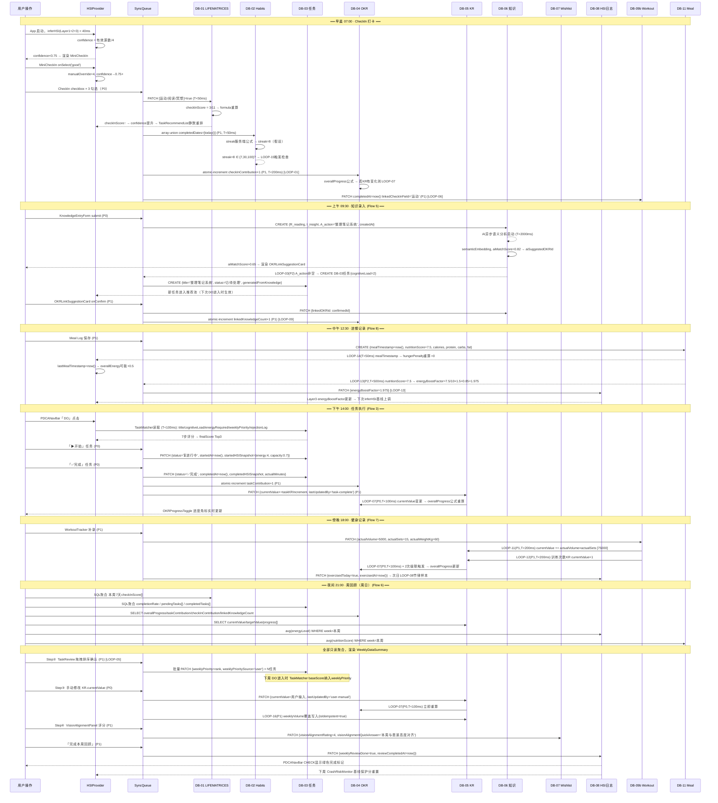
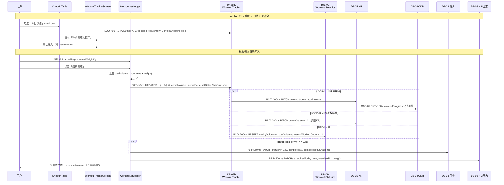
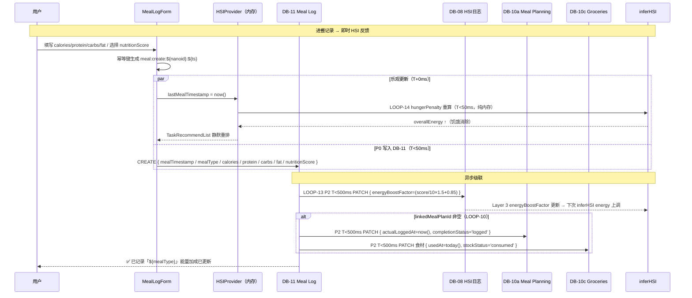
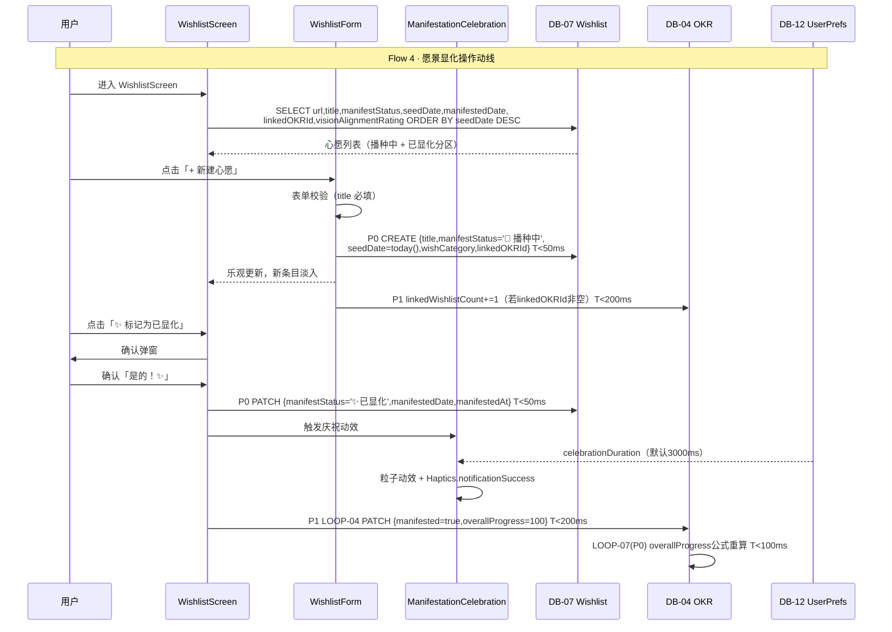
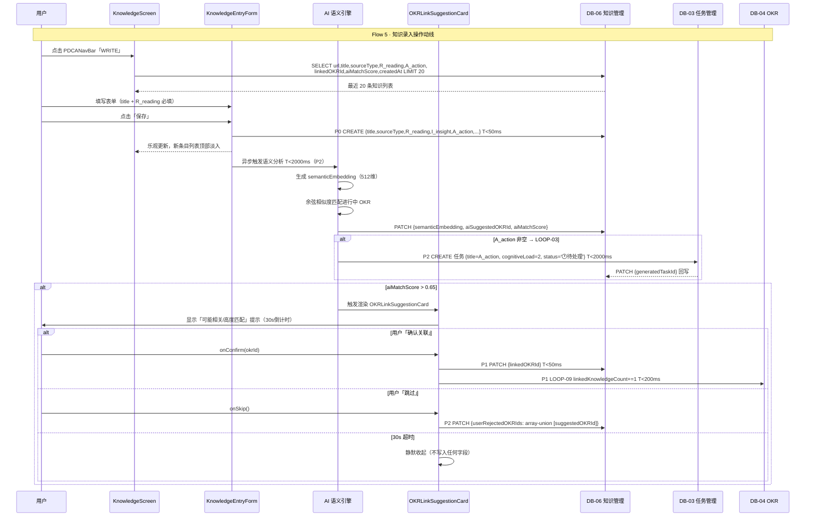
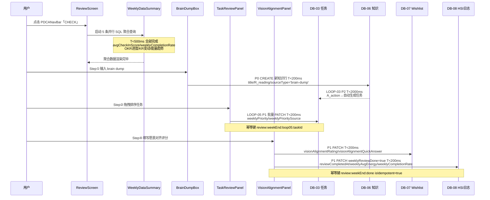

## 模块字段所有权注册表（Field Ownership Registry）

> **原则**：每个字段只有一个「主权模块」（Owner），其他模块只能读取，通过 SyncQueue 提交写入请求，由 Owner 模块负责最终一致性。
> 

| 字段（DB.fieldName） | Owner 模块 | 写入类型 | 读取方（Consumer 模块） | 跨模块写入规则 |
| --- | --- | --- | --- | --- |
| `DB-01.[fieldName]` (11项boolean) | **CheckIn（Flow 1）** | PATCH · P0 | HSIProvider · CrashRiskMonitor · Flow 6 | 只有 CheckInTable checkbox 事件可写，其他模块只读 |
| `DB-01.checkInScore` | **服务端公式**（DB-01 触发） | formula（只读） | HSIProvider(Layer2) · CrashRiskMonitor · Flow 6 聚合 | 不可直接写入，由服务端在boolean字段变更后自动重算 |
| `DB-02.completedDates` / `streak` | **CheckIn（Flow 1）** | array-union · P1 | LOOP-02(奖励判断) · LOOP-15(里程碑) · Flow 6 | Flow 1 打卡写入 completedDates；streak 由服务端公式维护 |
| `DB-03.status` / `startedAt` / `completedAt` | **TaskManager（Flow 3）** | PATCH · P0 | Flow 6 Step② · TaskMatcher(过滤) · LOOP-05 | 只有用户「开始/完成/放弃」操作写入；Flow 6 只读不写 |
| `DB-03.weeklyPriority` / `weeklyPrioritySource` | **Review（Flow 6 Step②）** | 批量PATCH · P1 · LOOP-05 | TaskMatcher(baseScore权重) · Flow 3 推荐排序 | 每周回顾确认后覆盖写入；Flow 3 只读用于排序计算 |
| `DB-03.rejectionLog[]` | **TaskManager（Flow 3）** | array-union · P1 | TaskMatcher(rejectionPenalty) · Flow 3 下次推荐 | 用户拒绝任务时写入，7日内同能量状态生效 |
| `DB-04.overallProgress` | **服务端公式**（DB-05 KR 触发） | formula · P0 · LOOP-07 | Flow 6 Step③展示 · PDCANavBar OKR角标 · Flow 4 显化判断 | 不可直接写入；任何 DB-05.currentValue 变更均触发公式重算 |
| `DB-04.checkInContribution` | **CheckIn（Flow 1）→ LOOP-01** | atomic-increment · P1 | Flow 6 Step③ OKR贡献展示 | 幂等键 `${checkInId}:${today()}:loop01` 防每日重复 |
| `DB-04.taskContribution` | **TaskManager（Flow 3）→ LOOP-07间接** | atomic-increment · P1 | Flow 6 Step③ OKR贡献展示 | 任务完成时 +1，幂等键 `${taskId}:${today()}:complete` |
| `DB-04.manifested` / `overallProgress=100` | **Wishlist（Flow 4）→ LOOP-04** | PATCH · P1 | Flow 6 OKR面板 · PDCANavBar OKR角标 | 仅 manifestStatus='✨已显化' 触发，幂等键 `${wishId}:loop04` |
| `DB-05.currentValue` | **多模块共享写入**（见冲突矩阵） | atomic-increment(LOOP-11/12) / patch(LOOP-16) / patch(用户手动) | LOOP-07(→DB-04进度重算) · Flow 6 Step③展示 | 写入优先级：用户手动 > LOOP-16(周统计覆盖) > LOOP-11/12(增量) |
| `DB-06.A_action` / `semanticEmbedding` / `aiMatchScore` | **Knowledge（Flow 5）** | PATCH · P0(保存) + P1(AI异步) | LOOP-03(→DB-03任务生成) · OKRLinkSuggestionCard渲染判断 | AI语义分析异步写入；用户保存为P0，AI补充为P1 |
| `DB-06.linkedOKRId` / `userRejectedOKRIds` | **Knowledge（Flow 5）** | PATCH · P1 | LOOP-09(→DB-04计数) · 下次AI推荐降权 | 用户确认/拒绝 OKRLinkSuggestionCard 时写入 |
| `DB-07.manifestStatus` / `manifestedDate` | **Wishlist（Flow 4）** | PATCH · P1 | LOOP-04(→DB-04) · Flow 6 Step④ 愿景对齐 | 用户操作主权；Flow 6 只写 visionAlignmentRating，不改 manifestStatus |
| `DB-07.visionAlignmentRating` / `visionAlignmentQuickAnswer` | **Review（Flow 6 Step④）** | PATCH · P1 | Flow 4 ManifestationHistory 历史趋势查阅 | 每周回顾 VisionAlignmentPanel 写入；Flow 4 只读展示 |
| `DB-08.swipScore` / `energyLevel[]` | **HSIProvider（CrashRiskMonitor）** | PATCH · P2(日志) / P1(干预) | Flow 2 触发判断 · Flow 3 hardFilter · TaskMatcher 门禁 | 60s 轮询写入日志；干预触发时 P1 写 dailyOverlayCount |
| `DB-08.weeklyReviewDone` / `reviewCompletedAt` | **Review（Flow 6 Step完成）** | PATCH · P1 | CrashRiskMonitor 下周基线重置 · PDCANavBar CHECK角标 | 幂等键 `review:${weekEnd}:done`，每周仅写一次 |
| `DB-09b.actualVolume` / `actualSets` / `completedAt` | **WorkoutTracker（Flow 7）** | PATCH · P1 | LOOP-11/12(→DB-05) · LOOP-06(CheckIn预写入触发) | LOOP-06 预写 completedAt；用户补录 actualVolume/actualSets |
| `DB-11.mealTimestamp` / `nutritionScore` | **MealLog（Flow 8）** | PATCH · P1 | LOOP-14(→HSI hungerPenalty内存) · LOOP-13(→DB-08 energyBoostFactor) | 进餐即时触发 LOOP-14（内存，不入SyncQueue） |
| `DB-12.*`（UserPrefs全量） | **Settings（用户偏好）** | PATCH · P2 | 所有组件渲染层（UIMode覆盖 / 动效开关 / 通知偏好） | 只读消费，不参与任何 LOOP；变更立即生效于全局渲染 |

---

## 模块间输入输出接口契约（Module I/O Contract）

> 以「模块」为单位定义**对外暴露的数据输出**（其他模块可消费的字段）与**对外声明的数据需求**（需要从其他模块读取的字段）。
> 

| 模块（Module） | 输出字段（Publishes） | 消费字段（Consumes from） | 触发的下游模块 |
| --- | --- | --- | --- |
| **HSIProvider**（全局推断引擎） | `energy.overallEnergy` · `focus.mentalCapacity` · `emotion.stressLevel` · `confidence` · `swipScore` · `temporal.timeOfDay` | DB-01.`checkInScore` · DB-08.`circadianBaseline` `energyBoostFactor` · DB-11.`mealTimestamp` · Synheart SDK HRV/SC · 行为日志 tapFreq/switchCount | TaskMatcher(排序重算) · PDCANavBar(按钮状态) · CrashRiskMonitor(风险评估) · TodayZone(UIMode切换) · MiniCheckIn(confidence门禁) |
| **CrashRiskMonitor**（崩溃风险监控） | riskLevel(`low/medium/high/critical`) · slope(5min变化速率) | HSIProvider.`swipScore` · DB-08.`dailyOverlayCount` `lastOverlayShownAt` | CrashInterventionOverlay(渲染) · TaskMatcherEngine(hardFilter) · AppFSM(禁用导航) · DB-08(日志写入) |
| **TaskMatcherEngine**（任务推荐引擎） | Top3 `finalScore[]`（内存，不持久化）· `sessionRejections[]`（内存） | DB-03.`cognitiveLoad` `energyRequired` `weeklyPriority` `rejectionLog` `bestTimeSlot` `dueDate` · HSIProvider全量 · DB-08.`hardFilter`(触发条件) | TaskRecommendList(渲染) · RecommendedTaskList · RecoveryCard(连续拒绝≥3触发) |
| **CheckIn（Flow 1）** | DB-01.`[fieldName]=true` `checkInScore`(服务端公式) · DB-02.`completedDates` `streak` · DB-04.`checkInContribution`(via LOOP-01) · DB-09b.`completedAt`(via LOOP-06) | DB-01(前置读取11项状态) · DB-02.`streak`(里程碑判断) · DB-04.`checkInContribution`(展示) · DB-08.`swipScore`(保护分基准) | HSIProvider(confidence提升) · LOOP-01/02/06/15 · CrashRiskMonitor(swipScore保护) |
| **TaskManager（Flow 3）** | DB-03.`status` `startedAt` `completedAt` `startedHSISnapshot` `completedHSISnapshot` `rejectionLog` · DB-04.`taskContribution`(via +1) · DB-05.`currentValue`(via LOOP-07间接) | HSIProvider全量 · DB-03(任务池读取) · DB-08.`hardFilter`状态 · [TaskMatcherEngine.Top](http://TaskMatcherEngine.Top)3 | LOOP-07(P0 DB-04进度重算) · Flow 6 Step②(完成率统计数据源) · RecoveryCard(拒绝≥3触发) |
| **Knowledge（Flow 5）** | DB-06.`R_reading` `I_insight` `A_action` `semanticEmbedding` `aiMatchScore` `linkedOKRId` `userRejectedOKRIds` `generatedTaskId` | DB-04.`title` `status`(OKR候选下拉) · DB-06(最近10条展示) | LOOP-03(A_action→DB-03新任务) · LOOP-09(linkedOKRId→DB-04计数) · OKRLinkSuggestionCard(aiMatchScore>0.65渲染) |
| **Wishlist（Flow 4）** | DB-07.`manifestStatus` `manifestedDate` `evidence` `visionAlignmentRating` `visionAlignmentQuickAnswer`(部分由Flow 6写) · DB-04.`manifested=true`(via LOOP-04) | DB-07(前置读取状态) · DB-04.`title`(关联OKR候选) | LOOP-04(→DB-04 manifested) · ManifestationCelebration(全屏动效) · Flow 6 Step④(愿景对齐数据源) |
| **Review（Flow 6）** | DB-03.`weeklyPriority` `weeklyPrioritySource`(via LOOP-05) · DB-07.`visionAlignmentRating` `visionAlignmentQuickAnswer` `reviewSkippedByUIMode` · DB-08.`weeklyReviewDone` `reviewCompletedAt` | DB-01(本周7天checkInScore) · DB-03(完成率/待处理任务) · DB-04(OKR进度) · DB-05(KR当前值) · DB-08(能量日志) · DB-11(营养均值) · DB-09c(周训练量) | LOOP-05(weeklyPriority→TaskMatcher下周) · LOOP-16(weeklyVolume→KR) · CrashRiskMonitor(下周基线重置) |
| **SyncQueue**（写入调度中心） | 各 DB 的最终一致性写入（按P0/P1/P2优先级） | 所有模块的 PATCH/create/atomic-increment 请求 · 幂等键去重表 | 所有 DB（最终写入方）· 失败时触发 rollbackPatch + Toast · P2失败写 DB-08.errorLog |

---

## 单日端到端数据流时序（User Day · Field-Level Sequence）

> 典型用户日内完整数据流：**早晨 CheckIn → 上午知识录入 → 下午任务执行 → 傍晚健身 → 夜间周回顾（周末）**
> 

> 每个阶段标注：触发字段 → 计算过程 → 写入字段 → 下游模块感知
> 



---

## 关键字段变更的全链路感知传播图

> 当某一核心字段发生变更时，哪些模块会感知到，需要重新计算或重新渲染？
> 

| 变更字段 | 变更来源 | 直接感知模块（T&lt;200ms） | 间接感知模块（T&lt;2000ms） | UI 层可见变化 |
| --- | --- | --- | --- | --- |
| `DB-01.checkInScore` ↑ | Flow 1 checkbox勾选 | HSIProvider(confidence↑) · CrashRiskMonitor(swipScore保护分↑) | TaskRecommendList(静默重排) · TodayZone(isHighStress可能变false) | 任务推荐列表顺序变化 · 压力指示器颜色变化 |
| `DB-05.currentValue` ↑ | Flow 3完成/Flow 7健身/Flow 6手动/LOOP-16 | LOOP-07(P0) → DB-04.overallProgress公式重算 | OKRProgressToggle(进度角标) · Flow 6 Step③展示值更新 | OKR进度条实时更新 · 百分比角标变化 |
| `DB-08.energyBoostFactor` ↑ | LOOP-13(饮食) / Flow 7(运动) | HSIProvider Layer3 基线上调 | 下次 inferHSI → overallEnergy可能+1 → TaskMatcher重排 | HSIStatusBar能量等级可能上升 · 任务认知负荷过滤放宽 |
| `DB-03.weeklyPriority` 批量更新 | Flow 6 Step② LOOP-05 | TaskMatcherEngine(下次DO时baseScore更新) | TaskRecommendList(下次进入DO页面时重排) | 下周任务推荐顺序变化（本次进入DO不立即重排） |
| `DB-07.manifestStatus = '✨已显化'` | Flow 4用户操作 | LOOP-04(P1) → DB-04.manifested=true overallProgress=100 | ManifestationCelebration(全屏动效3000ms) · Flow 6 OKR面板(显化标注) | 全屏庆祝动效 · OKR卡片显示「✨已显化」标签 · 进度条100% |
| `DB-02.streak` 达阈值(7/30/100) | Flow 1 CheckIn → DB-02公式重算 | LOOP-15(P2,T&lt;1000ms) → DB-07新建里程碑行 | ManifestationHistory(里程碑条目新增) · WishlistScreen列表更新 | Wishlist里程碑区出现新条目 · Toast庆祝提示 |
| `HSIProvider.swipScore` &gt; 90 | CrashRiskMonitor 60s轮询计算 | AppFSM(DO/PLAN禁用) · CrashInterventionOverlay(渲染fullscreen) | DB-08.dailyOverlayCount+1(P1) · TaskMatcherEngine.hardFilter启用 | 全屏崩溃干预浮层 · DO/PLAN按钮显示倒计时 · 任务列表过滤cognitiveLoad≥4 |
| `DB-06.A_action` 非空保存 | Flow 5 KnowledgeEntryForm submit | LOOP-03(P2,T&lt;2000ms) → DB-03 CREATE新任务行 | TaskMatcher推荐池(下次DO时包含新任务) · DB-06.generatedTaskId回写 | 下次进入DO页面时新任务出现在推荐池 |

---

# 二、全局状态与上下文层

## `<HSIProvider>` · 全局 HSI 状态上下文

```tsx
// 提供全局 HSI 状态，所有子组件通过 useHSI() hook 消费
interface LifeCompassStateVector {
  energy: {
    overallEnergy: 1 | 2 | 3 | 4 | 5;   // 三层加权融合
    computedFromHSI: boolean;
    manualOverride?: 1 | 2 | 3 | 4 | 5;
  };
  emotion: {
    stressLevel: number;    // 0–1
    calmLevel: number;      // 0–1
    valence: 'negative' | 'neutral' | 'positive';
  };
  focus: {
    engagementLevel: number;   // 0–1
    mentalCapacity: number;    // 0–1（认知余量，核心调度字段）
    cognitiveLoad: number;     // 0–1
  };
  behavior: {
    activityPattern: 'still' | 'light' | 'active';
    interactionRhythm: 'regular' | 'scattered';
  };
  temporal: {
    timeOfDay: 'morning' | 'forenoon' | 'afternoon' | 'evening' | 'night';
    circadianPhase: number;  // 基于历史节律学习
  };
  confidence: number;       // HSI 置信度 0–1，决定降级策略
  swipScore: number;        // 崩溃风险分 0–100
}
```

## HSI 三层加权融合推断算法（< 40ms 完成）

```tsx
// 三层数据源 × 权重动态分配 → LifeCompassStateVector
interface HSIInferenceInput {
  // ── Layer 1：生理信号层（Synheart SDK，实时流，weight=0.5 / 不可用时=0）
  heartRateVariability?: number;     // HRV ms，高HRV→低压力
  heartRateBpm?:         number;     // 静息心率
  skinConductance?:      number;     // 皮肤电导率（压力指标）
  activityAcceleration?: number;     // 加速度 m/s²（活动强度）

  // ── Layer 2：行为日志层（App 操作记录，5min 滑动窗口，weight=0.3）
  tapFrequency?:         number;     // 每分钟触摸次数
  switchCount?:          number;     // 页面切换次数（高→分心）
  sessionDurationMin?:   number;     // 当前连续使用时长
  continuousWorkMin?:    number;     // 不间断工作时长（Pomodoro 监控用）
  lastCheckInScore?:     number;     // DB-01.checkInScore（今日最新）
  lastMealTimestamp?:    Date;       // DB-11 最近进餐时间（饥饿能量修正）

  // ── Layer 3：历史节律层（DB-08 近30日学习，weight=0.2 / 无生理信号时=0.5）
  circadianBaseline?: {
    timeOfDay:           string;     // 当前时段 key
    typicalEnergyLevel:  number;     // 该时段历史均值 energy（1–5）
    typicalStressLevel:  number;     // 该时段历史均值 stress（0–1）
    sampleCount:         number;     // 样本数（< 7 置信度下调）
  };
  energyBoostFactor?:    number;     // LOOP-13 饮食系数（DB-11.nutritionScore → DB-08.energyBoostFactor，默认 1.0）
}

function inferHSI(input: HSIInferenceInput): LifeCompassStateVector {
  // ─ 权重分配（生理信号可用时优先）
  const physioAvailable  = input.heartRateVariability != null;
  const physioWeight     = physioAvailable ? 0.5 : 0.0;
  const behaviorWeight   = 0.3;
  const circadianWeight  = physioAvailable ? 0.2 : 0.5;

  // ─ Layer 1：压力推断
  const hrvStress = physioAvailable
    ? clamp(1 - (input.heartRateVariability! - 20) / 60, 0, 1)  // HRV 20ms→1.0 | 80ms→0
    : 0.5;
  const scStress  = input.skinConductance
    ? clamp(input.skinConductance / 10, 0, 1)
    : 0.5;
  const layer1Stress = (hrvStress + scStress) / 2;

  // ─ Layer 2：认知余量推断
  const switchPenalty   = clamp((input.switchCount ?? 0) / 20, 0, 0.5);
  const checkInBonus    = (input.lastCheckInScore ?? 0.5) * 0.3;
  const workTimePenalty = Math.max(0, ((input.continuousWorkMin ?? 30) - 25) / 35 * 0.3);
  const layer2Capacity  = clamp(0.6 - switchPenalty + checkInBonus - workTimePenalty, 0, 1);

  // ─ Layer 3：基线能量 + 饮食修正
  const baselineEnergy  = input.circadianBaseline?.typicalEnergyLevel ?? 3;
  const baselineStress  = input.circadianBaseline?.typicalStressLevel ?? 0.4;
  const hoursHungry     = input.lastMealTimestamp
    ? (Date.now() - input.lastMealTimestamp.getTime()) / 3600000
    : 2;
  const hungerPenalty   = clamp((hoursHungry - 2) / 6, 0, 0.5); // 2h内=0 | 8h=0.5
  const dietBonus       = ((input.energyBoostFactor ?? 1.0) - 1.0) * 1.5;

  // ─ 三层融合
  const fusedStress    = physioWeight * layer1Stress
                       + behaviorWeight * (1 - layer2Capacity)
                       + circadianWeight * baselineStress;
  const rawEnergy      = baselineEnergy - hungerPenalty * 2 + dietBonus;
  const overallEnergy  = clamp(Math.round(rawEnergy), 1, 5) as 1|2|3|4|5;
  const mentalCapacity = clamp(layer2Capacity - fusedStress * 0.3, 0, 1);

  // ─ confidence = 可用数据源数 / 4
  const sourceCount = [
    input.heartRateVariability, input.tapFrequency,
    input.lastCheckInScore,     input.circadianBaseline,
  ].filter(Boolean).length;
  const confidence = sourceCount / 4;

  return {
    energy:    { overallEnergy, computedFromHSI: true },
    emotion:   {
      stressLevel: fusedStress,
      calmLevel:   1 - fusedStress,
      valence:     fusedStress > 0.7 ? 'negative' : fusedStress < 0.3 ? 'positive' : 'neutral',
    },
    focus:     {
      engagementLevel: clamp(mentalCapacity * 1.2, 0, 1),
      mentalCapacity,
      cognitiveLoad:   1 - mentalCapacity,
    },
    behavior:  {
      activityPattern:   (input.activityAcceleration ?? 0) > 2 ? 'active'
                       : (input.activityAcceleration ?? 0) > 0.5 ? 'light' : 'still',
      interactionRhythm: (input.switchCount ?? 0) > 15 ? 'scattered' : 'regular',
    },
    temporal:  {
      timeOfDay:      getTimeOfDay(new Date()),
      circadianPhase: input.circadianBaseline?.typicalEnergyLevel ?? 3,
    },
    confidence,
    swipScore: computeSwipScore({ fusedStress, mentalCapacity, overallEnergy,
                                   continuousWorkMin: input.continuousWorkMin,
                                   checkInScore: input.lastCheckInScore }),
  };
}
```

**降级策略（根据 `confidence` 自动切换）**

| confidence | 渲染行为 |
| --- | --- |
| ≥ 0.75 | 静默推断，`<MiniCheckIn>` 不渲染 |
| 0.5–0.75 | 推断值显示 + 顶部「点击确认」提示 |
| < 0.5 | 隐藏推断值，渲染 `<MiniCheckIn>` |
| 数据缺失 | 使用历史节律基线，标注「基于历史节律」 |

---

## `<CrashRiskMonitor>` · 崩溃风险后台监听

```tsx
// 无 UI 组件，每 60s 后台轮询，触发全局事件
interface CrashRiskMonitorProps {
  pollingInterval: 60_000;
  onRiskLevelChange: (level: 'low' | 'medium' | 'high' | 'critical') => void;
}

// ── swipScore 完整计算公式（0–100，越高越危险）────────────────────
function computeSwipScore(params: {
  fusedStress:       number;          // 0–1，来自 HSI 推断
  mentalCapacity:    number;          // 0–1
  overallEnergy:     1|2|3|4|5;
  continuousWorkMin?: number;         // 连续工作时长（分钟）
  checkInScore?:      number;         // 今日 DB-01.checkInScore
}): number {
  const {
    fusedStress, mentalCapacity, overallEnergy,
    continuousWorkMin = 30,
    checkInScore      = 0.5,
  } = params;

  // 四维评分（满分 100）
  const stressScore    = fusedStress * 40;              // 压力 → 满分 40
  const capacityScore  = (1 - mentalCapacity) * 25;    // 余量枯竭 → 满分 25
  const energyScore    = (5 - overallEnergy) / 4 * 20; // 低能量 → 满分 20
  const workTimePenalty = Math.max(0, (continuousWorkMin - 25) / 35 * 10);
  // 连续工作 25min 内 = 0；60min = 满分 10（Pomodoro 效应）
  const checkInProtection = checkInScore * 5;           // 满打卡 → -5 分保护

  return clamp(Math.round(
    stressScore + capacityScore + energyScore + workTimePenalty - checkInProtection
  ), 0, 100);
}

// ── slope（5min 滑动窗口变化速率，预测崩溃趋势）─────────────────────
function computeSwipSlope(recentLogs: HSILogRecord[]): number {
  const window5min = recentLogs.filter(l =>
    l.date.getTime() > Date.now() - 5 * 60 * 1000
  );
  if (window5min.length < 2) return 0;
  const first = window5min[0].swipScore;
  const last  = window5min[window5min.length - 1].swipScore;
  return (last - first) / (window5min.length - 1); // 每步平均变化量
}

// ── 四级风险判定（swipScore + slope 双维度）────────────────────────
const RISK_THRESHOLDS = {
  low:      { maxScore: 60,  maxSlope: 0.03 },
  medium:   { minScore: 60,  maxScore: 70,  minSlope: 0.03, maxSlope: 0.05 },
  high:     { minScore: 70,  minSlope: 0.03 },
  critical: { minScore: 90,  minSlope: 0.08, anyCondition: true },
};

function resolveRiskLevel(score: number, slope: number): 'low'|'medium'|'high'|'critical' {
  if (score > 90 || slope > 0.08) return 'critical';
  if (score > 70 && slope > 0.03) return 'high';
  if (score >= 60 || slope >= 0.03) return 'medium';
  return 'low';
}

// ── 各风险等级触发行为 ──────────────────────────────────────────────
// low:      无操作（swipScore 写入 DB-08 日志）
// medium:   静默自动干预：
//             → TaskMatcherEngine 过滤 cognitiveLoad ≥ 4 的任务
//             → NotificationThrottler 节流所有非 P0 推送
//             → TodayZone.isHighStress = true（视觉降密度）
// high:     渲染 <CrashInterventionOverlay mode="suggestion">（底部抽屉）
//             → RecoveryCard 插入任务列表顶部
// critical: 渲染 <CrashInterventionOverlay mode="fullscreen">（全屏覆盖）
//             → 所有 PLAN / DO 导航按钮临时禁用
//             → 推送强制休息 SOP（冥想/散步/拉伸）
```

---

# 三、首页组件拆解 · `<DashboardScreen>`

## 操作动线映射（Flow 1）

```
用户打开 App
  ↓
<HSIProvider> 后台 < 40ms 推断完成
  ↓
<DashboardScreen> 渲染
  ├─ confidence ≥ 0.75  →  <TodayZone> 直接显示推荐任务（无需签到）
  └─ confidence < 0.75  →  <MiniCheckIn> 出现在 <TodayZone> 顶部
```

## `<HSIStatusBar>` · 顶部能量状态条

```tsx
interface HSIStatusBarProps {
  energy: 1 | 2 | 3 | 4 | 5;
  computedFromHSI: boolean;
  onManualOverride: (value: 1 | 2 | 3 | 4 | 5) => void;
}

// 渲染规则：
// - 始终显示当前能量等级（1–5 彩色指示点）
// - computedFromHSI=true → 显示「🫀 自动推断」标签
// - computedFromHSI=false → 显示「✏️ 手动设置」标签
// - 右侧始终有「编辑」按钮，点击弹出 5 级选择器（manualOverride）
// - 低能量模式（energy ≤ 2）：bar 背景色自动降低饱和度
```

## `<MiniCheckIn>` · mini 签到（低置信度降级）

```tsx
interface MiniCheckInProps {
  visible: boolean;  // confidence < 0.75 时为 true
  onSelect: (mood: 'okay' | 'good' | 'tired') => void;
}

// 渲染内容：
// 标题：「今天感觉怎样？」
// 3个按钮：🌱 还行 / ⚡ 状态好 / 🌧 有点累
// 选择后：
//   → manualOverride 更新
//   → visible 变为 false（1步完成签到）
//   → <TaskRecommendList> 立即重新排序

// ND 设计要点：
// - 不得显示加载状态或复杂 UI
// - 点击后即时消失，不等待网络响应
```

## `<TodayZone>` · 今日区（首屏核心，第1层）

```tsx
interface TodayZoneProps {
  hsiState: LifeCompassStateVector;
  isLowEnergy: boolean;  // energy ≤ 2
  isHighStress: boolean; // stressLevel > 0.7
}

// 子组件渲染顺序（从上到下）：
// 1. <MiniCheckIn />          条件渲染（confidence < 0.75）
// 2. <EnergyIndicator />      始终显示
// 3. <PDCANavBar />           始终显示
// 4. <TaskRecommendList />    始终显示（内容由 HSI 驱动）

// 低能量模式（isLowEnergy=true）UI 适配：
// - 减少颜色饱和度
// - 折叠次要信息
// - 字号适当放大
// - 首屏底部显示免责文案：「今天可以少做一点，这也是一种完成」

// 高压力模式（isHighStress=true）UI 适配：
// - 停止所有装饰性动画
// - 页面过渡动效从 200ms 降至 100ms
```

## `<PDCANavBar>` · PDCA 四按钮导航

```tsx
type PDCAMode = 'WRITE' | 'PLAN' | 'DO' | 'CHECK';

interface PDCANavBarProps {
  activeMode: PDCAMode;
  onModeChange: (mode: PDCAMode) => void;
}

// ── 路由映射 × 字段读取 × UIMode 强制规则 ─────────────────────────
const PDCA_ROUTE_SPEC: Record<PDCAMode, {
  targetScreen:   string;
  dataSources:    string[];
  // 进入时读取的首屏字段（决定首屏渲染内容）
  preloadFields:  string[];
  // HSI 门禁（swipScore 超过阈值时该模式变灰/禁用）
  swipLockThreshold?: number;
  // 进入时强制执行的 UIMode
  forcedUIMode?:  UIMode;
}> = {
  WRITE: {
    targetScreen:  'KnowledgeScreen',
    dataSources:   ['DB-06（知识管理）'],
    preloadFields: ['DB-06.title', 'DB-06.sourceType', 'DB-06.R_reading',
                    'DB-06.I_insight', 'DB-06.A_action', 'DB-06.linkedOKRId'],
    swipLockThreshold: undefined,   // 写作模式不受 swipScore 限制
  },
  PLAN: {
    targetScreen:  'TaskPlanScreen + OKRScreen',
    dataSources:   ['DB-03（任务管理）', 'DB-04（OKR）', 'DB-05（KR）'],
    preloadFields: ['DB-03.title', 'DB-03.priority', 'DB-03.cognitiveLoad',
                    'DB-03.dueDate', 'DB-03.scheduledDate',
                    'DB-04.title', 'DB-04.overallProgress', 'DB-04.status'],
    swipLockThreshold: 80,   // swipScore > 80 → PLAN 按钮显示警告提示
    forcedUIMode:  undefined,
  },
  DO: {
    targetScreen:  'TaskManagerScreen',
    dataSources:   ['DB-03（任务管理）'],
    preloadFields: ['DB-03.title', 'DB-03.cognitiveLoad', 'DB-03.energyRequired',
                    'DB-03.estimatedMinutes', 'DB-03.bestTimeSlot',
                    'DB-03.priority', 'DB-03.weeklyPriority'],
    swipLockThreshold: 90,   // swipScore > 90 → DO 按钮禁用（CrashIntervention 优先）
    forcedUIMode:  undefined,
  },
  CHECK: {
    targetScreen:  'ReviewScreen',
    dataSources:   ['DB-01', 'DB-03', 'DB-04', 'DB-05', 'DB-08'],
    preloadFields: ['DB-01.checkInScore[]（本周7天）',
                    'DB-03.completionRate（本周）',
                    'DB-04.overallProgress[]（进行中OKR）',
                    'DB-05.currentValue[]（关联KR）',
                    'DB-08.energyLevel[]（本周HSI日志）'],
    swipLockThreshold: undefined,   // 回顾不限制
    forcedUIMode:  'normal',        // 回顾模式始终 normal（避免 low-energy 折叠数据）
  },
};

// 按钮状态计算（HSI + SWIP 联动）
function getPDCAButtonState(mode: PDCAMode, hsi: LifeCompassStateVector): {
  disabled:    boolean;
  showWarning: boolean;
  warningText?: string;
} {
  const spec = PDCA_ROUTE_SPEC[mode];
  const locked = spec.swipLockThreshold && hsi.swipScore > spec.swipLockThreshold;
  return {
    disabled:    mode === 'DO' && hsi.swipScore > 90,
    showWarning: !!locked && mode !== 'DO',
    warningText: locked ? `当前状态 ${hsi.swipScore}/100，建议先休息再规划` : undefined,
  };
}
```

## `<TaskRecommendList>` · 今日推荐任务（Flow 3 核心渲染）

```tsx
// 真实数据源（Workspace）：
// - https://www.notion.so/a457c6021ddb4b6aa300e9265f67d7a2  ← 进行中任务数据库（首页「✅ 进行中任务」区块）

interface TaskRecommendListProps {
  dataSourceUrl: 'https://www.notion.so/a457c6021ddb4b6aa300e9265f67d7a2''';  // DB-03 进行中任务（读取字段：title / cognitiveLoad / energyRequired / estimatedMinutes / dueDate / bestTimeSlot / priority / weeklyPriority / rejectionLog / linkedOKRId / linkedKRId / status）
  hsiState: LifeCompassStateVector;   // 消费字段：energy.overallEnergy / focus.mentalCapacity / emotion.stressLevel / temporal.timeOfDay / swipScore
  maxVisible: 3;            // 始终只显示3条（排序后 finalScore Top3）
  onAccept: (taskId: string) => void;  // → 写入 DB-03.status='⏳进行中' / startedAt=now() / startedHSISnapshot
  onRefresh: () => void;    // 「换一批」→ 记录当前 Top3 taskIds 进入 sessionRejections（内存，不写 DB）；重排次优推荐
  onViewAll: () => void;    // 「查看全部」→ 展开 <FullTaskPool>，RecommendedTaskList 保持高亮
}

// 内部 TaskMatcher 字段级评分公式（完整 7 步链路）
//
// ─── Step 1: baseScore（任务静态优先级权重）──────────────────────────
//   来源字段：task.priority（DB-03）
//   priorityScore = {
//     'P0-极高': 1.0, 'P1-高': 0.8, 'P2-中': 0.5, 'P3-低': 0.3
//   }[task.priority]
//   statusPenalty = task.status === '⏸ 暂停' ? 0.5 : 1.0
//   baseScore = priorityScore × statusPenalty
//
// ─── Step 2: cognitiveFitMultiplier（认知余量匹配系数）──────────────
//   来源字段：hsi.focus.mentalCapacity（HSIProvider）
//   对应字段：task.cognitiveLoad（DB-03，值域 1–5）
//   actualCapacity  = hsi.focus.mentalCapacity          // 0–1
//   taskRequirement = task.cognitiveLoad / 5            // 归一化 0–1
//   if actualCapacity >= taskRequirement + 0.2:
//     multiplier = 1.2    // 充裕胜任，奖励推荐
//   elif actualCapacity >= taskRequirement:
//     multiplier = 1.0    // 刚好匹配
//   else:
//     multiplier = max(0.3, actualCapacity / taskRequirement)  // 超出余量惩罚
//
// ─── Step 3: deadlineUrgencyFactor（截止日紧迫性）──────────────────
//   来源字段：task.dueDate（DB-03）
//   daysLeft = (task.dueDate - today) / 86_400_000
//   urgencyFactor =
//     daysLeft <= 0  ? 2.0   // 已超期
//     daysLeft <= 1  ? 1.8   // 今日截止
//     daysLeft <= 3  ? 1.4   // 3日内
//     daysLeft <= 7  ? 1.2   // 本周内
//     otherwise      ? 1.0   // 无紧迫
//   null dueDate → urgencyFactor = 1.0
//
// ─── Step 4: timeSlotFitBonus（最佳时段奖励）───────────────────────
//   来源字段：task.bestTimeSlot（DB-03）vs hsi.temporal.timeOfDay
//   bonus = task.bestTimeSlot === hsi.temporal.timeOfDay ? 0.15
//         : task.bestTimeSlot === 'any'                 ? 0.05
//         : 0.0
//
// ─── Step 5: energyFitFilter（能量硬性门禁，不通过则 return null）──
//   来源字段：task.energyRequired（DB-03）vs hsi.energy.overallEnergy
//   energyGap = task.energyRequired - hsi.energy.overallEnergy
//   if energyGap > 2: return null   // 直接过滤出推荐池
//   energyPenalty = energyGap > 0 ? 1.0 - energyGap × 0.2 : 1.0
//
// ─── Step 6: rejectionPenalty（7日内同能量状态拒绝记忆衰减）────────
//   来源字段：task.rejectionLog[]（DB-03，含 hsiSnapshot.energyLevel）
//   recentRejections = rejectionLog.filter(r =>
//     r.timestamp > now - 7d &&
//     r.hsiSnapshot.energyLevel === hsi.energy.overallEnergy
//   ).length
//   rejectionPenalty = max(0.1, 1.0 - recentRejections × 0.25)
//   // 0次→1.0 | 1次→0.75 | 2次→0.5 | 3次→0.25 | ≥4次→0.1（强压制）
//
// ─── Step 7: 最终得分合并 ────────────────────────────────────────
//   finalScore = (baseScore × cognitiveFitMultiplier × deadlineUrgencyFactor
//                + timeSlotFitBonus) × energyPenalty × rejectionPenalty
//
// ─── 能量分层输出规则（后处理，覆盖排序结果）──────────────────────
//   高能量（energy ≥ 4, mentalCapacity ≥ 0.7）:
//     Top3 允许 cognitiveLoad 4–5，可含 1 条 P2 挑战任务
//   低能量（energy ≤ 2 || mentalCapacity < 0.4）:
//     强制过滤 cognitiveLoad ≥ 4 + estimatedMinutes > 30
//   中等能量（energy=3, mentalCapacity 0.4–0.7）:
//     Top3 结构：1条 cognitiveLoad 3–4 + 2条 cognitiveLoad 1–2
//   高压力（stressLevel > 0.7，叠加所有层级）:
//     移除 estimatedMinutes > 60 的任务
//     强制插入 1条 category='恢复/休息' 类任务（若 DB-03 中存在）

// 空状态处理（无任务时）：
// 显示：「今日已清空！要不要去 Wishlist 种下新的愿望？🎉」
// → 按钮跳转 <WishlistScreen>

// 每个 TaskCard 子组件：
// - 显示任务名、认知需求等级标签、截止日期
// - 推荐条目有视觉高亮（蓝色左边框）
// - 拒绝时弹出标签选择：太难 / 太简单 / 不想做
```

## `<CheckInTable>` · 打卡表（第2层，1次滚动）

```tsx
interface CheckInTableProps {
  items: CheckInItem[];
  date: Date;
  onCheck: (itemId: string, checked: boolean) => void;
  onBatchComplete: () => void;  // 批量补签入口
}

// 真实数据源（Workspace）：
// - https://www.notion.so/3250dfc8e62180cf9c56cb713e9da4e2  ← LIFEMATRICES 打卡主表
// - https://www.notion.so/3030dfc8e6218161af3bd57f4c922ab1  ← Habits 习惯追踪辅表

interface CheckInItem {
  id: string;
  notionPageUrl: string;   // 对应 https://www.notion.so/3250dfc8e62180cf9c56cb713e9da4e2 或 https://www.notion.so/3030dfc8e6218161af3bd57f4c922ab1 中的页面 URL
  label: string;           // 如「早晨：正念练习」
  checked: boolean;
  linkedPlanId?: string;   // REL-06 关联健身计划
  linkedOKRId?: string;    // 关联 OKR 目标 → https://www.notion.so/f432bdf19cd3457a819b482955585d58
  timeSlot: 'morning' | 'commute' | 'work' | 'evening';
}

// 字段级多步写入时序（单次勾选触发完整链路）：
//
// T+0ms   用户点击 checkbox
//   → 本地 store: checkInItem.checked = true（乐观更新）
//   → UI: scale 动效 1→1.05→1 + Haptics.impact('light')
//
// T+0ms   幂等键生成：`${checkInId}:${today()}:toggle`
//   → 若 pendingOps 已含此键 → abort（防止双击重复写入）
//
// T<50ms  P1 写入 DB-01（LIFEMATRICES）：
//   → PATCH { [checkInItem.fieldName]: true, updatedAt: now() }
//   → checkInScore 公式触发重算：
//     checkInScore = checkedCount / totalItemCount（小数，服务端公式）
//
// T<50ms  P1 并行写入 DB-02（Habits）——若 linkedHabits 存在：
//   → PATCH { completedDates: [...existing, today()] }（去重 upsert）
//   → completionRate 公式重算：近 28d 完成次数 / (targetCount × 4)
//
// T<200ms P1 写入 DB-04（OKR）——若 linkedOKRId 存在（LOOP-01）：
//   → 原子加法：checkInContribution += checkInWeight（默认 1）
//   → 触发 overallProgress 重算（见 DB-04 公式）
//
// T<200ms P1 写入 DB-09（健身计划）——若 linkedPlanId 存在（REL-06）：
//   → PATCH { linkedCheckInField: checkInItem.fieldName, completedAt: now() }
//   → 触发 LOOP-11：DB-05.currentValue += actualVolume（异步 P2）
//
// T<500ms P2 异步：CrashRiskMonitor 重新评估 swipScore（基于新打卡状态）
//
// 失败回滚规则：
//   P1 写入失败 → localStore.patch(entity, rollbackPatch)
//              → SyncQueue.enqueue（离线时）或 Toast 错误提示（在线时）
//   P2 写入失败 → 静默记录 errorLog，不影响主流程
//
// 防重复校验（批量补签模式 onBatchComplete）：
//   → 逐项检查 checkInItem.checked === false 再写入，跳过已勾选项
//   → 补签项附加 retroactive: true 标记（区别于当日操作）
// - 晚间 21:00 未完成项 → 顶部显示「今日还有 X 项未打卡」横幅
//   点击横幅 → 展开批量补签模式（onBatchComplete）
```

## `<SyncQueue>` · 离线降级完整字段写入规范（CheckIn / Task 全链路）

```tsx
// SyncQueue 是所有写操作的统一离线缓冲层
// 优先级 P0/P1/P2 与各 DB 的 SyncQueue 优先级规则保持一致
// DB优先级映射：DB-01/03/07=P0 | DB-04/05/02/06/09=P1 | DB-08/10/11=P2

interface SyncQueueEntry {
  id:            string;           // 幂等键（由操作侧生成，如 `${checkInId}:${today()}:toggle`）
  db:            'DB-01' | 'DB-02' | 'DB-03' | 'DB-04' | 'DB-05'
               | 'DB-06' | 'DB-07' | 'DB-08' | 'DB-09b' | 'DB-09c'
               | 'DB-10a' | 'DB-10b' | 'DB-10c' | 'DB-11';
  priority:      0 | 1 | 2;        // 0=立即 | 1=30s内 | 2=后台
  operation:     'create' | 'patch' | 'atomic-increment' | 'array-union';
  payload:       Record<string, unknown>;   // 写入字段 key-value（与 DB 接口字段名完全对齐）
  retryCount:    number;           // 当前重试次数（初始 0）
  maxRetries:    number;           // P0=5 | P1=3 | P2=1
  enqueuedAt:    number;           // 入队时间戳 ms
  expiresAt?:    number;           // 过期丢弃时间戳
  retroactive?:  boolean;          // true = 补签操作（非当日）
  rollbackPatch?: Record<string, unknown>;  // 失败时本地回滚 patch
}

// ── 优先级写入策略 ──────────────────────────────────────────────────
const SYNC_QUEUE_POLICY: Record<0 | 1 | 2, {
  flushTrigger:    'immediate' | 'online-restore' | 'background';
  flushIntervalMs: number;     // 在线时的定期 flush 间隔（0 = 实时）
  maxRetries:      number;
  expiryMs:        number;     // 条目过期丢弃时间
  affectedDBs:     string[];
}> = {
  0: {
    flushTrigger:    'immediate',
    flushIntervalMs: 0,
    maxRetries:      5,
    expiryMs:        7 * 24 * 3600_000,   // 7天
    affectedDBs:     ['DB-01', 'DB-03', 'DB-07'],
  },
  1: {
    flushTrigger:    'online-restore',
    flushIntervalMs: 30_000,              // 每 30s flush 一次
    maxRetries:      3,
    expiryMs:        3 * 24 * 3600_000,   // 3天
    affectedDBs:     ['DB-04', 'DB-05', 'DB-02', 'DB-06', 'DB-09b', 'DB-09c'],
  },
  2: {
    flushTrigger:    'background',
    flushIntervalMs: 300_000,             // 每 5min flush 一次
    maxRetries:      1,
    expiryMs:        24 * 3600_000,       // 1天
    affectedDBs:     ['DB-08', 'DB-10a', 'DB-10b', 'DB-10c', 'DB-11'],
  },
};

// ── 离线检测 + flush 完整时序 ────────────────────────────────────────
// NetworkMonitor 每 10s 轮询 /health endpoint
//   online  → SyncQueue.flush()（按优先级顺序 P0 → P1 → P2）
//   offline → 所有写操作转为 SyncQueue.enqueue()
//
// flush 执行顺序：
//   1. P0 条目 → 串行写入（保证 DB-01/03/07 操作顺序）
//   2. P1 条目 → 并行写入（最多 5 并发，保证 LOOP 触发一致性）
//   3. P2 条目 → 并行写入（最多 3 并发，后台静默）
//
// 写入成功 → SyncQueue.remove(entry.id)
// 写入失败（网络）→ 指数退避重试 1s→2s→4s→8s→16s
//   超过 maxRetries：
//     P0/P1 → localStore 保留乐观状态 + Toast「⚠️ 同步待完成」
//     P2    → 静默丢弃，errorLog.append(entry)
// 写入失败（409 Conflict）：
//   → localStore.patch(entity, rollbackPatch)（撤销乐观更新）
//   → SyncQueue.remove(entry.id)
//   → Toast「数据已在其他设备更新，已同步最新版本」

// ── CheckIn 勾选完整离线降级路径（5步入队，对应多步写入时序）────────
// 用户勾选 checkInItem（离线状态）：
//
// Step 1  本地 store 乐观更新（同在线，立即生效）
//
// Step 2  P0 enqueue → DB-01（LIFEMATRICES）：
//   { id: `${checkInId}:${today()}:toggle`,
//     db: 'DB-01', priority: 0, operation: 'patch',
//     payload:      { [checkInItem.fieldName]: true, updatedAt: now() },
//     rollbackPatch:{ [checkInItem.fieldName]: false } }
//
// Step 3  P1 enqueue → DB-02（Habits，若 linkedHabits 存在）：
//   { db: 'DB-02', priority: 1, operation: 'array-union',
//     payload: { completedDates: today() } }
//
// Step 4  P1 enqueue → DB-04（OKR，若 linkedOKRId 存在，LOOP-01）：
//   { db: 'DB-04', priority: 1, operation: 'atomic-increment',
//     payload: { checkInContribution: checkInWeight } }
//
// Step 5  P1 enqueue → DB-09b（Workout Tracker，若 linkedPlanId 存在，REL-06）：
//   { db: 'DB-09b', priority: 1, operation: 'patch',
//     payload: { completedAt: now() } }
//
// 恢复在线 → flush P0 → flush P1 → LOOP-01 在服务端完整触发

// ── TaskMatcher 离线降级（无网络时任务推荐策略）──────────────────────
// 1. 读取 IndexedDB 本地缓存的 DB-03 快照（最近一次在线同步）
// 2. HSI 使用 lastKnownHSI（上次在线缓存，字段：energy/focus/temporal/swipScore）
// 3. Step 4 timeSlotFitBonus 降级为 task.bestTimeSlot==='any' ? 0.05 : 0
//    （实时 timeOfDay 仍从设备本地时间读取，不依赖网络）
// 4. rejectionLog 读取 IndexedDB 本地副本
// 5. 任务卡片底部显示离线标注：
//    「⚠️ 离线模式 · 基于 ${lastSyncedAt} 数据」
//    lastSyncedAt 字段来源：DB-03 本地 IndexedDB 同步时间戳
// 6. 用户接受任务后：写操作进入 SyncQueue P1 队列，恢复联网后补写
```

## `<DailyRoutineToggle>` · 🌙 Daily Routine（第3层，折叠）

```tsx
// 静态内容组件，无外部数据源依赖。内容来自 Manifest 页面「Daily Routine」区块。
// 默认折叠；与当前 timeOfDay 联动高亮当前时段

interface DailyRoutineToggleProps {
  currentTimeSlot: 'morning' | 'work' | 'evening' | 'pre-sleep';
  onTimeSlotHighlight?: (slot: string) => void;
}

// 渲染内容（各时段静态列表）：
// ☀️ 早上自然醒
//   • 冥想 / 听金刚经解读
//   • 早饭：打豆浆、蒸玉米/红薯、煮鸡蛋
//   • 八段锦 / 拉伸 + 瑜伽
//   • 学一小时（营养学 / 神经科学 / 历史人文 → 整理成内容）
//   • 工作日骑车上班，自然出汗换衣服
// 💼 工作日
//   • 下班骑车回家 + 无氧
//   • 复盘 15 分钟无氧动作提升
// 🌙 晚上睡前
//   • 冥想 · 看书
//   • 准备好第二天出行装备（衣服 / 骑行运动装备）
//   • 准备第二天食物（泡豆子、洗玉米/红薯）
// 🛁 入睡前
//   • 洗澡 — 护肤 — 身体乳【听音乐】
//   • 阅读 — 听佛乐 — 心流
//   • 冥想 — 入眠
// 📅 周期安排
//   • 周五晚：游泳 / 网球
//   • 周末：骑行 + 咖啡馆/饭店 + 阅读
//   • 周末：攀岩 + 阅读
//   • 周末：观影 — 输出 — 准备下周粮食；营养学 — 更新食谱
// 🔄 周期复盘
//   • 每月一循环复盘
//   • 一季度一次旅行
//   • 一年一次大旅行

// 交互规范：
// - 根据 timeOfDay 自动展开对应时段分组
// - 各条目可点击跳转关联打卡项（linkedCheckInId）
// - ND 友好：折叠默认收起，减少信息压迫
```

## `<OKRProgressToggle>` · 进行中 OKR 目标（第3层，折叠）

```tsx
// 真实数据源：https://www.notion.so/f432bdf19cd3457a819b482955585d58（📊 当前进行中 OKR 目标）

interface OKRProgressToggleProps {
  dataSourceUrl: 'https://www.notion.so/f432bdf19cd3457a819b482955585d58''';  // DB-04 OKR（读取字段：title / status / overallProgress / checkInContribution / taskContribution / linkedKnowledgeCount / manifested / startDate / endDate）
  krDataSourceUrl: 'https://www.notion.so/e950dfc8e62182abae6981555b1d3e66''';  // DB-05 KR（读取字段：title / currentValue / targetValue / progress / unit / lastUpdatedBy）
  maxVisible?: 3;          // 默认只展示前3条（按 overallProgress 升序，进度落后优先展示）
  onViewAll: () => void;   // 跳转 OKRScreen
  onKRTap: (krId: string) => void;  // → 内联展开 KR 详情（手动更新 currentValue 入口）
}

// 每条 OKR 渲染（字段级映射）：
// - title（DB-04.title）+ overallProgress 百分比（DB-04.overallProgress 公式字段，只读）
// - 进度条：宽度 = overallProgress / 100；颜色：≥80%=green / 50–79%=blue / <50%=orange
// - 关联 KR 数量标签：count(DB-05 WHERE linkedOKRId = DB-04.url)
// - checkInContribution + taskContribution + linkedKnowledgeCount 三项贡献小标签
// - 点击展开 → 展示各 KR：currentValue / targetValue / progress（公式）/ unit
// 折叠态：仅显示 overallProgress ring + 「X 个目标进行中」
// KR currentValue 手动更新入口（onKRTap）：
//   → 弹出数字输入框，用户输入新 currentValue
//   → T+0ms 乐观更新本地 store
//   → T<50ms P0 写入 DB-05：PATCH { currentValue, lastUpdatedBy: 'user-manual', updatedAt: now() }
//   → T<100ms LOOP-07(P0) 自动触发：DB-04.overallProgress 公式重算
//   幂等键：`${krId}:${now()}:manual-update`（isIdempotent=false，实时变化不去重）
```

## `<SystemNavToggle>` · Step 1–4 系统导航（第4层，折叠）

```tsx
// 静态导航组件，链接到 Manifest 中 Step 1–4 各区块的真实页面 / 数据库
// 默认折叠；作为「系统入口」而非日常操作区

const SYSTEM_NAV_STRUCTURE = {
  'Step 1 · 🌌 愿景念力': {
    description: '你想成为谁？想活出怎样的人生？——这是整个系统的起点与北极星',
    links: [
      { label: '🌌 愿景', url: 'https://www.notion.so/3ae0dfc8e621821ab34a01e4bdff137e''' },
      { label: '🎯 目标', url: 'https://www.notion.so/1c80dfc8e6218308a12801abb96a52a4''' },
    ],
    databases: [
      { label: '📊 当前进行中 OKR 目标', url: 'https://www.notion.so/f432bdf19cd3457a819b482955585d58''' },
    ],
    // 字段读取：DB-04.title / status / overallProgress / manifested
    // 渲染逻辑：status='进行中' → 显示；manifested=true → 归档至愿景显化历史
  },
  'Step 2 · ⚒️ 方法论 SOP': {
    links: [
      { url: 'https://www.notion.so/a180dfc8e6218220b8b081853889ad58''' },
      { url: 'https://www.notion.so/5ca0dfc8e621823c954501715d1225ce''' },
      { url: 'https://www.notion.so/fdd0dfc8e62183b1a0fb017e04316bdd''' },
      { url: 'https://www.notion.so/18d0dfc8e62183ea8738014965d1c736''' },
      { url: 'https://www.notion.so/ee50dfc8e6218344b1f3013b47912c8c''' },
    ],
    // 静态内容，不依赖 DB 字段，仅作导航入口
  },
  'Step 3 · 🧠 知识数据库': {
    description: '用知识滋养愿景，用方法论拆解目标为可执行的项目与任务',
    subSections: {
      '📚 知识输入': [
                        { type: 'db',   url: 'https://www.notion.so/3850dfc8e621839095c0011d4e295881'' },
        { type: 'page', url: 'https://www.notion.so/9e80dfc8e6218369afd301da4048df3f'' },
        { type: 'page', url: 'https://www.notion.so/c790dfc8e62183b39ece81f87ad1e667'' },
      ],
      '🔃 任务计划': [
                        { type: 'db',   url: 'https://www.notion.so/54c0dfc8e62183e4a77101c2b11d1c92'' },
        { type: 'db',   url: 'https://www.notion.so/9a00dfc8e62182769ec381ed9a265b9e'' },
        { type: 'page', url: 'https://www.notion.so/3020dfc8e6218310b982817b57bb7f15'' },
      ],
      '🎯 目标执行': [
                        { type: 'db', url: 'https://www.notion.so/2840dfc8e62182b1a1b681caa51d9b22'' },
        { type: 'db', url: 'https://www.notion.so/e950dfc8e62182abae6981555b1d3e66'' },
        { type: 'db', url: 'https://www.notion.so/ee00dfc8e62183ebbe4e81e437350159'' },
      ],
    },
  },
  'Step 4 · 🌿 生活方式实践': {
    description: '把目标落地到每天的身体、饮食、习惯、环境——这是显化的物质基础',
    subSections: {
      '🏃 生活习惯': [
                        { type: 'page', url: 'https://www.notion.so/eb30dfc8e6218251ba63013dd9ed3d6a'' },
        { type: 'page', url: 'https://www.notion.so/89d0dfc8e6218365af778125f4ab6568'' },
      ],
      '🥦 运动饮食': [
                { type: 'page', url: 'https://www.notion.so/f8d0dfc8e6218393b32f81742d753b49'' },
        { type: 'page', url: 'https://www.notion.so/ced0dfc8e6218359b604018e0acbc533'' },
      ],
      '📦 物品财务': [
                { type: 'db',   url: 'https://www.notion.so/50e0dfc8e621827c971681fcacf459f6'' },
        { type: 'page', url: 'https://www.notion.so/f810dfc8e6218380be5a01cce37d5ac6'' },
      ],
      '🗓 活动计划': [
                        { type: 'db',   url: 'https://www.notion.so/5510dfc8e621834780218104c679e8a9'' },
        { type: 'db',   url: 'https://www.notion.so/3d30dfc8e62183d086ad81b687ee9862'' },
        { type: 'page', url: 'https://www.notion.so/15d66d2344ec409fb977551c2e8a473a'' },
        { type: 'page', url: 'https://www.notion.so/7a01ed6253704a8a93b0dedeac435c4d'' },
      ],
    },
  },
};
```

---

# 四、任务管理组件拆解 · `<TaskManagerScreen>`

## 操作动线映射（Flow 3 完整链路）

```
用户点击 PDCANavBar「DO」
  ↓
<TaskManagerScreen> 渲染
  ↓
<TaskMatcherEngine> 执行匹配（用户无感知，< 100ms）
  ↓
<RecommendedTaskList> 渲染 Top 3
  ├─ 用户点击任务      →  进入任务执行（跳转或展开详情）
  ├─ 用户点击「换一批」→  次优推荐重排 + 记录拒绝原因
  └─ 用户点击「查看全部」→  <FullTaskPool> 展开，推荐项保留高亮
```

## `<FullTaskPool>` · 完整任务池（字段过滤规范）

```tsx
// 默认隐藏，用户点击「查看全部」后展开
// 数据源：DB-03（任务管理）

interface FullTaskPoolProps {
  dataSourceUrl: string;        // https://www.notion.so/54c0dfc8e62183e4a77101c2b11d1c92 任务管理 DB
  hsiState: LifeCompassStateVector;
  onTaskSelect: (taskId: string) => void;
}

// ── HSI 分层过滤规则（按能量分组展示，非硬性过滤）──────────────────
const TASK_POOL_SECTIONS: Record<string, {
  label:          string;
  filterFn:       (task: TaskRecord, hsi: LifeCompassStateVector) => boolean;
  sortKey:        keyof TaskRecord;
  maxVisible:     number;
  collapsedByDefault: boolean;
}> = {
  recommended: {
    label:       '⚡ 今日推荐（HSI 匹配）',
    // 已由 TaskMatcherEngine 排序，直接复用 finalScore > 0.5
    filterFn:    (t, hsi) => !t.rejectionLog?.find(r =>
                   r.timestamp > new Date(Date.now() - 7 * 864e5) &&
                   r.hsiSnapshot.energyLevel === hsi.energy.overallEnergy
                 ),
    sortKey:     'priority',
    maxVisible:  5,
    collapsedByDefault: false,
  },
  highLoad: {
    label:       '🧠 高认知任务（慎选）',
    // cognitiveLoad 4–5，仅在 mentalCapacity ≥ 0.6 时不折叠
    filterFn:    (t) => t.cognitiveLoad >= 4,
    sortKey:     'dueDate',
    maxVisible:  10,
    collapsedByDefault: true, // 低能量时强制折叠
  },
  quickWins: {
    label:       '✅ 快速完成（≤ 15min）',
    filterFn:    (t) => t.estimatedMinutes <= 15 && t.cognitiveLoad <= 2,
    sortKey:     'priority',
    maxVisible:  8,
    collapsedByDefault: false,
  },
  overdue: {
    label:       '⚠️ 已超期',
    filterFn:    (t) => !!t.dueDate && new Date(t.dueDate) < new Date(),
    sortKey:     'dueDate',
    maxVisible:  10,
    collapsedByDefault: false, // 超期任务始终展开提醒
  },
  paused: {
    label:       '⏸ 暂停中',
    filterFn:    (t) => t.status === '⏸ 暂停',
    sortKey:     'priority',
    maxVisible:  5,
    collapsedByDefault: true,
  },
};

// ── 低能量模式（energy ≤ 2）强制折叠策略 ──────────────────────────
// highLoad 分组：整组折叠 + 顶部显示「🧠 当前能量建议跳过高认知任务」
// 折叠阈值来自 LifeCompassStateVector.energy.overallEnergy
// 折叠判断时机：FullTaskPool 首次渲染 + hsi 状态变化时重算

// ── 字段显示规范（每行 TaskCard 精简版）─────────────────────────────
// 标题（title）| 认知标签（cognitiveLoad）| 时长标签（estimatedMinutes）
// 截止日期（dueDate，红色 = 已超期，橙色 = 今日截止）
// HSI 匹配分标签（仅 recommended 分组显示）
// 右侧：「▶ 开始」按钮 + 「… 更多」（含拒绝/暂停/放弃）
```

## `<RecoveryCard>` · 恢复建议卡片（完整触发字段链路）

```tsx
// ── 触发条件（字段驱动，优先级从高到低）────────────────────────────
const RECOVERY_CARD_TRIGGER: Array<{
  condition:    (hsi: LifeCompassStateVector) => boolean;
  priority:     number;   // 1=最高
  cardVariant:  'gentle' | 'moderate' | 'urgent';
  suggestions:  string[];
}> = [
  {
    // swipScore > 80 或 mentalCapacity < 0.2
    condition:   (hsi) => hsi.swipScore > 80 || hsi.focus.mentalCapacity < 0.2,
    priority:    1,
    cardVariant: 'urgent',
    suggestions: ['立刻停下来，深呼吸 3 次', '闭眼休息 5 分钟', '喝一杯水'],
  },
  {
    // swipScore 60–80 且 stressLevel > 0.6
    condition:   (hsi) => hsi.swipScore >= 60 && hsi.emotion.stressLevel > 0.6,
    priority:    2,
    cardVariant: 'moderate',
    suggestions: ['5 分钟拉伸', '短暂散步 10 分钟', '切换低认知任务'],
  },
  {
    // continuousWorkMin > 50（超番茄时钟）
    condition:   (hsi) => (hsi as any)._continuousWorkMin > 50,
    priority:    3,
    cardVariant: 'gentle',
    suggestions: ['番茄休息 5 分钟', '远眺窗外', '听一首轻松的歌'],
  },
];

// ── 完整字段链路（从触发到 UI 渲染到数据写入）──────────────────────
//
// [字段读取 → 触发判断]
// T+0ms   CrashRiskMonitor 轮询完成
//           读取 hsi.swipScore（DB-08 最新快照）
//           读取 hsi.focus.mentalCapacity（HSIProvider 内存）
//           读取 hsi.emotion.stressLevel（HSIProvider 内存）
//
// [触发决策]
// T+0ms   遍历 RECOVERY_CARD_TRIGGER，找到优先级最高的满足条件项
//           若 cardVariant=urgent → 同时触发 CrashInterventionOverlay
//           否则 → 仅渲染 RecoveryCard（嵌入任务列表顶部）
//
// [UI 渲染]
// T<16ms  RecoveryCard 插入 FullTaskPool / RecommendedTaskList 列表顶部
//           渲染字段：
//             - swipScore（进度条可视化，0–100）
//             - cardVariant（决定图标 + 措辞 + 背景色）
//             - suggestions[]（最多显示 2 条，第 3 条折叠）
//             - continuousWorkMin（「已专注 X 分钟」文案数据源）
//
// [用户交互 → 字段写入]
// 用户点击「好，去休息」（onAccept）：
//   → DB-08 写入：
//     { type: 'recovery-accepted', swipScore: current,
//       variant: cardVariant, acceptedAt: now() }
//   → CrashRiskMonitor 进入 20min 冷却：不再插入 RecoveryCard
//   → TaskMatcherEngine.hardFilter = { maxCognitiveLoad: 2 } 临时启用 20min
//
// 用户点击「继续工作」（onDismiss）：
//   → DB-08 写入：
//     { type: 'recovery-dismissed', swipScore: current, dismissedAt: now() }
//   → RecoveryCard 隐藏（当次）
//   → 5min 后若 swipScore 未下降 → 再次渲染（不超过每日 3 次）
//
// [频率限制字段]（参见：# 十·五 DB08_HSILog 接口）
// DB-08 存储每日 RecoveryCard 渲染次数：
//   dailyRecoveryCardCount  number   今日触发次数（≥ 3 则不再触发 gentle/moderate）
//   lastRecoveryDismissAt   datetime 最近一次 dismiss 时间戳（5min 内不重复触发）
// 以上两字段在 onAccept / onDismiss 时写入 DB-08 当日 HSI 日志行
// 关联字段：weeklyReviewDone / reviewCompletedAt（Step ④ VisionAlignment 写入）

interface RecoveryCardProps {
  visible:      boolean;     // swipScore 超阈值 时插入列表顶部
  swipScore:    number;      // 来自 LifeCompassStateVector.swipScore
  cardVariant:  'gentle' | 'moderate' | 'urgent';
  suggestions:  string[];    // 来自 RECOVERY_CARD_TRIGGER[n].suggestions
  continuousWorkMin: number; // 文案：「已专注 X 分钟」
  onAccept:     () => void;
  onDismiss:    () => void;
}
```

## Flow 3 任务标记完成·完整字段写入链路

```tsx
// ── 触发时机 ──────────────────────────────────────────────────────
// 用户在 RecommendedTaskList 或 FullTaskPool 中点击「✅ 完成」
// 或在任务详情内将 status 选择器切换为「✅ 完成」

// ── 完整字段写入时序 ─────────────────────────────────────────────

// T+0ms   幂等键生成：`${taskId}:${today()}:complete`
//   → 若 pendingOps 已含此键 → abort（防双击重复写入）

// T+0ms   乐观更新本地 store（立即生效，不等待网络）：
//   task.status      = '✅ 完成'
//   task.completedAt = now()
//   → TaskCard：完成动效（缩小淡出 200ms）+ Haptics.notificationSuccess

// T<50ms  P0 写入 DB-03（任务管理）：
//   PATCH {
//     status:      '✅ 完成',
//     completedAt: now(),
//     completedHSISnapshot: {          // 完成时 HSI 快照（供行为分析）
//       energyLevel:    hsi.energy.overallEnergy,       // 1–5
//       stressLevel:    hsi.emotion.stressLevel,        // 0–1
//       mentalCapacity: hsi.focus.mentalCapacity,       // 0–1
//       timeOfDay:      hsi.temporal.timeOfDay,         // 'morning'|'afternoon'|...
//     }
//   }
//   幂等键：`${taskId}:${today()}:complete`

// T<200ms P1 写入 DB-04（OKR）——若 task.linkedOKRId 非空：
//   PATCH { taskContribution: atomic-increment +1 }
//   → LOOP-07（P0, T<100ms）自动触发：overallProgress 公式重算
//   → OKRProgressToggle 首页进度条实时刷新

// T<200ms P1 写入 DB-05（KR）——若 task.linkedKRId 非空（任务直接关联 KR）：
//   PATCH { currentValue: atomic-increment + (task.krContributionValue ?? 1) }
//   幂等键：`${taskId}:complete:kr-increment`
//   → LOOP-07 触发 DB-04.overallProgress 重算

// T<200ms P2 写入 DB-08（HSI 日志）——当日任务完成事件记录：
//   PATCH 当日行：
//   {
//     completedTaskCount:  atomic-increment +1,
//     lastTaskCompletedAt: now(),
//   }
//   → CrashRiskMonitor 下一次 60s 轮询读取：
//     completedTaskCount↑ → 成就感保护，swipScore 轻微下调

// T<500ms P2 异步：TaskRecommendList 重新排序（不阻塞主流程）
//   → 已完成任务从列表淡出移除（200ms 动效）
//   → 次优推荐自动补位，Top3 保持满员
//   → 若 DB-03 无剩余可推荐任务 → 空状态：
//     「🎉 今日已清空！要不要去 Wishlist 种下新的愿望？」
//     → 按钮跳转 WishlistScreen

// ── 失败回滚规则 ─────────────────────────────────────────────────
// P0 写入失败（离线）：
//   → SyncQueue 入队（P0, maxRetries=5, expiryMs=7d）
//   → 本地 store 维持乐观完成状态
//   → Toast「⚠️ 完成状态待同步，恢复联网后自动写入」
// P1/P2 失败 → SyncQueue 入队，静默重试，不影响 P0 完成状态展示

// ── 本周完成率字段（供 Flow 6 周回顾 Step② 聚合）─────────────────
// weeklyCompletionRate（非存储字段，ReviewScreen 实时计算）：
//   = completedThisWeek / totalActiveThisWeek
//   completedThisWeek   = count(status='✅ 完成' AND completedAt ∈ 本周)
//   totalActiveThisWeek = count(status ≠ '❌ 放弃' AND
//                               (createdAt ∈ 本周 OR weeklyPriority > 0))
//   → 供 WeeklyDataSummary 汇总展示（# 八 Flow 6 数据来源）
```

---

# 四·五·五、Flow 7 健身记录·WorkoutTrackerScreen 完整字段链路

> 本节定义健身记录全流程：从「打卡勾选触发 LOOP-06」→「WorkoutTrackerScreen 手动记录组训练组」→「DB-09b 写入」→「LOOP-11/12 级联 DB-05.currentValue」→「LOOP-07(P0) 触发 DB-04.overallProgress 重算」完整三级级联。与 **# 一·六** LOOP-06/11/12/16 矩阵对齐。
> 

## 操作动线映射（三大入口）

```jsx
入口 A：CheckInTable 勾选「🏋 今日训练」
  ↓ LOOP-06 (T<200ms)
  DB-09b.completedAt = now() + linkedCheckInField = fieldName
  ↓ 自动跳转提示：「已记录今日训练打卡，要补录训练组数？」
  → 用户确认 → 进入 WorkoutTrackerScreen（带 prefillPlanId）

入口 B：PDCANavBar「DO」→ TaskManagerScreen → 任务含 category='运动/健身'
  ↓ 用户点击「▶ 开始」
  → 跳转 WorkoutTrackerScreen（带 linkedTaskId）

入口 C：SystemNavToggle Step 4 「🏃 运动」→ WorkoutTrackerScreen（直接进入）
```

## `<WorkoutPlanSelector>` · 训练计划选择器

```tsx
// 数据源：DB-09a Workout Ideas（训练计划库）
// 读取字段：planName / muscleGroups / exerciseList[] / estimatedMinutes
// 用户选择后 prefill WorkoutSetLogger

interface WorkoutPlanSelectorProps {
  dataSourceUrl: string;     // DB-09a Workout Ideas
  preselectedPlanId?: string; // 来自入口A/B 的 prefillPlanId
  onSelect: (plan: WorkoutPlanRecord) => void;
}

// 渲染逻辑：
// - 按 muscleGroups 分组展示（胸/背/腿/肩/手臂/全身/有氧）
// - 右上角显示「本周已做 X 次」（来自 DB-09b count WHERE completedAt ∈ 本周）
// - 最近一次训练时间（lastWorkoutAt）用于智能提示「上次练 ${plan} 是 X 天前」
```

## `<WorkoutSetLogger>` · 训练组记录器（核心写入组件）

```tsx
interface WorkoutSetLoggerProps {
  planId:         string;       // DB-09a.url
  linkedTaskId?:  string;       // 来自入口B，完成后同步写 DB-03.status
  linkedCheckInField?: string;  // 来自入口A，LOOP-06 已预写 completedAt
  onComplete: (workoutId: string) => void;
}

// 每个训练动作（exerciseItem）渲染：
// - exerciseName | targetSets × targetReps × targetWeightKg（来自 DB-09a）
// - 每组输入：actualReps（数字键盘）/ actualWeightKg（步进器，±2.5kg）
// - 「完成该组」按钮 → 记录单组数据到内存 setLogs[]
// - 休息计时器：60s 倒计时（可跳过）
// - 全部组完成 → 「结束训练」按钮 → 触发完整写入链路
```

## WorkoutSetLogger 完整字段写入时序

```tsx
// ── 触发时机：用户点击「结束训练」────────────────────────────────

// T+0ms   幂等键生成：`workout:create:${nanoid}:${today()}`
//   → 若 pendingOps 已含此键 → abort

// T+0ms   乐观更新本地 store：
//   → WorkoutTrackerScreen 显示「🎉 训练完成！」庆祝横幅
//   → 计算汇总：
//     totalVolume = sum(actualReps × actualWeightKg, across all sets)
//     totalSets   = setLogs.length

// T<50ms  P0 CREATE DB-09b（Workout Tracker）写入完整训练记录：
//   {
//     title:           `${planName} · ${today()}`,
//     linkedPlanId:    planId,            // REL → DB-09a
//     linkedKRId:      plan.linkedKRId,  // REL → DB-05（训练量 KR）
//     linkedTaskId:    linkedTaskId,     // REL → DB-03（可选，来自入口B）
//     completedAt:     now(),
//     linkedCheckInField: linkedCheckInField,  // 来自入口A（可选）
//     actualSets:      totalSets,
//     actualReps:      sum(set.actualReps),
//     actualWeightKg:  max(set.actualWeightKg),  // 最大重量（本次PR参考）
//     actualVolume:    totalVolume,   // = sum(reps × weight)，LOOP-11 触发字段
//     setDetail:       JSON.stringify(setLogs),  // 组数明细快照
//     trainingDurationMin: elapsedMinutes,
//     hsiSnapshot: {                             // 训练时 HSI 快照
//       energyLevel:    hsi.energy.overallEnergy,
//       stressLevel:    hsi.emotion.stressLevel,
//     }
//   }
//   幂等键：`workout:create:${nanoid}:${today()}`

// T<200ms P1 触发 LOOP-11（训练量 → KR.currentValue）:
//   条件：plan.linkedKRId 非空（训练量类型 KR）
//   写入 DB-05：
//     PATCH { currentValue: atomic-increment + totalVolume }
//     幂等键：`${workoutId}:loop11`
//   → 立即触发 LOOP-07(P0, T<100ms)：
//     DB-04.overallProgress 公式重算
//     → OKRProgressToggle 首页进度条实时刷新

// T<200ms P1 触发 LOOP-12（训练次数 → KR.currentValue）:
//   条件：plan.linkedKRId_count 非空（训练次数类型 KR，与 linkedKRId 可分开配置）
//   写入 DB-05：
//     PATCH { currentValue: atomic-increment + 1 }
//     幂等键：`${workoutId}:loop12`
//   → 同样触发 LOOP-07

// T<200ms P1 写入 DB-03（任务管理）——若 linkedTaskId 非空（入口B）：
//   PATCH {
//     status:      '✅ 完成',
//     completedAt: now(),
//     completedHSISnapshot: { energyLevel, stressLevel, mentalCapacity, timeOfDay }
//   }
//   幂等键：`${linkedTaskId}:${today()}:complete`

// T<200ms P1 写入 DB-09c（Workout Statistics）——周汇总行更新：
//   UPSERT （week_start = 本周一）：
//     weeklyVolume:    atomic-increment + totalVolume
//     weeklyWorkoutCount: atomic-increment + 1
//     isIdempotent:    true   // LOOP-16 周回顾时覆盖写入 DB-05 的标志位
//     lastWorkoutAt:   now()
//   幂等键：`stats:${weekStart}:upsert`

// T<500ms P2 异步：DB-08 写入当日运动奖励标记：
//   PATCH { exercisedToday: true, exercisedAt: now() }
//   → inferHSI Layer 3 节律学习：运动当日 energyBoostFactor += 0.1
//   → 次日 circadianBaseline 更新时纳入样本

// ── 入口A 特殊处理（LOOP-06 已预写 completedAt）────────────────
// 若 linkedCheckInField 非空：
//   → 检查 DB-09b 是否已有今日 completedAt（LOOP-06 预写）
//   → 若有：update 同一行（补全 actualVolume/actualSets 等详细字段）
//   → 若无：create 新行（正常流程）
//   幂等键模式：`${planId}:${today()}:checkin-workout`
```

## `<WorkoutHistoryChart>` · 训练历史可视化

```tsx
// 数据源：DB-09b + DB-09c
// 读取字段：
//   DB-09b: completedAt / actualVolume / actualWeightKg（近30条）
//   DB-09c: weeklyVolume / weeklyWorkoutCount（近8周）

interface WorkoutHistoryChartProps {
  viewMode: 'weekly-volume' | 'max-weight' | 'frequency';
  // weekly-volume: 折线图，Y轴=weeklyVolume，X轴=weekStart
  // max-weight:    折线图，Y轴=actualWeightKg（per exercise），X轴=completedAt
  // frequency:     柱状图，Y轴=weeklyWorkoutCount，X轴=weekStart
}

// PR 检测逻辑（Personal Record 提示）：
//   今日 actualWeightKg > max(historical actualWeightKg WHERE linkedPlanId=current)
//   → 训练完成页面显示「🏆 新 PR！${exerciseName} ${actualWeightKg}kg」
//   → 写入 DB-07 Wishlist 里程碑行（category='健身里程碑'）：
//     { title: `[PR] ${exerciseName} ${actualWeightKg}kg`,
//       seedDate: today(), manifestStatus: '🌟 里程碑',
//       linkedHabitId: linkedHabitId }（可选，非 LOOP-15 路径，独立写入）
```

## Flow 7 完整 Mermaid sequenceDiagram



---

# 四·五·六、Flow 8 饮食记录·NutritionScreen 完整字段链路

> 本节定义饮食记录全流程：DB-11 Meal Log 写入 → LOOP-13（nutritionScore → DB-08.energyBoostFactor 修正）→ LOOP-14（mealTimestamp → inferHSI.hungerPenalty 实时重算）→ LOOP-10（营养四库联动）完整链路。与 **# 一·六** LOOP-10/13/14 矩阵、**# 二** inferHSI 算法中 `hungerPenalty` 和 `energyBoostFactor` 字段对齐。
> 

## 操作动线映射

```jsx
入口 A：DailyRoutineToggle「🥦 饮食计划」→ NutritionScreen

入口 B：CheckInTable 勾选「🥗 今日健康饮食」（linkedOKRId 非空）
  ↓ 触发快捷进餐记录（MealQuickLog 底部浮窗）
  → 用户选择 mealType → 简化写入 DB-11（仅 mealTimestamp + mealType + estimatedNutritionScore）

入口 C：SystemNavToggle Step 4「🥦 运动饮食」→ NutritionScreen（完整模式）
```

## `<MealPlanSelector>` · 当日餐食计划选择

```tsx
// 数据源：DB-10a Meal Planning + DB-10b Recipe Book
// 读取字段：
//   DB-10a: mealDate / mealType / linkedRecipeId / plannedCalories
//   DB-10b: recipeName / calories / protein / carbs / fat / nutritionScore

interface MealPlanSelectorProps {
  targetDate: Date;       // 默认今天
  mealType: 'breakfast' | 'lunch' | 'dinner' | 'snack';
  onSelectPlan: (mealPlanRecord: MealPlanRecord) => void;
  onSkipPlan:   () => void;  // 不按计划，直接手动录入
}

// 渲染逻辑：
// - 查询 DB-10a WHERE mealDate=today，按 mealType 分组展示
// - 每项显示：linkedRecipeId→recipeName / plannedCalories / 营养标签（蛋白质/碳水/脂肪）
// - 右上角「购物清单」入口：DB-10c Groceries 缺货项提醒
// - 若无计划 → 显示「今日无计划，直接录入 →」
```

## `<MealLogForm>` · 进餐记录表单（核心写入组件）

```tsx
interface MealLogFormProps {
  prefillFromPlan?:  MealPlanRecord;  // 来自 MealPlanSelector，预填字段
  mealType:          'breakfast' | 'lunch' | 'dinner' | 'snack';
  onComplete:        (mealLogId: string) => void;
}

// 表单字段 × DB-11 Meal Log 映射：
// ─────────────────────────────────────────────────────────────
// 字段                DB-11 字段名          类型    默认值
// 进餐时间            mealTimestamp         datetime  now()
// 餐食类型            mealType              select    入参
// 关联食谱            linkedRecipeId        REL→DB-10b 来自预填
// 关联计划            linkedMealPlanId      REL→DB-10a 来自预填
// 实际卡路里          calories              number    来自 Recipe 预填，可手动覆盖
// 蛋白质 (g)          protein               number    来自 Recipe 预填
// 碳水 (g)            carbs                 number    来自 Recipe 预填
// 脂肪 (g)            fat                   number    来自 Recipe 预填
// 营养评分 (0–10)     nutritionScore        number    AI 推算 or 用户打分
// 饱腹感评分          satietyLevel          select    1-5（用于节律学习）
// 备注               notes                 text      可选
// ─────────────────────────────────────────────────────────────

// nutritionScore 计算规则（自动推算）：
//   若 linkedRecipeId 非空：nutritionScore = DB-10b.nutritionScore（Recipe 预设）
//   否则基于宏量营养素估算：
//     proteinRatio = protein / (calories / 4)     // 蛋白质占比（热量换算）
//     carbQuality  = (carbs - fiber) / carbs       // 精制碳水比（默认 fiber=0）
//     fatQuality   = (saturatedFat ?? fat*0.3)/fat // 饱和脂肪比（默认估算）
//     nutritionScore = clamp(
//       proteinRatio*4 - carbQuality*2 - fatQuality*1 + 5,
//       0, 10
//     )
```

## MealLogForm 完整字段写入时序

```tsx
// ── 触发时机：用户点击「记录进餐」────────────────────────────────

// T+0ms   幂等键生成：`meal:create:${nanoid}:${mealTimestamp.toISOString()}`

// T+0ms   乐观更新本地 store：
//   → NutritionScreen 显示「✅ 已记录 ${mealType}」
//   → 本地 HSIProvider：lastMealTimestamp = mealTimestamp（立即生效）
//   → hungerPenalty 实时重算（LOOP-14 内存路径）：
//     hoursHungry = 0  → hungerPenalty = 0
//     → inferHSI 重算（T<50ms），energy 可能上调

// T<50ms  P0 CREATE DB-11（Meal Log）写入完整字段：
//   {
//     title:              `${mealType} · ${today()}`,
//     mealTimestamp:      mealTimestamp,
//     mealType:           mealType,
//     linkedRecipeId:     linkedRecipeId,
//     linkedMealPlanId:   linkedMealPlanId,
//     calories:           calories,
//     protein:            protein,
//     carbs:              carbs,
//     fat:                fat,
//     nutritionScore:     nutritionScore,
//     satietyLevel:       satietyLevel,
//     notes:              notes,
//   }
//   幂等键：`meal:create:${nanoid}:${mealTimestamp.toISOString()}`

// T<50ms  LOOP-14（内存路径，P1，最高优先级）：
//   mealTimestamp 写入 → HSIProvider.lastMealTimestamp = mealTimestamp
//   → inferHSI 触发重算：
//     hoursHungry = (now - mealTimestamp) / 3600000  // 刚吃完 ≈ 0
//     hungerPenalty = clamp((hoursHungry - 2) / 6, 0, 0.5)  // = 0
//     → overallEnergy 可能从 2 → 3（饥饿消除能量恢复）
//   → TaskRecommendList 静默重排（不触发 Loading）
//   注：LOOP-14 为纯内存操作，不进入 SyncQueue，不写 DB

// T<500ms P2 触发 LOOP-13（nutritionScore → energyBoostFactor）：
//   条件：nutritionScore 非空
//   写入 DB-08 当日 HSI 日志行：
//     PATCH {
//       energyBoostFactor: (nutritionScore / 10) * 1.5 + 0.85,
//       // 评分 0 → 0.85（轻微负向）| 评分 5 → 1.6 | 评分 10 → 2.35（上限裁剪至 2.0）
//       // clamp(result, 0.5, 2.0)
//       lastNutritionScore:  nutritionScore,
//       lastMealLoggedAt:    mealTimestamp,
//     }
//   幂等键：`meallog:${mealId}:loop13`
//   → 下次 inferHSI 调用（Layer 3）读取新 energyBoostFactor：
//     rawEnergy += (energyBoostFactor - 1.0) * 1.5
//     → 当日后续推断能量上调

// T<500ms P2 触发 LOOP-10（营养四库联动）——若 linkedMealPlanId 非空：
//   写入 DB-11：
//     PATCH { linkedMealPlanId: linkedMealPlanId }（已在 CREATE 时写入，此步为状态标记）
//   写入 DB-10a（Meal Planning）：
//     PATCH { actualLoggedAt: now(), completionStatus: 'logged' }
//   写入 DB-10c（Groceries）——若 linkedRecipeId 含缺货食材：
//     PATCH 对应食材行 { usedAt: today(), stockStatus: 'consumed' }
//   幂等键：`meallog:${mealDate}:${mealType}:loop10`

// T<1000ms P2 节律学习更新（LOOP-08 路径）：
//   读取近7日 nutritionScore 均值
//   写入 DB-08.circadianBaseline[timeOfDay].nutritionAvg（滚动均值）
//   → Layer 3 energyBoostFactor 基线长期校准
```

## `<NutritionDailySummary>` · 当日营养汇总组件

```tsx
// 数据源：DB-11（今日所有 Meal Log 行）
// SQL 聚合：
//   SELECT
//     sum(calories)      AS totalCalories,
//     sum(protein)       AS totalProtein,
//     sum(carbs)         AS totalCarbs,
//     sum(fat)           AS totalFat,
//     avg(nutritionScore) AS avgNutritionScore,
//     count(*)           AS mealCount
//   FROM "integration://3660dfc8-e621-81d3-b2f8-00034468cfda/search/921fa979-71d7-4c91-a403-c02b5020e0b3"
//   WHERE mealTimestamp >= today_start AND mealTimestamp < tomorrow_start

interface NutritionDailySummaryProps {
  targetCalories:  number;  // 来自 DB-12 UserPrefs.nutritionTargetCalories（默认 1800）
  targetProtein:   number;  // 来自 DB-12 UserPrefs.nutritionTargetProtein（默认 120g）
}

// 渲染规则：
// - 热量进度条：totalCalories / targetCalories（超出显示红色 + 警告）
// - 蛋白质进度条：totalProtein / targetProtein（绿色目标线）
// - avgNutritionScore 评分徽章（0–10，绿/橙/红三色区间）
// - LOOP-13 写入的 energyBoostFactor 显示为「今日饮食能量加成 ×${factor}」
// - mealCount < 3 且 timeOfDay='evening' → 提示「今日饮食记录不完整」
```

## Flow 8 完整 Mermaid sequenceDiagram



---

# 四·六、Flow 4 愿景显化·WishlistScreen 完整字段链路

> 本节定义 `<WishlistScreen>` 三大组件（WishlistForm / ManifestationCelebration / ManifestationHistory）的字段级读写链路，覆盖新建心愿、标记显化、OKR 关联、庆祝动效全路径。与 **# 一·六** LOOP-04/15 矩阵、**# 一·八** Flow 间数据交接矩阵对齐。
> 

## 操作动线映射（Flow 4 完整链路）

```jsx
用户点击侧边栏「Wishlist」或 SystemNavToggle Step1 入口
  ↓
<WishlistScreen> 渲染
  ├─ 读取 DB-07（全量 Wishlist 行）
  │    读取字段：title / manifestStatus / seedDate / manifestedDate
  │              linkedOKRId / evidence / visionAlignmentRating
  │              visionAlignmentQuickAnswer / reviewSkippedByUIMode
  ├─ 新建心愿  → <WishlistForm> 弹出（Step ①）
  ├─ 标记显化  → <ManifestationCelebration> 全屏动效（Step ②）
  └─ 查看历史  → <ManifestationHistory> 展开（Step ③）
```

## `<WishlistForm>` · 新建 / 编辑心愿（字段级写入链路）

```tsx
// 数据源：DB-07 Wishlist（https://www.notion.so/1c80dfc8e6218308a12801abb96a52a4）

interface WishlistFormProps {
  mode: 'create' | 'edit';
  wishId?: string;          // edit 模式时传入
  onSave:   () => void;
  onCancel: () => void;
}

// ── 表单字段 × DB-07 字段映射 ──────────────────────────────────────
// 用户填写字段（前端表单）       → DB-07 写入字段
// 标题（必填）                  → title（TEXT）
// 类型选择                      → wishCategory（Select: 事业/关系/健康/财富/体验）
// 期望时间线                    → targetDate（DATE）
// 愿景图片（可选）               → evidenceImageUrl（URL）
// 关联 OKR（可选，下拉选择）     → linkedOKRId（RELATION → DB-04.url）
// 心愿描述（可选）               → description（TEXT）

// ── 新建心愿完整字段写入时序 ────────────────────────────────────────
//
// T+0ms   用户点击「保存」
//   → 前端表单验证：title 非空（唯一必填项）
//   → 幂等键生成：`wishlist:create:${nanoid(8)}:${today()}`
//
// T+0ms   乐观更新本地 store：
//   wishItem = { title, manifestStatus: '🌱 播种中', seedDate: today(),
//               wishCategory, targetDate, linkedOKRId, description }
//   → WishlistScreen 列表立即显示新条目（500ms 淡入动效）
//
// T<50ms  P0 写入 DB-07（Wishlist）：
//   CREATE {
//     title:          formValues.title,
//     manifestStatus: '🌱 播种中',
//     seedDate:       today(),
//     wishCategory:   formValues.wishCategory ?? null,
//     targetDate:     formValues.targetDate ?? null,
//     linkedOKRId:    formValues.linkedOKRId ?? null,
//     description:    formValues.description ?? null,
//     evidenceImageUrl: null,
//     visionAlignmentRating: null,
//     visionAlignmentQuickAnswer: null,
//     reviewSkippedByUIMode: false,
//     createdAt:      now(),
//   }
//   幂等键：`wishlist:create:${nanoid}:${today()}`
//
// T<200ms P1 写入 DB-04（OKR）——若 linkedOKRId 非空：
//   PATCH { linkedWishlistCount: atomic-increment +1 }
//   → OKRProgressToggle 关联愿景数标签刷新
//
// ── 编辑心愿（edit 模式）──────────────────────────────────────────
// 仅修改用户改动的字段，其余字段保持不变
// 幂等键：`${wishId}:edit:${now()}`（isIdempotent=false，每次编辑独立记录）
// manifestStatus 不可在编辑模式下修改（只能通过「标记显化」操作变更）
```

## `<ManifestationCelebration>` · 显化标记完整字段链路

```tsx
// 触发入口：WishlistScreen 列表项右侧「✨ 标记为已显化」按钮
// 触发条件：manifestStatus ≠ '✨ 已显化'（已显化项不重复触发）

// ── 完整字段写入时序 ─────────────────────────────────────────────
//
// T+0ms   用户点击「✨ 标记为已显化」
//   → 确认弹窗：「恭喜你！这个愿望真的实现了吗？」
//   → 用户点击「是的！✨」确认
//   → 幂等键：`${wishId}:manifest:${today()}`
//
// T+0ms   乐观更新本地 store：
//   wish.manifestStatus = '✨ 已显化'
//   wish.manifestedDate = today()
//
// T<50ms  P0 写入 DB-07（Wishlist）：
//   PATCH {
//     manifestStatus:  '✨ 已显化',
//     manifestedDate:  today(),
//     manifestedAt:    now(),    // 精确时间戳
//   }
//
// T<16ms  触发 ManifestationCelebration 全屏动效：
//   - 持续时长：DB-12.celebrationDuration（默认 3000ms）
//   - 动效参数：粒子爆炸 + 星光落下 + 震动 Haptics.notificationSuccess
//   - 背景色：由 UIMode 决定（high-stress 时动效自动缩短至 1000ms）
//
// T<200ms P1 写入 DB-04（OKR）——LOOP-04（若 linkedOKRId 非空）：
//   PATCH {
//     manifested:      true,
//     overallProgress: 100,       // 强制设为 100%
//   }
//   幂等键：`${wishId}:loop04`
//   → OKRProgressToggle 首页进度条变为「已显化 🎉」
//   → LOOP-07（P0, T<100ms）：overallProgress=100 触发公式重算（幂等）
//
// T<500ms P2 异步：WishlistScreen 列表刷新
//   → 已显化条目移动至「显化历史」分区（ManifestationHistory）
//   → 「播种中」分区自动补位
//
// ── 失败回滚规则 ─────────────────────────────────────────────────
// P0 写入失败（离线）：
//   → SyncQueue 入队（P0, maxRetries=5）
//   → 庆祝动效仍播放（本地乐观，不等网络）
//   → Toast「✨ 显化记录待同步，恢复联网后写入」
// LOOP-04（P1）失败：
//   → 独立重试，不影响 DB-07 显化状态

interface ManifestationCelebrationProps {
  wishId:       string;
  wishTitle:    string;
  duration:     number;   // DB-12.celebrationDuration，默认 3000ms
  onComplete:   () => void;
  uiMode:       UIMode;   // high-stress → 缩短至 1000ms
}
```

## `<ManifestationHistory>` · 显化历史列表（字段级读取规范）

```tsx
// 读取字段：DB-07 WHERE manifestStatus = '✨ 已显化'
// 排序：manifestedDate DESC（最近显化优先）

interface ManifestationHistoryProps {
  dataSourceUrl: string;   // DB-07 https://www.notion.so/1c80dfc8e6218308a12801abb96a52a4
  onViewDetail:  (wishId: string) => void;
}

// ── SQL 聚合查询 ─────────────────────────────────────────────────
// SELECT url, title, seedDate, manifestedDate, wishCategory,
//        linkedOKRId, evidenceImageUrl,
//        visionAlignmentRating, visionAlignmentQuickAnswer
// FROM "integration://3660dfc8-e621-81d3-b2f8-00034468cfda/fs/bc98da72-0be3-4971-881b-6a3c951e0103"
// WHERE manifestStatus = '✨ 已显化'
// ORDER BY manifestedDate DESC
// LIMIT 50

// ── 每行展示字段 × 渲染逻辑 ─────────────────────────────────────
// 主标题：title
// 副标题：「从 ${seedDate} 播种，历时 ${daysBetween(seedDate, manifestedDate)} 天显化」
// 标签区：wishCategory / linkedOKR.title（若 linkedOKRId 非空）
// 图片：evidenceImageUrl（可选，缩略图右侧）
// 愿景对齐分：visionAlignmentRating（来自 Flow 6 Step④，1–5星）
// 对齐回顾：visionAlignmentQuickAnswer（摘要显示前 50 字符）
//
// 空状态：「你的第一个愿望正在宇宙中酝酿 🌌」
//           → 按钮「种下第一个愿望」打开 WishlistForm

// ── 跨 Flow 字段来源说明 ─────────────────────────────────────────
// visionAlignmentRating / visionAlignmentQuickAnswer
//   来源：Flow 6 Step④ VisionAlignmentPanel（# 五·五）写入
//   含义：最近一次周回顾中用户对该愿景的满意度评分与文字回顾
//   更新时机：每次 Flow 6 完成时覆盖写入（非追加）
```

## Flow 4 完整 sequenceDiagram



---

# 四·七、Flow 5 知识录入·KnowledgeScreen 完整字段链路

> 本节定义 `<KnowledgeScreen>` 两大组件（KnowledgeEntryForm / OKRLinkSuggestionCard）的字段级读写链路，覆盖录入知识、AI 语义分析、OKR 关联确认/拒绝全路径。与 **# 一·六** LOOP-03/09 矩阵对齐。
> 

## 操作动线映射（Flow 5 完整链路）

```jsx
用户点击 PDCANavBar「WRITE」
  ↓
<KnowledgeScreen> 渲染
  ├─ 读取 DB-06（最近知识条目列表，默认 20 条）
  │    预加载字段：title / sourceType / R_reading / I_insight / A_action
  │                linkedOKRId / aiMatchScore / createdAt
  ├─ 用户填写表单  →  <KnowledgeEntryForm> 保存（Step ①）
  │                        ↓（T<2000ms 异步）
  │                   AI 语义分析（LOOP-03 + LOOP-09 前置）
  │                        ↓（若 aiMatchScore > 0.65）
  └─ AI 建议显示  →  <OKRLinkSuggestionCard> 弹出（Step ②）
       ├─ 用户「确认关联」→  LOOP-09 触发 DB-04.linkedKnowledgeCount += 1
       └─ 用户「跳过」   →  写入 userRejectedOKRIds（降权，不再推荐同 OKR）
```

## `<KnowledgeEntryForm>` · 知识录入完整字段写入链路

```tsx
// 数据源：DB-06 知识管理

interface KnowledgeEntryFormProps {
  onSave:    (entry: KnowledgeEntry) => void;
  onCancel:  () => void;
  defaultSourceType?: KnowledgeSourceType;
}

type KnowledgeSourceType =
  | 'book'           // 书
  | 'article'        // 文章
  | 'video'          // 视频
  | 'podcast'        // 播客
  | 'conversation'   // 对话
  | 'brain-dump'     // 大脑清空（Flow 6 Step① 专用）
  | 'reflection';    // 自我反思

// ── 表单字段 × DB-06 字段映射 ──────────────────────────────────────
// 来源类型（必填）                 → sourceType（Select）
// 标题（必填）                    → title（Title）
// R = 核心内容记录（必填）         → R_reading（Text 富文本）
// I = 我的洞见（可选）             → I_insight（Text 富文本）
// A = 可执行行动（可选）           → A_action（Text）← 触发 LOOP-03
// 关联书目/来源 URL（可选）        → sourceUrl（URL）
// 标签（可选，多选）               → tags（Multi-select）
// 关联 OKR（可选，AI 预填）        → linkedOKRId（Relation → DB-04）

// ── 完整字段写入时序 ─────────────────────────────────────────────
//
// T+0ms   用户点击「保存」
//   → 表单校验：title + R_reading 非空
//   → 幂等键生成：`knowledge:create:${nanoid(8)}:${now()}`
//
// T+0ms   乐观更新本地 store（即时反映，不等网络）：
//   → KnowledgeScreen 列表顶部插入新条目（淡入动效）
//
// T<50ms  P0 写入 DB-06（知识管理）：
//   CREATE {
//     title:       formValues.title,
//     sourceType:  formValues.sourceType,
//     R_reading:   formValues.R_reading,
//     I_insight:   formValues.I_insight ?? null,
//     A_action:    formValues.A_action ?? null,
//     sourceUrl:   formValues.sourceUrl ?? null,
//     tags:        formValues.tags ?? [],
//     linkedOKRId: null,              // AI 分析后写入
//     aiMatchScore:       null,       // AI 分析后写入
//     aiSuggestedOKRId:   null,       // AI 分析后写入
//     userRejectedOKRIds: [],
//     semanticEmbedding:  null,       // 异步生成
//     generatedTaskId:    null,       // LOOP-03 生成后回写
//     createdAt:   now(),
//   }
//   幂等键：`knowledge:create:${nanoid}:${now()}`
//
// T<2000ms P2 异步：AI 语义分析（不阻塞 UI，后台执行）
//   ── Step 1: 生成语义嵌入向量
//     semanticEmbedding = embedding(R_reading + I_insight)  // 512维向量
//     → PATCH DB-06: { semanticEmbedding }
//
//   ── Step 2: OKR 语义匹配（余弦相似度 × OKR 标题/描述）
//     candidates = DB-04.rows WHERE status='进行中'
//     for each okr in candidates:
//       score = cosineSimilarity(semanticEmbedding, okr.semanticEmbedding)
//       score *= (okr.id ∈ userRejectedOKRIds ? 0.3 : 1.0)  // 拒绝降权
//     bestOKR = candidates.sortBy(score DESC)[0]
//     aiMatchScore = bestOKR.score
//     → PATCH DB-06: { aiSuggestedOKRId: bestOKR.id, aiMatchScore }
//
//   ── Step 3: A_action 非空时触发 LOOP-03
//     if A_action 非空:
//       创建 DB-03 任务行（见下方 LOOP-03 展开规范）
//       → PATCH DB-06: { generatedTaskId: newTask.url }
//
//   ── Step 4: 若 aiMatchScore > 0.65 → 触发 OKRLinkSuggestionCard 渲染
//     → 发送 UI 事件：showOKRSuggestion({ knowledgeId, suggestedOKRId, score })
//     → 超时 30s 无操作 → 自动收起（不写入任何字段）

// ── LOOP-03 展开规范（A_action 触发任务自动生成）────────────────────
// 触发条件：A_action 字段非空（保存时）
// 执行时机：T<2000ms（P2 异步）
// 写入 DB-03：
//   CREATE {
//     title:                    formValues.A_action,
//     status:                   '🕐 待处理',
//     priority:                 'P2-中',
//     cognitiveLoad:            2,            // 默认认知负荷中等
//     energyRequired:           2,            // 默认中等能量
//     estimatedMinutes:         30,           // 默认估时 30min
//     generatedFromKnowledge:   knowledgeId,  // 反向引用 DB-06
//     linkedOKRId:              formValues.linkedOKRId ?? null,
//     source:                   'auto-from-knowledge',
//     createdAt:                now(),
//   }
//   幂等键：`${knowledgeId}:loop03`
// 成功后回写 DB-06：
//   PATCH { generatedTaskId: newTask.url }（P2，供追踪）
// → 新任务进入 DB-03 任务池，Flow 3 TaskMatcher 下次刷新时纳入推荐
```

## `<OKRLinkSuggestionCard>` · OKR 关联建议（字段级交互链路）

```tsx
interface OKRLinkSuggestionCardProps {
  knowledgeId:     string;     // DB-06 知识条目 URL
  suggestedOKRId:  string;     // DB-04 OKR URL（AI 推荐）
  matchScore:      number;     // aiMatchScore 0–1
  onConfirm:       (okrId: string) => void;  // → LOOP-09
  onChangeOKR:     (okrId: string) => void;  // 用户手动换选 OKR
  onSkip:          () => void;               // 跳过，写入 userRejectedOKRIds
  autoHideAfterMs: 30_000;     // 30s 无操作自动收起
}

// 卡片展示字段（渲染规范）：
// 标题文案：
//   aiMatchScore ≥ 0.85 → 「✨ 高度匹配：${okr.title}」
//   0.65–0.85           → 「🔗 可能相关：${okr.title}」
// 副标题：okr.overallProgress%（来自 DB-04.overallProgress）
// 行动区：「确认关联」/ 「换个 OKR」/ 「跳过」三按钮
// 右上角：30s 倒计时进度条（autoHideAfterMs 驱动）

// ── 用户「确认关联」字段写入链路 ────────────────────────────────────
// T+0ms   幂等键：`${knowledgeId}:loop09`
//
// T<50ms  P1 写入 DB-06（知识管理）：
//   PATCH { linkedOKRId: confirmedOKRId }
//
// T<200ms P1 写入 DB-04（OKR）——LOOP-09：
//   PATCH { linkedKnowledgeCount: atomic-increment +1 }
//   幂等键：`${knowledgeId}:loop09`
//   → OKRProgressToggle 知识关联数标签 +1
//
// ── 用户「跳过」字段写入链路 ─────────────────────────────────────────
// T<50ms  P2 写入 DB-06（知识管理）：
//   PATCH { userRejectedOKRIds: array-union [suggestedOKRId] }
//   → 下次同条知识编辑时，该 OKR 不再出现在建议候选池
//   → TaskMatcher 中：知识关联任务 adjustedScore × 0.3（OKR 拒绝降权）
//
// ── 超时自动收起（30s）────────────────────────────────────────────
// → 不写入任何字段（静默跳过）
// → aiSuggestedOKRId 保留在 DB-06（供后续手动关联参考）

// ── 「换个 OKR」模式 ─────────────────────────────────────────────
// 展示 DB-04 进行中 OKR 下拉列表（status='进行中', 按 overallProgress ASC）
// 用户选择后 → onConfirm(selectedOKRId) 触发上方确认链路
// PATCH DB-06: { aiSuggestedOKRId: selectedOKRId, aiMatchScore: 1.0 }（用户手动 = 完美匹配）
```

## Flow 5 完整 sequenceDiagram



---

# 五·五、Flow 6 周回顾·ReviewScreen 分步字段聚合规范

> 本节定义 `<ReviewScreen>` 四个步骤组件（Step①~④）的完整字段读取、聚合算法与写入链路，精细到 SQL 聚合逻辑 × DB 字段 × SyncQueue 优先级 × 幂等键。与 **# 一·六** LOOP-05/16 矩阵及 **# 零** Flow 6 速查行完全对齐。
> 

## `<WeeklyDataSummary>` · 周数据自动聚合看板

```tsx
// 渲染时机：ReviewScreen 首屏，进入即开始聚合，无需用户操作
// 数据来源：DB-01 / DB-03 / DB-04 / DB-05 / DB-08（本周 7 天窗口）

interface WeeklyDataSummaryProps {
  weekStart: Date;   // ISO 周一 00:00:00
  weekEnd:   Date;   // ISO 周日 23:59:59
  // 以下字段全部通过前端聚合 SQL 查询（querySql）实时计算，非存储字段
}

// ── SQL 聚合逻辑（5 条并行查询，T<500ms 全部完成）──────────────────

// Query 1：本周打卡完成率
// SELECT
//   COUNT(*) FILTER (WHERE "checkInScore" >= 0.8) AS highScoreDays,
//   COUNT(*) AS totalDays,
//   AVG("checkInScore") AS avgCheckInScore,
//   SUM(CASE WHEN "checkInScore" >= 0.6 THEN 1 ELSE 0 END) AS streakEligibleDays
// FROM "https://www.notion.so/3250dfc8e62180cf9c56cb713e9da4e2"
// WHERE DATE("createdTime") BETWEEN ? AND ?
// params: [weekStart, weekEnd]
// → 输出字段：avgCheckInScore / highScoreDays / streakEligibleDays

// Query 2：本周任务完成统计
// SELECT
//   COUNT(*) AS totalCompleted,
//   AVG("cognitiveLoad") AS avgCognitiveLoad,
//   COUNT(*) FILTER (WHERE json_extract("completedHSISnapshot", '$.energyLevel') <= 2) AS completedInLowEnergy,
//   COUNT(DISTINCT "linkedOKRId") FILTER (WHERE "linkedOKRId" IS NOT NULL) AS linkedOKRCount
// FROM "https://www.notion.so/a457c6021ddb4b6aa300e9265f67d7a2'''"
// WHERE "status" = '✅ 完成'
//   AND DATE("completedAt") BETWEEN ? AND ?
// params: [weekStart, weekEnd]
// → 输出字段：totalCompleted / avgCognitiveLoad / completedInLowEnergy / linkedOKRCount

// Query 3：进行中 OKR 进度快照
// SELECT
//   url,
//   "title",
//   "overallProgress",
//   "taskContribution",
//   "checkInContribution",
//   "linkedKnowledgeCount"
// FROM "https://www.notion.so/f432bdf19cd3457a819b482955585d58'''"
// WHERE "status" = '进行中'
// ORDER BY "overallProgress" ASC
// LIMIT 5
// → 输出字段：OKR 列表（含各贡献度子字段）

// Query 4：本周 KR 进度变化
// SELECT
//   url,
//   "title",
//   "currentValue",
//   "targetValue",
//   "progress",
//   "lastUpdatedBy",
//   "updatedAt"
// FROM "https://www.notion.so/e950dfc8e62182abae6981555b1d3e66'''"
// WHERE DATE("updatedAt") BETWEEN ? AND ?
//   AND "lastUpdatedBy" IN ('user-manual', 'loop-11', 'loop-12', 'loop-16')
// ORDER BY "updatedAt" DESC
// params: [weekStart, weekEnd]
// → 输出字段：本周有变动的 KR 列表 + lastUpdatedBy 来源标注

// Query 5：本周 HSI 能量日志
// SELECT
//   DATE("createdTime") AS logDate,
//   "energyLevel",
//   "swipScore",
//   "energyBoostFactor",
//   "dailyRecoveryCardCount"
// FROM "https://www.notion.so/a457c6021ddb4b6aa300e9265f67d7a2''"   -- DB-08 HSI 日志
// WHERE DATE("createdTime") BETWEEN ? AND ?
// ORDER BY logDate ASC
// params: [weekStart, weekEnd]
// → 输出字段：7 天能量折线图数据 / swipScore 趋势 / 恢复卡使用次数汇总

// ── 前端聚合衍生指标（JavaScript，基于以上 5 条查询结果）────────────
// weeklyCompletionRate = totalCompleted / totalActiveThisWeek
//   totalActiveThisWeek = count(status ≠ '❌ 放弃' AND
//                               (createdAt ∈ 本周 OR weeklyPriority > 0))
// avgEnergyLevel  = mean(energyLevel[] from Query 5)
// swipScoreTrend  = slope(swipScore[] from Query 5)  // 正=压力升高，负=恢复中
// okrMomentum     = mean(overallProgress[] from Query 3)  // 整体 OKR 推进均值

// ── 渲染结构（字段映射）────────────────────────────────────────────
// 顶部总览卡：avgCheckInScore | weeklyCompletionRate | avgEnergyLevel
// 中部趋势图：7 天 energyLevel 折线 + swipScore 背景色带
// OKR 进度列：overallProgress ring × 进行中 OKR 列表（最多 5 条）
// KR 更新列：本周有变动 KR + lastUpdatedBy 来源 badge
//   - 'user-manual' → 🖊 手动
//   - 'loop-11'/'loop-12' → 🏋 训练自动
//   - 'loop-16' → 📊 周统计覆盖
// 底部数字：completedInLowEnergy（低能量时完成数，正向激励）
```

## `<BrainDumpBox>` · Step① 清空大脑

```tsx
// 操作动线：ReviewScreen → Step① → 用户自由输入 → 自动分类 → 写入 DB-06

interface BrainDumpBoxProps {
  dataSourceUrl: 'https://www.notion.so/3850dfc8e621839095c0011d4e295881''';   // DB-06 知识管理
  onDumpComplete: (entryIds: string[]) => void;  // Step① 完成回调，传递新建行 URL
}

// ── 字段写入时序 ──────────────────────────────────────────────────
// T+0ms   用户输入完成，点击「导入系统」
//   → 乐观更新：BrainDumpBox 内容区显示「正在整理...」旋转图标
//
// T<200ms P0 写入 DB-06（知识管理）——每条 dump 内容新建一行：
//   CREATE {
//     title:        dumpText.slice(0, 80),           // 截取前 80 字作标题
//     R_reading:    dumpText,                        // 完整内容存入原文字段
//     sourceType:   'brain-dump',                   // 固定分类标记
//     createdAt:    now(),
//     linkedOKRId:  null,                            // 初始空，等待 AI 异步填写
//     aiMatchScore: null,                            // 初始空
//     semanticEmbedding: null,                       // 初始空，异步生成
//   }
//   幂等键：`braindump:${weekEnd}:${dumpIndex}:create`
//
// T<2000ms P2 异步：AI 语义分析（LOOP-03 变体）
//   → 对每条 dumpText 生成 semanticEmbedding
//   → 匹配 DB-04 OKR 列表，若 aiMatchScore > 0.65：
//     PATCH { linkedOKRId, aiMatchScore, aiSuggestedOKRId }
//   → 若 I_insight / A_action 可提取：
//     PATCH { I_insight, A_action }（触发 LOOP-03 异步生成任务）
//
// T<2000ms P2 并行：若任何 dump 条目含 A_action：
//   → LOOP-03 触发：DB-03 新建任务行
//     { title: A_action, cognitiveLoad: 2, status: '🕐 待处理',
//       priority: 'P2-中', generatedFromKnowledge: knowledgeId }
//
// ── Step① 完成条件 ───────────────────────────────────────────────
// 所有 P0 写入成功 → onDumpComplete(newEntryIds) 回调
// → ReviewScreen 进度条推进至 Step②
// → BrainDumpBox 渲染「✅ 已存入知识库，AI 正在整理关联...」
```

## `<TaskReviewPanel>` · Step② 任务回顾

```tsx
// 操作动线：用户逐条评审本周任务 → 确认 weeklyPriority → LOOP-05 批量 PATCH

interface TaskReviewPanelProps {
  dataSourceUrl: 'https://www.notion.so/a457c6021ddb4b6aa300e9265f67d7a2'''';  // DB-03 任务管理
  weekStart: Date;
  weekEnd:   Date;
  onConfirm: (rankedTaskIds: string[]) => void;  // 用户确认排序后回调
}

// ── 读取字段（进入 Step② 时 SQL 查询）──────────────────────────────
// SELECT url, "title", "status", "priority", "cognitiveLoad",
//        "completedAt", "weeklyPriority", "weeklyPrioritySource",
//        "linkedOKRId", "dueDate", "estimatedMinutes"
// FROM "https://www.notion.so/a457c6021ddb4b6aa300e9265f67d7a2'''"
// WHERE "status" IN ('🕐 待处理', '⏳ 进行中', '⏸ 暂停')
//    OR ("status" = '✅ 完成' AND DATE("completedAt") BETWEEN ? AND ?)
// ORDER BY
//   CASE "status"
//     WHEN '⏳ 进行中' THEN 1
//     WHEN '🕐 待处理' THEN 2
//     WHEN '⏸ 暂停'   THEN 3
//     WHEN '✅ 完成'  THEN 4
//   END,
//   "priority" ASC
// params: [weekStart, weekEnd]

// ── LOOP-05 批量 PATCH 完整字段链路 ───────────────────────────────
// 用户在 TaskReviewPanel 完成拖拽排序，点击「确认本周排序」：
//
// T+0ms   收集 rankedTaskIds[]（拖拽后顺序）
//   → 为每条任务计算 weeklyPriority = index + 1（1 最高）
//   → 乐观更新本地 store
//
// T<200ms P1 批量 PATCH DB-03（LOOP-05）——逐条 SyncQueue 入队（最多 5 并发）：
//   PATCH {
//     weeklyPriority:       rank,          // 用户排序名次（整数，1起）
//     weeklyPrioritySource: 'user',        // 标记为用户手动确认
//     weeklyPrioritySetAt:  now(),         // 写入时间戳（供下周 CHECK 时判断是否过期）
//   }
//   幂等键：`review:${weekEnd}:loop05:${taskId}`
//
// AI 自动分配路径（用户跳过手动排序时）：
//   weeklyPriority       = taskMatcher.finalScore rank（TaskMatcher 7步得分排序）
//   weeklyPrioritySource = 'ai-auto'
//   → 同样通过 LOOP-05 P1 批量写入，幂等键相同格式
//
// T<500ms P2 异步：更新 DB-08 当日行：
//   PATCH { weeklyReviewStep2Done: true, reviewStep2CompletedAt: now() }
//   （供 ReviewScreen 进度恢复用，非关键路径）
//
// 完成后 onConfirm(rankedTaskIds) → ReviewScreen 推进至 Step③
```

## `<OKRProgressPanel>` · Step③ OKR 进度确认

```tsx
// 复用 WeeklyDataSummary Query 3/4 的 OKR + KR 数据，无新增 DB 写入
// 用户操作：滑动调整各 KR currentValue → 触发 OKRProgressToggle.onKRTap 同一链路
// 详见 # 四·五 KR currentValue 手动更新·完整字段链路
```

## `<VisionAlignmentPanel>` · Step④ 愿景对齐反思

```tsx
// 操作动线：用户填写愿景对齐评分 + 快速回答 → 写入 DB-07

interface VisionAlignmentPanelProps {
  dataSourceUrl:    'https://www.notion.so/1c80dfc8e6218308a12801abb96a52a4';   // DB-07 Wishlist
  okrDataSourceUrl: 'https://www.notion.so/f432bdf19cd3457a819b482955585d58'''';  // DB-04 OKR（关联显示）
  uiMode:           UIMode;            // high-stress → 跳过模式启用
  onComplete: () => void;              // Step④ 全部完成回调
}

// ── 读取字段（进入 Step④ 时）────────────────────────────────────────
// SELECT url, "title", "manifestStatus", "seedDate", "linkedOKRId"
// FROM "https://www.notion.so/1c80dfc8e6218308a12801abb96a52a4"
// WHERE "manifestStatus" IN ('🌱 种下', '🌿 生长中')
// ORDER BY "seedDate" ASC
// LIMIT 10

// ── UIMode 门禁规则 ──────────────────────────────────────────────
// uiMode === 'high-stress' 时：
//   → 显示「本周压力较高，可跳过深度反思」提示
//   → 「快速完成」按钮启用（仅写 DB-08.weeklyReviewDone=true，跳过 DB-07 写入）
//   → DB-07 各行写入 reviewSkippedByUIMode: true
//   → 幂等键：`review:${weekEnd}:skip-vision:${wishId}`
// 其余 UIMode → 正常流程

// ── 正常流程字段写入时序 ─────────────────────────────────────────
// 用户对每条进行中心愿完成「愿景对齐评分」(1–5)：
//
// T+0ms   乐观更新 visionAlignmentRating
//
// T<200ms P1 写入 DB-07（Wishlist）每条心愿行：
//   PATCH {
//     visionAlignmentRating:       rating,        // 1–5 整数，用户滑块输入
//     visionAlignmentQuickAnswer:  quickAnswer,   // 用户填写的简短反思文字（≤200字）
//     lastReviewedAt:              now(),
//     reviewSkippedByUIMode:       false,
//   }
//   幂等键：`review:${weekEnd}:vision:${wishId}`
//
// T<200ms P1 并行：若用户标记某心愿为「本周已显化」：
//   PATCH { manifestStatus: '✨ 已显化', manifestedDate: now() }
//   → LOOP-04 触发：DB-04.manifested=true / overallProgress=100
//
// ── Step④ 完成 → DB-08 weeklyReviewDone 写入（最终落点）──────────
// 所有 P1 写入成功 → onComplete() 回调
// T<200ms P1 写入 DB-08 本周行（关键写入，标记整个周回顾完成）：
//   PATCH {
//     weeklyReviewDone:      true,
//     reviewCompletedAt:     now(),
//     reviewCompletedStep:   4,           // 记录完成到第几步（用于恢复断点）
//     weeklyAvgEnergy:       avgEnergyLevel,   // 来自 WeeklyDataSummary Query 5
//     weeklyAvgSwipScore:    avgSwipScore,     // 来自 WeeklyDataSummary Query 5
//     weeklyCompletionRate:  completionRate,   // 来自 WeeklyDataSummary Query 2
//   }
//   幂等键：`review:${weekEnd}:done`（isIdempotent=true）
//
// → ReviewScreen 渲染「🎉 本周回顾完成！」庆祝动效（500ms）
// → PDCANavBar CHECK 按钮显示「✅ 已完成」绿色标记
// → 下次进入 ReviewScreen 时读取 weeklyReviewDone=true → 展示上周摘要而非空白
```

## Flow 6 全链路时序总览



---

# 五、