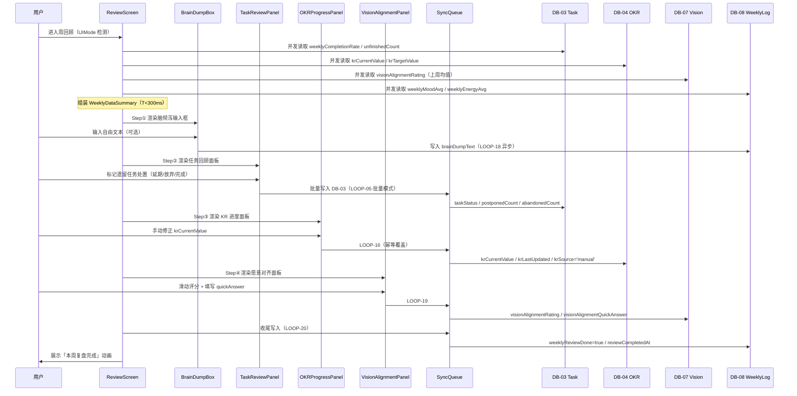

# 六、愿景显化组件 · `<WishlistScreen>`

## 操作动线映射（Flow 4 完整链路）

```jsx
[种子] 新建条目
  → <WishlistForm status="seed" />
  → 系统记录创建时间（显化起点）
  ↓
[孕育中] 用户建立关联 OKR / 开始执行相关任务
  → 手动更新状态为「🌱 孕育中」
  → HSI 检测相关任务持续投入 → 自动提示状态更新
  ↓
[已显化] 用户标记完成
  → <ManifestationCelebration> 触发（全屏3秒动效）
  → LOOP-04 触发（T<50ms）：DB-04.manifested=true / overallProgress=100
  → Celebration.onComplete → DB-07.celebrationPlayed=true（P2, T<500ms）
  → REL-09：里程碑 DB 自动生成记录
  → 首页「已显化清单」条目数 +1
```

## Flow 4 完整字段级操作动线（精细到每步写入）

```tsx
// ━━━━━━━━━━━━━━━━━━━━━━━━━━━━━━━━━━━━━━━━━━━━━━━━━━━━━━━━━━━━━━━━━
// WishlistItem 完整字段定义参见：# 十·五 DB07_Wishlist 接口
// 写入字段（全量）：
//   title            string     愿望标题（必填）
//   description      string     详细描述
//   category         select     分类（💗 健康 / 💰 财富 / 🧠 成长 / 🌍 体验 / 💑 关系）
//   manifestStatus   select     显化状态（🌱 种子 / 🌱 孕育中 / ✨ 已显化）
//   seedDate         date       种下日期（创建时写入 today()）
//   manifestedDate   date       显化完成日期（Step 3 写入 now()）
//   affirmation      text       肯定句（宇宙下单用语）
//   visualUrl        url        愿景图片 URL
//   emotionNote      text       情绪备注（种下时的心情）
//   celebrationCopy  text       AI 生成庆祝文案（Step 3 异步写入）
//   linkedOKRId      relation   关联 OKR → DB-04
//   linkedMilestoneId relation  关联里程碑（Step 3 REL-09 写入）
//   evidence         text       显化证明（富文本，Step 3 用户输入）
// ━━━━━━━━━━━━━━━━━━━━━━━━━━━━━━━━━━━━━━━━━━━━━━━━━━━━━━━━━━━━━━━━━
// ── Step 1：新建愿望种子 ────────────────────────────────────────────
// 用户打开 WishlistScreen → 点击「+ 新建愿望」
// T+0ms   WishlistForm 渲染，读取字段默认值：
//           manifestStatus = '🌱 种子'
//           seedDate = today()
//           category = '💗 健康'（默认，用户可修改）
//
// T+0ms   用户填写字段（必填：title；选填：description / category /
//         affirmation / visualUrl / emotionNote）
//
// T+0ms   用户点击「保存」：
//   P0 写入 DB-07：
//   {
//     title, description, category,
//     manifestStatus: '🌱 种子',
//     seedDate: today(),
//     affirmation, visualUrl, emotionNote,
//   }
//   → 幂等键：`wishlist:create:${title}:${seedDate}`
//   → 回写 id → 本地 store
//
// ── Step 2：孕育中 → OKR 关联 ──────────────────────────────────────
// 用户手动将 manifestStatus 更新为「🌱 孕育中」
// 同时建立 linkedOKRId（可选）
//
// 写入 DB-07：
//   PATCH { manifestStatus: '🌱 孕育中', linkedOKRId }
//
// 若 linkedOKRId 存在：
//   T<200ms  DB-04 反向写入：
//     PATCH { linkedWishlistId: wishId }
//     → OKR 详情页展示关联愿望
//
// HSI 自动检测（后台）：
//   若相关 OKR 下的 tasks 完成数 / 本周 CheckIn 命中率连续 3 天 ≥ 0.5：
//   → 推送提示：「你已经在努力实现 [{title}] 了，要更新状态吗？」
//   → 用户点击 → WishlistForm 预填 manifestStatus = '🌱 孕育中'
//
// ── Step 3：标记已显化（LOOP-04 完整触发链路）──────────────────────
// 用户点击「✨ 标记为已显化」
//
// T+0ms   P0 写入 DB-07：
//   {
//     manifestStatus: '✨ 已显化',
//     manifestedDate: now(),
//     evidence: userInput（可选），
//   }
//
// T<200ms  若 linkedOKRId 非空（LOOP-04）：
//   P1 写入 DB-04：
//     { manifested: true, overallProgress: 100 }
//   → 触发 OKRScreen 进度条完成动效
//
// T<200ms  AI 生成庆祝文案（异步，P2）：
//   input: { title, category, seedDate, manifestedDate, emotionNote }
//   output: celebrationCopy（个性化祝贺语）
//   → 写入 DB-07.celebrationCopy
//   → 传入 ManifestationCelebration.aiCopyText
//
// T<200ms  ManifestationCelebration 触发：
//   → 全屏动效 3000ms（duration 可由偏好设置覆盖）
//   → 显示 aiCopyText（AI 生成）或默认文案「✨ 你做到了！」
//
// T<500ms  REL-09（里程碑写入，P2 异步）：
//   → 里程碑 DB 新建行：
//     { title: `[{category}] ${title} 已显化`,
//       linkedWishlistId: wishId,
//       linkedOKRId,
//       date: manifestedDate }
//   → 回写 DB-07.linkedMilestoneId
//
// T<500ms  首页计数更新：
//   → DashboardScreen「已显化清单」角标 +1
//   → 写入 AppState.manifestedCount += 1（内存，下次启动读 DB-07 重算）
```

## `<ManifestationCelebration>` · 庆祝动效

```tsx
interface ManifestationCelebrationProps {
  wishItem: WishlistItem;
  duration?: number;         // 默认3000ms，ND 敏感用户可缩短
  aiCopyText?: string;       // AI 生成的个性化庆祝文案
  onClose: () => void;
}

// 渲染规则：
// - 全屏覆盖（z-index 最高层）
// - 动效：🎊 粒子爆炸 + 淡入文案
// - 右上角「✕ 关闭」始终可见（ND 用户不强迫停留）
// - duration 由用户偏好设置控制（可在设置中调整）
// - aiCopyText 显示在粒子动效下方（字号 24px，居中）
// - 关闭后自动导航至 <ManifestationHistory>（让用户看到记录）
```

## `<ManifestationHistory>` · 已显化清单（字段规范）

```tsx
// 数据源：DB-07，filter: manifestStatus = '✨ 已显化'
// 排序：manifestedDate DESC

interface ManifestationHistoryProps {
  dataSourceUrl: string;      // https://www.notion.so/1c80dfc8e6218308a12801abb96a52a4 Wishlist
  onItemTap: (wishId: string) => void;  // 展开详情
}

// ── 每行 ManifestationCard 渲染字段 ───────────────────────────────
// title（大字，emoji category icon 前置）
// seedDate → manifestedDate（「从 X 到 Y，历时 N 天」）
// celebrationCopy（AI 庆祝文案，浅色小字）
// category 色标签
// linkedOKRId 关联目标标题（若存在，显示「🎯 关联目标：[title]」）
//
// ── 展开详情字段 ──────────────────────────────────────────────────
// evidence（显化证明，富文本）
// emotionNote（当时心情）
// affirmation（肯定句）
// visualUrl（愿景图片，全宽显示）
// linkedMilestoneId → 里程碑卡片链接
//
// ── 空状态 ────────────────────────────────────────────────────────
// 「还没有显化记录，种下第一颗愿望种子吧 🌱」
// → 按钮：「+ 新建愿望」跳转 WishlistForm
//
// ── 统计字段（列表顶部汇总区）────────────────────────────────────
// totalManifested = DB-07.count(manifestStatus='已显化')
// fastestDays     = min(manifestedDate - seedDate)（最快显化天数）
// avgDays         = mean(manifestedDate - seedDate)
// categoryBreakdown: Record<category, count>（分类分布）
```

---

# 七、知识录入组件 · `<KnowledgeScreen>`

## 操作动线映射（Flow 5 完整链路）

```
用户录入知识条目
  → <KnowledgeEntryForm> 填写标题 + 摘要
  ↓
保存时触发 AI 语义分析（后台，< 2s）
  → 与进行中 OKR 语义匹配
  → 匹配分 > 0.65 → <OKRLinkSuggestionCard> 出现
  ↓
用户确认关联
  → 「🎯 关联目标」属性自动填充
  → OKR 「关联知识数」字段 +1
  ↓
R.I.A. 行动调整（A 部分）填写
  → REL-04：任务管理中自动生成新任务
```

## `<KnowledgeEntryForm>` · R.I.A. 三阶段字段写入时序

```tsx
// ━━━━━━━━━━━━━━━━━━━━━━━━━━━━━━━━━━━━━━━━━━━━━━━━━━━━━━━━━━━━━━━━━
// KnowledgeRecord 完整字段定义参见：# 十·五 DB06_Knowledge 接口
// 写入字段（全量）：
//   title              string    知识标题（必填）
//   source             text      来源（书名 / 链接 / 课程名）
//   sourceType         select    来源类型（book / article / video / podcast / experience）
//   R_reading          text      原文摘录 / 局部知识（Step R）
//   I_insight          text      个人洞察 / 层次理解（Step I）
//   A_action           text      行动调整项（Step A，非空时触发 LOOP-03）
//   tags               multi_select  知识标签
//   semanticEmbedding  number[]  768 维语义向量（AI 异步写入，P1）
//   aiSuggestedOKRId   relation  AI 建议关联 OKR（aiMatchScore 最高者）
//   aiMatchScore       number    AI 匹配置信度 0–1（> 0.65 触发建议卡片）
//   linkedOKRId        relation  用户确认关联的 OKR → DB-04（LOOP-09）
//   generatedTaskId    relation  LOOP-03 自动生成的任务 → DB-03
//   userRejectedOKRIds relation[] 用户拒绝的 OKR（降权系数 0.3）
// ━━━━━━━━━━━━━━━━━━━━━━━━━━━━━━━━━━━━━━━━━━━━━━━━━━━━━━━━━━━━━━━━━
// ── Step R：原文录入（Reading）────────────────────────────────────
// 用户填写 R_reading（原文摘录 / 局部知识）
// T+0ms   表单本地缓存，不触发任何写入
// T+0ms   字数 ≥ 20 时显示「I（洞察）」输入框（渐进式展开，减少压迫感）

// ── Step I：个人洞察（Insight）──────────────────────────────────────
// 用户填写 I_insight（个人洞察 / 层次理解）
// T+0ms   I_insight 字段本地缓存
// T+0ms   字数 ≥ 10 时显示「A（行动）」输入框

// ── Step A：行动调整（Action）───────────────────────────────────────
// 用户填写 A_action（行动调整项）
// T+0ms   A_action 字段本地缓存
// A_action 非空时：「保存」按钮右侧出现「✅ 将自动生成任务」小标

// ── 用户点击「保存」：完整写入时序 ────────────────────────────────
//
// T+0ms   幂等键生成：`knowledge:create:${title}:${today()}`
//         若 pendingOps 已含此键 → abort（防双击）
//
// T+0ms   P0 写入 DB-06（知识管理）：
//   {
//     title, source, sourceType,
//     R_reading, I_insight, A_action,
//     tags,
//     createdAt: now(),
//   }
//   → 回写 id → 本地 store（后续步骤引用 knowledgeId）
//
// T<200ms  P1 并行：AI 语义分析启动（后台异步，不阻塞 UI）
//   input: { title, R_reading, I_insight }
//   output: semanticEmbedding（number[]，768 维向量）
//           aiSuggestedOKRId（匹配分最高的进行中 OKR id）
//           aiMatchScore（匹配置信度 0–1）
//   写入 DB-06：
//     PATCH { semanticEmbedding, aiSuggestedOKRId, aiMatchScore }
//   → 若 aiMatchScore > 0.65：触发 OKRLinkSuggestionCard 渲染
//     否则：卡片不出现，静默写入 aiSuggestedOKRId 供未来参考
//
// T<2000ms P2 异步：LOOP-03（若 A_action 非空）
//   幂等键：`${knowledgeId}:loop03`
//   → DB-03 新建任务行：
//     {
//       title: A_action,
//       generatedFromKnowledge: knowledgeId,
//       cognitiveLoad: 2,
//       status: '🕐 待处理',
//       priority: 'P2-中',
//       scheduledDate: null,
//     }
//   → 回写 DB-06.generatedTaskId
//   → Toast 提示：「📝 已根据 A 部分自动生成任务」
//
// 失败处理：
//   P0 失败 → Toast 错误提示，允许重试，表单保留内容
//   P1 失败 → 静默失败，OKRLinkSuggestionCard 不出现
//   P2 失败 → 本地缓存 A_action，下次联网时重试

interface KnowledgeEntryFormProps {
  onSave: (record: Partial<KnowledgeRecord>) => void;
  prefilledOKRId?: string;   // 从 OKRScreen 跳入时预填关联 OKR
}
```

## `<OKRLinkSuggestionCard>` · OKR 关联建议完整字段协议

```tsx
interface OKRLinkSuggestionCardProps {
  suggestedOKR: OKRItem;           // AI 匹配的目标
  confidence: number;              // aiMatchScore 0–1
  knowledgeId: string;             // 当前知识条目 id
  onConfirm: () => void;
  onReject: (reason?: string) => void;
}

// ── 渲染规则 ────────────────────────────────────────────────────────
// 出现时机：AI 分析完成且 aiMatchScore > 0.65
// 位置：KnowledgeEntryForm 保存成功后，表单下方非弹窗嵌入
// 文案：「📎 这条知识可能与你的目标【{okr.title}】有关，是否关联？」
// 置信度显示：≥ 0.85 → 「高度匹配」/ 0.65–0.85 → 「可能相关」
// 两个操作按钮：✅ 关联 / ✕ 不关联
// 超时：30s 无操作 → 自动收起（不写入 rejected）

// ── onConfirm 字段写入链路 ──────────────────────────────────────────
// 用户点击「✅ 关联」：
//
// T+0ms   P1 写入 DB-06：
//   PATCH { linkedOKRId: suggestedOKR.id }
//
// T<200ms  P1 写入 DB-04（LOOP-09）：
//   原子加法：PATCH { linkedKnowledgeCount: increment(1) }
//   → OKRScreen 「关联知识数」角标 +1
//
// T<200ms  若 DB-06.A_action 非空且 LOOP-03 尚未执行：
//   补充写入 DB-03.linkedOKRId = suggestedOKR.id（任务关联 OKR）
//
// OKRLinkSuggestionCard 隐藏，显示内联确认标签：
//   「✅ 已关联到：{okr.title}」

// ── onReject 字段写入链路（降权写入）───────────────────────────────
// 用户点击「✕ 不关联」：
//
// T+0ms   P2 写入 DB-06：
//   PATCH {
//     userRejectedOKRIds: arrayUnion(suggestedOKR.id)
//     // arrayUnion = 追加到数组，已存在则跳过
//   }
//   → 未来 AI 匹配时：若 okrId ∈ userRejectedOKRIds
//     则该 OKR 的 aiMatchScore 乘以惩罚系数 0.3（实质上不再推荐）
//
// OKRLinkSuggestionCard 隐藏
// 不显示任何惩罚或提示（用户选择被尊重）

// ── 降权算法（AI 匹配侧读取规则）───────────────────────────────────
// 每次 AI 生成 aiSuggestedOKRId 时：
//   const rejectedIds = DB-06.userRejectedOKRIds ?? []
//   candidates = allActiveOKRs
//     .map(okr => ({
//       ...okr,
//       adjustedScore: rejectedIds.includes(okr.id)
//         ? rawScore * 0.3      // 被拒绝 → 降权到 30%
//         : rawScore
//     }))
//     .sort((a, b) => b.adjustedScore - a.adjustedScore)
//   aiSuggestedOKRId = candidates[0].id（adjustedScore 最高）
//   aiMatchScore     = candidates[0].adjustedScore
//   // 若 adjustedScore < 0.65 → 不触发卡片
```

---

# 七、知识录入组件 · `<KnowledgeScreen>`

## 操作动线映射（Flow 5 完整链路）

```jsx
用户点击 PDCANavBar「WRITE」
  ↓
<KnowledgeScreen> 渲染
  → 预加载 DB-06 近 10 条条目（title / sourceType / createdAt）
  → swipScore 不限制（WRITE 模式不设 swipLockThreshold）
  ↓
<KnowledgeEntryForm> 三段 RIA 录入
  ├─ R（Reading）：原文摘录 / 来源书名 / URL
  ├─ I（Insight） ：个人感悟与思考
  └─ A（Action）  ：可执行行动项（非必填）
  ↓
用户点击「保存」
  ├─ T<50ms   P0 → DB-06 写入（含 semanticEmbedding 异步计算触发）
  ├─ T<2000ms A_action 非空 → LOOP-03（P2）
  │    → DB-03 自动生成任务行
  │    → generatedTaskId 回写 DB-06
  └─ T<2000ms aiMatchScore > 0.65 → <OKRLinkSuggestionCard> 渲染
       ├─ 用户确认（onConfirm）→ LOOP-09（P1, T<200ms）
       │    → DB-06.linkedOKRId 写入
       │    → DB-04.linkedKnowledgeCount += 1
       └─ 超时 30s 无操作 → 自动收起（不写 userRejectedOKRIds）
```

## `<KnowledgeEntryForm>` · 三段录入组件完整字段写入时序

```tsx
interface KnowledgeEntryFormProps {
  onSave: (entry: KnowledgeEntry) => void;
  defaultLinkedOKRId?: string;  // 从 PDCANavBar WRITE 入口传入的预关联 OKR
}

// ── DB-06 KnowledgeEntry 写入字段清单 ─────────────────────────────
interface KnowledgeEntry {
  id:              string;      // 系统生成 UUID
  title:           string;      // 自动提取：R_reading 前 50 字 / 用户手填标题
  sourceType:      'book' | 'article' | 'video' | 'podcast' | 'self';
  sourceUrl?:      string;      // 来源 URL（article / video / podcast）
  sourceAuthor?:   string;      // 作者（book / article）
  R_reading:       string;      // 原文摘录（必填）
  I_insight:       string;      // 个人感悟（必填）
  A_action?:       string;      // 可执行行动（非必填，触发 LOOP-03）
  linkedOKRId?:    string;      // 手动关联 OKR（或 OKRLinkSuggestionCard onConfirm 写入）
  aiSuggestedOKRId?: string;    // AI 语义匹配建议（aiMatchScore ≥ 0.65 时写入，用户不可见）
  aiMatchScore?:   number;      // 0–1，语义向量余弦相似度
  semanticEmbedding?: number[]; // 1536 维向量（OpenAI text-embedding-3-small，异步写入）
  generatedTaskId?: string;     // LOOP-03 生成任务后回写（异步）
  createdAt:       Date;
  updatedAt:       Date;
}

// ── 完整字段写入时序（保存按钮点击后）────────────────────────────
//
// T+0ms   幂等键生成：`${deviceId}:${timestamp}:knowledge-save`
//   → pendingOps 去重检查（防双击）
//
// T+0ms   乐观更新本地 store：
//   → KnowledgeList 列表顶部插入新条目（optimistic）
//   → 保存按钮变为「已保存 ✓」（不等待网络）
//
// T<50ms  P0 写入 DB-06（知识库）：
//   CREATE {
//     id, title, sourceType, sourceUrl?, sourceAuthor?,
//     R_reading, I_insight, A_action?,
//     linkedOKRId?: defaultLinkedOKRId,
//     createdAt: now(), updatedAt: now()
//   }
//   幂等键：`${id}:knowledge-create`
//
// T<50ms  并行：语义向量计算异步任务入队
//   → 调用 text-embedding-3-small API（最长 2000ms）
//   → 输入：R_reading + I_insight 拼接（截断至 512 token）
//   → 完成后 PATCH DB-06.semanticEmbedding（P2）
//   → 超时（>2000ms）→ semanticEmbedding=null，OKRLinkSuggestionCard 不渲染
//   → 完成后：对 DB-04 所有进行中 OKR 进行 cosine 匹配
//     aiMatchScore = max cosine(entry.embedding, okr.embedding)
//     PATCH DB-06 { aiMatchScore, aiSuggestedOKRId }
//
// T<2000ms（A_action 非空）LOOP-03 P2 触发：
//   DB-03 CREATE {
//     title:                   A_action,
//     status:                  '🕐 待处理',
//     priority:                'P2-中',
//     cognitiveLoad:           2,
//     generatedFromKnowledge:  knowledgeId,
//     linkedOKRId:             DB-06.linkedOKRId ?? undefined,
//     estimatedMinutes:        30,
//     createdAt:               now(),
//   }
//   幂等键：`${knowledgeId}:loop03`
//   → 创建成功后 P2 回写：
//     PATCH DB-06 { generatedTaskId: newTask.id }
//
// T<2000ms（aiMatchScore > 0.65）<OKRLinkSuggestionCard> 渲染——见下节
//
// 失败回滚：
//   P0 写入失败 → SyncQueue 入队（maxRetries=5）+ Toast「⚠️ 知识待同步」
//   P2 写入失败（LOOP-03 / embedding）→ 静默 errorLog，不影响主流程
```

## `<OKRLinkSuggestionCard>` · AI OKR 关联建议卡片

```tsx
interface OKRLinkSuggestionCardProps {
  visible:          boolean;
  suggestedOKR: {
    id:             string;
    title:          string;
    overallProgress: number;
  };
  matchScore:       number;           // aiMatchScore 0.65–1.0
  onConfirm:        () => void;
  onDismiss:        () => void;
  autoHideAfterMs:  30_000;           // 30s 无操作自动收起
}

// ── 卡片文案分级（按 aiMatchScore）────────────────────────────────
// aiMatchScore ≥ 0.85  → 标题：「🎯 高度匹配！」
// aiMatchScore 0.65–0.85 → 标题：「💡 可能相关」

// ── onConfirm 字段写入链路 ───────────────────────────────────────
// T+0ms   乐观更新: DB-06.linkedOKRId = suggestedOKR.id
// T<50ms  P0 PATCH DB-06 { linkedOKRId: suggestedOKR.id }
//         幂等键: `${knowledgeId}:link-okr:${okriId}`
// T<200ms P1 LOOP-09: PATCH DB-04 { linkedKnowledgeCount: +1 }
//         幂等键: `${knowledgeId}:loop09`
//         → ReviewScreen Step③ 「知识关联数」实时刷新
// T+0ms   卡片 200ms 淡出消失

// ── onDismiss / 超时自动收起 ─────────────────────────────────
// 不写入 userRejectedOKRIds（手动关闭 ≠ 任务拒绝降权）
// aiSuggestedOKRId 保留于 DB-06（不对用户可见）

// ── UIMode 适配 ───────────────────────────────────────────────────
// focused：完整显示
// high-stress：卡片不渲染，aiSuggestedOKRId 静默写入 DB-06
// low-energy：简化版（仅标题 + 两个按钮）
// normal：完整显示
```

## AI 语义向量计算规范

```tsx
// 向量计算 SLA
// 模型: text-embedding-3-small（1536 维）
// 输入: R_reading + I_insight 拼接，截断至 512 token
// 超时阈值: T<2000ms
// 触发阈值: aiMatchScore > 0.65 → 卡片渲染
// 高度匹配阈值: aiMatchScore ≥ 0.85 → 文案升级
//
// 超时降级策略：
// 场景 A （>2000ms）→ semanticEmbedding=null, 卡片不渲染
//              → errorLog: { type: 'semantic-timeout', knowledgeId }
// 场景 B （API 5xx） → 静默降级 + SyncQueue P2 重试 1 次（24h）
// 场景 C （离线）   → 跳过向量计算，联网后 SyncQueue flush 补发
//
// OKR 匹配逻辑：
// • 对比 DB-04 所有 status='进行中' OKR 的 semanticEmbedding
// • cosine(a, b) = dot(a,b) / (norm(a) × norm(b))
// • argmax → aiSuggestedOKRId + aiMatchScore
// • 多 OKR 匹配 > 0.65 → 仅推荐最高分（单卡片不支持多选）
```

---

# 八、周回顾组件 · `<ReviewScreen>`

## 操作动线映射（Flow 6 完整链路）

```
用户点击 PDCANavBar「CHECK」
  ↓
<WeeklyDataSummary> 自动聚合（页面打开前已完成）
  - 打卡完成率 / 任务完成率 / OKR进度 / 里程碑
  ↓
四步流程（Step ① → ② → ③ → ④）
  ↓
AI 生成「下周建议优先级 Top 5」草稿
  ↓
用户确认 → ✅ 愿景对齐 checkbox 勾选 → 本周回顾完成
```

```tsx
interface ReviewScreenProps {
  weekData: WeeklyData;
  currentStep: 1 | 2 | 3 | 4;
  onStepComplete: (step: number) => void;
}

// ━━━━━━━━━━━━━━━━━━━━━━━━━━━━━━━━━━━━━━━━━━━━━━━━━━━━━━━━━━━━━━━━━
// WeeklyData 并行查询跨库字段对照（参见 # 十·五 各 DB 接口）：
//   DB-01 DB01_LIFEMATRICES → checkInScore / streakDays / 11项boolean
//   DB-03 DB03_Task         → status / priority / cognitiveLoad /
//                             weeklyPriority / scheduledDate / completedAt
//   DB-04 DB04_OKR          → title / overallProgress / checkInContribution /
//                             taskContribution / reviewNote
//   DB-05 DB05_KR           → currentValue / targetValue / progress / lastUpdatedBy
//   DB-08 DB08_HSILog       → energyLevel / stressLevel / swipScore /
//                             weeklyReviewDone / reviewCompletedAt /
//                             dailyRecoveryCardCount / lastRecoveryDismissAt
// ━━━━━━━━━━━━━━━━━━━━━━━━━━━━━━━━━━━━━━━━━━━━━━━━━━━━━━━━━━━━━━━━━
// ── WeeklyData 五库并行查询字段规范 ──────────────────────────────────
// 页面打开时后台并行查询，用户看到的是聚合结果（非原始数据库行）
interface WeeklyData {
  // ─ 来源 DB-01（LIFEMATRICES）────────────────────────────────────
  // 查询：filter date IN [weekStart, weekEnd]，读取字段：
  //   morning_meditation, morning_exercise, morning_learning,
  //   commute_bike, evening_workout, evening_review,
  //   presleep_meditation, presleep_reading, checkInScore
  checkInRate:       number;     // mean(checkInScore[7天]) 或 已勾选次数/总次数
  checkInDailyScores: number[];  // [0.6, 0.8, 1.0, ...] 共 7 个，用于趋势迷你图
  streakAtWeekEnd:   number;     // DB-01.streakDays（周末最新值）

  // ─ 来源 DB-03（任务管理）────────────────────────────────────────
  // 查询：filter scheduledDate IN [weekStart, weekEnd] OR
  //              completedAt IN [weekStart, weekEnd]
  // 读取字段：status, priority, cognitiveLoad, linkedOKRId, weeklyPriority
  taskCompletionRate: number;   // count(status=已完成) / count(全部) 本周
  completedTaskCount: number;   // 本周完成数（绝对值，给用户成就感）
  overdueTaskCount:   number;   // 截至周末仍未完成的 P0/P1 任务数
  topPriorityDoneRate: number;  // P0+P1 任务完成率（单独统计）

  // ─ 来源 DB-04（目标管理 OKR）────────────────────────────────────
  // 查询：filter status='🚀 进行中'
  // 读取字段：title, overallProgress, checkInContribution,
  //            taskContribution, linkedKRIds, reviewNote
  okrProgress: Array<{
    okrId:           string;
    title:           string;
    overallProgress: number;      // 本周末快照
    deltaThisWeek:   number;      // overallProgress(周末) - overallProgress(周初)
    // 周初值来源：DB-08 近7日中 weekStart 时刻的快照
    linkedKRCount:   number;      // 关联 KR 数量
    reviewNote?:     string;      // 上周写入的回顾备注（供本周参考）
  }>;

  // ─ 来源 DB-05（关键成果 KR）─────────────────────────────────────
  // 查询：JOIN DB-04（进行中 OKR）→ 取所有关联 KR
  // 读取字段：title, currentValue, targetValue, progress, lastUpdatedBy
  krDetails: Array<{
    krId:          string;
    title:         string;
    progress:      number;        // 0–1
    deltaThisWeek: number;        // currentValue 变化量（本周净增）
    lastUpdatedBy: 'task' | 'checkin' | 'manual';
  }>;

  // ─ 来源 DB-08（HSI 日志）────────────────────────────────────────
  // 查询：filter date IN [weekStart, weekEnd]
  // 读取字段：energyLevel, stressLevel, swipScore, timeSlot
  energyCalendar: Array<{
    date:         Date;
    avgEnergy:    number;         // 当日各时段 energyLevel 均值
    maxSwipScore: number;         // 当日 swipScore 峰值
    avgStress:    number;         // 当日 stressLevel 均值
  }>;
  weekAvgEnergy:    number;       // 7天均值
  crashDaysCount:   number;       // swipScore > 70 的天数（高风险天）

  // ─ 通用字段 ─────────────────────────────────────────────────────
  weekStart:    Date;
  weekEnd:      Date;
  behaviorVsCheckIn?: BehaviorReport;  // Phase 6 SYN-05
}

// 异常态处理：
// checkInRate < 30% → 跳过 <WeeklyDataSummary>，直接渲染 <BrainDumpBox>
// 文案：「这周有些忙，先把脑子里的东西倒出来就好」
// 不展示任何数据缺失的警告或惩罚性提示
```

## 四步流程字段写入映射表

```tsx
// ── Step ①：BrainDump 清空大脑 ───────────────────────────────────────
// 组件：<BrainDumpBox>
// 字段读取：无（输入框，不预填）
// 用户输入：自由文本，分行
// 写入时机：用户点击「下一步 →」
//   P0 本地 store：brainDumpText（本会话临时保存，不写数据库）
//   P2 可选写入：若用户设置「保存 BrainDump 到知识库」
//     → DB-06 新建行：
//       { title: `周回顾 BrainDump ${weekEnd}`,
//         R_reading: brainDumpText, sourceType: 'experience',
//         createdAt: now() }
// UI：多行文本框，无字数限制，低认知压力

// ── Step ②：TaskReview 任务回顾 ──────────────────────────────────────
// 组件：<TaskReviewPanel>
// 字段读取（渲染列表）：
//   DB-03 查询：status != '✅ 已完成' AND
//               (scheduledDate <= weekEnd OR dueDate <= weekEnd OR weeklyPriority IS NOT NULL)
//   显示字段：title, status, priority, dueDate, cognitiveLoad, weeklyPriority(上期)
//
// 用户操作 A：批量设置下周 weeklyPriority（1–5 拖拽排序 or 数字输入）
//   写入时机：用户点击「确认排序」
//   P1 批量写入 DB-03：
//     FOR each task IN reviewedTasks:
//       PATCH { weeklyPriority: userAssignedRank }  // 1=最高下周优先
//
// 用户操作 B：状态变更（放弃 / 暂停）
//   P0 即时写入 DB-03：
//     PATCH { status: '🗑 放弃' | '⏸ 暂停' }
//
// 用户操作 C：拆解大任务（点击「拆解」）
//   → 弹出子任务创建表单
//   → P0 写入 DB-03 新建行，linkedProjectId = parentTaskId

// ── Step ③：OKRProgress OKR 进度 ────────────────────────────────────
// 组件：<OKRProgressPanel>
// 字段读取：weekData.okrProgress（已聚合，来自五库并行查询）
// 显示字段：title, overallProgress, deltaThisWeek, krDetails[]
//
// 用户操作 A：手动更新 KR currentValue
//   P0 即时写入 DB-05：
//     PATCH { currentValue: userInput, lastUpdatedBy: 'manual', lastUpdatedAt: now() }
//   → 触发 DB-04.overallProgress 公式重算
//   → 本地 weekData.okrProgress 即时刷新
//
// 用户操作 B：写入 reviewNote（本周小结）
//   写入时机：用户点击「保存小结」或进入 Step ④
//   P1 写入 DB-04：
//     PATCH { reviewNote: userText }
//     // reviewNote 格式：追加模式（不覆盖旧值）
//     // 实际写入：reviewNote = `[${weekEnd}] ${userText}\n` + (existing ?? '')

// ── Step ④：VisionAlignment 愿景对齐 ────────────────────────────────
// 组件：<VisionAlignmentPanel>
// 字段读取：
//   DB-07 Wishlist：filter manifestStatus IN ['🌱 种子','🌱 孕育中']
//   读取字段：title, category, linkedOKRId, seedDate
//   → 展示「还在努力实现」的愿望清单（与本周 OKR 活动做关联提示）
//
// 用户操作 A：填写愿景对齐反思文本（自由输入）
//   写入时机：用户点击「完成本周回顾」
//   P1 写入 DB-04（每条进行中 OKR）：
//     PATCH { reviewNote: appendText(`[愿景对齐] ${alignmentText}`) }
//
// 用户操作 B：勾选「本周愿景对齐」checkbox
//   P0 即时写入 DB-08（本周末 HSI 日志）：
//     PATCH { weeklyReviewDone: true, reviewCompletedAt: now() }
//
// 完成后：
//   → LOOP-05 触发（DB-03 weeklyPriority 批量确认生效）
//   → Toast：「✅ 本周回顾完成，下周任务已就绪！」
//   → 自动跳回 DashboardScreen（CHECK → 首页）
//
// 全流程字段写入汇总：
// Step ①: DB-06（可选），本地 store
// Step ②: DB-03.weeklyPriority（批量），DB-03.status（即时）
// Step ③: DB-05.currentValue（手动），DB-04.reviewNote（追加）
// Step ④: DB-04.reviewNote（追加），DB-08.weeklyReviewDone，LOOP-05
```

### `<BehaviorVerificationReport>` · 行为验证报告（SYN-05，Phase 6）

```tsx
interface BehaviorVerificationReportProps {
  items: BehaviorCompareItem[];
  isVisible: boolean;        // 用户可关闭，系统尊重选择
  onToggleVisibility: () => void;
}

interface BehaviorCompareItem {
  label: string;             // 打卡项名称
  selfReport: boolean;       // 主观打卡
  behaviorData: string;      // 行为数据推断描述
  deviation: 'consistent' | 'minor' | 'major' | 'contradictory';
}

// 标题固定为：「这周我真正做了什么？」（好奇探索语气）
// 绝不使用：「你的打卡不真实」类惩罚性标题
// 偏差 > 30% 时才显示（minor 偏差不触发报告）
```

---

# 九、全局 UI 自适应规范

## HSI 驱动的 UI 状态机

```tsx
// 根据 HSI 状态自动切换 UI 模式，所有组件通过 useUIMode() 消费
type UIMode = 'normal' | 'low-energy' | 'high-stress' | 'focused';

// ── UIMode 四级字段阈值定义 ──────────────────────────────────────────
const UIMODE_THRESHOLDS = {
  focused:    { mentalCapacity: { gt: 0.8 } },
  highStress: { stressLevel:    { gt: 0.7 } },
  lowEnergy:  { overallEnergy:  { lte: 2  } },
  normal:     {},  // 默认兜底
} as const;

// ── 优先级：focused > high-stress > low-energy > normal ──────────────
function resolveUIMode(hsi: LifeCompassStateVector): UIMode {
  if (hsi.focus.mentalCapacity > 0.8)  return 'focused';
  if (hsi.emotion.stressLevel  > 0.7)  return 'high-stress';
  if (hsi.energy.overallEnergy <= 2)   return 'low-energy';
  return 'normal';
}
```

| UIMode | 来源字段 | 动画 | 颜色饱和度 | 过渡时长 | 信息密度 |
| --- | --- | --- | --- | --- | --- |
| `normal` | —（默认） | 开启 | 标准（100%） | 200ms | 标准 |
| `low-energy` | `overallEnergy ≤ 2` | 减少（仅必要过渡） | 降低（70%） | 200ms | 折叠次要模块 |
| `high-stress` | `stressLevel > 0.7` | 关闭（0 动效） | 降低（60%） | 100ms | 最小化（只显核心操作） |
| `focused` | `mentalCapacity > 0.8` | 开启（全效） | 标准（100%） | 200ms | 展开更多（数据完全可见） |

---

## UIMode × 16 组件响应矩阵（字段驱动）

> 每个组件在四种 UIMode 下的**具体属性字段变化**。组件通过 `useUIMode()` hook 读取当前模式后自适应渲染。
> 

### C01 · `<HSIStatusBar>`

```tsx
// 驱动字段：energy.overallEnergy / computedFromHSI / emotion.stressLevel
const HSIStatusBarUISpec: Record<UIMode, {
  barOpacity:       number;    // 整体透明度
  saturation:       number;    // 色彩饱和度百分比
  showConfidence:   boolean;   // 是否展示「置信度」小标
  pulseAnimation:   boolean;   // 心率脉冲动效
}> = {
  'normal':      { barOpacity: 1.0, saturation: 100, showConfidence: true,  pulseAnimation: true  },
  'low-energy':  { barOpacity: 0.85,saturation: 70,  showConfidence: false, pulseAnimation: false },
  'high-stress': { barOpacity: 1.0, saturation: 60,  showConfidence: false, pulseAnimation: false },
  'focused':     { barOpacity: 1.0, saturation: 100, showConfidence: true,  pulseAnimation: true  },
};
// high-stress 下 bar 背景色强制切换为橙色警示色（hex #F97316 低饱和）
// low-energy 下顶部追加免责文案：「今天可以少做，这也是一种完成」
```

### C02 · `<MiniCheckIn>`

```tsx
// 驱动字段：confidence（来自 LifeCompassStateVector.confidence）
const MiniCheckInUISpec: Record<UIMode, {
  visible:          boolean;    // 是否渲染（confidence < 0.5 时始终渲染）
  buttonFontSize:   number;     // 按钮字号 px
  buttonSpacing:    number;     // 按钮间距 px
  showSubtext:      boolean;    // 是否显示按钮副文案
}> = {
  'normal':      { visible: true,  buttonFontSize: 16, buttonSpacing: 12, showSubtext: true  },
  'low-energy':  { visible: true,  buttonFontSize: 18, buttonSpacing: 16, showSubtext: false },
  // low-energy：字体放大 + 间距加宽，减少认知压力
  'high-stress': { visible: true,  buttonFontSize: 20, buttonSpacing: 20, showSubtext: false },
  // high-stress：最大化按钮，1 秒内完成，绝不显示额外信息
  'focused':     { visible: false, buttonFontSize: 16, buttonSpacing: 12, showSubtext: true  },
  // focused：confidence 高，MiniCheckIn 不渲染
};
```

### C03 · `<TodayZone>`

```tsx
// 驱动字段：isLowEnergy / isHighStress / hsiState.emotion.stressLevel
const TodayZoneUISpec: Record<UIMode, {
  collapseCheckInTable:  boolean;  // 是否折叠 CheckInTable
  collapseOKRToggle:     boolean;  // 是否折叠 OKRProgressToggle
  showMotivationBanner:  boolean;  // 是否显示激励横幅
  backgroundSaturation:  number;  // 背景色饱和度%
  showDecorativeIcons:   boolean;  // 是否显示装饰性 emoji
}> = {
  'normal':      { collapseCheckInTable: false, collapseOKRToggle: false,
                   showMotivationBanner: false, backgroundSaturation: 100, showDecorativeIcons: true },
  'low-energy':  { collapseCheckInTable: true,  collapseOKRToggle: true,
                   showMotivationBanner: true,  backgroundSaturation: 70,  showDecorativeIcons: false },
  // low-energy：折叠非核心区块，显示激励横幅，移除装饰
  'high-stress': { collapseCheckInTable: true,  collapseOKRToggle: true,
                   showMotivationBanner: false, backgroundSaturation: 60,  showDecorativeIcons: false },
  // high-stress：极简化，横幅也不显示（减少任何额外刺激）
  'focused':     { collapseCheckInTable: false, collapseOKRToggle: false,
                   showMotivationBanner: false, backgroundSaturation: 100, showDecorativeIcons: true },
};
```

### C04 · `<PDCANavBar>`

```tsx
// 驱动字段：swipScore / hsi.emotion.stressLevel
const PDCANavBarUISpec: Record<UIMode, {
  disabledModes:     PDCAMode[];  // 当前被禁用的按钮
  showWarningDot:    boolean;     // 是否显示警告红点
  buttonSize:        'compact' | 'normal' | 'large';  // 按钮尺寸
  showModeLabel:     boolean;     // 是否显示文字标签
}> = {
  'normal':      { disabledModes: [],       showWarningDot: false, buttonSize: 'normal',  showModeLabel: true  },
  'low-energy':  { disabledModes: [],       showWarningDot: false, buttonSize: 'large',   showModeLabel: true  },
  // low-energy：放大按钮，降低精细操作要求
  'high-stress': { disabledModes: ['PLAN'], showWarningDot: true,  buttonSize: 'normal',  showModeLabel: false },
  // high-stress：PLAN 禁用（swipScore > 80 时），警告红点，隐藏文字减少认知
  'focused':     { disabledModes: [],       showWarningDot: false, buttonSize: 'normal',  showModeLabel: true  },
};
// swipScore > 90 时：DO 按钮也进入 disabledModes（所有模式均触发）
// 字段来源：LifeCompassStateVector.swipScore（实时读取，非 UIMode 函数内部）
```

### C05 · `<TaskRecommendList>`

```tsx
// 驱动字段：energy.overallEnergy / focus.mentalCapacity / emotion.stressLevel
const TaskRecommendListUISpec: Record<UIMode, {
  maxCognitiveLoad:    number;   // 硬过滤阈值（DB-03.cognitiveLoad）
  maxEstimatedMinutes: number;   // 硬过滤阈值（DB-03.estimatedMinutes）
  cardDensity:         'full' | 'compact';  // 卡片信息密度
  showMatchScore:      boolean;  // 是否展示 HSI 匹配分标签
  insertRecoveryCard:  boolean;  // 是否在列表顶部插入 RecoveryCard
}> = {
  'normal':      { maxCognitiveLoad: 5, maxEstimatedMinutes: 120, cardDensity: 'full',    showMatchScore: true,  insertRecoveryCard: false },
  'low-energy':  { maxCognitiveLoad: 2, maxEstimatedMinutes: 30,  cardDensity: 'compact', showMatchScore: false, insertRecoveryCard: true  },
  // low-energy：严格过滤高认知 + 长任务，插入恢复建议
  'high-stress': { maxCognitiveLoad: 2, maxEstimatedMinutes: 20,  cardDensity: 'compact', showMatchScore: false, insertRecoveryCard: true  },
  // high-stress：阈值更严格（20min），卡片最简化
  'focused':     { maxCognitiveLoad: 5, maxEstimatedMinutes: 120, cardDensity: 'full',    showMatchScore: true,  insertRecoveryCard: false },
};
```

### C06 · `<FullTaskPool>`

```tsx
// 驱动字段：energy.overallEnergy / focus.mentalCapacity
const FullTaskPoolUISpec: Record<UIMode, {
  forceCollapseHighLoad:  boolean;  // highLoad 分组强制折叠
  showCollapseWarning:    boolean;  // 高认知分组顶部显示「当前能量建议跳过」
  defaultExpandSections:  string[]; // 默认展开的分组 key
}> = {
  'normal':      { forceCollapseHighLoad: false, showCollapseWarning: false,
                   defaultExpandSections: ['recommended', 'overdue', 'quickWins'] },
  'low-energy':  { forceCollapseHighLoad: true,  showCollapseWarning: true,
                   defaultExpandSections: ['quickWins', 'overdue'] },
  // low-energy：高认知分组折叠 + 顶部警示，只展开快速完成 + 超期
  'high-stress': { forceCollapseHighLoad: true,  showCollapseWarning: true,
                   defaultExpandSections: ['quickWins'] },
  // high-stress：只展开 quickWins（≤ 15min + cognitiveLoad ≤ 2）
  'focused':     { forceCollapseHighLoad: false, showCollapseWarning: false,
                   defaultExpandSections: ['recommended', 'highLoad', 'overdue', 'quickWins'] },
  // focused：展开所有分组，including 高认知任务
};
```

### C07 · `<RecoveryCard>`

```tsx
// 驱动字段：swipScore / cardVariant / continuousWorkMin
const RecoveryCardUISpec: Record<UIMode, {
  autoInsert:         boolean;  // 是否自动插入列表顶部（无需用户触发）
  cardVariantOverride: 'gentle' | 'moderate' | 'urgent' | null;  // null = 使用 RECOVERY_CARD_TRIGGER 原始 variant
  showSwipMeter:      boolean;  // 是否显示 swipScore 进度条
  dismissable:        boolean;  // 是否允许用户关闭
}> = {
  'normal':      { autoInsert: false, cardVariantOverride: null,      showSwipMeter: false, dismissable: true  },
  'low-energy':  { autoInsert: true,  cardVariantOverride: 'gentle',  showSwipMeter: false, dismissable: true  },
  // low-energy：自动插入温和版本，不显示分数（避免增加焦虑）
  'high-stress': { autoInsert: true,  cardVariantOverride: 'moderate',showSwipMeter: true,  dismissable: true  },
  // high-stress：插入中等版本 + 显示 swipScore 进度条（数据化干预）
  'focused':     { autoInsert: false, cardVariantOverride: null,      showSwipMeter: false, dismissable: true  },
};
// urgent variant 由 RECOVERY_CARD_TRIGGER 独立控制，不受 UIMode 降级
```

### C08 · `<CheckInTable>`

```tsx
// 驱动字段：timeOfDay / hsiState.energy.overallEnergy
const CheckInTableUISpec: Record<UIMode, {
  showAllSlots:       boolean;   // 是否显示所有时段（false = 只显示当前时段）
  highlightUnchecked: boolean;   // 是否高亮未打卡项
  batchModeVisible:   boolean;   // 是否显示批量补签入口
  rowHeight:          'compact' | 'normal';  // 行高
}> = {
  'normal':      { showAllSlots: true,  highlightUnchecked: true,  batchModeVisible: true,  rowHeight: 'normal'  },
  'low-energy':  { showAllSlots: false, highlightUnchecked: false, batchModeVisible: false, rowHeight: 'normal'  },
  // low-energy：只显示当前时段，不施压未打卡项，隐藏批量补签
  'high-stress': { showAllSlots: false, highlightUnchecked: false, batchModeVisible: false, rowHeight: 'compact' },
  // high-stress：极简行高 + 只显示当前时段
  'focused':     { showAllSlots: true,  highlightUnchecked: true,  batchModeVisible: true,  rowHeight: 'normal'  },
};
```

### C09 · `<OKRProgressToggle>`

```tsx
// 驱动字段：hsiState.energy / focus.mentalCapacity
const OKRProgressToggleUISpec: Record<UIMode, {
  defaultExpanded:    boolean;   // 默认是否展开
  showKRDetails:      boolean;   // 是否显示 KR 明细（展开态）
  showDeltaThisWeek:  boolean;   // 是否显示本周进度变化量
  maxVisibleOKRs:     number;    // 最多显示 OKR 数量
}> = {
  'normal':      { defaultExpanded: false, showKRDetails: true,  showDeltaThisWeek: true,  maxVisibleOKRs: 3 },
  'low-energy':  { defaultExpanded: false, showKRDetails: false, showDeltaThisWeek: false, maxVisibleOKRs: 1 },
  // low-energy：折叠 + 只显示 1 条 OKR + 隐藏明细（减少信息负担）
  'high-stress': { defaultExpanded: false, showKRDetails: false, showDeltaThisWeek: false, maxVisibleOKRs: 0 },
  // high-stress：整个 toggle 不展开，仅显示角标计数
  'focused':     { defaultExpanded: true,  showKRDetails: true,  showDeltaThisWeek: true,  maxVisibleOKRs: 5 },
  // focused：自动展开 + 显示全量数据
};
```

### C10 · `<DailyRoutineToggle>`

```tsx
// 驱动字段：hsi.temporal.timeOfDay
const DailyRoutineToggleUISpec: Record<UIMode, {
  defaultExpanded:      boolean;
  autoScrollToSlot:     boolean;  // 是否自动滚动到当前时段
  highlightCurrentSlot: boolean;
  showWeeklyPlanner:    boolean;  // 是否显示「周期安排」区块
}> = {
  'normal':      { defaultExpanded: false, autoScrollToSlot: true,  highlightCurrentSlot: true,  showWeeklyPlanner: true  },
  'low-energy':  { defaultExpanded: false, autoScrollToSlot: false, highlightCurrentSlot: false, showWeeklyPlanner: false },
  // low-energy：不自动展开，隐藏周期安排（减少当下压力）
  'high-stress': { defaultExpanded: false, autoScrollToSlot: false, highlightCurrentSlot: false, showWeeklyPlanner: false },
  'focused':     { defaultExpanded: true,  autoScrollToSlot: true,  highlightCurrentSlot: true,  showWeeklyPlanner: true  },
};
```

### C11 · `<KnowledgeEntryForm>`

```tsx
// 驱动字段：focus.mentalCapacity / energy.overallEnergy
const KnowledgeEntryFormUISpec: Record<UIMode, {
  progressiveReveal:  boolean;   // R→I→A 渐进展开（true）vs 全部展示（false）
  autoSuggestOKR:     boolean;   // 是否触发 AI OKR 关联建议
  minCharsToReveal_I: number;    // 触发「I 洞察」展开的最小字数
  minCharsToReveal_A: number;    // 触发「A 行动」展开的最小字数
  showAutoTaskHint:   boolean;   // 是否显示「将自动生成任务」小标
}> = {
  'normal':      { progressiveReveal: true,  autoSuggestOKR: true,  minCharsToReveal_I: 20, minCharsToReveal_A: 10, showAutoTaskHint: true  },
  'low-energy':  { progressiveReveal: true,  autoSuggestOKR: false, minCharsToReveal_I: 10, minCharsToReveal_A: 5,  showAutoTaskHint: false },
  // low-energy：降低触发门槛，关闭 AI 建议（减少等待焦虑）
  'high-stress': { progressiveReveal: true,  autoSuggestOKR: false, minCharsToReveal_I: 5,  minCharsToReveal_A: 3,  showAutoTaskHint: false },
  // high-stress：极低门槛（几乎立即展开），禁用 AI 功能
  'focused':     { progressiveReveal: false, autoSuggestOKR: true,  minCharsToReveal_I: 20, minCharsToReveal_A: 10, showAutoTaskHint: true  },
  // focused：三栏全部展开（思维清晰，不需要渐进），启用全部 AI 功能
};
```

### C12 · `<OKRLinkSuggestionCard>`

```tsx
// 驱动字段：aiMatchScore（DB-06）/ confidence（LifeCompassStateVector）/ mentalCapacity
const OKRLinkSuggestionCardUISpec: Record<UIMode, {
  autoShow:            boolean;   // aiMatchScore > 0.65 时是否自动弹出（false = 静默写入）
  confidenceDisplay:   'text' | 'bar' | 'none';  // 置信度展示形式
  timeoutSecs:         number;    // 自动收起倒计时（秒），0 = 不自动收起
  showRejectionReason: boolean;   // 是否显示拒绝原因输入框
  animateEntrance:     boolean;   // 是否带入场动效
}> = {
  'normal':      { autoShow: true,  confidenceDisplay: 'bar',  timeoutSecs: 30, showRejectionReason: false, animateEntrance: true  },
  'low-energy':  { autoShow: false, confidenceDisplay: 'none', timeoutSecs: 0,  showRejectionReason: false, animateEntrance: false },
  // low-energy：不自动弹出（减少决策压力），AI 建议静默写入 aiSuggestedOKRId 供用户后续查看
  'high-stress': { autoShow: false, confidenceDisplay: 'none', timeoutSecs: 0,  showRejectionReason: false, animateEntrance: false },
  // high-stress：完全不出现（任何打断性 UI 均禁用）
  'focused':     { autoShow: true,  confidenceDisplay: 'bar',  timeoutSecs: 60, showRejectionReason: true,  animateEntrance: true  },
  // focused：延长超时到 60s，允许填写拒绝原因（认知余量充足，支持更细腻操作）
};
// 说明：low-energy / high-stress 下未被展示的建议，在用户下次进入 focused / normal
// 模式打开 KnowledgeScreen 时，以「延迟建议」形式补出（不丢失 AI 分析结果）
// 延迟建议展示字段：aiSuggestedOKRId（DB-06）+ aiMatchScore（DB-06）
```

### C13 · `<WeeklyDataSummary>`

```tsx
// 驱动字段：checkInRate / weekAvgEnergy（DB-08）/ crashDaysCount / taskCompletionRate（DB-03）
const WeeklyDataSummaryUISpec: Record<UIMode, {
  showEnergyCalendar:  boolean;   // 是否显示 7 天能量热力图（energyCalendar[]）
  showCrashDays:       boolean;   // 是否显示崩溃风险天数（crashDaysCount）
  showKRDeltaDetail:   boolean;   // 是否显示 KR 逐条进度变化量（krDetails[].deltaThisWeek）
  dataCardLayout:      'grid' | 'list';  // 数据卡片排列方式
  showBenchmark:       boolean;   // 是否显示与上周对比基准线
  skipThreshold:       number;    // checkInRate 低于此值时跳过整个摘要（直接进 BrainDump）
}> = {
  'normal':      { showEnergyCalendar: true,  showCrashDays: true,  showKRDeltaDetail: true,  dataCardLayout: 'grid', showBenchmark: true,  skipThreshold: 0.30 },
  'low-energy':  { showEnergyCalendar: false, showCrashDays: false, showKRDeltaDetail: false, dataCardLayout: 'list', showBenchmark: false, skipThreshold: 0.50 },
  // low-energy：精简到 checkInRate + taskCompletionRate 两个核心数字，隐藏负面指标
  'high-stress': { showEnergyCalendar: false, showCrashDays: false, showKRDeltaDetail: false, dataCardLayout: 'list', showBenchmark: false, skipThreshold: 0.60 },
  // high-stress：跳过阈值提升到 60%，几乎直接进入 BrainDump（回顾压力最小化）
  'focused':     { showEnergyCalendar: true,  showCrashDays: true,  showKRDeltaDetail: true,  dataCardLayout: 'grid', showBenchmark: true,  skipThreshold: 0.20 },
  // focused：完整数据视图，对比基准线，全量 KR 明细展开
};
// 字段写入：WeeklyDataSummary 本身不写入数据库
// 但渲染完成后触发后台任务：
//   → DB-08 写入 weeklyReviewStartedAt: now()（用于计算回顾完整性）
//   → 若 weekAvgEnergy < 2.5：自动写入 DB-08.lowEnergyWeekFlag = true
```

### C14 · `<BrainDumpBox>`

```tsx
// 驱动字段：swipScore / stressLevel / overallEnergy
const BrainDumpBoxUISpec: Record<UIMode, {
  placeholderVariant:  'calm' | 'encouraging' | 'minimal';  // 占位文案风格
  autoSaveToKnowledge: boolean;    // 是否显示「保存到知识库」开关
  showWordCount:       boolean;    // 是否显示字数统计（可能增加焦虑）
  minHeightLines:      number;     // 输入框最小行高（视觉上「可以多写」的邀请感）
  showTimerPrompt:     boolean;    // 是否显示「5分钟内写完就好」计时提示
}> = {
  'normal':      { placeholderVariant: 'encouraging', autoSaveToKnowledge: true,  showWordCount: false, minHeightLines: 6,  showTimerPrompt: false },
  'low-energy':  { placeholderVariant: 'calm',        autoSaveToKnowledge: false, showWordCount: false, minHeightLines: 4,  showTimerPrompt: true  },
  // low-energy：最轻量化——占位符改为「今天有什么想放下的？」（不强调写多），显示计时减少压迫
  'high-stress': { placeholderVariant: 'minimal',     autoSaveToKnowledge: false, showWordCount: false, minHeightLines: 3,  showTimerPrompt: true  },
  // high-stress：极简占位「随便写，写完就好」+ 最小行高，计时可见（5min 内完成承诺）
  'focused':     { placeholderVariant: 'encouraging', autoSaveToKnowledge: true,  showWordCount: true,  minHeightLines: 8,  showTimerPrompt: false },
  // focused：完整功能，字数统计开启，大输入区（认知余量充足，支持深度倾倒）
};
// 字段写入时序（Step ① 点击「下一步 →」）：
//   T+0ms   P0 本地 store：brainDumpText = inputValue（临时，不写 DB）
//   T+0ms   DB-08 写入：
//             PATCH { brainDumpCompletedAt: now() }（记录 Step ① 完成时间）
//   T<200ms 若 autoSaveToKnowledge=true 且用户开关已开启（DB-12.prefs.saveBrainDump=true）：
//             P2 写入 DB-06：
//               { title: `BrainDump · ${weekEndFormatted}`,
//                 R_reading: brainDumpText, sourceType: 'experience',
//                 tags: ['brain-dump', 'weekly-review'], createdAt: now() }
```

### C15 · `<TaskReviewPanel>`

```tsx
// 驱动字段：overdueTaskCount（DB-03）/ weeklyPriority / mentalCapacity
const TaskReviewPanelUISpec: Record<UIMode, {
  showOverdueAlert:      boolean;   // 是否显示超期任务顶部警告横幅
  enableDragSort:        boolean;   // 是否启用拖拽排序（mentalCapacity 足够时才有意义）
  showCognitiveLoadTag:  boolean;   // 每条任务是否显示认知需求标签
  maxTasksPerBatch:      number;    // 每屏显示的最大任务数（分批减少压迫感）
  showAISuggestion:      boolean;   // 是否显示 AI「下周优先级建议」草稿
  priorityInputMethod:   'drag' | 'tap' | 'auto';  // 优先级设置方式
}> = {
  'normal':      { showOverdueAlert: true,  enableDragSort: true,  showCognitiveLoadTag: true,  maxTasksPerBatch: 10, showAISuggestion: true,  priorityInputMethod: 'drag' },
  'low-energy':  { showOverdueAlert: false, enableDragSort: false, showCognitiveLoadTag: false, maxTasksPerBatch: 5,  showAISuggestion: false, priorityInputMethod: 'tap'  },
  // low-energy：关闭拖拽（精细操作高认知），每屏只显 5 条，AI 建议不出现（减少决策)
  'high-stress': { showOverdueAlert: false, enableDragSort: false, showCognitiveLoadTag: false, maxTasksPerBatch: 3,  showAISuggestion: false, priorityInputMethod: 'auto' },
  // high-stress：每屏仅 3 条，优先级设置改为 AI 自动分配（用户确认即可，零拖拽）
  'focused':     { showOverdueAlert: true,  enableDragSort: true,  showCognitiveLoadTag: true,  maxTasksPerBatch: 15, showAISuggestion: true,  priorityInputMethod: 'drag' },
  // focused：全功能，每屏最多 15 条，AI 建议草稿展开
};
// priorityInputMethod='auto' 时的字段写入规则（high-stress 专属路径）：
//   AI 按 [dueDate 紧迫度 × P0/P1 比例 × cognitiveLoad 反向权重] 自动分配 weeklyPriority
//   写入 DB-03：PATCH { weeklyPriority: aiAssignedRank, weeklyPrioritySource: 'ai-auto' }
//   weeklyPrioritySource 字段区分手动 vs AI 自动（供日后模型训练）
```

### C16 · `<VisionAlignmentPanel>`

```tsx
// 驱动字段：Wishlist manifestStatus（DB-07）/ OKR overallProgress（DB-04）/ mentalCapacity
const VisionAlignmentPanelUISpec: Record<UIMode, {
  showWishlistCards:   boolean;   // 是否展示进行中的愿望卡片（DB-07 query）
  showProgressDelta:   boolean;   // 是否显示 OKR 本周进度变化量（deltaThisWeek）
  alignmentInputMode:  'free-text' | 'rating' | 'minimal';  // 对齐反思输入方式
  showAffirmations:    boolean;   // 是否显示愿望肯定句（affirmation 字段）
  completionAnimation: boolean;   // 点击「完成」后是否播放完成动效
  autoCompleteIfEmpty: boolean;   // 若用户跳过填写，是否自动写入占位完成标记
}> = {
  'normal':      { showWishlistCards: true,  showProgressDelta: true,  alignmentInputMode: 'free-text', showAffirmations: true,  completionAnimation: true,  autoCompleteIfEmpty: false },
  'low-energy':  { showWishlistCards: true,  showProgressDelta: false, alignmentInputMode: 'rating',    showAffirmations: true,  completionAnimation: false, autoCompleteIfEmpty: true  },
  // low-energy：用 1–5 星评分替代自由文本（极低认知成本），自动补全避免卡关
  // 肯定句保留：在低能量时尤其有疗愈作用
  'high-stress': { showWishlistCards: false, showProgressDelta: false, alignmentInputMode: 'minimal',   showAffirmations: false, completionAnimation: false, autoCompleteIfEmpty: true  },
  // high-stress：隐藏愿望卡片和 OKR 进度数字（减少「我又没完成」的压力感）
  // minimal 模式：仅显示「这周，你是否在朝着自己想要的方向前进？」+ [是 / 不确定 / 没有] 三键
  'focused':     { showWishlistCards: true,  showProgressDelta: true,  alignmentInputMode: 'free-text', showAffirmations: true,  completionAnimation: true,  autoCompleteIfEmpty: false },
};
// alignmentInputMode 字段写入映射：
//   'free-text' → DB-04.reviewNote（appendText 模式）+ DB-08.weeklyReviewDone=true
//   'rating'    → DB-08 写入：{ visionAlignmentRating: 1–5, weeklyReviewDone: true }
//                 visionAlignmentRating 为 DB-08 新增字段（number 类型，1–5）
//   'minimal'   → DB-08 写入：
//                 { visionAlignmentQuickAnswer: 'yes'|'uncertain'|'no',
//                   weeklyReviewDone: true, reviewCompletedAt: now() }
// autoCompleteIfEmpty=true 时写入：
//   DB-08.weeklyReviewDone = true, DB-08.reviewCompletedAt = now()
//     DB-08.reviewSkippedByUIMode = true
  reviewSkippedCount?: number;（标记跳过原因，供分析）
```

---

## UIMode × 16 组件矩阵汇总速查表

> 精简版速查，字段驱动链路完整版见各组件规格。`●` = 启用 / 完整，`◐` = 降级，`○` = 禁用 / 隐藏
> 

| 组件 | 驱动字段（核心） | normal | low-energy | high-stress | focused |
| --- | --- | --- | --- | --- | --- |
| C01 HSIStatusBar | overallEnergy / stressLevel | ● 全量 | ◐ 降饱和 | ◐ 橙色警示 | ● 全量 |
| C02 MiniCheckIn | confidence | ● 标准字号 | ◐ 字号放大 | ◐ 最大化 | ○ 不渲染 |
| C03 TodayZone | overallEnergy / stressLevel | ● 完整 | ◐ 折叠次要 | ◐ 极简 | ● 完整 |
| C04 PDCANavBar | swipScore | ● 全按钮 | ◐ 按钮放大 | ◐ PLAN 禁用 | ● 全按钮 |
| C05 TaskRecommendList | mentalCapacity / overallEnergy | ● 全认知 | ◐ 限 CL≤2 / 30min | ◐ 限 CL≤2 / 20min | ● 全认知 |
| C06 FullTaskPool | overallEnergy / mentalCapacity | ● 全分组 | ◐ 折叠高认知 | ◐ 仅 quickWins | ● 展开全组 |
| C07 RecoveryCard | swipScore / continuousWorkMin | ○ 按需触发 | ◐ 自动 gentle | ◐ 自动 moderate | ○ 不自动插入 |
| C08 CheckInTable | timeOfDay / overallEnergy | ● 全时段 | ◐ 当前时段 | ◐ 极简行高 | ● 全时段 |
| C09 OKRProgressToggle | overallEnergy / mentalCapacity | ● 3条折叠 | ◐ 1条折叠 | ○ 仅角标 | ● 5条展开 |
| C10 DailyRoutineToggle | temporal.timeOfDay | ● 自动滚动 | ◐ 不展开 | ◐ 不展开 | ● 自动展开 |
| C11 KnowledgeEntryForm | mentalCapacity / overallEnergy | ● R→I→A 渐进 | ◐ 低门槛渐进 | ◐ 极低门槛 | ● 全展开 |
| C12 OKRLinkSuggestionCard | aiMatchScore / mentalCapacity | ● 自动弹出 | ○ 静默写入 | ○ 完全不出现 | ● 60s 超时 |
| C13 WeeklyDataSummary | checkInRate / weekAvgEnergy | ● 全量数据 | ◐ 双核心数字 | ◐ 跳过阈值 60% | ● 含对比基准 |
| C14 BrainDumpBox | swipScore / stressLevel | ● 6行标准 | ◐ 4行+计时 | ◐ 3行极简 | ● 8行+字数 |
| C15 TaskReviewPanel | overdueTaskCount / mentalCapacity | ● 拖拽 10条 | ◐ 点选 5条 | ◐ AI自动 3条 | ● 拖拽 15条 |
| C16 VisionAlignmentPanel | manifestStatus / overallProgress | ● 自由文本 | ◐ 1–5星评分 | ◐ 三键极简 | ● 自由文本 |

### C13 · `<WeeklyDataSummary>`

```tsx
// 驱动字段：checkInRate / weekAvgEnergy / taskCompletionRate
const WeeklyDataSummaryUISpec: Record<UIMode, {
  showEnergyCalendar: boolean;   // 是否显示每日能量日历
  showKRDelta:        boolean;   // 是否显示 KR 进度变化量
  showCrashDaysAlert: boolean;   // 是否显示「高风险天数」警示
  chartType:          'bar' | 'line' | 'minimal'; // 数据可视化类型
}> = {
  'normal':      { showEnergyCalendar: true,  showKRDelta: true,  showCrashDaysAlert: true,  chartType: 'bar'     },
  'low-energy':  { showEnergyCalendar: false, showKRDelta: false, showCrashDaysAlert: false, chartType: 'minimal' },
  // low-energy：只显示核心数字，隐藏图表和负面提示
  'high-stress': { showEnergyCalendar: false, showKRDelta: false, showCrashDaysAlert: false, chartType: 'minimal' },
  'focused':     { showEnergyCalendar: true,  showKRDelta: true,  showCrashDaysAlert: true,  chartType: 'line'    },
  // focused：折线图（趋势更清晰），全量数据
};
```

### C14 · `<ReviewPanels>` (BrainDumpBox / TaskReviewPanel / OKRProgressPanel / VisionAlignmentPanel)

```tsx
// 驱动字段：currentStep / energy.overallEnergy / focus.mentalCapacity
const ReviewPanelsUISpec: Record<UIMode, {
  stepLabelStyle:      'numbered' | 'icon';  // 步骤标签样式
  allowSkipStep:       boolean;   // 是否允许跳过某步
  taskReviewSortable:  boolean;   // Step② 是否支持拖拽排序 weeklyPriority
  showOKRHistory:      boolean;   // Step③ 是否显示历史 reviewNote
  aiDraftVisible:      boolean;   // 是否显示 AI 生成的下周建议草稿
}> = {
  'normal':      { stepLabelStyle: 'numbered', allowSkipStep: false, taskReviewSortable: true,  showOKRHistory: true,  aiDraftVisible: true  },
  'low-energy':  { stepLabelStyle: 'icon',     allowSkipStep: true,  taskReviewSortable: false, showOKRHistory: false, aiDraftVisible: false },
  // low-energy：允许跳步（不强迫完整流程），禁用拖拽（操作精度要求高），隐藏历史
  'high-stress': { stepLabelStyle: 'icon',     allowSkipStep: true,  taskReviewSortable: false, showOKRHistory: false, aiDraftVisible: false },
  'focused':     { stepLabelStyle: 'numbered', allowSkipStep: false, taskReviewSortable: true,  showOKRHistory: true,  aiDraftVisible: true  },
};
// CHECK 模式（PDCANavBar）始终强制 UIMode = 'normal'（PDCA_ROUTE_SPEC.CHECK.forcedUIMode = 'normal'）
// 原因：回顾需要看全量数据，不能因为低能量而折叠关键指标
```

### C15 · `<ManifestationCelebration>`

```tsx
// 驱动字段：duration（用户偏好）/ energy.overallEnergy
const ManifestationCelebrationUISpec: Record<UIMode, {
  particleCount:    number;   // 粒子爆炸数量（动效强度）
  durationMs:       number;   // 动效持续毫秒（基础值，可被用户偏好覆盖）
  backgroundBlur:   boolean;  // 全屏覆盖是否模糊背景
  playSound:        boolean;  // 是否播放庆祝音效
  aiCopyFontSize:   number;   // AI 庆祝文案字号 px
}> = {
  'normal':      { particleCount: 200, durationMs: 3_000, backgroundBlur: true,  playSound: true,  aiCopyFontSize: 24 },
  'low-energy':  { particleCount: 80,  durationMs: 2_000, backgroundBlur: false, playSound: false, aiCopyFontSize: 22 },
  // low-energy：降低粒子数和音效（感官友好），缩短时长
  'high-stress': { particleCount: 40,  durationMs: 1_500, backgroundBlur: false, playSound: false, aiCopyFontSize: 20 },
  // high-stress：极简庆祝（避免感官过载），缩短到 1.5s
  'focused':     { particleCount: 200, durationMs: 3_000, backgroundBlur: true,  playSound: true,  aiCopyFontSize: 24 },
};
// 用户偏好设置（AppSettings.celebrationDuration）可以覆盖 durationMs
// ND 用户保护：点击「✕ 关闭」始终立即终止动效（不受 durationMs 限制）
```

### C16 · `<CrashInterventionOverlay>`

```tsx
// 驱动字段：swipScore / resolveRiskLevel 返回值
const CrashInterventionOverlayUISpec: Record<UIMode, {
  mode:             'suggestion' | 'fullscreen' | 'hidden';
  overlayOpacity:   number;   // 遮罩透明度 0–1
  blurBackground:   boolean;
  showStressCurve:  boolean;  // 是否显示 2h 压力曲线
  lockNavigation:   boolean;  // 是否锁定 PLAN/DO 导航按钮
}> = {
  'normal':      { mode: 'hidden',     overlayOpacity: 0,    blurBackground: false, showStressCurve: false, lockNavigation: false },
  'low-energy':  { mode: 'suggestion', overlayOpacity: 0.5,  blurBackground: false, showStressCurve: false, lockNavigation: false },
  // low-energy 时若 swipScore < 70：不触发 overlay，RecoveryCard 已覆盖
  'high-stress': { mode: 'suggestion', overlayOpacity: 0.7,  blurBackground: true,  showStressCurve: true,  lockNavigation: false },
  // high-stress：底部抽屉 + 模糊背景 + 显示压力曲线（数据化解释）
  'focused':     { mode: 'hidden',     overlayOpacity: 0,    blurBackground: false, showStressCurve: false, lockNavigation: false },
};
// swipScore > 90 时（critical 风险）：强制 mode = 'fullscreen' + lockNavigation = true
// 此规则优先于 UIMode，由 CrashRiskMonitor 直接写入 AppState 触发
```

---

## UIMode 切换防抖规则（`MODE_SWITCH_DEBOUNCE`）

> 防止能量波动导致 UI 频繁闪烁。所有 UIMode 切换经过防抖状态机。
> 

```tsx
// ── 防抖参数常量 ────────────────────────────────────────────────────
const MODE_SWITCH_DEBOUNCE = {
  // 最小停留时间（ms）：当前模式持续不足此值时，不允许切换
  minDwellMs: {
    'normal':      60_000,   // normal 停留 ≥ 60s 才能切走
    'low-energy':  30_000,   // low-energy 停留 ≥ 30s 才能切走（防止短暂低能量触发）
    'high-stress': 20_000,   // high-stress 停留 ≥ 20s 才能切走
    'focused':     45_000,   // focused 停留 ≥ 45s 才能切走（专注状态应被保护）
  },
  // 连续切换上限：N 次连续切换内锁定当前模式
  maxSwitchInWindow: 3,      // 5 分钟窗口内切换次数上限
  lockWindowMs:      300_000,// 5 分钟窗口（锁定检测范围）
  lockDurationMs:    120_000,// 触发锁定后保持当前模式 2 分钟
} as const;

// ── 防抖状态机（运行在 HSIProvider 内部，无 UI）────────────────────
interface UIModeDebounceState {
  currentMode:         UIMode;
  currentModeEnteredAt: number;    // timestamp ms，进入当前模式的时间
  recentSwitchLog:     number[];   // 近期切换时间戳数组（用于计数）
  isLocked:            boolean;    // 是否处于锁定状态
  lockedUntil?:        number;     // 锁定解除时间戳
}

function shouldSwitchMode(
  debounce: UIModeDebounceState,
  candidateMode: UIMode,
  now: number = Date.now()
): { allowed: boolean; reason?: string } {
  // 规则 0：目标模式与当前相同 → 无需切换
  if (candidateMode === debounce.currentMode) {
    return { allowed: false };
  }

  // 规则 1：处于锁定状态 → 不允许切换（critical 风险除外）
  if (debounce.isLocked && debounce.lockedUntil && now < debounce.lockedUntil) {
    return { allowed: false, reason: 'mode-locked' };
  }

  // 规则 2：当前模式停留时长 < minDwellMs → 不允许切换
  const dwellMs = now - debounce.currentModeEnteredAt;
  const requiredDwell = MODE_SWITCH_DEBOUNCE.minDwellMs[debounce.currentMode];
  if (dwellMs < requiredDwell) {
    return { allowed: false, reason: `min-dwell-not-met (${dwellMs}ms < ${requiredDwell}ms)` };
  }

  // 规则 3：窗口内连续切换次数超限 → 触发锁定
  const windowStart = now - MODE_SWITCH_DEBOUNCE.lockWindowMs;
  const recentCount = debounce.recentSwitchLog.filter(t => t > windowStart).length;
  if (recentCount >= MODE_SWITCH_DEBOUNCE.maxSwitchInWindow) {
    // 触发锁定：记录 lockedUntil，下次 HSIProvider 轮询时写入 debounceState
    return { allowed: false, reason: `switch-count-exceeded (${recentCount} in window)` };
  }

  return { allowed: true };
}

// ── 锁定触发写入（由 HSIProvider 调用）─────────────────────────────
function applyModeLock(debounce: UIModeDebounceState, now: number): UIModeDebounceState {
  return {
    ...debounce,
    isLocked:    true,
    lockedUntil: now + MODE_SWITCH_DEBOUNCE.lockDurationMs,
  };
}

// ── 例外规则（绕过防抖的强制切换场景）──────────────────────────────
// 1. CrashRiskMonitor 检测 critical 风险（swipScore > 90）
//    → 强制切换 UIMode = 'high-stress'，绕过所有防抖规则
//    → 同时触发 CrashInterventionOverlay fullscreen
// 2. PDCANavBar.CHECK 模式进入
//    → 强制切换 UIMode = 'normal'（PDCA_ROUTE_SPEC.CHECK.forcedUIMode）
//    → 绕过防抖（因为进入 ReviewScreen 是明确的用户意图）
// 3. MiniCheckIn 用户手动签到（onSelect 回调）
//    → 立即重算 HSI → 若新 UIMode 与当前不同 → 绕过 minDwellMs 规则
//    → 因为用户主动提供了新的能量数据，应立即响应

// ── UIMode 切换完整时序 ──────────────────────────────────────────────
// T+0ms    HSIProvider 每 60s 轮询完成 inferHSI()
//          → candidateMode = resolveUIMode(newHSI)
// T+0ms    shouldSwitchMode(debounce, candidateMode) 判断
//          → allowed = false → 维持 currentMode
//          → allowed = true  → 进入切换流程
// T+0ms    切换写入：
//          → debounce.currentMode = candidateMode
//          → debounce.currentModeEnteredAt = now
//          → debounce.recentSwitchLog.push(now)
//          → debounce.recentSwitchLog = log.filter(t => t > windowStart)（窗口清理）
// T<16ms   Context 广播新 UIMode → 所有订阅组件 re-render
//          → 各组件根据自身 UISpec 读取新配置
//          → 过渡动效时长由 UIMode 决定（normal=200ms | high-stress=100ms）
```

## 字体与间距规范（ND/HSP 感官友好）

- 正文字体：无衬线字体（SF Pro / Inter）
- 行间距：≥ 1.6
- 段落间距：清晰分隔，≥ 16px
- 主色调：低饱和度暖色（绿/橙系），避免高饱和蓝/红
- **UIMode 色彩映射**：`saturate(100%)` → `normal/focused` | `saturate(70%)` → `low-energy` | `saturate(60%)` → `high-stress`

## 空状态设计规范

| 场景 | 空状态文案 | 操作引导 |
| --- | --- | --- |
| 任务池为空 | 「今日已清空！🎉」 | 跳转 Wishlist |
| 无进行中 OKR | 「要先定义一个目标吗？」 | 跳转 OKR Screen |
| 本周数据严重缺失 | 「这周有些忙，先把脑子倒出来就好」 | 直接进入 BrainDump |
| 设备离线 | 「今日三件事」简化输入框 | 手动模式降级 |

---

# 八、周回顾组件 · `<ReviewScreen>`

> **所属 Flow**：Flow 6 — Weekly Review Pipeline
> 

> **触发时机**：每周日 LOOP-17（`scheduleWeeklyReview`）推送 → 用户点击进入
> 

> **核心职责**：汇总上周执行数据 → 驱动 OKR 进度修正 → 写入 DB-07 愿景对齐评分 → 封存 DB-08 周记录
> 

---

## 8.1 操作动线总览（四步）



---

## 8.2 Step① — BrainDumpBox · 脑倾泻输入

### 触发条件

- 始终展示，UIMode=`low-energy` 时折叠为单行占位符，点击展开
- 字数无上限；支持语音转文字（可选接入）

### 字段写入（LOOP-18 · 异步低优先级）

| 目标表 | 字段 | 类型 | 写入时机 | 备注 |
| --- | --- | --- | --- | --- |
| DB-08 | `brainDumpText` | `string` | 用户点击「保存」或离焦 500ms 后 | 追加写入，不覆盖 |
| DB-08 | `brainDumpUpdatedAt` | `ISO8601` | 同上 | 每次追加更新时间戳 |

---

## 8.3 Step② — TaskReviewPanel · 任务回顾 + LOOP-05 批量写入

### 数据读取（ReviewScreen 初始化时并发）

| 字段 | 来源 | 用途 |
| --- | --- | --- |
| `taskStatus` | DB-03 | 筛选上周未完成任务 |
| `weeklyCompletionRate` | DB-03（聚合） | 面板顶部完成率展示 |
| `postponedCount` | DB-03 | 累计延期次数展示 |
| `taskDeadline` | DB-03 | 判断是否逾期 |
| `taskPriority` | DB-03 | 任务排序权重 |

### 用户操作 → 字段写入（LOOP-05 批量模式，T<500ms/批）

| 用户操作 | 目标表 | 字段 | 写入值 | 级联 |
| --- | --- | --- | --- | --- |
| 标记「完成」 | DB-03 | `taskStatus` | `'completed'` | 触发 DB-08.weeklyCompletionRate 聚合重算 |
| 标记「延期」 | DB-03 | `taskStatus` / `postponedCount` / `taskDeadline` | `'pending'` / `+1` / `nextWeekDate` | postponedCount ≥ 3 触发 LOOP-06 降权 |
| 标记「放弃」 | DB-03 | `taskStatus` / `abandonedAt` | `'abandoned'` / `now()` | 从当周 OKR 关联中解绑 |
| 批次提交 | DB-08 | `weeklyCompletionRate` | 重新聚合：`completed / total` | 写入时附带 `weekId` |

### 失败回滚规则

- SyncQueue 批量写入失败（网络断开）→ 本地 IndexedDB 暂存，重连后自动重放
- 单条写入超时（>2000ms）→ 乐观更新回滚，Toast 提示「同步失败，请重试」

---

## 8.4 Step③ — OKRProgressPanel · KR 手动修正 + LOOP-16 幂等覆盖

### 数据读取

| 字段 | 来源 | 展示位置 |
| --- | --- | --- |
| `okrTitle` | DB-04 | KR 标题 |
| `krCurrentValue` | DB-04 | 当前进度值（可编辑） |
| `krTargetValue` | DB-04 | 目标值（只读） |
| `krUnit` | DB-04 | 单位标注（次/天/% 等） |
| `krLastUpdated` | DB-04 | 上次更新时间展示 |
| `krSource` | DB-04 | 来源标注（`'auto'` / `'manual'`） |

### LOOP-16 幂等写入规范

```tsx
// LOOP-16: KR 手动修正·幂等覆盖
interface KRManualUpdatePayload {
  okrId: string;                         // DB-04 主键
  krCurrentValue: number;                // 用户输入新值
  krLastUpdated: string;                 // now() ISO8601
  krSource: 'manual';                    // 来源标记
  weekId: string;                        // 所属周标识
  prevValue?: number;                    // 用于冲突检测（乐观锁）
}
// 幂等条件：相同 okrId + weekId + krCurrentValue → 跳过重复写入
// 冲突检测：服务端 krCurrentValue !== prevValue → 返回 409，前端弹 diff 确认弹窗
```

### 字段写入（LOOP-16）

| 目标表 | 字段 | 写入值 | 幂等键 |
| --- | --- | --- | --- |
| DB-04 | `krCurrentValue` | 用户输入数值 | `okrId + weekId` |
| DB-04 | `krLastUpdated` | `now()` | 同上 |
| DB-04 | `krSource` | `'manual'` | 同上 |

---

## 8.5 Step④ — VisionAlignmentPanel · 愿景对齐评分 + LOOP-19

### UIMode 渲染差异

| UIMode | 渲染形式 | 跳过逻辑 |
| --- | --- | --- |
| `focus` | 完整评分滑块（1–10）+ 文字框 | 不可跳过 |
| `normal` | 完整评分滑块（1–10）+ 文字框 | 可跳过（点击「稍后再说」） |
| `low-energy` | 仅展示 3 档快捷选项（低/中/高） | 自动映射为 3 / 6 / 9 分；可一键跳过 |

### 跳过逻辑（UIMode=`low-energy` 或用户主动跳过）

```tsx
// 跳过时写入标记，不写评分
DB07.reviewSkippedByUIMode = currentUIMode;   // 'low-energy' | 'normal'
DB08.reviewSkippedCount += 1;                  // 累计跳过次数
// visionAlignmentRating 本周不写入（保持上周值）
```

### LOOP-19 字段写入规范

| 目标表 | 字段 | 类型 | 写入条件 | 备注 |
| --- | --- | --- | --- | --- |
| DB-07 | `visionAlignmentRating` | `number`（1–10） | 用户提交评分（未跳过） | low-energy 快捷档映射：低→3, 中→6, 高→9 |
| DB-07 | `visionAlignmentQuickAnswer` | `string` | 用户填写文字（可选） | 最长 500 字 |
| DB-07 | `reviewSkippedByUIMode` | `UIMode` | 用户跳过时 | 记录跳过时的能量模式 |
| DB-08 | `reviewSkippedCount` | `number` | 跳过时 +1 | 累计跳过次数统计 |

---

## 8.6 收尾写入 — LOOP-20 · 周记录封存

### 触发条件

- 四步全部完成（或用户点击「完成复盘」按钮）
- UIMode=`low-energy` 允许仅完成 Step① + Step② 即触发

### 字段写入（LOOP-20，原子写入，T<200ms）

```tsx
interface WeeklyReviewCompletionPayload {
  weekId: string;                            // 本周 ISO 周标识
  weeklyReviewDone: true;                    // DB-08 封存标志
  reviewCompletedAt: string;                 // now() ISO8601
  reviewDurationMs: number;                  // 本次复盘耗时（ms）
  reviewCompletionMode: UIMode;              // 完成时的 UIMode
  stepsCompleted: ('dump'|'task'|'okr'|'vision')[];  // 已完成步骤列表
}
```

| 目标表 | 字段 | 写入值 | 原子性要求 |
| --- | --- | --- | --- |
| DB-08 | `weeklyReviewDone` | `true` | ✅ 必须与 reviewCompletedAt 同批写入 |
| DB-08 | `reviewCompletedAt` | `now()` | ✅ 同上 |
| DB-08 | `reviewDurationMs` | 进入页面至点击完成的 ms 差值 | 可异步写入 |
| DB-08 | `reviewCompletionMode` | 当前 UIMode 字符串 | 可异步写入 |
| DB-08 | `stepsCompleted` | `string[]`（JSON 序列化） | 可异步写入 |

### 失败处理

- `weeklyReviewDone + reviewCompletedAt` 原子写入失败 → 整体回滚，不封存
- 次要字段（durationMs / mode / steps）失败 → 静默忽略，不影响封存
- 已封存的 weekId 再次提交 → 幂等拦截，返回 `{ alreadyDone: true }`

---

## 8.7 WeeklyDataSummary · 初始化并发读取规范

```tsx
// ReviewScreen 进入时并发拉取，组装 WeeklyDataSummary
interface WeeklyDataSummary {
  // 来自 DB-03（Task）
  totalTasks: number;
  completedTasks: number;
  weeklyCompletionRate: number;              // 0–1 浮点
  unfinishedTasks: TaskItem[];               // 未完成任务列表（最多 20 条）
  postponedTaskCount: number;

  // 来自 DB-04（OKR）
  activeOKRs: OKRItem[];                     // 进行中的 OKR 列表
  krProgressList: KRProgressItem[];          // 每个 KR 的当前/目标值

  // 来自 DB-07（Vision）
  lastVisionAlignmentRating?: number;        // 上周评分（可能为空）
  visionTitle: string;                       // 愿景标题

  // 来自 DB-08（WeeklyLog）
  weeklyMoodAvg?: number;                    // 本周情绪均值
  weeklyEnergyAvg?: number;                  // 本周能量均值
  weeklyHSIAvg?: number;                     // 本周 HSI 均值
  weekId: string;                            // 本周 ISO 标识
}
// 超时策略：单表 T<150ms，全量 T<300ms；超时后降级展示可用数据
```

---

## 8.8 UIMode=`low-energy` · 全流程跳过模式

<aside>
⚡

**低能量模式下的最小复盘路径**：仅需完成 Step① 脑倾泻（可留白）+ Step② 任务批量延期（一键全部延期），即可触发 LOOP-20 封存。系统自动写入 `reviewSkippedByUIMode='low-energy'`，不强制用户完成 OKR 修正和愿景评分。

</aside>

| 步骤 | low-energy 行为 | 必填 |
| --- | --- | --- |
| Step① BrainDump | 单行占位，点击展开 | ❌ 可留白 |
| Step② TaskReview | 顶部「全部延期」一键按钮 | ✅ 至少点击一次 |
| Step③ OKRProgress | 折叠，展示上周值，不要求修改 | ❌ 可跳过 |
| Step④ VisionAlignment | 3 档快捷选项 或 一键跳过 | ❌ 可跳过 |

---

# 十·五、全量 DB 字段接口定义（DB-01 ~ DB-11）

> 所有数据库字段的规范化 TypeScript 接口。注释标明写入者（►写入）、读取者（►读取）和关联 LOOP 编号。每个字段均可作为 query-data-sources / PATCH 的精确键名。
> 

```tsx
// ══════════════════════════════════════════════════════════════
// DB-01：LIFEMATRICES（打卡主表）
// Workspace URL: https://www.notion.so/3250dfc8e62180cf9c56cb713e9da4e2
// ══════════════════════════════════════════════════════════════
interface DB01_LIFEMATRICES {
  id:                    string;
  date:                  Date;          // 打卡日期（唯一键语义）

  // ─ 11 项打卡 boolean 字段 ──────────────────────────────────
  morning_meditation:    boolean;       // 冥想 / 听金刚经解读
  morning_exercise:      boolean;       // 八段锦 / 拉伸 / 瑜伽
  morning_learning:      boolean;       // 晨间学习（营养学/神经科学/历史）
  morning_breakfast:     boolean;       // 早饭制备（豆浆/蒸玉米/煮鸡蛋）
  commute_bike:          boolean;       // 骑车通勤
  evening_workout:       boolean;       // 下班后无氧训练
  evening_review:        boolean;       // 15 分钟动作复盘
  presleep_meditation:   boolean;       // 睡前冥想
  presleep_reading:      boolean;       // 阅读 / 心流
  presleep_skincare:     boolean;       // 护肤 / 身体乳
  presleep_prep:         boolean;       // 准备次日装备 + 食材

  // ─ 计算字段（Notion 公式自动维护）─────────────────────────
  checkInScore:          number;        // checkedCount / totalItemCount，0–1
                                        // ► 写入: CheckInTable.onCheck（P1 T<50ms）
                                        // ► 读取: LOOP-01→DB-04, HSIInference.lastCheckInScore
  totalItemCount:        number;        // 固定 = 11
  checkedCount:          number;        // 已勾选项数（公式字段）
  streakDays:            number;        // 连续 checkInScore=1.0 的天数
                                        // ► 读取: WeeklyDataSummary.streakAtWeekEnd

  // ─ 关联字段 ─────────────────────────────────────────────────
  linkedHabits:          string[];      // → DB-02.id[]（REL-06）
  linkedPlanIds:         string[];      // → DB-09b.id[]（健身计划 REL-06）

  // ─ 元数据 ──────────────────────────────────────────────────
  retroactive:           boolean;       // true = 补签（BatchComplete），默认 false
  updatedAt:             Date;
  _idempotencyKey:       string;        // `${date}:${fieldName}:toggle`
}

// ══════════════════════════════════════════════════════════════
// DB-02：Habits（习惯追踪辅表）
// ══════════════════════════════════════════════════════════════
interface DB02_Habits {
  id:                    string;
  title:                 string;
  targetFrequency:       number;        // 目标次数/周（通常 5–7）
  targetUnit:            'day' | 'week' | 'month';

  completedDates:        Date[];        // append-only upsert（去重）
                                        // ► 写入: CheckInTable.onCheck（P1 T<50ms）

  streak:                number;        // 当前连续完成天数（公式字段）
                                        // ► LOOP-15 阈值: 7/14/21/30/50/66/100/180/365 天
  completionRate:        number;        // 近28d 完成次数 / (targetFrequency × 4)，0–1
                                        // ► 读取: LOOP-02→DB-04.checkInContribution

  linkedOKRId:           string | null;
  linkedCheckInField:    string | null; // DB-01 对应的 boolean 字段名
  linkedMilestoneIds:    string[];      // → 里程碑 DB（LOOP-15 写入）

  category:              '健康' | '学习' | '专注' | '社交' | '创作' | '其他';
  createdAt:             Date;
  isArchived:            boolean;
}

// ══════════════════════════════════════════════════════════════
// DB-03：任务管理
// ══════════════════════════════════════════════════════════════
interface DB03_Task {
  id:                    string;
  title:                 string;

  status:                '🕐 待处理' | '🔄 进行中' | '✅ 已完成' | '⏸ 暂停' | '🗑 放弃';
  priority:              'P0-极高' | 'P1-高' | 'P2-中' | 'P3-低';
  weeklyPriority:        number | null; // 1–5，周回顾 Step② 写入
                                        // ► 写入: TaskReviewPanel.onConfirmRank（P1 批量）
                                        // ► 读取: TaskMatcher Step1 baseScore

  // ─ TaskMatcher 7 步评分字段 ────────────────────────────────
  cognitiveLoad:         1 | 2 | 3 | 4 | 5;  // UIMode 硬过滤: low-energy≤2, high-stress≤2
  energyRequired:        1 | 2 | 3 | 4 | 5;
  estimatedMinutes:      number;              // UIMode 硬过滤: low-energy≤30, high-stress≤20
  bestTimeSlot:          'morning' | 'forenoon' | 'afternoon' | 'evening' | 'night' | 'any';

  dueDate:               Date | null;
  scheduledDate:         Date | null;
  completedAt:           Date | null;

  linkedOKRId:           string | null;
  linkedProjectId:       string | null;       // 父任务 id（拆解子任务）
  generatedFromKnowledge: string | null;      // → DB-06.id（LOOP-03 生成源）

  // ─ HSI 拒绝记忆（7日衰减）─────────────────────────────────
  rejectionLog: Array<{
    timestamp:           Date;
    reason:              '太难' | '太简单' | '不想做' | null;
    hsiSnapshot: {
      energyLevel:       number;  // 拒绝时 energy（1–5）
      stressLevel:       number;  // 拒绝时 stress（0–1）
    };
  }>;
  // 衰减公式: rejectionPenalty = max(0.1, 1 - recentRejections × 0.25)
  // 0次→1.0 | 1次→0.75 | 2次→0.5 | ≥4次→0.1

  createdAt:             Date;
  updatedAt:             Date;
}

// ══════════════════════════════════════════════════════════════
// DB-04：OKR 目标管理
// ══════════════════════════════════════════════════════════════
interface DB04_OKR {
  id:                    string;
  title:                 string;
  description:           string | null;

  status:                '🚀 进行中' | '✅ 已完成' | '⏸ 暂停' | '🗑 放弃';
  overallProgress:       number;        // 0–100，公式: mean(linkedKRs[].progress × 100)
                                        // ► 触发: LOOP-07（KR 更新时重算）
  manifested:            boolean;       // ► 写入: LOOP-04（Wishlist 显化触发）

  // ─ 贡献量字段（多个 LOOP 的写入目标）────────────────────────
  checkInContribution:   number;        // ► LOOP-01: 每日打卡贡献
  taskContribution:      number;        // ► LOOP-05: 任务完成贡献
  linkedKnowledgeCount:  number;        // ► LOOP-09: +1 per Knowledge 关联确认

  linkedKRIds:           string[];      // → DB-05.id[]
  linkedWishlistId:      string | null; // → DB-07.id（LOOP-04 反向写入）
  linkedTaskIds:         string[];      // → DB-03.id[]

  reviewNote:            string | null; // 追加模式: [weekEnd] text\n + existing
                                        // ► 写入: ReviewScreen Step③/④

  cycleStart:            Date;
  cycleEnd:              Date;
  createdAt:             Date;
  updatedAt:             Date;
}

// ══════════════════════════════════════════════════════════════
// DB-05：关键成果 KR
// ══════════════════════════════════════════════════════════════
interface DB05_KR {
  id:                    string;
  title:                 string;        // 如「本季度完成 12 次深度阅读」

  // ─ 进度字段（多个 LOOP 的写入目标）─────────────────────────
  currentValue:          number;        // ► LOOP-11: += actualVolume（即时）
                                        // ► LOOP-12: += 1（completedAt 触发，即时）
                                        // ► LOOP-16: = weeklyVolume（周回顾幂等补录）
  targetValue:           number;
  unit:                  string;        // 「次」「kg」「分钟」「页」等
  progress:              number;        // currentValue / targetValue，0–1
                                        // ► 触发 DB-04.overallProgress 重算（LOOP-07）
  startValue:            number;        // 初始基准值，默认 0

  lastUpdatedBy:         'task' | 'checkin' | 'manual' | 'workout' | 'nutrition' | null;
  lastUpdatedAt:         Date | null;

  linkedOKRId:           string;        // 必填
  createdAt:             Date;
  isArchived:            boolean;
}

// ══════════════════════════════════════════════════════════════
// DB-06：知识管理（R.I.A. 系统）
// ══════════════════════════════════════════════════════════════
interface DB06_Knowledge {
  id:                    string;
  title:                 string;

  R_reading:             string;        // 原文摘录
  I_insight:             string | null; // 个人洞察
  A_action:              string | null; // 行动调整项
                                        // ► A_action 非空 → LOOP-03 触发

  source:                string | null;
  sourceType:            '书籍' | '文章' | '视频' | '播客' | '经验' | '对话';
  tags:                  string[];

  // ─ AI 语义字段（P1 异步 T<200ms）──────────────────────────
  semanticEmbedding:     number[] | null;   // 768 维向量
  aiSuggestedOKRId:      string | null;     // 最匹配 OKR id
  aiMatchScore:          number | null;     // 0–1，> 0.65 触发 OKRLinkSuggestionCard
                                             // 被拒绝 OKR 降权系数: × 0.3

  linkedOKRId:           string | null;     // onConfirm 写入
  userRejectedOKRIds:    string[];          // onReject 写入（降权列表）
  generatedTaskId:       string | null;     // → DB-03.id（LOOP-03）

  createdAt:             Date;
  updatedAt:             Date;
}

// ══════════════════════════════════════════════════════════════
// DB-07：Wishlist（愿望清单 / 显化系统）
// ══════════════════════════════════════════════════════════════
interface DB07_Wishlist {
  id:                    string;
  title:                 string;

  manifestStatus:        '🌱 种子' | '🌱 孕育中' | '✨ 已显化' | '🗑 放弃';
  seedDate:              Date;          // 显化起点
  manifestedDate:        Date | null;   // ► 写入: LOOP-04 触发后

  description:           string | null;
  category:              '💗 健康' | '💼 事业' | '🌏 旅行' | '💡 创作'
                       | '🤝 关系' | '💰 财富' | '🧠 成长' | '其他';
  affirmation:           string | null; // 肯定句
  visualUrl:             string | null;
  emotionNote:           string | null;

  celebrationCopy:       string | null; // AI 庆祝文案（P2 异步）
  evidence:              string | null;

  linkedOKRId:           string | null;
  linkedMilestoneId:     string | null; // → 里程碑 DB（LOOP-15 REL-09）
  linkedHabitId:         string | null; // → DB-02.id（LOOP-15 streak 触发源）

  createdAt:             Date;
  updatedAt:             Date;
}

// ══════════════════════════════════════════════════════════════
// DB-08：HSI 日志
// ══════════════════════════════════════════════════════════════
interface DB08_HSILog {
  id:                    string;
  date:                  Date;
  timeSlot:              'morning' | 'forenoon' | 'afternoon' | 'evening' | 'night';
  timestamp:             Date;

  // ─ 状态快照（每 60s 轮询写入）─────────────────────────────
  energyLevel:           number;        // 1–5
  stressLevel:           number;        // 0–1
  mentalCapacity:        number;        // 0–1
  swipScore:             number;        // 0–100
  confidence:            number;        // 0–1

  heartRateBpm:          number | null;
  heartRateVariability:  number | null; // HRV ms（Synheart SDK）
  skinConductance:       number | null;

  circadianBaseline: {
    typicalEnergyLevel:  number;
    typicalStressLevel:  number;
    sampleCount:         number;        // < 7 → confidence 下调
  } | null;

  // ─ 饮食修正因子（LOOP-13 写入目标）─────────────────────────
  energyBoostFactor:     number;        // 1.0 = 基准
                                        // ► LOOP-13: = 1.0 + (nutritionScore - 5) × 0.1
                                        // ► 读取: inferHSI Layer3 dietBonus

  // ─ RecoveryCard 频率限制 ────────────────────────────────────
  dailyRecoveryCardCount: number;       // ≥3 不再触发 gentle/moderate
  lastRecoveryDismissAt:  Date | null;  // 5min 内不重复触发

  weeklyReviewDone:      boolean;       // ► 写入: ReviewScreen Step④
  reviewCompletedAt:     Date | null;

  // ─ 行为验证（Phase 6 SYN-05）──────────────────────────────
  behaviorVsCheckIn: Record<string, {
    selfReport:          boolean;
    behaviorInferred:    boolean;
    deviation:           'consistent' | 'minor' | 'major' | 'contradictory';
  }> | null;

  source:                'synheart' | 'behavior' | 'manual' | 'checkin';
  createdAt:             Date;
}

// ══════════════════════════════════════════════════════════════
// DB-09a：Workout Ideas（健身计划库）
// ══════════════════════════════════════════════════════════════
interface DB09a_WorkoutIdea {
  id:                    string;
  title:                 string;        // 如「哑铃深蹲」
  exerciseType:          '无氧' | '有氧' | '柔韧' | '平衡' | '综合';
  muscleGroup:           string[];      // 目标肌群
  defaultSets:           number;
  defaultReps:           number | null;
  defaultDurationSec:    number | null;
  defaultWeightKg:       number | null; // null = 徒手
  videoGuideUrl:         string | null;
  coachNote:             string | null;
  linkedTrackerIds:      string[];      // → DB-09b.id[]
  createdAt:             Date;
}

// ══════════════════════════════════════════════════════════════
// DB-09b：Workout Tracker（健身执行记录）
// ══════════════════════════════════════════════════════════════
interface DB09b_WorkoutTracker {
  id:                    string;
  date:                  Date;
  linkedPlanId:          string;        // → DB-09a.id

  // ─ 执行量字段（LOOP-11/12 写入源）──────────────────────────
  plannedSets:           number;
  actualSets:            number;
  plannedReps:           number | null;
  actualReps:            number | null;
  plannedWeightKg:       number | null;
  actualWeightKg:        number | null;
  actualVolume:          number;        // = actualSets × actualReps × actualWeightKg
                                        // ► LOOP-11: 即时 → DB-05.currentValue += actualVolume
  durationActualSec:     number | null;

  completedAt:           Date | null;   // ► LOOP-12: 非空 → DB-05.currentValue += 1
  linkedCheckInField:    string | null; // DB-01 对应打卡字段名（REL-06）

  perceivedEffort:       1 | 2 | 3 | 4 | 5 | null; // RPE
  techniqueNote:         string | null;

  linkedStatId:          string | null; // → DB-09c.id
  createdAt:             Date;
  updatedAt:             Date;
}

// ══════════════════════════════════════════════════════════════
// DB-09c：Workout Statistics（健身统计汇总）
// ══════════════════════════════════════════════════════════════
interface DB09c_WorkoutStatistics {
  id:                    string;
  periodType:            'week' | 'month' | 'quarter';
  periodStart:           Date;
  periodEnd:             Date;

  // ─ 汇总量字段（LOOP-16 写入源）────────────────────────────
  weeklyVolume:          number;        // ► LOOP-16: 周回顾 Step③ 幂等写入 DB-05.currentValue
  monthlyVolume:         number;
  totalSessions:         number;
  avgSessionDurationMin: number;
  dominantExerciseType:  string;

  maxWeightKgByExercise: Record<string, number>;
  volumeTrend:           'increasing' | 'stable' | 'declining';

  linkedTrackerIds:      string[];
  linkedKRId:            string | null;

  calculatedAt:          Date;
  isIdempotent:          boolean;       // LOOP-16 幂等标记（true = 已写入 KR，防重复）
}

// ══════════════════════════════════════════════════════════════
// DB-10a：Meal Planning（餐食计划）
// ══════════════════════════════════════════════════════════════
interface DB10a_MealPlanning {
  id:                    string;
  weekStart:             Date;
  mealType:              '早餐' | '午餐' | '晚餐' | '加餐';
  dayOfWeek:             0 | 1 | 2 | 3 | 4 | 5 | 6;  // 0=周日

  linkedRecipeId:        string | null;
  plannedCalories:       number | null;
  notes:                 string | null;

  groceriesGenerated:    boolean;
  linkedGroceryIds:      string[];      // → DB-10c.id[]（LOOP-13 写入）

  status:                '计划中' | '已执行' | '已跳过';
  executedMealLogId:     string | null; // → DB-11.id
  createdAt:             Date;
}

// ══════════════════════════════════════════════════════════════
// DB-10b：Recipe Book（食谱库）
// ══════════════════════════════════════════════════════════════
interface DB10b_Recipe {
  id:                    string;
  title:                 string;
  category:              '早餐' | '午餐' | '晚餐' | '加餐' | '零食';

  ingredients: Array<{
    name:                string;
    amount:              number;
    unit:                '克' | '毫升' | '个' | '片' | '勺';
    groceryCategory:     '蔬果' | '主食' | '蛋白质' | '乳制品' | '调料' | '饮品';
  }>;

  calories:              number;
  protein:               number;
  carbs:                 number;
  fat:                   number;
  fiber:                 number | null;
  nutritionScore:        number;        // 0–10（供 LOOP-13 预测用）

  prepTimeMins:          number;
  cookTimeMins:          number;
  difficulty:            1 | 2 | 3;
  instructions:          string;
  imageUrl:              string | null;

  timesCooked:           number;
  lastCookedDate:        Date | null;
  userRating:            1 | 2 | 3 | 4 | 5 | null;
  createdAt:             Date;
}

// ══════════════════════════════════════════════════════════════
// DB-10c：Groceries（购物清单）
// ══════════════════════════════════════════════════════════════
interface DB10c_Groceries {
  id:                    string;
  itemName:              string;
  category:              '蔬果' | '主食' | '蛋白质' | '乳制品' | '调料' | '饮品' | '其他';

  plannedAmount:         number;
  unit:                  string;
  actualPurchasedAmount: number | null;
  status:                '待购' | '已购' | '缺货' | '取消';

  linkedMealPlanId:      string | null;
  linkedRecipeId:        string | null;

  estimatedCost:         number | null;
  actualCost:            number | null;
  purchasedAt:           Date | null;
  storeName:             string | null;

  weekOf:                Date;
  createdAt:             Date;
  createdBy:             'manual' | 'LOOP-13';
}

// ══════════════════════════════════════════════════════════════
// DB-11：Meal Log（进餐记录）
// ══════════════════════════════════════════════════════════════
interface DB11_MealLog {
  id:                    string;
  date:                  Date;
  mealType:              '早餐' | '午餐' | '晚餐' | '加餐';

  // ─ 核心时间字段（LOOP-14 写入源）──────────────────────────
  mealTimestamp:         Date;          // 精确进餐时间戳
                                        // ► LOOP-14: 即时写 HSIInference.lastMealTimestamp（<50ms）
                                        // ► 读取: inferHSI Layer2 hungerPenalty 计算

  // ─ 营养数据（LOOP-13 写入源）──────────────────────────────
  linkedRecipeId:        string | null;
  calories:              number;
  protein:               number;
  carbs:                 number;
  fat:                   number;
  fiber:                 number | null;
  nutritionScore:        number;        // 0–10
                                        // ► LOOP-13: → DB-08.energyBoostFactor
                                        //   公式: 1.0 + (nutritionScore - 5) × 0.1

  hungerLevelBefore:     1 | 2 | 3 | 4 | 5 | null;
  satisfactionAfter:     1 | 2 | 3 | 4 | 5 | null;
  energyImpactNote:      string | null;

  linkedMealPlanId:      string | null;

  createdAt:             Date;
  inputMethod:           'manual' | 'recipe-autofill' | 'scan';
}
```

---

# 十·六、LOOP-01 ~ LOOP-16 完整触发链路汇总

> 规范化所有数据闭环。字段说明：**trigger** = 触发源字段 | **write** = 写入目标 | **latency** = 执行时延 | **idempotencyKey** = 幂等键模式
> 

```tsx
// LOOP 定义类型
interface LoopDefinition {
  name:            string;
  trigger?:        { db: string; field: string; event: string };
  condition?:      string;
  write?:          object | object[];
  sideEffect?:     string;
  latency?:        string;
  idempotencyKey?: string;
  note?:           string;
}

const LOOP_MANIFEST: Record<string, LoopDefinition> = {

  'LOOP-01': {
    name:     '打卡贡献 → OKR',
    trigger:  { db: 'DB-01', field: 'checkInScore', event: '每次 checkbox 勾选后公式重算' },
    condition: 'DB-01.linkedOKRId != null',
    write:    { db: 'DB-04', field: 'checkInContribution', op: 'increment(checkInWeight=1)' },
    sideEffect: 'DB-04.overallProgress 公式重算（LOOP-07 级联）',
    latency:  'P1 T<200ms',
    idempotencyKey: '${checkInId}:${date}:loop01',
  },

  'LOOP-02': {
    name:     '习惯 completionRate → OKR 贡献',
    trigger:  { db: 'DB-02', field: 'completedDates', event: 'completedDates 追加新日期后' },
    condition: 'DB-02.linkedOKRId != null',
    write:    { db: 'DB-04', field: 'checkInContribution', op: 'increment(completionRate × 0.5)' },
    latency:  'P1 T<200ms',
    idempotencyKey: '${habitId}:${date}:loop02',
  },

  'LOOP-03': {
    name:     'Knowledge A_action → 自动生成任务',
    trigger:  { db: 'DB-06', field: 'A_action', event: '知识条目保存时 A_action 非空' },
    condition: 'DB-06.A_action != null',
    write:    { db: 'DB-03', fields: {
                  title: 'A_action 内容',
                  generatedFromKnowledge: 'DB-06.id',
                  cognitiveLoad: 2,
                  status: '🕐 待处理',
                  priority: 'P2-中',
    }},
    sideEffect: 'DB-06.generatedTaskId = 新建任务 id',
    latency:  'P2 T<2s（异步）',
    idempotencyKey: '${knowledgeId}:loop03',
  },

  'LOOP-04': {
    name:     'Wishlist 已显化 → OKR 完成',
    trigger:  { db: 'DB-07', field: 'manifestStatus', event: '更新为「✨ 已显化」' },
    condition: 'DB-07.linkedOKRId != null',
    write:    { db: 'DB-04', fields: { manifested: true, overallProgress: 100 } },
    sideEffect: 'ManifestationCelebration + 里程碑 DB 新建行（REL-09）',
    latency:  'P1 T<200ms',
    idempotencyKey: '${wishId}:loop04',
  },

  'LOOP-05': {
    name:     '周回顾 weeklyPriority 批量确认',
    trigger:  { db: 'DB-03', field: 'weeklyPriority', event: '周回顾 Step② 用户确认排序' },
    condition: 'DB-08.weeklyReviewDone = true（Step④ 写入后）',
    write:    { db: 'DB-03', field: 'weeklyPriority', op: 'batchPatch（所有 reviewedTasks）' },
    latency:  'P1 T<200ms（批量）',
    idempotencyKey: '${weekEnd}:loop05:${taskId}',
  },

  'LOOP-06': {
    name:     'OKR overallProgress ← KR progress（公式，只读）',
    trigger:  { db: 'DB-05', field: 'progress', event: 'currentValue 变化后公式重算' },
    write:    { db: 'DB-04', field: 'overallProgress', op: 'formula: mean(linkedKRs.progress × 100)' },
    note:     'Notion 公式字段自动计算，LOOP-07 覆盖此语义（等价）',
    latency:  '公式字段实时（Notion 服务端）',
  },

  'LOOP-07': {
    name:     'KR currentValue 变化 → OKR overallProgress 重算',
    trigger:  { db: 'DB-05', field: 'currentValue', event: '任意写入路径变更 currentValue' },
    write:    { db: 'DB-04', field: 'overallProgress', op: 'formula: mean(linkedKRs[].progress × 100)' },
    latency:  '公式字段实时',
  },

  'LOOP-08': {
    name:     '（已合并至 LOOP-13）',
    note:     'LOOP-13 是 LOOP-08 的精细化版本，统一使用 LOOP-13，此编号保留作向后兼容',
    deprecated: true,
  },

  'LOOP-09': {
    name:     'Knowledge 关联确认 → OKR.linkedKnowledgeCount',
    trigger:  { db: 'DB-06', field: 'linkedOKRId', event: 'OKRLinkSuggestionCard.onConfirm' },
    condition: 'DB-06.linkedOKRId 刚被写入（非 null）',
    write:    { db: 'DB-04', field: 'linkedKnowledgeCount', op: 'increment(1)' },
    sideEffect: '若 A_action 非空且 LOOP-03 未执行 → 补充写入 DB-03.linkedOKRId',
    latency:  'P1 T<200ms',
    idempotencyKey: '${knowledgeId}:${okrId}:loop09',
  },

  'LOOP-10': {
    name:     '（预留）',
    note:     '预留给未来的跨库自动化场景（Phase 5–6）',
  },

  'LOOP-11': {
    name:     'Workout actualVolume → KR currentValue（即时）',
    trigger:  { db: 'DB-09b', field: 'actualVolume', event: '健身执行记录完成写入' },
    condition: 'DB-09b.linkedKRId != null',
    write:    { db: 'DB-05', field: 'currentValue', op: '+= actualVolume（原子加法）' },
    sideEffect: 'DB-05.lastUpdatedBy = "workout", lastUpdatedAt = now()',
    latency:  'P1 即时 T<200ms',
    idempotencyKey: '${trackerId}:loop11',
  },

  'LOOP-12': {
    name:     'Workout completedAt → KR currentValue +1（即时）',
    trigger:  { db: 'DB-09b', field: 'completedAt', event: 'completedAt 由 null → Date' },
    condition: 'DB-09b.linkedKRId != null，KR.unit 为次数类',
    write:    { db: 'DB-05', field: 'currentValue', op: '+= 1（原子加法）' },
    note:     '与 LOOP-11 并行；LOOP-16 通过 isIdempotent 防止重复叠加',
    latency:  'P1 即时 T<200ms',
    idempotencyKey: '${trackerId}:loop12',
  },

  'LOOP-13': {
    name:     '进餐营养评分 → DB-08.energyBoostFactor',
    trigger:  { db: 'DB-11', field: 'nutritionScore', event: '进餐记录保存' },
    write:    { db: 'DB-08', field: 'energyBoostFactor',
                op: '= 1.0 + (nutritionScore - 5) × 0.1（范围 0.5–1.5）' },
    sideEffect: 'inferHSI Layer3 dietBonus 在下次 60s 轮询时生效',
    latency:  'P1 T<200ms',
    idempotencyKey: '${mealLogId}:loop13',
  },

  'LOOP-14': {
    name:     '进餐时间戳 → HSI.lastMealTimestamp（即时 <50ms）',
    trigger:  { db: 'DB-11', field: 'mealTimestamp', event: '进餐记录保存' },
    write:    { target: 'HSIInferenceInput.lastMealTimestamp（内存）', op: '= mealTimestamp' },
    note:     '写入 HSI 内存缓存，不持久化 DB-08；inferHSI 用此计算 hungerPenalty 修正能量',
    latency:  'P0 <50ms（内存写入）',
    idempotencyKey: '${mealLogId}:loop14',
  },

  'LOOP-15': {
    name:     'Habits streak 里程碑 → Wishlist / 里程碑 DB',
    trigger:  { db: 'DB-02', field: 'streak', event: 'completedDates 写入后 streak 公式重算' },
    condition: 'streak ∈ [7, 14, 21, 30, 50, 66, 100, 180, 365]（里程碑阈值集合）',
    write:    [
      { db: '里程碑 DB', op: '新建行: { habitId, streak, achievedAt: now() }' },
      { db: 'DB-07', field: 'linkedMilestoneId', op: '若存在关联 Wishlist → 反向写入' },
    ],
    latency:  'P2 T<500ms（异步）',
    idempotencyKey: '${habitId}:streak${streak}:loop15',
  },

  'LOOP-16': {
    name:     'Workout Statistics weeklyVolume → KR currentValue（周回顾幂等补录）',
    trigger:  { db: 'DB-09c', field: 'weeklyVolume', event: '周回顾 Step③ 统计汇总完成' },
    condition: 'DB-09c.isIdempotent = false（本周尚未写入 KR）',
    write:    { db: 'DB-05', field: 'currentValue', op: '= weeklyVolume（覆盖，非累加）' },
    sideEffect: 'DB-09c.isIdempotent = true（防重复写入）',
    note:     '幂等校验: 若 DB-05.lastUpdatedBy="workout" 且 lastUpdatedAt 在本周内 → 跳过',
    latency:  'P1 T<200ms（周回顾 Step③ 触发）',
    idempotencyKey: '${statId}:${weekEnd}:loop16',
  },
};
```

## LOOP 汇总速查表

| LOOP | 名称 | 触发字段（来源 DB） | 写入目标（目标 DB.字段） | 时延 | 幂等键 |
| --- | --- | --- | --- | --- | --- |
| LOOP-01 | 打卡 → OKR贡献 | DB-01.checkInScore | DB-04.checkInContribution += 1 | P1 T<200ms | `checkInId:date:loop01` |
| LOOP-02 | 习惯率 → OKR贡献 | DB-02.completedDates | DB-04.checkInContribution += completionRate×0.5 | P1 T<200ms | `habitId:date:loop02` |
| LOOP-03 | 知识行动 → 任务 | DB-06.A_action | DB-03 新建行（title=A_action） | P2 T<2s | `knowledgeId:loop03` |
| LOOP-04 | 显化 → OKR完成 | DB-07.manifestStatus=已显化 | DB-04.manifested=true, overallProgress=100 | P1 T<200ms | `wishId:loop04` |
| LOOP-05 | 周回顾优先级确认 | ReviewScreen Step② | DB-03.weeklyPriority（批量） | P1 T<200ms | `weekEnd:loop05:taskId` |
| LOOP-06/07 | KR进度 → OKR总进度 | DB-05.currentValue | DB-04.overallProgress（公式重算） | 公式实时 | Notion 公式字段 |
| LOOP-08 | （已合并 LOOP-13） | — | — | — | — |
| LOOP-09 | 知识关联 → OKR知识数 | DB-06.linkedOKRId（onConfirm） | DB-04.linkedKnowledgeCount += 1 | P1 T<200ms | `knowledgeId:okrId:loop09` |
| LOOP-11 | 训练量 → KR量 | DB-09b.actualVolume | DB-05.currentValue += actualVolume | P1 即时 | `trackerId:loop11` |
| LOOP-12 | 完成次数 → KR量 | DB-09b.completedAt（非null） | DB-05.currentValue += 1 | P1 即时 | `trackerId:loop12` |
| LOOP-13 | 营养评分 → 能量系数 | DB-11.nutritionScore | DB-08.energyBoostFactor = 1+(score-5)×0.1 | P1 T<200ms | `mealLogId:loop13` |
| LOOP-14 | 进餐时间 → HSI饥饿修正 | DB-11.mealTimestamp | HSIInput.lastMealTimestamp（内存） | P0 <50ms | `mealLogId:loop14` |
| LOOP-15 | 习惯里程碑 → Wishlist | DB-02.streak（阈值触发） | 里程碑 DB 新建 + DB-07.linkedMilestoneId | P2 T<500ms | `habitId:streak{N}:loop15` |
| LOOP-16 | 周统计量 → KR（幂等） | DB-09c.weeklyVolume | DB-05.currentValue = weeklyVolume（幂等覆盖） | P1 T<200ms | `statId:weekEnd:loop16` |

---

# 十一、Phase 迭代路线图

> **字段对照规则**：以下各阶段 `newFields` 均以 **# 十·五** 全量接口为准。
> 

> DB 接口名速查：DB01_LIFEMATRICES · DB02_Habits · DB03_Task · DB04_OKR · DB05_KR · DB06_Knowledge · DB07_Wishlist · DB08_HSILog · DB09a_WorkoutIdea · DB09b_WorkoutTracker · DB09c_WorkoutStatistics · DB10a_MealPlanning · DB10b_Recipe · DB10c_Groceries · DB11_MealLog
> 

> LOOP 编号以 **# 十·六 LOOP_MANIFEST** 为准；LOOP-08 已合并至 LOOP-13，各节不得再引用 LOOP-08。
> 

## 六阶段上线计划总览

```tsx
// Phase 1 → Phase 6：功能逐层解锁，后续 Phase 依赖前序 Phase 全部字段就绪
// 每个 Phase 定义：解锁功能 / 必需 DB Schema / HSI 数据源层级
const PHASE_ROADMAP = [
  {
    phase: 1,
    name: 'Dashboard MVP',
    description: '无生理信号降级模式，行为 + 节律双层 HSI',
    requiredDBs: ['DB-01（LIFEMATRICES）', 'DB-03（任务管理，基础字段）', 'DB-04（OKR，基础进度）'],
    hsiLayers: ['Layer2_Behavior', 'Layer3_Circadian'],  // Layer1 生理信号缺失，confidence ≤ 0.5
    unlockedComponents: [
      '<TodayZone>', '<CheckInTable>', '<PDCANavBar>',
      '<TaskRecommendList>（无 rejectionLog）', '<MiniCheckIn>（默认显示）',
      '<HSIStatusBar>（手动模式）', '<DailyRoutineToggle>', '<OKRProgressToggle>',
    ],
    lockedComponents: ['<CrashRiskMonitor>（仅行为层，无 swipScore 曲线）'],
    confidenceRange: [0.25, 0.50],  // 只有 tapFrequency + circadianBaseline 2源
  },
  {
    phase: 2,
    name: '知识闭环 + AI 关联',
    description: 'R.I.A. 三阶段录入 + LOOP-03 自动任务生成 + OKR 语义关联',
    requiredDBs: ['DB-06（知识管理，完整 RIA 字段）', 'DB-03.generatedFromKnowledge'],
    prerequisite: 'Phase 1 完成 + DB-06 schema 部署',
    unlockedComponents: [
      '<KnowledgeEntryForm>（完整 R.I.A.）',
      '<OKRLinkSuggestionCard>（aiMatchScore）',
      'LOOP-03（A_action → DB-03 自动建任务）',
    ],
    newFields: [
      'DB-06.semanticEmbedding', 'DB-06.aiSuggestedOKRId', 'DB-06.aiMatchScore',
      'DB-06.generatedTaskId', 'DB-06.userRejectedOKRIds',
      'DB-03.generatedFromKnowledge', 'DB-04.linkedKnowledgeCount',
    ],
  },
  {
    phase: 3,
    name: '愿景显化 + 里程碑',
    description: 'Wishlist 完整显化流程 + LOOP-04 + ManifestationCelebration',
    requiredDBs: ['DB-07（Wishlist，完整字段）', '里程碑 DB（REL-09）'],
    prerequisite: 'Phase 1–2 完成',
    unlockedComponents: [
      '<WishlistScreen>', '<WishlistForm>', '<ManifestationCelebration>',
      '<ManifestationHistory>', 'LOOP-04（显化 → OKR 100%）',
    ],
    newFields: [
      'DB-07.manifestStatus', 'DB-07.seedDate', 'DB-07.manifestedDate',
      'DB-07.celebrationCopy', 'DB-07.linkedOKRId', 'DB-07.linkedMilestoneId',
      'DB-04.manifested', 'DB-04.linkedWishlistId',
    ],
  },
  {
    phase: 4,
    name: '崩溃防护 + 生理信号',
    description: 'Synheart SDK 接入 + DB-08 完整日志 + CrashRiskMonitor 全激活',
    requiredDBs: ['DB-08（HSI 日志，完整字段）'],
    prerequisite: 'Phase 1–3 完成 + Synheart SDK 授权',
    unlockedComponents: [
      '<CrashRiskMonitor>（swipScore + slope 双维度）',
      '<CrashInterventionOverlay>（suggestion + fullscreen 双模式）',
      '<RecoveryCard>（完整触发链路）',
      'HSI Layer1 生理信号层（HRV / 皮肤电导率）',
      'UIMode 防抖状态机（MODE_SWITCH_DEBOUNCE 完整生效）',
    ],
    newFields: [
      'DB-08.energyLevel', 'DB-08.stressLevel', 'DB-08.swipScore',
      'DB-08.weeklyReviewDone', 'DB-08.dailyRecoveryCardCount',
      'DB-08.lastRecoveryDismissAt', 'DB-08.hrvSnapshot', 'DB-08.scSnapshot',
    ],
    confidenceRange: [0.75, 1.0],  // 三层全开，HSI 静默推断
  },
  {
    phase: 5,
    name: '健身 / 营养 / Habits 闭环',
    description: '三层健身架构 + 营养四库联动 + LOOP-11~16 全激活',
    requiredDBs: [
      'DB-09（Workout Ideas / Tracker / Statistics）',
      'DB-10（Recipe Book / Meal Planning）',
      'DB-11（Meal Timing / 进餐日志）',
      'DB-02（Habits，完整七字段）',
    ],
    prerequisite: 'Phase 1–4 完成 + DB-01.linkedPlanId REL-06 字段就绪',
    unlockedComponents: [
      'LOOP-11（健身打卡 → KR 进度）',
      'LOOP-12（Tracker 完成 → OKR KR currentValue）',
      'LOOP-13（营养合规 → HSI energyBoostFactor）',
      'LOOP-14（进餐时间 → HSI hungerPenalty）',
      'LOOP-15（Habits streak → 里程碑 / Wishlist 触发）',
      'LOOP-16（周运动统计 → ReviewScreen 周回顾 KR 自动填充）',
    ],
  },
  {
    phase: 6,
    name: '行为验证 SYN-05',
    description: '主观打卡 vs 行为数据交叉验证，BehaviorVerificationReport',
    requiredDBs: ['DB-08（swipScore 历史）', 'DB-01（自我报告）'],
    prerequisite: 'Phase 5 完成 + 行为数据采集 ≥ 28 天',
    unlockedComponents: [
      '<BehaviorVerificationReport>（偏差 > 30% 时显示）',
      'SYN-05 行为数据推断层（tapFrequency 模式对比）',
    ],
    guardRail: '偏差报告措辞强制为探索语气，禁用惩罚性文案',
  },
];
```

## Phase × 数据源依赖甘特（字段级）

| Phase | 新增核心 DB / 字段 | 解锁 LOOP | HSI confidence 目标 | ND 降级保障 |
| --- | --- | --- | --- | --- |
| P1 MVP | DB-01, DB-03(基础), DB-04(基础) | LOOP-01（打卡→OKR） | 0.25–0.50（行为+节律） | MiniCheckIn 始终可见，3选即完成 |
| P2 知识 | DB-06 全字段 | LOOP-03（A→任务） | 不变 | AI 功能失败静默，不阻塞保存 |
| P3 愿景 | DB-07, 里程碑 DB | LOOP-04（显化→OKR） | 不变 | ManifestationCelebration 可跳过 |
| P4 防护 | DB-08, Synheart SDK | —（监控层，非写入） | 0.75–1.0（三层全开） | SDK 不可用→退回 P1 推断模式 |
| P5 健康 | DB-09/10/11, DB-02 | LOOP-11~16 | 不变（energyBoostFactor 修正） | 健身/营养 DB 缺失→静默跳过 LOOP-13/14 |
| P6 验证 | 行为推断层（无新 DB） | SYN-05 | 不变 | 报告默认隐藏，用户主动开启 |

---

# 十二、字段依赖矩阵（跨库功能解锁条件）

> 每个核心功能/LOOP 的字段级前置条件。若任一 **必需字段（Required）** 缺失则功能降级或禁用；**可选字段（Optional）** 缺失时功能仍可运行但精度下降。
> 

```tsx
// 字段依赖矩阵定义格式
interface FieldDependency {
  feature:        string;           // 功能或 LOOP 名称
  requiredFields: string[];         // 缺失则功能禁用或静默降级
  optionalFields: string[];         // 缺失则精度/体验下降，但不阻断
  degradationBehavior: string;      // 字段缺失时的降级行为
  unlockedInPhase: number;          // 最早在哪个 Phase 可用
}

const FIELD_DEPENDENCY_MATRIX: FieldDependency[] = [
  // ── HSI 推断核心 ────────────────────────────────────────────────
  {
    feature: 'inferHSI() Layer1 生理信号',
    requiredFields: ['heartRateVariability', 'heartRateBpm'],
    optionalFields: ['skinConductance', 'activityAcceleration'],
    degradationBehavior: '生理层权重降为 0，circadianWeight 升至 0.5',
    unlockedInPhase: 4,
  },
  {
    feature: 'inferHSI() Layer2 行为日志',
    requiredFields: ['tapFrequency', 'switchCount'],
    optionalFields: ['continuousWorkMin', 'lastCheckInScore', 'lastMealTimestamp'],
    degradationBehavior: 'lastCheckInScore 缺失→ checkInBonus=0，confidence -0.25',
    unlockedInPhase: 1,
  },
  {
    feature: 'inferHSI() Layer3 历史节律',
    requiredFields: ['circadianBaseline.typicalEnergyLevel'],
    optionalFields: ['circadianBaseline.sampleCount（< 7 置信度下调）'],
    degradationBehavior: '缺失→使用默认值 energy=3, stress=0.4，标注「基于历史节律」',
    unlockedInPhase: 1,
  },
  // ── TaskMatcher 评分 ─────────────────────────────────────────────
  {
    feature: 'TaskMatcher.cognitiveFitMultiplier',
    requiredFields: ['DB-03.cognitiveLoad', 'hsi.focus.mentalCapacity'],
    optionalFields: [],
    degradationBehavior: 'cognitiveLoad 缺失→ multiplier=1.0（不奖不惩）',
    unlockedInPhase: 1,
  },
  {
    feature: 'TaskMatcher.rejectionPenalty',
    requiredFields: ['DB-03.rejectionLog[]'],
    optionalFields: ['DB-03.rejectionLog[].hsiSnapshot.energyLevel'],
    degradationBehavior: 'rejectionLog 为空→ penalty=1.0（无记忆）',
    unlockedInPhase: 1,
  },
  {
    feature: 'TaskMatcher.timeSlotFitBonus',
    requiredFields: ['DB-03.bestTimeSlot', 'hsi.temporal.timeOfDay'],
    optionalFields: [],
    degradationBehavior: 'bestTimeSlot 缺失→ bonus=0.05（any 默认值）',
    unlockedInPhase: 1,
  },
  // ── CrashRiskMonitor ─────────────────────────────────────────────
  {
    feature: 'computeSwipScore()',
    requiredFields: ['hsi.emotion.fusedStress', 'hsi.focus.mentalCapacity', 'hsi.energy.overallEnergy'],
    optionalFields: ['continuousWorkMin', 'DB-01.checkInScore'],
    degradationBehavior: 'checkInScore 缺失→ checkInProtection=0（无保护分）',
    unlockedInPhase: 1,
  },
  {
    feature: 'computeSwipSlope()（趋势预测）',
    requiredFields: ['DB-08.swipScore[]（近 5min 日志）'],
    optionalFields: [],
    degradationBehavior: '日志不足 2 条→ slope=0，风险判定仅凭 swipScore 绝对值',
    unlockedInPhase: 4,
  },
  // ── 知识闭环 ─────────────────────────────────────────────────────
  {
    feature: 'LOOP-03（A_action → 自动建任务）',
    requiredFields: ['DB-06.A_action', 'DB-03 schema（含 generatedFromKnowledge）'],
    optionalFields: ['DB-03.linkedOKRId（OKR 关联，来自 LOOP-12 补充写入）'],
    degradationBehavior: 'A_action 为空→不触发；DB-03 schema 缺字段→本地缓存重试',
    unlockedInPhase: 2,
  },
  {
    feature: 'OKRLinkSuggestionCard（语义匹配）',
    requiredFields: ['DB-06.semanticEmbedding', 'DB-04 进行中 OKR 列表'],
    optionalFields: ['DB-06.userRejectedOKRIds（降权过滤）'],
    degradationBehavior: 'AI 分析失败→卡片静默不出现，aiMatchScore 写入 null',
    unlockedInPhase: 2,
  },
  // ── 愿景显化 ─────────────────────────────────────────────────────
  {
    feature: 'LOOP-04（标记显化 → OKR 100%）',
    requiredFields: ['DB-07.manifestedDate', 'DB-07.linkedOKRId', 'DB-04.overallProgress'],
    optionalFields: ['DB-07.celebrationCopy（AI 生成，P2 异步）'],
    degradationBehavior: 'linkedOKRId 为空→跳过 DB-04 写入，仍触发庆祝动效',
    unlockedInPhase: 3,
  },
  // ── 健身 / 营养 闭环 ─────────────────────────────────────────────
  {
    feature: 'LOOP-11（健身打卡 → KR 进度）',
    requiredFields: ['DB-09.actualVolume', 'DB-09.linkedKRId', 'DB-05.currentValue'],
    optionalFields: ['DB-09.completedAt（时间戳，用于当日去重）'],
    degradationBehavior: 'linkedKRId 为空→只写 DB-09，不更新 DB-05',
    unlockedInPhase: 5,
  },
  {
    feature: 'LOOP-14（进餐时间 → HSI 饥饿惩罚）',
    requiredFields: ['DB-11.mealTimestamp'],
    optionalFields: ['DB-11.mealType', 'DB-11.calorieEstimate'],
    degradationBehavior: '无进餐记录→ hoursHungry 默认 2h，hungerPenalty=0',
    unlockedInPhase: 5,
  },
];
```

| 功能 / LOOP | 关键必需字段 | 解锁 Phase | 缺失降级行为 |
| --- | --- | --- | --- |
| HSI 生理层 | HRV, heartRateBpm | P4 | 权重=0，切行为+节律模式 |
| TaskMatcher 7步 | cognitiveLoad, energyRequired, bestTimeSlot | P1 | 缺字段→对应步骤系数=中性值 |
| SwipScore 计算 | fusedStress, mentalCapacity, overallEnergy | P1 | checkInScore 缺→无保护分 |
| LOOP-03 知识→任务 | A_action, DB-03 schema | P2 | 本地缓存，联网后重试 |
| LOOP-04 显化→OKR | manifestedDate, linkedOKRId | P3 | linkedOKRId 空→跳过 DB-04 |
| LOOP-11 健身→KR | actualVolume, linkedKRId | P5 | linkedKRId 空→只写 DB-09 |
| LOOP-13 营养→HSI | nutritionComplianceScore | P5 | 无记录→boostFactor=1.0（中性） |
| LOOP-14 进餐→饥饿 | DB-11.mealTimestamp | P5 | 默认 hoursHungry=2，penalty=0 |
| LOOP-15 streak→里程碑 | DB-02.streak, milestone 阈值配置 | P5 | streak 计算失败→静默跳过 |
| SYN-05 行为验证 | DB-08 历史 28d, DB-01 自我报告 | P6 | 数据不足→报告不触发 |

---

# 十三、离线降级字段规范

## SyncQueue 架构与优先级

```tsx
// 离线期间所有写操作进入 SyncQueue，联网后按优先级顺序刷新
interface SyncQueueEntry {
  id:              string;          // UUID，幂等键前缀
  idempotencyKey:  string;          // `${entityType}:${entityId}:${operation}:${date}`
  entityType:      'DB-01' | 'DB-02' | 'DB-03' | 'DB-04' | 'DB-05'
                 | 'DB-06' | 'DB-07' | 'DB-08' | 'DB-09' | 'DB-10' | 'DB-11';
  entityId:        string;          // Notion 页面 ID
  operation:       'create' | 'patch';  // 不支持 delete（离线期间不删除）
  patchData:       Record<string, unknown>;  // 要写入的字段 KV
  priority:        0 | 1 | 2;      // P0=用户可见/即时, P1=业务关键, P2=后台/AI
  createdAt:       number;          // timestamp ms
  retryCount:      number;          // 已重试次数，≥ 5 次标记为 failed
  retroactive?:    boolean;         // 补签/补录标记
}

// ── 各 DB 默认写入优先级 ─────────────────────────────────────────────
const DB_DEFAULT_PRIORITY: Record<string, 0 | 1 | 2> = {
  'DB-01': 0,    // LIFEMATRICES 打卡 → 直接影响首屏 checkInScore
  'DB-03': 0,    // 任务状态变更 → 用户可感知
  'DB-07': 0,    // Wishlist 显化 → 情感事件，不可丢失
  'DB-04': 1,    // OKR 进度 → 业务关键但非即时
  'DB-05': 1,    // KR currentValue → 同上
  'DB-02': 1,    // Habits completedDates → 近似实时
  'DB-06': 1,    // 知识录入 → 用户明确意图
  'DB-08': 2,    // HSI 日志 → 后台，允许延迟
  'DB-09': 1,    // 健身 Tracker → 业务关键
  'DB-10': 2,    // 营养记录 → 允许延迟
  'DB-11': 2,    // 进餐时间戳 → 允许延迟
};
```

## 离线期间各功能可用性矩阵

| 功能 / 组件 | 离线可用？ | 离线行为 | 数据来源 | 恢复联网后行为 |
| --- | --- | --- | --- | --- |
| `<MiniCheckIn>` 签到 | ✅ 完全可用 | 写本地 store，UI 立即响应 | 内存 + IndexedDB | SyncQueue 刷新 DB-01（P0） |
| `<CheckInTable>` 勾选 | ✅ 完全可用 | 乐观更新 + 幂等键入队 | 本地快照 | P0 优先写入，冲突策略：last-write-wins |
| `<TaskRecommendList>` | ⚠️ 降级可用 | 使用上次同步的任务快照，HSI 用节律基线 | IndexedDB last-known | 重新拉取 DB-03，刷新推荐列表 |
| `<OKRProgressToggle>` | ⚠️ 只读 | 展示上次同步进度，不允许写 KR | IndexedDB last-known | 恢复后允许手动更新 KR |
| `<KnowledgeEntryForm>` | ✅ 可录入 | P0 本地保存完整 RIA，AI 分析跳过 | 本地草稿 + SyncQueue | 联网后触发 AI 语义分析（补偿执行） |
| `<CrashRiskMonitor>` | ⚠️ 降级 | 只用行为层（tapFrequency / switchCount），无 DB-08 历史 | 内存行为窗口 | DB-08 补录离线期间 HSI 快照 |
| `<BrainDumpBox>` | ✅ 完全可用 | 纯本地文本，不依赖网络 | 内存 + IndexedDB | 可选写入 DB-06（用户确认后） |
| `<ManifestationCelebration>` | ✅ 可触发 | 本地状态更新，AI 文案使用缓存或默认文案 | 本地 store | P0 写 DB-07，P2 补跑 AI 庆祝文案 |
| LOOP-03/04 自动触发 | ❌ 延迟执行 | 操作入 SyncQueue，标记 pendingLoops | SyncQueue | flush() 后按顺序执行所有 pendingLoops |

## SyncQueue 冲突解决规范

```tsx
// 恢复联网后 SyncQueue.flush() 的冲突解决策略
const SYNC_CONFLICT_RULES: Record<string, 'last-write-wins' | 'array-union' | 'max' | 'manual'> = {
  // scalar 字段：以离线本地写为准（用户的明确操作）
  'DB-01.*':              'last-write-wins',
  'DB-03.status':         'last-write-wins',
  'DB-03.weeklyPriority': 'last-write-wins',
  'DB-07.manifestStatus': 'last-write-wins',

  // array 字段：追加合并，不覆盖远端已有数据
  'DB-02.completedDates': 'array-union',
  'DB-06.userRejectedOKRIds': 'array-union',

  // 数值累加字段：取较大值（进度只增不减）
  'DB-04.overallProgress': 'max',
  'DB-05.currentValue':    'max',

  // KR 手动输入：冲突时提示用户选择
  'DB-05.currentValue（手动录入）': 'manual',
};

// flush() 执行时序：
// 1. 按 priority 升序（P0 → P1 → P2）
// 2. 同优先级按 createdAt 升序（先进先出）
// 3. 遇到冲突：应用 SYNC_CONFLICT_RULES
// 4. retryCount ≥ 5 → 标记 failed，Toast 错误提示
// 5. 全部刷新完成 → Toast「📶 数据已同步」
// 6. 清理成功 entry，保留 failed entry 供用户手动处理
```

---

# 十四、健身三库完整字段写入链路 · DB-09

## 三库架构概述

```
DB-09a Workout Ideas（运动素材库，静态）
  ↓ 用户选择动作/计划
DB-09b Workout Tracker（每次训练日志，动态写入）
  ↓ 完成后聚合
DB-09c Workout Statistics（周/月统计，公式自动计算）
  ↓ LOOP-12/16
DB-05 KR currentValue（健身 OKR 进度）
```

## DB-09a · Workout Ideas（运动素材库）字段规范

```tsx
interface WorkoutIdea {
  // ── 标识字段 ────────────────────────────────────────────────────
  title:           string;     // 动作/计划名称，如「深蹲 3×12」
  category:        '无氧' | '有氧' | '柔韧' | '冥想/恢复' | '球类/水上';  // DB select
  muscleGroup:     string[];   // 主要肌群（multi-select）：腿/背/胸/核心/...
  equipmentNeeded: string[];   // 所需器材（multi-select）：徒手/哑铃/杠铃/...

  // ── 训练参数 ────────────────────────────────────────────────────
  defaultSets:     number;     // 默认组数
  defaultReps:     number;     // 默认次数（或时间秒）
  defaultWeight:   number;     // 默认重量 kg（有氧/体重类为 0）
  volumeUnit:      'reps×sets' | 'seconds' | 'km' | 'kcal';  // 与 DB-05 KR 单位对齐
  cognitiveLoad:   1 | 2 | 3;  // 技术难度（1=简单徒手，3=复杂技术动作）
  energyRequired:  1 | 2 | 3 | 4 | 5;  // 体能需求（与 HSI energy 对齐）

  // ── 关联字段 ────────────────────────────────────────────────────
  linkedKRId?:     string;     // 默认关联的 KR（如「月深蹲总量」）
  bestTimeSlot:    'morning' | 'evening' | 'any';  // 最佳执行时段
  recoveryHours:   number;     // 训练后建议恢复时长（小时）

  // ── 媒体 ────────────────────────────────────────────────────────
  videoUrl?:       string;     // 动作示范视频
  notesTemplate?:  string;     // 训练日志默认备注模板
}
```

## DB-09b · Workout Tracker 完整字段写入时序

```tsx
interface WorkoutTrackerEntry {
  // ── 标识字段 ────────────────────────────────────────────────────
  title:           string;     // 「2026-03-20 深蹲」（自动生成）
  date:            Date;       // 训练日期
  linkedIdeaId:    string;     // REL → DB-09a.id

  // ── 实际执行数据（用户填写）──────────────────────────────────────
  actualSets:      number;
  actualReps:      number;
  actualWeight:    number;     // kg
  actualVolume:    number;     // = actualSets × actualReps × actualWeight（公式）
                               // 有氧类：= distance(km) 或 duration(min)
  durationMin:     number;     // 实际训练时长
  rpe:             1|2|3|4|5|6|7|8|9|10;  // 主观强度 Rate of Perceived Exertion

  // ── 自动填充字段 ─────────────────────────────────────────────────
  completedAt:     Date;       // 完成时间戳（LOOP-11/12 触发时间基准）
  linkedPlanId?:   string;     // 若来自 CheckInTable REL-06，写入 linkedPlanId
  linkedCheckInId?:string;     // 关联的 DB-01 打卡行 ID
  linkedKRId?:     string;     // 继承自 DB-09a.linkedKRId
  notes?:          string;     // 训练备注
}

// ── 完整写入时序（用户点击「完成训练」）────────────────────────────
//
// T+0ms   幂等键：`workout:create:${linkedIdeaId}:${date()}`
// T+0ms   P0 写入 DB-09b：
//   { title, date, linkedIdeaId, actualSets, actualReps,
//     actualWeight, actualVolume, durationMin, rpe, completedAt }
//   → 回写 trackerId → 本地 store
//
// T<200ms  P1 触发 LOOP-11（若 linkedKRId 非空）：
//   → DB-05 原子加法：PATCH { currentValue: += actualVolume }
//   → 幂等键：`${trackerId}:loop11`
//   → 触发 DB-04.overallProgress 重算
//
// T<200ms  P1 触发 LOOP-12（若 linkedCheckInId 非空）：
//   → DB-01 PATCH { [linkedCheckInField]: true, completedAt: now() }
//   → 触发 checkInScore 重算 → HSI 重新推断
//
// T<500ms  P2 触发 DB-09c 统计更新（异步聚合）：
//   → weeklyVolume += actualVolume
//   → weeklyFrequency += 1
//   → lastTrainingDate = completedAt
//   → avgRPE = rollingMean(rpe, 近 28d)
//
// T<500ms  P2 写入 DB-08（HSI 日志补充）：
//   → PATCH { lastWorkoutAt: completedAt, lastWorkoutRPE: rpe }
//   → 下次 inferHSI() 时：activityAcceleration 修正（高 RPE 训练后适当降 energy）
```

## DB-09c · Workout Statistics 字段规范

```tsx
interface WorkoutStatistics {
  // ── 时间维度（每条记录 = 一周或一个月）────────────────────────
  periodType:      'week' | 'month';
  periodStart:     Date;
  periodEnd:       Date;

  // ── 聚合字段（公式自动计算，来源 DB-09b）────────────────────────
  totalSessions:   number;     // 本周/月训练次数
  totalVolume:     number;     // 总训练量（与 DB-05 KR 单位一致）
  totalDurationMin:number;     // 总训练时长
  avgRPE:          number;     // 平均主观强度
  categoryBreakdown: Record<WorkoutIdea['category'], number>;  // 按类别分布

  // ── 趋势字段 ─────────────────────────────────────────────────────
  volumeDeltaVsLastPeriod: number;  // 与上期相比变化量（%）
  consistencyScore:        number;  // 训练间隔均匀度（0–1，越高越规律）

  // ── LOOP-16 触发字段 ─────────────────────────────────────────────
  weeklyVolumeForKR: number;   // 本周实际量，供 ReviewScreen Step③ 自动填 KR
  linkedKRId?:       string;   // 主要健身 KR，来自 DB-09a 最常用 linkedKRId
}
```

---

# 十五、营养四库完整字段写入链路 · DB-10/11

## 四库联动架构

```
DB-10b Recipe Book（食谱库，静态素材）
  ↓ 用户规划一周餐食
DB-10a Meal Planning（每周餐食计划）
  ↓ 自动提取食材
DB-10c Groceries（购物清单，按周生成）
  ↓ 用餐记录（实际执行）
DB-11 Meal Log（每次进餐时间戳 + 实际摄入）
  ↓ LOOP-13/14
DB-08 HSI 日志（energyBoostFactor + lastMealTimestamp）
```

## DB-10b · Recipe Book 字段规范

```tsx
interface Recipe {
  title:           string;     // 食谱名
  category:        '早餐' | '午餐' | '晚餐' | '零食' | '饮品';
  prepTimeMin:     number;     // 准备时长
  cookTimeMin:     number;
  servings:        number;     // 份量

  // ── 营养素字段（每份）──────────────────────────────────────────
  calories:        number;     // 总热量 kcal
  protein:         number;     // 蛋白质 g
  carbs:           number;     // 碳水 g
  fat:             number;     // 脂肪 g
  fiber:           number;     // 膳食纤维 g

  // ── HSI 关联字段 ─────────────────────────────────────────────────
  energyBoostIndex:number;     // 0–1，该食谱对 HSI energyBoostFactor 的贡献系数
                               // 由营养素公式自动计算：
                               // = clamp((protein/20 + fiber/10 - carbs/50) * 0.5 + 0.5, 0, 1)
  ingredients:     string[];   // 食材列表（自动生成购物清单用）
  linkedHabitIds?: string[];   // 关联 Habits（如「喝豆浆」习惯）
}
```

## DB-10a · Meal Planning → DB-10c Groceries 写入时序

```tsx
// ── 用户创建本周餐食计划 ────────────────────────────────────────────
//
// T+0ms   用户在 Meal Planning 关联每餐 Recipe（DB-10b）
// T+0ms   P0 写入 DB-10a：
//   { weekStart, mealSlots: [{ day, mealType, recipeId, servings }] }
//
// T<200ms  P1 自动生成购物清单（LOOP-购物）：
//   幂等键：`groceries:generate:${weekStart}`
//   → 合并所有关联 Recipe.ingredients × servings
//   → 去重 + 合并同名食材
//   → DB-10c 新建行（或 PATCH 已有本周清单）：
//     { weekStart, items: [ { ingredient, quantity, unit, checked: false } ] }
//
// T<500ms  P2 计算本周营养预测：
//   → 聚合所有 Recipe.calories / protein / carbs / fat
//   → 写入 DB-10a.projectedNutrition（预测字段）
//   → 若 protein < 目标蛋白量的 80% → 推送提醒「本周蛋白质规划不足」
```

## DB-11 · Meal Log 完整字段写入时序

```tsx
interface MealLog {
  title:           string;     // 「2026-03-20 午餐」（自动生成）
  mealTimestamp:   Date;       // 进餐时间（LOOP-14 核心字段）
  mealType:        '早餐' | '午餐' | '晚餐' | '零食';
  linkedRecipeId?: string;     // 关联 Recipe（选填，手动记录可空）

  // ── 实际摄入（用户填写或估算）──────────────────────────────────
  actualCalories:  number;
  actualProtein:   number;
  actualCarbs:     number;
  actualFat:       number;
  waterMl:         number;     // 饮水量（毫升）

  // ── 自动计算字段 ─────────────────────────────────────────────────
  nutritionScore:  number;     // 0–1，当餐营养合规分
                               // = clamp(protein/targetProtein*0.4
                               //       + fiber/targetFiber*0.3
                               //       + (1-carbs/carbLimit)*0.3, 0, 1)
  energyBoostContribution: number;  // 该餐对 HSI energyBoostFactor 的贡献
}

// ── 完整写入时序（用户记录一次进餐）────────────────────────────────
//
// T+0ms   P0 写入 DB-11：
//   { title, mealTimestamp, mealType, actualCalories, ..., nutritionScore }
//
// T<50ms  P1 触发 LOOP-14（HSI 饥饿惩罚更新）：
//   → 写入 HSIInferenceInput.lastMealTimestamp = mealTimestamp
//   → 下次 inferHSI() 时 hungerPenalty 使用新时间戳重算
//   → 若 mealTimestamp 距今 < 30min → 立即触发 inferHSI() 刷新
//
// T<200ms  P1 触发 LOOP-13（营养合规 → energyBoostFactor）：
//   当日所有 MealLog 的 nutritionScore 均值 = dailyNutritionScore
//   energyBoostFactor = 1.0 + (dailyNutritionScore - 0.5) × 0.4
//   // 完美饮食（1.0）→ boostFactor=1.2 | 很差饮食（0）→ boostFactor=0.8
//   → 写入 DB-08 当日日志：PATCH { energyBoostFactor }
//   → 下次 inferHSI() 直接读取（LOOP-08 字段）
//
// T<200ms  P1 更新 DB-02 Habits（若 linkedHabitIds 存在）：
//   → PATCH { completedDates: arrayUnion(today()) }
//   → 如「喝豆浆」「吃蔬菜」等饮食习惯自动打卡
//
// T<500ms  P2 更新 DB-10a 本周执行率：
//   → executedMeals += 1
//   → executionRate = executedMeals / totalPlannedMeals
//   → 若与 Meal Planning 计划匹配 → linkedRecipeId 写入已完成标记
```

---

# 十六、Habits DB-02 七项真实字段完整规范

## 完整字段架构

```tsx
interface HabitRecord {
  // ── Field 1: 习惯名称（title，必填）──────────────────────────────
  title:             string;
  // 示例值：「早晨冥想」「骑车通勤」「蛋白质摄入」「晚间拉伸」「正念练习」「阅读」「深度睡眠 7h」

  // ── Field 2: 目标频次（targetFrequency，select）──────────────────
  targetFrequency:   '每日' | '每周3次' | '每周5次' | '每周' | '每月';  // 值域
  targetCount:       number;  // 每个计算周期（28d）的目标次数
  // 映射关系：每日=28, 每周5次=20, 每周3次=12, 每周=4, 每月=1

  // ── Field 3: 完成日期（completedDates，multi-select 或 relation）──
  completedDates:    string[];  // 格式：'YYYY-MM-DD'，去重 upsert
  // 写入来源：CheckInTable.onCheck（P1 并行），DB-11 Meal Log（P1 饮食类），
  //           DB-09b Tracker 完成（P1 运动类），用户手动补签（retroactive: true）

  // ── Field 4: 连续打卡天数（streak，formula）──────────────────────
  streak:            number;   // 公式字段，每日 0:00 重算
  // 计算逻辑：从今天往前找连续 completedDates，中断即停
  // 适配非每日习惯：每周类 streak = 连续达标周数

  // ── Field 5: 完成率（completionRate，formula）────────────────────
  completionRate:    number;   // 0–1，近 28 天完成次数 / targetCount
  // = count(completedDates IN [today-28d, today]) / targetCount
  // 用于 ReviewScreen WeeklyDataSummary / Habits 健康度看板

  // ── Field 6: 关联 OKR（linkedOKRId，relation → DB-04）────────────
  linkedOKRId?:      string;   // 可选，某个 Habit 直接支撑某 OKR
  // 写入时机：用户在 Habits 页手动关联，或 OKRLinkSuggestionCard 推荐时关联
  // LOOP-01 触发：completedDates 追加 → DB-04.checkInContribution += habitWeight
  habitWeight:       number;   // 该 Habit 对 OKR 的打卡贡献权重（默认 1，可配置）

  // ── Field 7: 关联打卡字段（linkedCheckInField，relation → DB-01）─
  linkedCheckInField?: string; // DB-01 中对应的字段名（如 'morning_meditation'）
  // 写入来源：CheckInTable 勾选时，自动回写 DB-02.completedDates（双向）
  // 若 linkedCheckInField 为空，则 Habits 独立管理，不依赖 CheckInTable
}
```

## Habits 打卡完整双向写入时序

```tsx
// ── Case A：从 CheckInTable 触发 ────────────────────────────────────
// T+0ms   用户勾选 CheckInItem（例如「早晨：正念练习」）
// T<50ms  P1 写 DB-01：PATCH { morning_meditation: true }
// T<50ms  P1 写 DB-02（若 linkedCheckInField='morning_meditation'）：
//           PATCH { completedDates: arrayUnion(today()) }
//           → streak 公式重算
//           → completionRate 公式重算
// T<200ms P1 写 DB-04（若 linkedOKRId 非空）：
//           PATCH { checkInContribution: += habitWeight }

// ── Case B：Habits 独立打卡（无 CheckIn 关联）──────────────────────
// T+0ms   用户在 Habits 页手动勾选
// T<50ms  P0 写 DB-02：PATCH { completedDates: arrayUnion(today()) }
// T<200ms P1 写 DB-04（若 linkedOKRId 非空）：同上
// （不写 DB-01，因为无 linkedCheckInField）

// ── Case C：营养/运动自动打卡（来自 DB-11 / DB-09b）──────────────
// T+0ms   DB-11 MealLog 写入完成
// T<200ms P1 遍历 DB-11.linkedHabitIds（Recipe 关联的 Habits）：
//           FOR each habitId IN linkedHabitIds:
//             PATCH DB-02[habitId] { completedDates: arrayUnion(today()) }
// （类似地，DB-09b Tracker 完成后触发运动类 Habits 自动打卡）

// ── Streak 里程碑触发（LOOP-15）────────────────────────────────────
// 每次 DB-02.streak 更新后检查里程碑阈值
const STREAK_MILESTONES = [7, 14, 21, 30, 50, 66, 100, 180, 365];

function checkStreakMilestone(habit: HabitRecord): void {
  if (STREAK_MILESTONES.includes(habit.streak)) {
    // 触发 LOOP-15：
    // Option A：在里程碑 DB 新建行
    //   { title: `[${habit.title}] ${habit.streak}天连续`, linkedHabitId, date: today() }
    // Option B：若 DB-07 中有关联 Wishlist（如「养成冥想习惯」）
    //   → 推送提示：「🎉 你的 [habit.title] 连续 ${habit.streak} 天了！要不要更新愿望状态？」
    //   → 用户点击 → WishlistForm 预填 manifestStatus='🌱 孕育中'
  }
}
```

## Habits 七项字段 × 功能矩阵